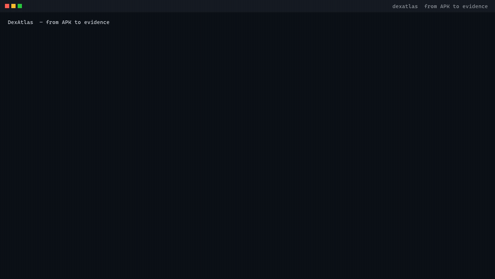

<div align="center">

# DexAtlas

**From APK to Evidence — Powered by AI Agents.**

An open-source, evidence-first Android reverse engineering and mobile application analysis platform.

[](https://github.com/gg320324492-lgtm/dexatlas/actions/workflows/ci.yml)
[](https://www.python.org/downloads/)
[](LICENSE)
[](tests)
[](pyproject.toml)
[](https://docs.astral.sh/ruff/)
[](https://mypy-lang.org/)

</div>

DexAtlas brings Android decompilation, program analysis, AI agents and developer-friendly
automation together in one modular, reproducible workflow — built for developers, security
researchers and engineers analysing applications they own or are authorized to assess.

> [!IMPORTANT]
> **Status: early development (Phase 1 — Foundation).** The CLI, analysis core and report
> pipeline are being built now. Agent orchestration, MCP and the web workbench are *planned*,
> not shipped — see the [Roadmap](#roadmap). Nothing on this page claims a feature that does
> not yet run.

<p align="center">
  
</p>

Every frame above is a real run against [`examples/demo-app/demo.apk`](examples/demo-app/),
an application built from the smali sources committed beside it — not a staged recording.

The same recording is available as a [video](docs/assets/demo.mp4) — it is encoded from
the identical frames, so the two cannot drift apart.

<details>
<summary><b>Full session</b> — search, cross-references, decompiled source and the report</summary>

<p align="center">
  
</p>

</details>

---

## Why DexAtlas?

Traditional Android reverse engineering means switching between JADX, Apktool, a hex editor
and a spreadsheet of notes, then manually tracking which conclusion came from which method.
The evidence is scattered across tools and evaporates between sessions.

DexAtlas is built around fixing that:

- **Unified Android analysis** — decompilation, APK resources, DEX metadata and code
  navigation behind one interface, with each backend's original output preserved.
- **Evidence-first results** — every finding carries its source tool, tool version, project
  hash and exact code location. A conclusion you cannot click back to is not a finding.
- **Automation-friendly** — the same analysis core is reachable from a CLI and a REST API,
  so analyses are reproducible in CI rather than retyped by hand.
- **Agent-ready architecture** — normalized tool interfaces and structured JSON are the
  contract an AI agent will consume in Phase 2, designed for it from the start.
- **Extensible by design** — analysis backends are adapters behind one interface; new engines
  plug in without rewriting the core.

## Principles

1. Evidence over speculation.
2. Reproducibility over impressive demos.
3. Modular tools over tightly coupled frameworks.
4. Human oversight for sensitive operations.
5. Open-source collaboration and transparent evaluation.

## Roadmap

| Phase | Version  | Theme                     | Scope                                                                                                        |
| ----- | -------- | ------------------------- | ------------------------------------------------------------------------------------------------------------ |
| **1** | `v0.1.0` | Functional Foundation     | APK ingestion, JADX/Apktool/Androguard backends, unified index, search, CLI, REST API, JSON/Markdown reports |
| **1** | `v0.1.1` | Foundation Hardening      | Fixed the Smali fallback, which had never run for any APK                                                    |
| **1** | `v0.1.2` | Acceptance Checklist      | Five self-built test APKs, a demo video, and the exit checklist in the plan's own words                      |
| **1** | `v0.1.3` | Evidence That Points Back | Cross-references become evidence, locators travel with the report, the docs are checked                      |
| **2** | `v0.5.0` | Agentic Intelligence      | Agent planning, MCP server, evidence verification, resumable tasks, React workbench                          |
| **3** | `v1.0.0` | Production-Ready          | Native (Ghidra) and dynamic (Frida) analysis, plugin ecosystem, HTML/PDF reports, public benchmark           |

Full detail, exit checklists and the review protocol: **[docs/roadmap/ROADMAP.md](docs/roadmap/ROADMAP.md)**.

Phases are promoted on evidence, not on a calendar. Every phase ends with a source review,
and the next phase's issue list is derived from that review.

## Architecture

```text
APK ingest ──► hash + validate ──► task scheduler
                                      │
                    ┌─────────────────┼─────────────────┐
                    ▼                 ▼                 ▼
                 JADX              Apktool          Androguard
            (Java pseudocode)   (Manifest/Smali)    (DEX metadata/xrefs)
                    └─────────────────┼─────────────────┘
                                      ▼
                            unified symbol index
                                      ▼
                        search / method-reference query
                                      ▼
                             evidence linkage
                                      ▼
                          JSON / Markdown report
```

External analysis engines are invoked **as separate processes** and are never vendored or
linked. Their outputs are kept in their native form — what DexAtlas unifies is the index and
metadata interface, not the representation. Methods JADX cannot decompile reliably are
flagged as errors and retain a Smali fallback.

```
src/dexatlas/
├── core/          models, indexing, evidence, storage, pipeline
├── tools/         jadx/, apktool/, androguard/ adapters
├── api/           FastAPI application
├── cli/           Typer application
├── reports/       JSON / Markdown renderers
└── config/        settings and backend tool discovery
```

## Quick start

Full instructions, including backend installation and troubleshooting:
**[docs/install.md](docs/install.md)**.

```bash
git clone https://github.com/gg320324492-lgtm/dexatlas.git
cd dexatlas
uv sync --extra analysis

uv run dexatlas backends              # what is installed, at what version
uv run dexatlas analyze app.apk -o report.md --json report.json
uv run dexatlas manifest  <project-id>
uv run dexatlas search   <project-id> "yourTerm"
uv run dexatlas xrefs    <project-id> "com.example.Foo.bar(Ljava/lang/String;)V"
```

The REST API is the same analysis core over HTTP:

```bash
uv run uvicorn dexatlas.api.app:app --reload
# interactive docs at http://localhost:8000/docs
```

**Backends are optional and independent.** DexAtlas reports what it can do with what is
installed and records what it could not do, as evidence in the report. With none
installed you still get hashing, validation and the APK's own metadata; with all three
you get a full symbol index, decompiled source and cross-references.

Docker, with JADX and Apktool preinstalled:

```bash
docker build -t dexatlas . && docker run --rm dexatlas dexatlas backends
```

A demo application is bundled, so there is nothing to download:

```bash
uv run dexatlas analyze examples/demo-app/demo.apk -o report.md
```

It is built from the smali sources in [`examples/demo-app/`](examples/demo-app/)
and rebuildable with `scripts/build-demo-apk.sh` — no mystery binary. Larger test
fixtures are fetched with `scripts/fetch-fixtures.sh`.

## Documentation

- **[Installation](docs/install.md)** — every command verified against a fresh clone
- **[Architecture](docs/architecture/README.md)** — how it fits together and why
- **[Current status](docs/status.md)** — where the project stands and what is left
  (Chinese; 当前状态)
- **[Analysis coverage & provenance](docs/analysis-provenance.md)** — which backend produced
  which conclusion, and how to check it yourself (Chinese; 分析覆盖度与证据来源)
- **[Roadmap](docs/roadmap/ROADMAP.md)** — three phases, and where this stands

Remaining Phase 1 work — the source review, and the issues written from it — is tracked
in [issue #1](https://github.com/gg320324492-lgtm/dexatlas/issues/1).

## Contributing

Issues, bug reports and pull requests are welcome — see [CONTRIBUTING.md](CONTRIBUTING.md).
Start with the `v0.1.0` milestone; the eight Phase 1 issues are the current work backlog.

Please do not open a pull request that includes an APK, decompiled source, or any code from
an application you are not authorized to analyse. See [SECURITY.md](SECURITY.md).

## Intended use

DexAtlas is intended for education, authorized software analysis, mobile application
security assessment and defensive research.

The platform does not authorize access to third-party applications, accounts, services or
data. Signature forging, license bypass, protection evasion and unauthorized data extraction
are explicitly **out of scope** — they are not features, not selling points, not demos.

## License

[Apache-2.0](LICENSE). Third-party analysis engines are invoked as external processes and
are not redistributed as part of this project; see the license section of the
[roadmap](docs/roadmap/ROADMAP.md#license) for the audit notes.
