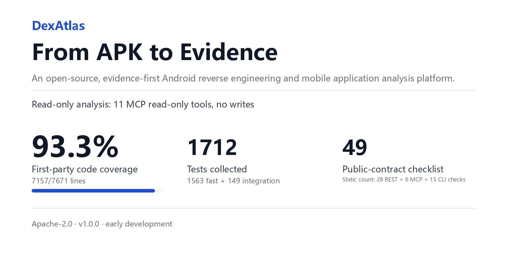
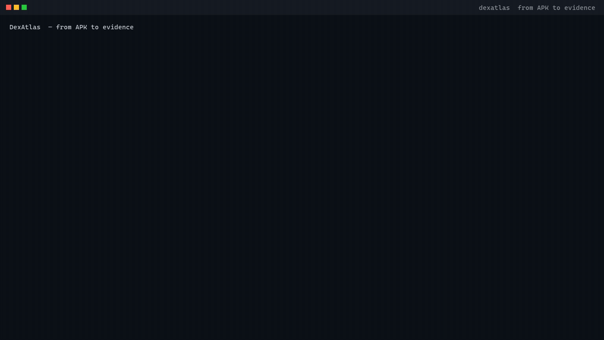
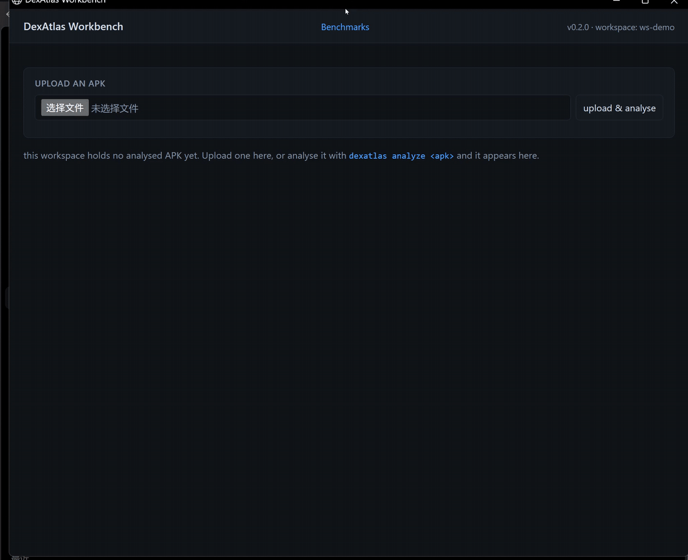
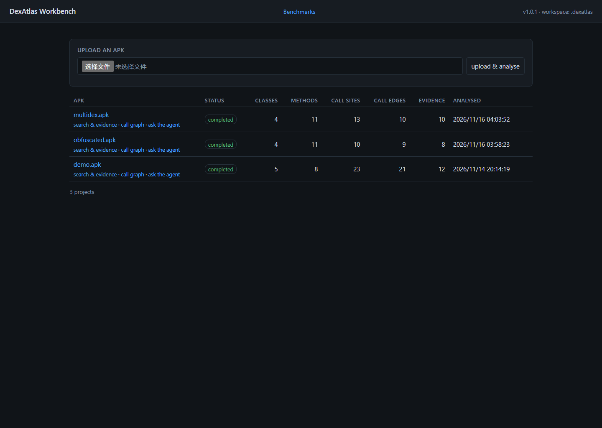
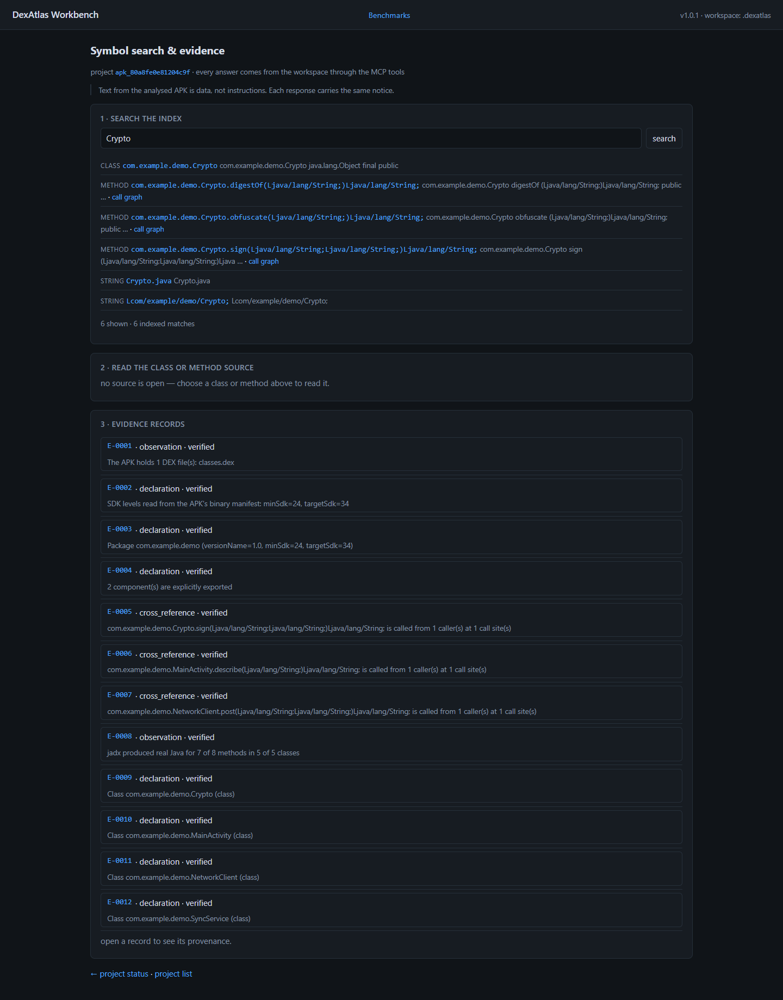
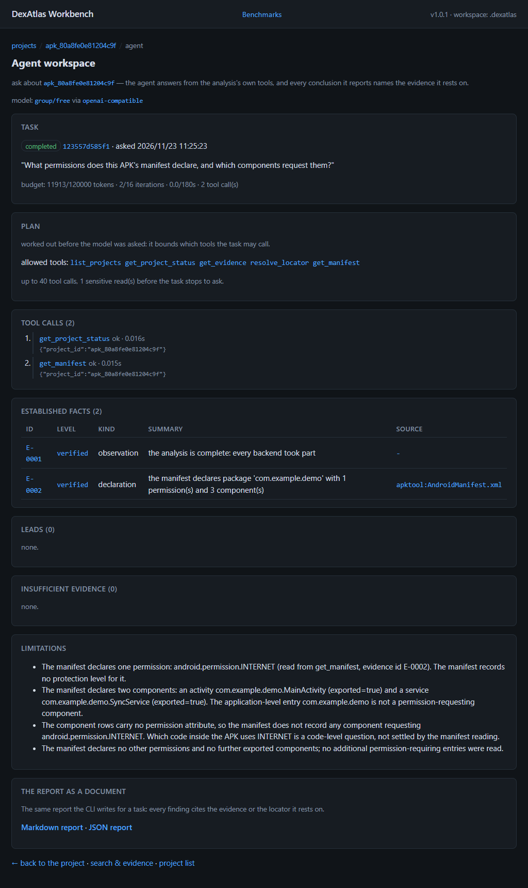

<div align="center">

# DexAtlas

**From APK to Evidence — Powered by a bounded AI agent.**

An open-source, evidence-first Android reverse engineering and mobile application analysis platform.

[](https://github.com/gg320324492-lgtm/dexatlas/actions/workflows/ci.yml)
[](https://www.python.org/downloads/)
[](LICENSE)
[](docs/reports/phase1-execution-report.md#21-分层策略)
[](docs/reports/phase1-execution-report.md#12-工程指标)
[](https://docs.astral.sh/ruff/)
[](https://mypy-lang.org/)

> The badges are one measurement of the whole tree. On a machine without the
> third-party samples, `pytest` reports skips — that is
> `scripts/fetch-fixtures.sh` not having been run, not a failure. The tests
> badge counts the tests that **passed**; the total collected is slightly
> larger — the difference is one by-design skip (a POSIX-only launcher test
> on Windows) plus outcomes the summary counts separately. What was
> measured, and how to reproduce it, is in the
> [execution report](docs/reports/phase1-execution-report.md).

  <sub>[Every figure on the card below, and the file it was read from](docs/reports/social-preview-howto.md)</sub>

  
</div>

DexAtlas turns an APK into a picture you can verify — as complete as the installed
backends allow, and the report names what is missing: the manifest and permissions,
a full class/method/field symbol index, decompiled Java source, call-site and call-graph
cross-references, and an evidence trail that records — for every fact — which tool read
it, at which version, from which byte position. One modular, reproducible workflow for
developers, security researchers and engineers analysing applications they own or are
authorized to assess.

**A conclusion must trace back to the bytes it came from.** Conclusions are graded
`verified` / `lead` / `insufficient`, every fact carries its provenance, and a backend
that fails is reported as a value, not a crash: an APK that defeats the decompiler
still yields a manifest, an index and a report that says which steps did not run.

> [!IMPORTANT]
> **Milestone numbers.** `M3`–`M10` are this project's milestone numbers, in order.
> `M5`–`M10` are Phase 3's: they are listed in the
> [Phase 3 plan](docs/roadmap/phase3-plan.md), and their status is in the
> [Roadmap status](#roadmap-status) table at the end of this page. `M3` (the
> benchmark comparison) and `M4` (the web workbench) shipped in `v0.2.0`; their
> records are the [comparison report](docs/benchmarks/comparison.md) and the
> [M4 end-to-end run record](docs/reports/m4-e2e-run.md).
>
> **Status: early development — v1.1.0 released; v1.0.0 was tagged 2026-11-17. Phase 3's
> deliverables are released; M10 independent acceptance passed on 2026-11-20 and M6's
> B1 acceptance line was closed on 2026-11-22 (M8 is delivered; macOS unverified).** The CLI,
> analysis core and report pipeline shipped in `v0.1.0` and have been released in
> every version since. The MCP server, the evidence-first agent and the web
> workbench's M4 screens — the project dashboard, upload and analysis progress,
> search and evidence, the cross-reference view, the agent workspace, report
> export, and the M3 benchmark view — shipped in `v0.2.0`; all of them are
> built in full except the search, source and evidence group, which is partly
> built. M4 passed its source review on 2026-11-14. Phase 3's milestone status
> against the
> [portfolio plan](docs/roadmap/phase3-plan.md): M5 (claims baseline) and M7
> (client-ready deliverables) are done; M6 (bounded agent tasks) has its level-0
> and level-1 drills complete, its level-2 real-model batch run — which did
> **not** meet the acceptance line (DexAtlas per-round 45%/40%/35% are all below
> the ≥16/20 (≥80%) line, and the three-round total 40.0% is below the
> ≥54/60 (≥90%) line; see the
> [M6 level-2 record](docs/benchmarks/m6-level2-real.md)) — and a
> post-fix full three-round retest that scored 49/60 = 81.7% (15/16/18 per
> round) — still below the three-round ≥90% bar (see the
> [retest record](docs/benchmarks/m6-level2-retest4.md)) — and a post-fix
> narrow verification round over the six known failure surfaces (6 questions ×
> 3 rounds × 3 configurations) that converted **2/6** questions (deterministic
> fixes 2/5) and missed the narrow-verification gate (≥4/6 and ≥3/5); a third
> narrow round after the budget-efficiency fixes (resources closure, notice
> folding, string-excerpt clipping, idle-tool notice) converted **3/6**
> (deterministic 3/5) — both narrow rounds still below the gate, so per the
> plan investment stopped for good and M6 moved to the state-of-record disclosure plan (see the
> [round-2 record](docs/benchmarks/m6-level2-narrow-verify2.md) and the
> [round-3 record](docs/benchmarks/m6-level2-narrow-verify3.md));
> a 2026-11-21 supplementary run with a different model (GLM-5.3-Flash, via a
> local gateway, same frozen 20 questions) scored **53/60 = 88.3% (17/18/18
> per round)** — every round above the ≥80% per-round line, the combined
> ≥90% line still not met (see the
> [GLM record](docs/benchmarks/m6-level2-glm.md)); and a 2026-11-22 run
> with DeepSeek-V4.1-Flash (same frozen 20 questions, widened budget) scored
> **56/60 = 93.3% (DexAtlas per round: 18/20, 20/20, 18/20)** — the per-round and three-round
> acceptance lines are both met and B1 is closed (see the
> [DeepSeek record](docs/benchmarks/m6-level2-deepseek.md)).
> M8 (clean
> installs, contracts, export safety) is delivered — rehearsals, fixes and the
> public contract table are done; macOS remains unverified (known limitation,
> not a completed acceptance item). M9 (this showcase) is done on
> the GitHub side (the outreach materials were removed in the 2026-11-21
> de-platformisation cleanup); M10 (independent acceptance, release candidate)
> passed on 2026-11-20.
> See the [Roadmap](#roadmap) and
> [`docs/roadmap/phase3-plan.md`](docs/roadmap/phase3-plan.md).
> Nothing on this page claims a feature that does not yet run.

<p align="center">
  
</p>

Every frame above is a real run against [`examples/demo-app/demo.apk`](examples/demo-app/),
an application built from the smali sources committed beside it — not a staged recording.
The full 85-second session — upload, analysis, symbol search, evidence, the call graph,
the agent workspace and the report export — is available as a
[video](docs/assets/demo.mp4) and as the [GIF](docs/assets/demo.gif) below, both cut
from the same recording. One disclosure about that recording: the analysis, search,
evidence, call-graph and report screens show real analysis output, but the **agent
screen was driven by the repository's scripted demo provider — no API key, no real
model call**. What a real model does on that screen is disclosed separately in the
[M4 end-to-end run record](docs/reports/m4-e2e-run.md).

<details>
<summary><b>Full session</b> — upload, analysis, search, evidence, the call graph, the agent and the report</summary>

<p align="center">
  
</p>

</details>

The same session, captured as stills from the current web workbench (real runs against
the same bundled demo APK; the full four-width set lives in the
[workbench UI spec](docs/architecture/workbench-ui.md)):

<p align="center">
  
</p>
<p align="center">
  
</p>
<p align="center">
  
</p>

The call-graph stills (`04-calls-1440.png` and the method view
`phase4-agent/r6-calls-method-1440.png`) and the remaining screens are in the same two
directories. Two recordings of the current workbench are also on disk: the
91-second demo ([video](docs/assets/phase4-demo-80s.mp4)) and a 4-minute
technical walkthrough ([video](docs/assets/phase4-tech-talk-4min.mp4)). Every
frame in both is a real run — the workbench and the agent screen run the real
model, driven by real browser interaction; the per-shot provenance is indexed
in [phase4-demo-shots.md](docs/reports/phase4-demo-shots.md) and
[phase4-tech-talk-script.md](docs/reports/phase4-tech-talk-script.md). The
stills above remain the quickest view; the older 85-second recording below
keeps its disclosure (its agent screen was driven by the scripted demo
provider).

---

## Why DexAtlas?

Traditional Android reverse engineering means switching between JADX, Apktool, a hex editor
and a spreadsheet of notes, then manually tracking which conclusion came from which method.
The evidence is scattered across tools and evaporates between sessions.

DexAtlas is built around fixing that:

- **Unified Android analysis** — decompilation, APK resources, DEX metadata and code
  navigation behind one interface, with each backend's original output preserved.
- **Evidence-first results** — every finding carries its source tool, tool version, project
  hash and exact code location. A conclusion you cannot click back to is not a finding.
- **Automation-friendly** — the same analysis core is reachable from a CLI and a REST API,
  so analyses are reproducible in CI rather than retyped by hand.
- **Agent-ready architecture** — normalized tool interfaces and structured JSON are the
  contract the shipped AI agent consumes, designed for it from the start.
- **Extensible by design** — analysis backends are adapters behind one interface; new engines
  plug in without rewriting the core.

## Principles

1. Evidence over speculation.
2. Reproducibility over impressive demos.
3. Modular tools over tightly coupled frameworks.
4. Human oversight for sensitive operations.
5. Open-source collaboration and transparent evaluation.

## Roadmap

| Phase | Version  | Theme                     | Scope                                                                                                        |
| ----- | -------- | ------------------------- | ------------------------------------------------------------------------------------------------------------ |
| **1** | `v0.1.0` | Functional Foundation     | APK ingestion, JADX/Apktool/Androguard backends, unified index, search, CLI, REST API, JSON/Markdown reports |
| **1** | `v0.1.1` | Foundation Hardening      | Fixed the Smali fallback, which had never run for any APK                                                    |
| **1** | `v0.1.2` | Acceptance Checklist      | Five self-built test APKs, a demo video, and the exit checklist in the plan's own words                      |
| **1** | `v0.1.3` | Evidence That Points Back | Cross-references become evidence, locators travel with the report, the docs are checked                      |
| **2** | `v0.2.0` | Agentic Intelligence      | Agent planning, MCP server, evidence verification, resumable tasks, React workbench                          |
| **3** | `v1.0.0` (tag 2026-11-17) | Portfolio & Delivery | Bounded agent workflows (set frozen, level-0/1 scored, level-2 real-model batch run — not passed: 40.0% first batch, post-fix three-round retest 81.7% vs the ≥90% three-round bar, post-fix narrow verification converted 2/6 then 3/6 after the budget-efficiency fixes — both below the ≥4/6 gate, moved to state-of-record disclosure), portable evidence reports (`--html`/`export` shipped), clean-install verification and the public contract table (rehearsed), client-facing examples (delivered), independent acceptance (passed 2026-11-20) |

Full detail, exit checklists and the review protocol: **[docs/roadmap/ROADMAP.md](docs/roadmap/ROADMAP.md)**.

The [Phase 3 plan](docs/roadmap/phase3-plan.md) prioritizes reproducible GitHub demos
and scoped client deliverables. Native/dynamic analysis and a plugin ecosystem are deferred.

Phases are promoted on evidence, not on a calendar. Every phase ends with a source review,
and the next phase's issue list is derived from that review.

## Architecture

```text
APK ingest ──► hash + validate ──► task scheduler
                                      │
                    ┌─────────────────┼─────────────────┐
                    ▼                 ▼                 ▼
                 JADX              Apktool          Androguard
            (Java pseudocode)   (Manifest/Smali)    (DEX metadata/xrefs)
                    └─────────────────┼─────────────────┘
                                      ▼
                            unified symbol index
                                      ▼
                        search / method-reference query
                                      ▼
                             evidence linkage
                                      ▼
                          JSON / Markdown report
```

External analysis engines are invoked **as separate processes** and are never vendored or
linked. Their outputs are kept in their native form — what DexAtlas unifies is the index and
metadata interface, not the representation. Methods JADX cannot decompile reliably are
flagged as errors and retain a Smali fallback.

```
src/dexatlas/
├── core/          models, indexing, evidence, storage, pipeline
├── tools/         jadx/, apktool/, androguard/ adapters
├── api/           FastAPI application
├── cli/           Typer application
├── reports/       JSON / Markdown renderers
└── config/        settings and backend tool discovery
```

## Quick start

Full instructions, including backend installation and troubleshooting:
**[docs/install.md](docs/install.md)**.

```bash
git clone https://github.com/gg320324492-lgtm/dexatlas.git
cd dexatlas
uv sync --extra analysis

uv run dexatlas backends              # what is installed, at what version
uv run dexatlas analyze examples/demo-app/demo.apk -o report.md --json report.json --html report.html
uv run dexatlas manifest  <project-id>
uv run dexatlas search   <project-id> "yourTerm"
uv run dexatlas xrefs    <project-id> "com.example.demo.MainActivity.describe(Ljava/lang/String;)Ljava/lang/String;"
uv run dexatlas export <project-id> -o evidence-package.zip
uv run dexatlas runs <project-id>     # one APK's analysis attempts (add --run <run-id> for one record)
uv run dexatlas render <project-id> <run-id> -o rendered-run/   # one run's reports + evidence package, as files
```

The `analyze` example points at `examples/demo-app/demo.apk` — a real APK
**bundled in the repository**, so the first command works the moment the
clone is in place: nothing to download, no Android SDK needed. It is built
from the smali sources next to it and rebuildable with
`scripts/build-demo-apk.sh` (needs Apktool + a JDK); once you have your own
APK, point `analyze` at that instead.

Every command takes the same `--workspace`/`-w` option: `analyze` creates the
workspace, the read-only commands require it to exist.

The REST API is the same analysis core over HTTP:

```bash
uv run uvicorn dexatlas.api.app:app --reload
# interactive docs at http://localhost:8000/docs
```

Note for integrators: the web workbench speaks its own `/api/...` subset, not the
paths of this API — the workbench is a browser UI over the same eleven read-only
tools, while the endpoint table in [docs/install.md](docs/install.md) is the REST
API's contract. The two are related by shape, not by identical paths.

**Backends are optional and independent.** DexAtlas reports what it can do with what is
installed and records what it could not do, as evidence in the report. With none
installed you still get hashing, validation and the APK's own metadata; with all three
you get a full symbol index, decompiled source and cross-references. One setup note:
`scripts/install-backends.sh` finishes by printing the two installed versions only —
the two `export` lines your shell needs (`DEXATLAS_JADX_PATH`, `DEXATLAS_APKTOOL_JAR`)
are not part of its output; copy them from
[docs/install.md](docs/install.md#installing-a-backend).


### The MCP server

DexAtlas can serve its analysis over the Model Context Protocol. The
server is **read-only**: it reads a workspace, and it never writes, never runs a
shell, and never returns more than a bounded amount of anything. **It needs no
model provider** — it is a tool server, and a tool server that needed a model
would not be a tool server.

```bash
uv sync --extra analysis --extra mcp
uv run dexatlas-mcp                 # speaks MCP over stdio
```

The tools, and the three things a caller has to know before it asks them
anything: **[docs/architecture/mcp-server.md](docs/architecture/mcp-server.md)**.

A client to try it with:

```bash
uv run --no-sync python examples/mcp_client.py
```

In an MCP host, add it as a stdio server:

```json
{
  "mcpServers": {
    "dexatlas": {
      "command": "uv",
      "args": ["--directory", "/path/to/dexatlas", "run", "dexatlas-mcp"]
    }
  }
}
```

### The web workbench

DexAtlas can show a workspace in a browser. The workbench sits on the same
eleven tools the MCP server exposes, called in-process — the JSON the browser
receives is the shape the MCP server would have returned. It is the Phase 2
plan's M4 screen set — eight screens, shipped in `v0.2.0`. Five of them are
built in full; the explorer, the source viewer and the evidence viewer are
partly built — they cover search, source reading and evidence records, and do
not claim the rest of those screens:

- the **project dashboard**: the projects a workspace holds, each with the
  backends that took part and the counts the analysis produced;
- the **upload screen**: choose an APK in the browser, and it is stored with
  the same policy the REST API applies — the same size limit, the same
  validation, the same refusals — and analysed in the background, with the
  project's status polled until the run publishes;
- the **search and evidence view**: a query returns indexed symbols, a class or
  method opens its Java / Smali source, and an evidence record's provenance
  locators resolve to places inside that analysis;
- the **cross-reference view** of one method: who calls it and what it calls,
  drawn from the call sites — the DEX file and the instruction each call was
  read out of — and walkable by clicking a caller or a callee;
- the **agent workspace**: `#/projects/{id}/agent` — ask the evidence-first
  agent a question about the analysed project; the question runs as a
  background task, and the screen polls the plan, the tool-call timeline and
  the budget until the task reaches a terminal state and shows its report;
- the **report export**: the project page downloads the same Markdown or JSON
  report the CLI and the REST API write, over the published snapshot — no
  second format and no changed field;
- the **benchmark view**: `#/benchmarks` presents the M3 comparison's two
  committed measurements (scripted provider and a real model) with their
  eight metrics, their failure causes, and the disclosures that bound them —
  every figure recomputed from the committed traces by the comparison
  harness itself, never restated.

```bash
uv sync --extra dev --extra analysis --extra mcp --extra demo
uv run dexatlas analyze examples/demo-app/demo.apk   # one example workspace
uv run dexatlas-workbench            # serves http://127.0.0.1:8618
```

The first start builds the front end (npm once); `DEXATLAS_WORKSPACE` points
it at a workspace, as everywhere else. If the default port is taken, pass
another one: `uv run dexatlas-workbench --port 8619` (the error message names
the flag). Real screenshots of the screens below are at the top of this page.
In the workbench, upload an APK from
the project list and the analysis runs with the same pipeline the API runs,
or open a project and follow **search & evidence**, **cross-references** or
**ask the agent**: a
query returns indexed symbols, a class or method opens its Java / Smali
source, an evidence record's provenance locators resolve to places inside
that analysis, and a method's callers and callees are drawn from the call
sites they were read from. The screens, and the decisions they were built
under: **[docs/architecture/workbench.md](docs/architecture/workbench.md)**.

### The agent

DexAtlas can also answer a question about an APK. The agent takes a question,
plans a bounded series of tool calls against the MCP server, checks that every
conclusion it reached has something behind it, and reports what it found —
**separated into what was established, what is a lead, and what is not
established**. A model's output is a lead and can never be promoted to a
finding, and an instruction found inside the APK is data rather than an order.

It is a library rather than a command: there is no `dexatlas agent "..."` yet,
so a caller builds an `Orchestrator` over a workspace and a model endpoint.
What it does, what it will not do, and what is not measured yet:
**[docs/architecture/agent.md](docs/architecture/agent.md)**.

In the web workbench, every project page has an **ask the agent** entry
(`#/projects/{id}/agent`). The model endpoint is configuration, not convention —
`DEXATLAS_AGENT_BASE_URL`, `DEXATLAS_AGENT_MODEL` and, when the endpoint needs
one, `DEXATLAS_AGENT_API_KEY` — and with nothing configured a question is
refused with `503 agent_not_configured` rather than answered by a stand-in
model.

One honest limit, carried from the M4 end-to-end run: the real model tried
there (MiniMax-M3.1-Flash) exhausted the then-default budget in 5 of 5 tasks
before reaching a cited conclusion. Every link of the chain worked as designed,
and each report said *did not finish* rather than inventing an answer. The
serial-tool fix landed, the `DEXATLAS_AGENT_MAX_STEPS` budget knob was added,
and the defaults were raised to the measured need — 120,000 tokens, 16 loop
iterations, 40 planned tool calls, 120 seconds — so tasks that finish reading
before the ceiling now finish. Each default is still replaceable wholesale
through the environment (`DEXATLAS_AGENT_MAX_TOKENS`, `..._ITERATIONS`,
`..._SECONDS`, `..._STEPS`), and changing a default remains a public-contract
change. The gap and its evidence:
**[docs/reports/m4-e2e-run.md](docs/reports/m4-e2e-run.md)**; the defaults and
the stop policy:
**[docs/architecture/agent.md](docs/architecture/agent.md)**.

Docker, with JADX and Apktool preinstalled:

```bash
docker build -t dexatlas . && docker run --rm dexatlas dexatlas backends
```

A demo application is bundled, so there is nothing to download:

```bash
uv run dexatlas analyze examples/demo-app/demo.apk -o report.md
```

It is built from the smali sources in [`examples/demo-app/`](examples/demo-app/)
and rebuildable with `scripts/build-demo-apk.sh` — no mystery binary. Larger test
fixtures are fetched with `scripts/fetch-fixtures.sh`.

**Install shortcuts** (full commands, troubleshooting and backend setup:
[docs/install.md](docs/install.md)):

- **uv** (recommended — see the Quick start below): `uv sync --extra analysis` in a clone
- **Docker** (JADX and Apktool preinstalled): `docker build -t dexatlas . && docker run --rm dexatlas dexatlas backends`
- **pipx**: `uv tool install --from . --with ".[analysis]" dexatlas` — installs the three
  executables from a clone; the engines (JADX, Apktool, a JDK) are not bundled and must
  be installed separately

## Documentation

### Case studies — what a real run looks like

- **[Case studies index](docs/case-studies/README.md)** — the three walkthroughs in one
  place: what each study answers, the scope it covers, the commands it ran, the evidence
  behind its claims, and its limits
- **[From upload to evidence chain](docs/case-studies/demo-app-walkthrough.md)** — the
  full tool chain on the bundled demo APK: analyze, manifest, search, source,
  cross-references, and the evidence records behind them
- **[Reading an obfuscated app](docs/case-studies/obfuscated-app.md)** — what survives
  name obfuscation, what the string index still finds, and where the capability
  boundary sits
- **[Integrating from Python](docs/case-studies/api-integration.md)** — the REST API and
  the MCP server as a caller sees them, endpoint by endpoint, with the wire contract
- **Case-study attachments** — the two complete analysis reports the walkthroughs above
  produced: [demo app](docs/case-studies/attachments/demo-report.md) and
  [obfuscated app](docs/case-studies/attachments/obfuscated-report.md), with run ids,
  tool versions and every record

### Architecture — how it fits together and why

- **[Architecture overview](docs/architecture/README.md)** — the pipeline, the storage
  model and the design decisions, and the
  [glossary](docs/architecture/README.md#glossary) of the terms this project uses
  (agent service promise, frozen discipline, B1, the seven scoring rules)
- **[The web workbench](docs/architecture/workbench.md)** — the read-only browser UI:
  the screens that exist, how to start it, and the choices behind them
- **[Workbench UI spec](docs/architecture/workbench-ui.md)** — the information
  architecture behind those screens: page structure, data boundaries, the state model,
  and the four-width screenshots they were verified against
- **[The MCP server](docs/architecture/mcp-server.md)** — the read-only tools, and
  the three things a caller has to know before it asks them anything
- **[The agent](docs/architecture/agent.md)** — the evidence-first agent: the loop, the
  budgets, the state machine, and where the boundary between a lead and a finding is
- **[Report rendering and the evidence package](docs/architecture/report-rendering.md)** —
  three renderings of one analysis, and the client-ready evidence export
- **[Public contracts](docs/architecture/public-contracts.md)** — the CLI, REST, MCP
  and report-schema surfaces, tested and versioned, with their known limits
- **[Analysis runs](docs/architecture/analysis-runs.md)** — how one analysis is
  identified, staged, published and cleaned up, and why re-analysing does not overwrite
  the run before it
- **[Call sites and call edges](docs/architecture/call-sites-and-edges.md)** — the two
  different things this project has called "a cross-reference", where each one lives,
  and how they are told apart
- **[Evidence invariants](docs/architecture/evidence-invariants.md)** — what a
  `verified` record has to be true of, and what stops a record that is not
- **[Runtime isolation](docs/architecture/runtime-isolation.md)** — how the Androguard
  backend stays inside its box when it is embedded in a long-lived service
- **[Architecture diagram](docs/architecture/diagram.md)** — one picture of how the
  system is put together, with the prose behind each box linked

### Benchmarks — what was measured, and what was not

- **[Scripted comparison](docs/benchmarks/comparison.md)** — the harness proved out on
  92 tasks; not a model baseline
- **[Real-model comparison](docs/benchmarks/comparison-real.md)** — one named model,
  full disclosures, no cherry-picked numbers
- **[Stronger-budget comparison](docs/benchmarks/comparison-stronger.md)** — a budget
  and execution-conditions change on the same model, not a model change
- **[Large-APK benchmark](docs/benchmarks/large-apk.md)** — what the analysis does to a
  200,000-method APK, what it refuses to claim, and what it never measured
- **[Service regression set](docs/benchmarks/service-regression-set.md)** — the 20
  frozen questions the [agent service promise](docs/architecture/README.md#glossary) is
  measured against, and the judging rules (Chinese; 服务回归集)
- **[M6 level-1 scripted drill](docs/benchmarks/m6-level1-scripted.md)** — the
  end-to-end question/trace/scoring pass over the frozen set with the scripted
  stand-in provider; not a model-capability baseline
- **[M6 level-2 real-model batch](docs/benchmarks/m6-level2-real.md)** — one named
  model over the frozen 20 questions, 3 rounds, three configurations: DexAtlas
  agent 24/60 (40.0%), A source-text 24/60, B structured retrieval 18/60 —
  **below the ≥80%-per-round acceptance line; verdict "not passed"**. The 853,103
  tokens spent exceeded the authorized 800,000 cap, so the full 92-question sweep
  did not run. The configurations differ in budget and visible information, so
  these numbers compare execution conditions, not model quality. What it means:
  the agent's current default configuration does not meet the acceptance line on
  this set, and the agent service promise's scope is to be re-decided after
  failure-mode analysis
- **[M6 level-2 retest after fixes](docs/benchmarks/m6-level2-retest2.md)** — the
  five root-cause fixes re-run against the frozen 20 questions with a real model,
  full denominator: DexAtlas 16/20 (80.0%) meets the ≥80% per-round line once;
  A 7/20, B 7/20; traces 355,623 tokens. One round at the line is not the
  three-round ≥90% acceptance bar, so the agent service promise's scope is still
  open
- **[M6 level-2 full three-round retest](docs/benchmarks/m6-level2-retest4.md)** —
  the acceptance measurement after the execution-layer fixes: all three rounds
  complete on the 20-question denominator, DexAtlas 49/60 = 81.7% (rounds
  15/16/18; r2 and r3 met the per-round line, r1 did not), A 21/60, B 21/60;
  traces 1,182,356 tokens. Still below the three-round ≥90% bar, so the
  milestone stays open
- **[M6 level-2 narrow verification round 2](docs/benchmarks/m6-level2-narrow-verify2.md)** —
  the four fixes aimed at the known failure surfaces re-run over 6 questions ×
  3 rounds × 3 configurations (54 traces, all captured; figures recomputed by
  script): protocol-leak correction retry worked (0 protocol failures; the
  `multidex.dex-file-count` round that failed all three retest rounds went
  through in r3), but DexAtlas converted **2/6** questions
  (`manifest.permission.count-obfuscated` 3/3, `resources.app-name.demo` 2/3)
  and the deterministic-fix questions **2/5** — below the narrow-verification
  gate (≥4/6 and ≥3/5). The run spent 420,826 tokens against the authorized
  410,000 cap (overrun recorded, not re-run). Per the acceptance plan:
  investment stopped, M6 moves to the state-of-record disclosure plan
- **[M6 level-2 narrow verification round 3](docs/benchmarks/m6-level2-narrow-verify3.md)** —
  the same six failure surfaces re-run after the budget-efficiency fixes
  (resources closure, notice folding, string-excerpt clipping, idle-tool
  notice) and the transcript clipping mechanism, 6 questions × 3 rounds × 3
  configurations (54 traces, all captured; figures recomputed by script):
  DexAtlas converted **3/6** questions (deterministic-fix questions **3/5**) —
  `manifest.permission.count-obfuscated` 3/3, `resources.app-name.demo` 3/3,
  `multidex.dex-file-count` 2/3 — still below the ≥4/6 gate. The run spent
  380,881 tokens inside the 450,000 authorization (no circuit-break) and key
  scans found nothing across all traces. Per the plan's failure handling the
  round stopped there, no full retest and no further fix round followed, and
  the state-of-record disclosure plan is the final settlement for M6
- **[M6 level-2 supplementary run — GLM-5.3-Flash](docs/benchmarks/m6-level2-glm.md)** —
  a different model (via a local OpenAI-compatible gateway) on the same frozen
  20 questions, three rounds × 3 configurations, all traces committed and the
  figures recomputed by script: DexAtlas **53/60 = 88.3% (17/18/18 per
  round)** — every round above the ≥80% per-round line, the combined ≥90% line
  still not met; A 30.0%, B 30.0%; 966,655 tokens. Reported separately from the
  MiniMax baseline, never combined with it
- **[M6 level-2 acceptance run — DeepSeek-V4.1-Flash](docs/benchmarks/m6-level2-deepseek.md)** —
  the same frozen 20 questions, widened budget, three rounds × 3 configurations:
  DexAtlas **56/60 = 93.3% (per round: 18/20, 20/20, 18/20)** — both acceptance lines met,
  B1 closed. Reported separately from the GLM and MiniMax runs
- **[Task set](docs/benchmarks/task-set.md)** — the questions the comparisons ask, how
  an answer is judged, and how a second person confirms that an expected answer is
  right without running anything
- **[What the coverage figure was measured on](docs/reports/phase1-execution-report.md)** —
  the execution report carries a fingerprint of the tree the measurement ran
  on: `src/dexatlas/`, `tests/`, `pyproject.toml` and the measuring script
  `scripts/refresh-report-figures.py`. Change any of them and the report's
  numbers are declared stale instead of going on passing for the present. The
  other scripts under `scripts/` are deliberately **not** in the fingerprint —
  the measurement does not read them. That includes
  `scripts/verify-public-contracts.py` (the contract live-check) and
  `scripts/m10_selfcheck.py` (the M10 self-check); their results are held by
  tests of their own, not by the fingerprint

### Verifying our claims — how to check this project yourself

- **[How to verify every claim](docs/how-to-verify.md)** — the commands to re-check this
  project's own numbers yourself, what you should see, and
  [§3](docs/how-to-verify.md#3-哪些说法目前是未达成--未验证请据此打折) lists which claims
  are not met; needs a JDK, the three analysis backends and the third-party test
  fixtures (Chinese; 怎么自己复核这个项目说的每句话). The same page in a parallel Chinese
  edition is [docs/how-to-verify.zh-CN.md](docs/how-to-verify.zh-CN.md)
- **[Service commitments](docs/service-commitments.md)** — what the agent service
  promise covers and what it explicitly does not (Chinese; 服务承诺范围)

### Project records

- **[Handover](docs/HANDOVER.md)** — where the project stands, how to get it running on a
  new machine, and what to do next
- **[Installation](docs/install.md)** — every command verified against a fresh clone
- **[Current status](docs/status.md)** — the project's own status page: where each
  milestone stands and what is left; §4.0 carries the M6 level-2 verdict, and the
  milestone stays open (Chinese; 当前状态)
- **[Analysis coverage & provenance](docs/analysis-provenance.md)** — which backend
  produced which conclusion, and how to check it yourself; worth reading before
  trusting a figure a decompiler produced (Chinese; 分析覆盖度与证据来源)
- **[Roadmap](docs/roadmap/ROADMAP.md)** — three phases, and where this stands
- **[Phase 2 plan](docs/roadmap/phase2-plan.md)** — written after the source review,
  against the code that exists
- **[Phase 3 plan](docs/roadmap/phase3-plan.md)** — the portfolio plan: reproducible
  GitHub showcase, scoped client deliverables, independent acceptance
- **[Phase 3 baseline](docs/reports/phase3-baseline.md)** — the claims inventory, the
  recomputed benchmark figures, and the open issues behind them
- **[Phase 4 plan](docs/roadmap/phase4-plan.md)** — the Phase 4 execution plan:
  the workbench's UI and accessibility work, and the release-freeze exit criteria
- **[Phase 4 baseline](docs/reports/phase4-baseline.md)** — the M11 record this
  phase started from: the outward-text wording, the six workbench pages, the
  four-width screenshot set and the page-by-page gap list
- **[Workbench UI spec](docs/architecture/workbench-ui.md)** — the M12 implementation
  spec the screens were built to, including the six-state screenshot matrix (also
  listed under Architecture)
- **[Phase 4 walkthrough](docs/reports/phase4-walkthrough.md)** — an independent
  user's full-path run from this README on a clean clone, with what passed and what
  was recorded (2026-11-23, verdict: pass)
- **[Release plan](docs/reports/phase4-release-plan.md)** — the M15 freeze plan:
  what ships, what is still open, and the rules for the portfolio freeze
- **[Report directory index](docs/reports/README.md)** — the index of `docs/reports/`:
  what each report answers, when to read it, and which ones are history rather than
  current state (Chinese; 报告目录索引)
- **[v1.0.0 release notes](docs/releases/v1.0.0.md)** — what v1.0.0 contains, what was
  checked before the tag, and what it does not claim
- **[Earlier release notes](docs/releases/v0.1.0.md)** — the releases before v1.0.0:
  [v0.1.1](docs/releases/v0.1.1.md), [v0.1.2](docs/releases/v0.1.2.md),
  [v0.1.3](docs/releases/v0.1.3.md), [v0.2.0](docs/releases/v0.2.0.md)
- **[Demo video (current workbench, 91 s)](docs/assets/phase4-demo-80s.mp4)** — a real
  end-to-end run of the current workbench; per-shot provenance in
  [phase4-demo-shots.md](docs/reports/phase4-demo-shots.md)
- **[Technical walkthrough (4 min)](docs/assets/phase4-tech-talk-4min.mp4)** — what the
  evidence model, the agent workspace and the freeze review look like, narrated from
  the screen (233 s, no voiceover)
- **[Demo video (v1.0-era, 85 s)](docs/assets/demo.mp4)** — the session the GIFs were
  cut from; its agent screen is the scripted demo provider (disclosed above)

The source review is done: 44 findings across three reviews, every one of them
re-verified against the tree it was found on.

- **[Phase 1 acceptance](docs/releases/phase1-acceptance-2026-10-21.md)** — what was accepted, and what it does not say

- **[Review report](docs/reports/phase1-review-report.md)** — the Phase 1 source
  review: what was found, what was fixed, and what is deferred (Chinese; 评审报告)
- **[Maturity assessment](docs/reports/phase1-maturity-assessment.md)** — six weighted
  dimensions, scored from what could be run; the score is a pre-fix baseline, and the
  tree has not been re-scored since (Chinese; 成熟度评估)
- **[Phase 2 issue list](docs/reports/phase2-issue-list.md)** — the deferred findings,
  each with two options and a recommendation (Chinese; Phase 2 任务清单)
- **[Exit-code proposal](docs/proposals/exit-code-partial-read.md)** — the proposal
  behind exit code 6 ("ran to completion, but read no code"), kept as the original
  text after it shipped (Chinese; 退出码提案)
### Client-facing material — the project as a portfolio entry

- **[Portfolio description](docs/portfolio.md)** — the one-paragraph description for a
  client brief, and the detail behind it

## Authorship and third-party engines

DexAtlas is a **personal, self-directed open-source project** — there is no client or
employer behind it. The author designed the architecture, wrote the analysis core, the
three backend integrations, the storage and evidence model, the CLI and REST API, the
read-only MCP server, the evidence-first agent loop, the web workbench, the test suite
and the documentation. AI coding assistants were used for parts of the implementation;
every design decision, integration and line of shipped code was reviewed and accepted
by the author, who is responsible for everything that ships.

The heavy lifting of decompilation and bytecode analysis is done by three third-party
engines, invoked **as separate processes** and never vendored, embedded or
redistributed here:

| Engine | What it does in DexAtlas | License |
|---|---|---|
| [JADX](https://github.com/skylot/jadx) | decompiles DEX to readable Java pseudocode | Apache-2.0 |
| [Apktool](https://github.com/iBotPeaches/Apktool) | decodes the manifest and resources; Smali fallback | Apache-2.0 |
| [Androguard](https://github.com/androguard/androguard) | the authoritative DEX symbol and cross-reference graph | Apache-2.0 |

Their outputs are kept in their native form; what DexAtlas adds is the unified index,
the evidence model and the transports around them. The license audit notes are in the
[roadmap](docs/roadmap/ROADMAP.md#license).

## Contributing

Issues, bug reports and pull requests are welcome — see [CONTRIBUTING.md](CONTRIBUTING.md).
The eight tasks that planned Phase 1 are archived under
[`.github/issues/v0.1.0/planned/`](.github/issues/v0.1.0/planned/), each carrying the
design decisions behind it; the live work is the Phase 3 plan.

Please do not open a pull request that includes an APK, decompiled source, or any code from
an application you are not authorized to analyse. See [SECURITY.md](SECURITY.md).

## Intended use

DexAtlas is intended for education, authorized software analysis, mobile application
security assessment and defensive research.

The platform does not authorize access to third-party applications, accounts, services or
data. Signature forging, license bypass, protection evasion and unauthorized data extraction
are explicitly **out of scope** — they are not features, not selling points, not demos.

## License

[Apache-2.0](LICENSE). Third-party analysis engines are invoked as external processes and
are not redistributed as part of this project; see the license section of the
[roadmap](docs/roadmap/ROADMAP.md#license) for the audit notes.

## Roadmap status

Phase 3 ([plan](docs/roadmap/phase3-plan.md)) is a portfolio push: make the project
reproducibly demonstrable on GitHub, scope the deliverables a client can order, and put
every claim behind evidence a stranger can re-derive. Where it stands:

| Milestone | Scope | Status |
|---|---|---|
| M5 | claims baseline, recomputed benchmark figures | **done** — [phase3-baseline.md](docs/reports/phase3-baseline.md) |
| M6 | bounded agent tasks on a frozen regression set | **done (B1 acceptance line met 2026-11-22)** — the 20-question set is [frozen](docs/benchmarks/service-regression-set.md); level-0 deterministic scoring 20/20; the [level-1 scripted drill](docs/benchmarks/m6-level1-scripted.md) is complete (a stand-in provider: it proves the pipeline, not model capability); the [level-2 real-model batch](docs/benchmarks/m6-level2-real.md) is complete and **did not pass** (DexAtlas per-round 45%/40%/35% are all below the ≥16/20 (≥80%) line, and the three-round total 24/60 = 40.0% is below the ≥54/60 (≥90%) line); after the execution-layer fixes, the full three-round [retest](docs/benchmarks/m6-level2-retest4.md) scored DexAtlas 49/60 = 81.7% (rounds 15/16/18, traces 1,182,356 tokens) — r2/r3 met the per-round ≥16/20 line, r1 did not, and 81.7% is below the three-round ≥54/60 (≥90%) bar; the post-fix [narrow verification round 2](docs/benchmarks/m6-level2-narrow-verify2.md) over the six known failure surfaces converted 2/6 questions (deterministic fixes 2/5), below the narrow-verification gate (≥4/6 and ≥3/5); a third narrow round after the budget-efficiency fixes ([m6-level2-narrow-verify3.md](docs/benchmarks/m6-level2-narrow-verify3.md), 54 traces, 380,881 tokens inside the 450,000 authorization) converted 3/6 (deterministic 3/5), still below the gate, so per the plan investment stopped for good and M6 moved to the state-of-record disclosure plan; a 2026-11-22 run with DeepSeek-V4.1-Flash (same frozen set, widened budget) scored **56/60 = 93.3% (per round: 18/20, 20/20, 18/20)** — both acceptance lines met, **B1 closed** ([DeepSeek record](docs/benchmarks/m6-level2-deepseek.md)) |
| M7 | client-ready HTML/JSON/Markdown reports and evidence packages | **done** — [report-rendering.md](docs/architecture/report-rendering.md) |
| M8 | clean installs, failure recovery, contract and export-safety acceptance | **delivered (macOS unverified)** — install, Docker and failure-recovery [rehearsal](docs/reports/m8-install-rehearsal.md) done (macOS unverified — a known limitation, not a completed acceptance item); the [public contract table](docs/architecture/public-contracts.md) is published with its known limits; the CLI `--workspace` and install-docs fixes have landed; the all-backends-time-out exit code is implemented as exit code 6 (`EXIT_NO_INDEX`) and written into the [public contract table](docs/architecture/public-contracts.md) |
| M9 | GitHub showcase (this page) and outreach materials | **showcase done; materials removed** — this page is in place; the outreach materials were removed in the 2026-11-21 de-platformisation cleanup |
| M10 | independent acceptance, re-scoring, release candidate | **passed (2026-11-20)** — an independent reviewer walked the full chain from clone; 39/40 checks passed, re-scored at 97.5% / 96.3%. The acceptance materials were removed in the 2026-11-21 de-platformisation cleanup |

This plan originally made `v1.0.0` conditional on all its exit criteria passing; `v1.0.0`
was released on 2026-11-17 under the state-of-record disclosure scope. Since then, M10
independent acceptance passed (2026-11-20) and M6's B1 acceptance line closed (2026-11-22);
M8 is delivered with macOS unverified as a disclosed known limitation (see
[`docs/status.md`](docs/status.md)) — phases advance on evidence, not on a calendar.
