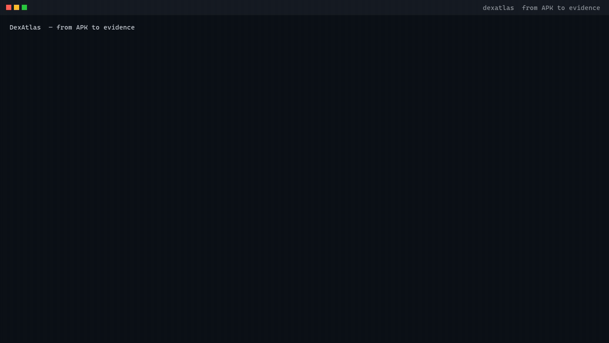
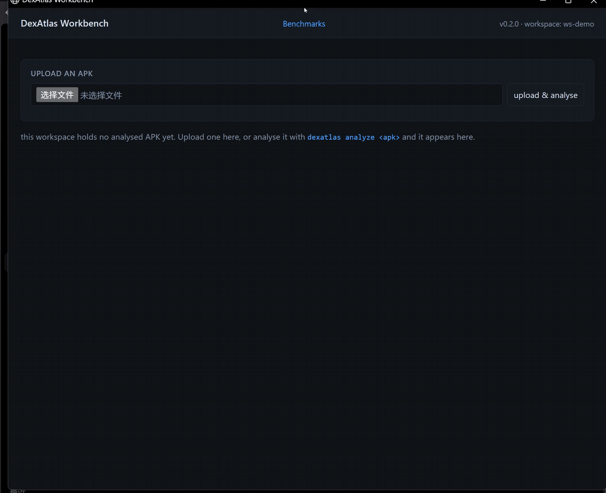

<div align="center">

# DexAtlas

**From APK to Evidence — Powered by AI Agents.**

An open-source, evidence-first Android reverse engineering and mobile application analysis platform.

[](https://github.com/gg320324492-lgtm/dexatlas/actions/workflows/ci.yml)
[](https://www.python.org/downloads/)
[](LICENSE)
[](tests)
[](pyproject.toml)
[](https://docs.astral.sh/ruff/)
[](https://mypy-lang.org/)

</div>

DexAtlas brings Android decompilation, program analysis, AI agents and developer-friendly
automation together in one modular, reproducible workflow — built for developers, security
researchers and engineers analysing applications they own or are authorized to assess.

> [!IMPORTANT]
> **Status: early development (Phase 2 in progress).** The CLI, analysis core and report
> pipeline shipped in `v0.1.0` and have been released in every version since. The MCP
> server and the evidence-first agent are built, and all eight of the web workbench's
> M4 screens — the project dashboard, upload and analysis progress, search and
> evidence, the cross-reference view, the agent workspace, report export, and the M3
> benchmark view — are built and shipped in `v0.2.0`. See the
> [Roadmap](#roadmap). Nothing on this page claims a feature that does not yet run.

<p align="center">
  
</p>

Every frame above is a real run against [`examples/demo-app/demo.apk`](examples/demo-app/),
an application built from the smali sources committed beside it — not a staged recording.
The full 85-second session — upload, analysis, symbol search, evidence, the call graph,
the agent workspace and the report export — is available as a
[video](docs/assets/demo.mp4) and as the [GIF](docs/assets/demo.gif) below, both cut
from the same recording.

<details>
<summary><b>Full session</b> — upload, analysis, search, evidence, the call graph, the agent and the report</summary>

<p align="center">
  
</p>

</details>

---

## Why DexAtlas?

Traditional Android reverse engineering means switching between JADX, Apktool, a hex editor
and a spreadsheet of notes, then manually tracking which conclusion came from which method.
The evidence is scattered across tools and evaporates between sessions.

DexAtlas is built around fixing that:

- **Unified Android analysis** — decompilation, APK resources, DEX metadata and code
  navigation behind one interface, with each backend's original output preserved.
- **Evidence-first results** — every finding carries its source tool, tool version, project
  hash and exact code location. A conclusion you cannot click back to is not a finding.
- **Automation-friendly** — the same analysis core is reachable from a CLI and a REST API,
  so analyses are reproducible in CI rather than retyped by hand.
- **Agent-ready architecture** — normalized tool interfaces and structured JSON are the
  contract an AI agent will consume in Phase 2, designed for it from the start.
- **Extensible by design** — analysis backends are adapters behind one interface; new engines
  plug in without rewriting the core.

## Principles

1. Evidence over speculation.
2. Reproducibility over impressive demos.
3. Modular tools over tightly coupled frameworks.
4. Human oversight for sensitive operations.
5. Open-source collaboration and transparent evaluation.

## Roadmap

| Phase | Version  | Theme                     | Scope                                                                                                        |
| ----- | -------- | ------------------------- | ------------------------------------------------------------------------------------------------------------ |
| **1** | `v0.1.0` | Functional Foundation     | APK ingestion, JADX/Apktool/Androguard backends, unified index, search, CLI, REST API, JSON/Markdown reports |
| **1** | `v0.1.1` | Foundation Hardening      | Fixed the Smali fallback, which had never run for any APK                                                    |
| **1** | `v0.1.2` | Acceptance Checklist      | Five self-built test APKs, a demo video, and the exit checklist in the plan's own words                      |
| **1** | `v0.1.3` | Evidence That Points Back | Cross-references become evidence, locators travel with the report, the docs are checked                      |
| **2** | `v0.5.0` | Agentic Intelligence      | Agent planning, MCP server, evidence verification, resumable tasks, React workbench                          |
| **3** | `v1.0.0` | Production-Ready          | Native (Ghidra) and dynamic (Frida) analysis, plugin ecosystem, HTML/PDF reports, public benchmark           |

Full detail, exit checklists and the review protocol: **[docs/roadmap/ROADMAP.md](docs/roadmap/ROADMAP.md)**.

Phases are promoted on evidence, not on a calendar. Every phase ends with a source review,
and the next phase's issue list is derived from that review.

## Architecture

```text
APK ingest ──► hash + validate ──► task scheduler
                                      │
                    ┌─────────────────┼─────────────────┐
                    ▼                 ▼                 ▼
                 JADX              Apktool          Androguard
            (Java pseudocode)   (Manifest/Smali)    (DEX metadata/xrefs)
                    └─────────────────┼─────────────────┘
                                      ▼
                            unified symbol index
                                      ▼
                        search / method-reference query
                                      ▼
                             evidence linkage
                                      ▼
                          JSON / Markdown report
```

External analysis engines are invoked **as separate processes** and are never vendored or
linked. Their outputs are kept in their native form — what DexAtlas unifies is the index and
metadata interface, not the representation. Methods JADX cannot decompile reliably are
flagged as errors and retain a Smali fallback.

```
src/dexatlas/
├── core/          models, indexing, evidence, storage, pipeline
├── tools/         jadx/, apktool/, androguard/ adapters
├── api/           FastAPI application
├── cli/           Typer application
├── reports/       JSON / Markdown renderers
└── config/        settings and backend tool discovery
```

## Quick start

Full instructions, including backend installation and troubleshooting:
**[docs/install.md](docs/install.md)**.

```bash
git clone https://github.com/gg320324492-lgtm/dexatlas.git
cd dexatlas
uv sync --extra analysis

uv run dexatlas backends              # what is installed, at what version
uv run dexatlas analyze app.apk -o report.md --json report.json
uv run dexatlas manifest  <project-id>
uv run dexatlas search   <project-id> "yourTerm"
uv run dexatlas xrefs    <project-id> "com.example.demo.MainActivity.describe(Ljava/lang/String;)Ljava/lang/String;"
```

The REST API is the same analysis core over HTTP:

```bash
uv run uvicorn dexatlas.api.app:app --reload
# interactive docs at http://localhost:8000/docs
```

**Backends are optional and independent.** DexAtlas reports what it can do with what is
installed and records what it could not do, as evidence in the report. With none
installed you still get hashing, validation and the APK's own metadata; with all three
you get a full symbol index, decompiled source and cross-references.

### The MCP server

DexAtlas can serve its analysis over the Model Context Protocol. The
server is **read-only**: it reads a workspace, and it never writes, never runs a
shell, and never returns more than a bounded amount of anything. **It needs no
model provider** — it is a tool server, and a tool server that needed a model
would not be a tool server.

```bash
uv sync --extra analysis --extra mcp
uv run dexatlas-mcp                 # speaks MCP over stdio
```

The tools, and the three things a caller has to know before it asks them
anything: **[docs/architecture/mcp-server.md](docs/architecture/mcp-server.md)**.

A client to try it with:

```bash
uv run --no-sync python examples/mcp_client.py
```

In an MCP host, add it as a stdio server:

```json
{
  "mcpServers": {
    "dexatlas": {
      "command": "uv",
      "args": ["--directory", "/path/to/dexatlas", "run", "dexatlas-mcp"]
    }
  }
}
```

### The web workbench

DexAtlas can show a workspace in a browser. The workbench sits on the same
ten tools the MCP server exposes, called in-process — the JSON the browser
receives is the shape the MCP server would have returned. It is the Phase 2
plan's M4 screen set; all eight screens are built and shipped in `v0.2.0`:

- the **project dashboard**: the projects a workspace holds, each with the
  backends that took part and the counts the analysis produced;
- the **upload screen**: choose an APK in the browser, and it is stored with
  the same policy the REST API applies — the same size limit, the same
  validation, the same refusals — and analysed in the background, with the
  project's status polled until the run publishes;
- the **search and evidence view**: a query returns indexed symbols, a class or
  method opens its Java / Smali source, and an evidence record's provenance
  locators resolve to places inside that analysis;
- the **cross-reference view** of one method: who calls it and what it calls,
  drawn from the call sites — the DEX file and the instruction each call was
  read out of — and walkable by clicking a caller or a callee;
- the **agent workspace**: `#/projects/{id}/agent` — ask the evidence-first
  agent a question about the analysed project; the question runs as a
  background task, and the screen polls the plan, the tool-call timeline and
  the budget until the task reaches a terminal state and shows its report;
- the **report export**: the project page downloads the same Markdown or JSON
  report the CLI and the REST API write, over the published snapshot — no
  second format and no changed field;
- the **benchmark view**: `#/benchmarks` presents the M3 comparison's two
  committed measurements (scripted provider and a real model) with their
  eight metrics, their failure causes, and the disclosures that bound them —
  every figure recomputed from the committed traces by the comparison
  harness itself, never restated.

```bash
uv sync --extra dev --extra analysis --extra mcp --extra demo
uv run dexatlas analyze examples/demo-app/demo.apk   # one example workspace
uv run dexatlas-workbench            # serves http://127.0.0.1:8618
```

The first start builds the front end (npm once); `DEXATLAS_WORKSPACE` points
it at a workspace, as everywhere else. In the workbench, upload an APK from
the project list and the analysis runs with the same pipeline the API runs,
or open a project and follow **search & evidence**, **cross-references** or
**ask the agent**: a
query returns indexed symbols, a class or method opens its Java / Smali
source, an evidence record's provenance locators resolve to places inside
that analysis, and a method's callers and callees are drawn from the call
sites they were read from. The screens, and the decisions they were built
under: **[docs/architecture/workbench.md](docs/architecture/workbench.md)**.

### The agent

DexAtlas can also answer a question about an APK. The agent takes a question,
plans a bounded series of tool calls against the MCP server, checks that every
conclusion it reached has something behind it, and reports what it found —
**separated into what was established, what is a lead, and what is not
established**. A model's output is a lead and can never be promoted to a
finding, and an instruction found inside the APK is data rather than an order.

It is a library rather than a command: there is no `dexatlas agent "..."` yet,
so a caller builds an `Orchestrator` over a workspace and a model endpoint.
What it does, what it will not do, and what is not measured yet:
**[docs/architecture/agent.md](docs/architecture/agent.md)**.

In the web workbench, every project page has an **ask the agent** entry
(`#/projects/{id}/agent`). The model endpoint is configuration, not convention —
`DEXATLAS_AGENT_BASE_URL`, `DEXATLAS_AGENT_MODEL` and, when the endpoint needs
one, `DEXATLAS_AGENT_API_KEY` — and with nothing configured a question is
refused with `503 agent_not_configured` rather than answered by a stand-in
model.

One honest limit, carried from the M4 end-to-end run: the real model tried
there (MiniMax-M3.1-Flash) exhausted its default budget in 5 of 5 tasks before
reaching a cited conclusion. Every link of the chain worked as designed, and
each report said *did not finish* rather than inventing an answer; the
serial-tool fix and the `DEXATLAS_AGENT_MAX_STEPS` budget knob landed
afterwards. The gap and its evidence:
**[docs/reports/m4-e2e-run.md](docs/reports/m4-e2e-run.md)**.

Docker, with JADX and Apktool preinstalled:

```bash
docker build -t dexatlas . && docker run --rm dexatlas dexatlas backends
```

A demo application is bundled, so there is nothing to download:

```bash
uv run dexatlas analyze examples/demo-app/demo.apk -o report.md
```

It is built from the smali sources in [`examples/demo-app/`](examples/demo-app/)
and rebuildable with `scripts/build-demo-apk.sh` — no mystery binary. Larger test
fixtures are fetched with `scripts/fetch-fixtures.sh`.

## Documentation

- **[Handover](docs/HANDOVER.md)** — where the project stands, how to get it running on a
  new machine, and what to do next
- **[Installation](docs/install.md)** — every command verified against a fresh clone
- **[Architecture](docs/architecture/README.md)** — how it fits together and why
- **[The web workbench](docs/architecture/workbench.md)** — the read-only browser UI:
  the screens that exist, how to start it, and the choices behind them
- **[The MCP server](docs/architecture/mcp-server.md)** — the ten read-only tools,
  and the three things a caller has to know before it asks them anything
- **[Current status](docs/status.md)** — where the project stands and what is left
  (Chinese; 当前状态)
- **[Analysis coverage & provenance](docs/analysis-provenance.md)** — which backend produced
  which conclusion, and how to check it yourself (Chinese; 分析覆盖度与证据来源)
- **[Roadmap](docs/roadmap/ROADMAP.md)** — three phases, and where this stands
- **[Phase 2 plan](docs/roadmap/phase2-plan.md)** — written after the source review, against the code that exists
- **[Large-APK benchmark](docs/benchmarks/large-apk.md)** — what the analysis does to a
  200,000-method APK, what it refuses to claim, and what it never measured
- **[The agent](docs/architecture/agent.md)** — the evidence-first agent: the loop, the
  budgets, the state machine, and where the boundary between a lead and a finding is

The source review is done: 44 findings across three reviews, every one of them
re-verified against the tree it was found on.

- **[Phase 1 acceptance](docs/releases/phase1-acceptance-2026-10-21.md)** — what was accepted, and what it does not say

- **[Review report](docs/reports/phase1-review-report.md)** — what was found, what was fixed, and what is deferred (Chinese; 评审报告)
- **[Maturity assessment](docs/reports/phase1-maturity-assessment.md)** — six weighted dimensions, scored from what could be run (Chinese; 成熟度评估)
- **[Phase 2 issue list](docs/reports/phase2-issue-list.md)** — the deferred findings, each with two options and a recommendation (Chinese; Phase 2 任务清单)

## Contributing

Issues, bug reports and pull requests are welcome — see [CONTRIBUTING.md](CONTRIBUTING.md).
The eight tasks that planned Phase 1 are archived under
[`.github/issues/v0.1.0/planned/`](.github/issues/v0.1.0/planned/), each carrying the
design decisions behind it; the live work is the Phase 2 plan.

Please do not open a pull request that includes an APK, decompiled source, or any code from
an application you are not authorized to analyse. See [SECURITY.md](SECURITY.md).

## Intended use

DexAtlas is intended for education, authorized software analysis, mobile application
security assessment and defensive research.

The platform does not authorize access to third-party applications, accounts, services or
data. Signature forging, license bypass, protection evasion and unauthorized data extraction
are explicitly **out of scope** — they are not features, not selling points, not demos.

## License

[Apache-2.0](LICENSE). Third-party analysis engines are invoked as external processes and
are not redistributed as part of this project; see the license section of the
[roadmap](docs/roadmap/ROADMAP.md#license) for the audit notes.
