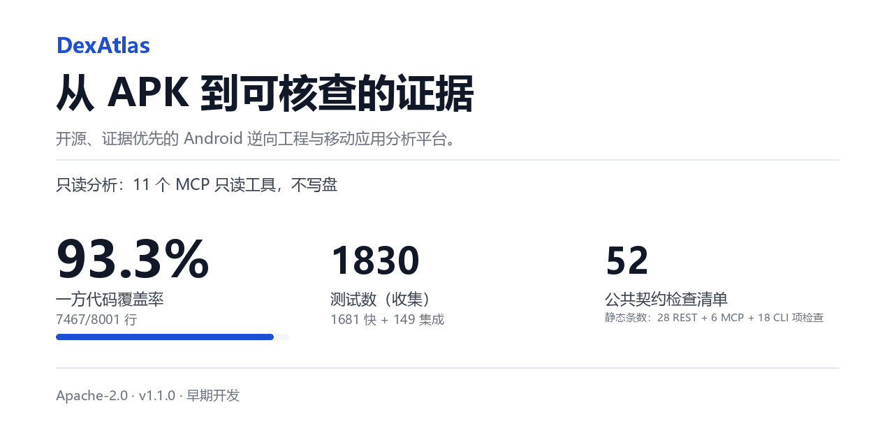
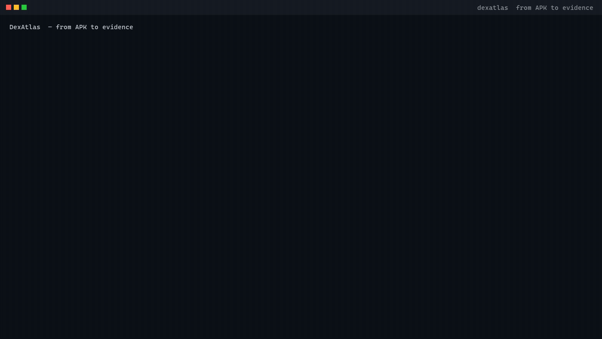
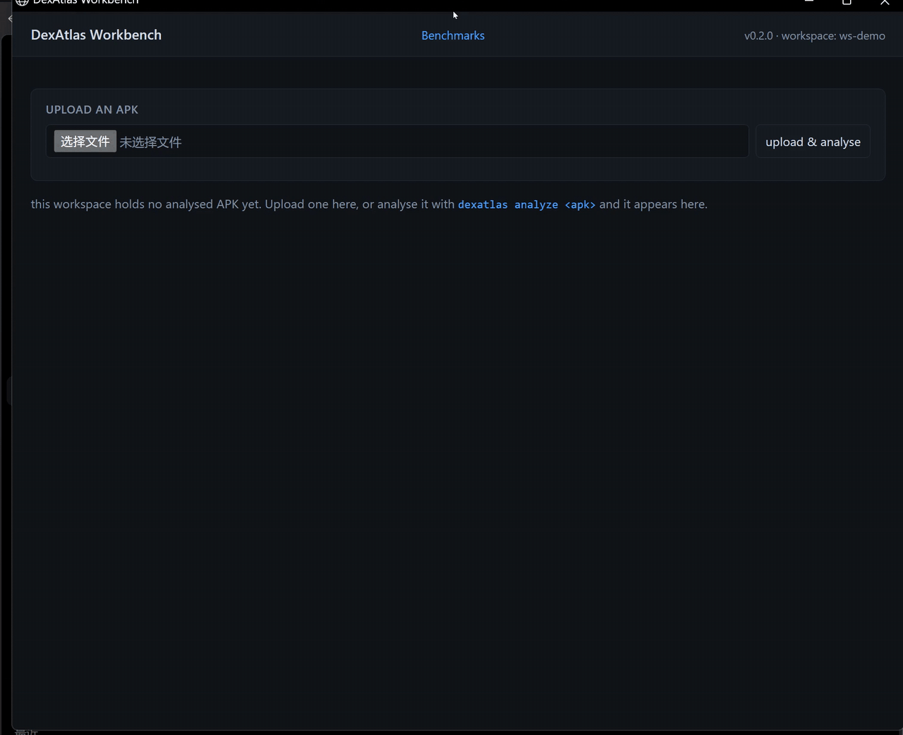

<div align="center">

# DexAtlas

**从 APK 到可核查的证据 —— 由一个有边界的 AI agent 驱动。**

开源、证据优先的 Android 逆向工程与移动应用分析平台。

[](https://github.com/gg320324492-lgtm/dexatlas/actions/workflows/ci.yml)
[](https://www.python.org/downloads/)
[](LICENSE)
[](docs/reports/phase1-execution-report.md#21-分层策略)
[](docs/reports/phase1-execution-report.md#12-工程指标)

> 徽章数字与[英文版 README](README.md)同源，取自同一份测量记录，同样由
> `scripts/refresh-report-figures.py` 写回——**不要手改**。Tests 徽章数的是
> **通过**的测试；树上收集的总数略多——差的是一条按设计跳过的测试
>（Windows 上的 POSIX launcher 测试）与汇总单列的预期结果。测的是什么、
> 怎么复现，见[执行报告](docs/reports/phase1-execution-report.md)。

  <sub>[下面这张卡片上每一个数，以及它是从哪个文件读出来的](docs/reports/social-preview-howto.md)</sub>

  

</div>

DexAtlas 把一个 APK 变成一幅完整、可核查的图景：manifest 与权限清单、完整的
类/方法/字段符号索引、反编译的 Java 源码、调用点与调用关系交叉引用，以及一条证据链——
每个事实都记录着是哪个工具、在哪个版本、从哪个字节位置读出来的。一套模块化、可复现的
工作流，面向开发者、安全研究员，以及对自己拥有或已获授权的应用进行分析的工程师。

**一条结论必须能指回它来自的那些字节。** 结论分级为 `verified` / `lead` /
`insufficient`，每个事实都带 provenance；后端失败被当作一个值来报告，而不是抛异常——
哪怕 APK 让反编译器彻底失效，你仍会拿到 manifest、符号索引，以及一份写明哪些步骤
没能运行的分析报告。

> [!IMPORTANT]
> **当前状态：早期开发——v1.0.0 已发布（tag 2026-11-17，
> 见[发版说明](docs/releases/v1.0.0.md)）；Phase 3 的交付物已发布，但退出标准未全部达成
> （M6、M8 与 M10 的验收仍未关闭）。** CLI、分析内核与报告
> 流水线在 `v0.1.0` 发布，此后每个版本都在交付。MCP server、证据优先的 Agent 与
> Web 工作台的 M4 八屏——项目面板、上传与分析进度、检索与证据溯源、单方法调用
> 关系、Agent 工作区、报告导出、M3 基准视图——随 `v0.2.0` 发布，其中除检索、
> 源码与证据这一组外均已全部建成。
> M4 已于 2026-11-14 通过源码评审。Phase 3 各里程碑相对
> [作品集计划](docs/roadmap/phase3-plan.md)的状态：M5（声明基线）与 M7（客户可审阅
> 交付包）已完成；M6（有限 Agent 任务）的
> 层级 0 与层级 1 演练已完成，层级 2 真实模型批次已跑——**未达验收线**
> （DexAtlas 逐轮 45%/40%/35% 均低于每轮 ≥16/20（≥80%）线，三轮合计 40.0% 低于
> 三轮合计 ≥54/60（≥90%）线；见
> [M6 层级 2 运行记录](docs/benchmarks/m6-level2-real.md)）；执行层修复后的三轮完整
> 复测 49/60 = 81.7%（逐轮 15/16/18），仍低于三轮合计 ≥54/60（≥90%）的验收门槛（见
> [复测记录](docs/benchmarks/m6-level2-retest4.md)）；修复后的窄验证在六个已知失败面上
> （6 题 × 3 轮 × 3 配置）转通过 **2/6** 题（确定性子集 2/5），未达窄验证门槛（≥4/6 与
> ≥3/5）；预算效率四项修复（resources 收口、notice 折叠、string excerpt 截断、空转软提示）
> 之后的第三轮窄验证转通过 **3/6**（确定性子集 3/5），两轮窄验证均低于门槛，故按方案
> 停止投入、M6 转入方案 3 现状披露（见[二轮窄验证记录](docs/benchmarks/m6-level2-narrow-verify2.md)
> 与[三轮窄验证记录](docs/benchmarks/m6-level2-narrow-verify3.md)）；M8（干净安装、契约与
> 导出安全）的演练、修复与公共契约表已完成、验收待做；M9（本页展示入口）GitHub 侧
> 已完成（对外素材已随 2026-11-21 的去平台化清理移除）；M10（独立验收、发布候选）
> 已于 2026-11-20 通过。
> 详见[路线图](#路线图)与
> [`docs/roadmap/phase3-plan.md`](docs/roadmap/phase3-plan.md)。
> 本文档不会声称任何尚未实际可运行的功能。

<p align="center">
  
</p>

上面每一帧都是针对 [`examples/demo-app/demo.apk`](examples/demo-app/) 的真实运行结果——
该应用由同目录下的 smali 源码构建而成，不是预先编排的录像。完整的 85 秒端到端会话——
上传、分析、符号检索、证据溯源、调用关系、Agent 工作区与报告导出——见
[视频](docs/assets/demo.mp4)与下方 [GIF](docs/assets/demo.gif)，两者出自同一次录制。
关于这段录像的一处披露：分析、检索、证据、调用关系与报告各屏展示的都是真实分析
产物，但 **Agent 屏由仓库自带的 scripted 演示 provider 驱动——没有密钥，没有真实
模型调用**。真实模型在该屏上的表现另行记录于
[M4 端到端实测报告](docs/reports/m4-e2e-run.md)。

<details>
<summary><b>完整流程</b> —— 上传、分析、检索、证据、调用关系、Agent 与报告</summary>

<p align="center">
  
</p>

</details>

---

## 为什么是 DexAtlas？

传统 Android 逆向意味着在 JADX、Apktool、十六进制编辑器和一份记录笔记的表格之间反复切换，
再手工追踪每条结论究竟来自哪个方法。证据散落在各个工具里，会话一结束就消失了。

DexAtlas 要解决的正是这个问题：

- **统一的 Android 分析**——反编译、APK 资源、DEX 元数据与代码导航收敛到同一套接口，
  同时保留各后端的原始输出。
- **证据优先的结论**——每条发现都带有来源工具、工具版本、项目哈希与精确代码位置。
  无法点回原处的结论，不算结论。
- **面向自动化**——CLI 与 REST API 共用同一个分析内核，让分析结果可在 CI 中复现，
  而不是每次手工重敲一遍。
- **为 Agent 而生的架构**——标准化的工具接口与结构化 JSON，是已建成的 AI Agent 消费的
  契约，从第一天就按这个目标设计。
- **可扩展的设计**——分析后端是统一接口之后的适配器，新增引擎无需重写内核。

## 原则

1. 证据优于推测。
2. 可复现性优于炫技演示。
3. 模块化工具优于紧耦合框架。
4. 敏感操作需要人工确认。
5. 开放协作，透明评估。

## 路线图

| 阶段        | 版本      | 主题           | 范围                                                                                              |
| ----------- | --------- | -------------- | ------------------------------------------------------------------------------------------------- |
| **Phase 1** | `v0.1.0`  | 基础能力建设   | APK 导入、JADX/Apktool/Androguard 后端、统一索引、代码检索、CLI、REST API、JSON/Markdown 报告      |
| **Phase 1** | `v0.1.1`  | 基础能力加固   | 修复了此前对任何 APK 都从未生效过的 Smali 回退                                                    |
| **Phase 1** | `v0.1.2`  | 验收清单补齐   | 5 个自建测试 APK、演示视频，并把退出清单恢复成计划书的原话                                        |
| **Phase 1** | `v0.1.3`  | 证据能指回原处 | 交叉引用成为证据、locator 随报告迁移、文档与代码互相校验                                          |
| **Phase 2** | `v0.2.0`  | Agent 智能分析 | Agent 任务规划、MCP Server、证据校验、可恢复任务、React 工作台                                       |
| **Phase 3** | `v1.0.0`（tag 2026-11-17） | 作品集与交付 | 有限 Agent 流程（题集冻结、层级 0/1 判分完成，层级 2 真实模型批次已跑——未通过：首批逐轮 45%/40%/35% 均低于每轮 ≥16/20（≥80%）线、三轮合计 40.0% 低于三轮合计 ≥54/60（≥90%）线；执行层修复后三轮完整复测 49/60 = 81.7%，仍低于三轮合计 ≥54/60（≥90%）门槛；修复后的窄验证先转通过 2/6、预算效率四项修复后转通过 3/6，均低于 ≥4/6 门槛，转方案 3 现状披露）、可迁移证据报告（`--html`/`export` 已交付）、干净安装验证与公共契约表（演练完成）、客户式案例（已交付）、独立验收（准备包就绪，未执行） |

完整内容、退出清单与评审机制：**[docs/roadmap/ROADMAP.md](docs/roadmap/ROADMAP.md)**。

[第三阶段计划](docs/roadmap/phase3-plan.md)以 GitHub 可复现展示与有范围的交付展示为目标；
原生/动态分析和插件生态延后，不再是本阶段退出条件。

阶段推进依据证据而非日历。每个阶段以一次源码评审结束，下一阶段的任务清单由评审结果
推导而来，而非照搬既有假设。

## 架构

```text
APK 导入 ──► 哈希 + 校验 ──► 任务调度器
                                 │
               ┌─────────────────┼─────────────────┐
               ▼                 ▼                 ▼
             JADX             Apktool          Androguard
        （Java 伪代码）    （Manifest/Smali）  （DEX 元数据/交叉引用）
               └─────────────────┼─────────────────┘
                                 ▼
                         统一符号索引
                                 ▼
                  代码检索 / 方法引用查询
                                 ▼
                           证据关联
                                 ▼
                    JSON / Markdown 报告
```

外部分析引擎以**独立进程**方式调用，绝不内嵌或随仓库分发。它们的输出保持原生形态——
DexAtlas 统一的是索引与元数据接口，而不是抹平不同表示之间的差异。JADX 无法可靠反编译的
方法会被标注为错误，并保留回退到 Smali 的能力。

```
src/dexatlas/
├── core/          模型、索引、证据、存储、流水线
├── tools/         jadx/、apktool/、androguard/ 适配器
├── api/           FastAPI 应用
├── cli/           Typer 应用
├── reports/       JSON / Markdown 渲染器
└── config/        配置与后端工具发现
```

## 快速开始

完整说明（含后端安装与故障排查）：**[docs/install.md](docs/install.md)**。

```bash
git clone https://github.com/gg320324492-lgtm/dexatlas.git
cd dexatlas
uv sync --extra analysis

uv run dexatlas backends              # 哪些后端可用、版本号是多少
uv run dexatlas analyze examples/demo-app/demo.apk -o report.md --json report.json --html report.html
uv run dexatlas manifest  <project-id>
uv run dexatlas search   <project-id> "yourTerm"
uv run dexatlas xrefs    <project-id> "com.example.Foo.bar(Ljava/lang/String;)V"
uv run dexatlas export <project-id> -o evidence-package.zip
```

`analyze` 示例指向 `examples/demo-app/demo.apk` —— 这是**仓库自带的**真实
APK，克隆下来就能直接分析：无需下载，也不需要 Android SDK。它由旁边的
smali 源码构建而成，可用 `scripts/build-demo-apk.sh` 重新构建（需要
Apktool + JDK）；拿到自己的 APK 后，把 `analyze` 指向它即可。

所有命令都接受同一组 `--workspace`/`-w` 选项：`analyze` 可以创建工作区，
其余只读命令要求工作区已存在。

REST API 是同一套分析内核的 HTTP 接口：

```bash
uv run uvicorn dexatlas.api.app:app --reload
# 交互式文档：http://localhost:8000/docs
```

**后端是可选且互相独立的。** DexAtlas 会报告它用现有后端能做什么，并把做不到的部分
作为证据记录进报告。一个后端都不装时，仍能得到哈希、校验和 APK 自身元数据；三个都装
时，则能获得完整的符号索引、反编译源码和交叉引用。

### MCP server

DexAtlas 可以通过 Model Context Protocol 对外提供分析能力。这个 server 是**只读的**：
它读取一个工作区，从不写入、从不运行 shell，任何返回都有数量上限。**它不需要任何
模型 provider**——它是一个工具服务器，而一个需要模型才能跑的工具服务器就不叫工具
服务器了。

```bash
uv sync --extra analysis --extra mcp
uv run dexatlas-mcp                 # 通过 stdio 说 MCP
```

十一个工具，以及调用方在提问之前必须知道的三件事：
**[MCP server 架构](docs/architecture/mcp-server.md)**。

可以直接试用的客户端：

```bash
uv run --no-sync python examples/mcp_client.py
```

在 MCP host 里把它注册为 stdio server：

```json
{
  "mcpServers": {
    "dexatlas": {
      "command": "uv",
      "args": ["--directory", "/path/to/dexatlas", "run", "dexatlas-mcp"]
    }
  }
}
```

Docker 镜像已预装 JADX 与 Apktool：

```bash
docker build -t dexatlas . && docker run --rm dexatlas dexatlas backends
```

仓库内已附带一个演示应用，无需下载任何东西：

```bash
uv run dexatlas analyze examples/demo-app/demo.apk -o report.md
```

它由 [`examples/demo-app/`](examples/demo-app/) 下的 smali 源码构建而成，可用
`scripts/build-demo-apk.sh` 重新构建——不是来历不明的二进制文件。体积更大的测试样本
则通过 `scripts/fetch-fixtures.sh` 获取。

**安装捷径**（完整命令、故障排查与后端安装：[docs/install.md](docs/install.md)）：

- **uv**（推荐——见下方快速开始）：在克隆目录里执行 `uv sync --extra analysis`
- **Docker**（预装 JADX 与 Apktool）：`docker build -t dexatlas . && docker run --rm dexatlas dexatlas backends`
- **pipx**：`uv tool install --from . --with ".[analysis]" dexatlas` —— 从克隆目录安装
  三个可执行入口；JADX、Apktool 与 JDK 等引擎不随包分发，需另行安装

## Web 工作台

DexAtlas 可以在浏览器里展示分析工作区。工作台直接 in-process 调用 MCP server
暴露的那十一个只读工具函数，浏览器拿到的 JSON 与 MCP server 返回的形状完全相同；
唯一接受输入的是上传屏，它把 APK 交给与 REST API、CLI 相同的分析管线。这是
[Phase 2 计划](docs/roadmap/phase2-plan.md) 的 M4 屏幕清单：共八屏，随 `v0.2.0`
发布。五屏全部建成；检索、源码与证据这一组（第 3、4、7 屏）只部分建成——检索、
源码与证据记录已经有了，其余部分不声称建成：

- **项目面板**：工作区里的每个项目，以及各自参与的后端与分析产出的计数；
- **上传屏**：在浏览器里选择一个 APK，它按与 REST API 相同的策略入库——同样的大小
  上限、同样的校验、同样的拒绝措辞——后台运行分析，前端轮询项目状态直到发布；
- **检索与证据视图**：一次查询返回索引符号，点开类或方法看 Java / Smali 源码，
  证据记录的 provenance locator 能解析回这次分析里的具体位置；
- **单方法调用关系视图**：谁调用它、它调用谁，按调用点画出——每条调用来自哪个
  DEX 文件、哪条指令——点一个调用方或被调方就能走过去；
- **Agent 工作区**：`#/projects/{id}/agent`——向证据优先的 agent 提一个关于该项目的
  问题；问题作为后台任务运行，屏幕轮询计划、工具调用时间线与预算消耗，直到任务
  到达终态并展示报告；
- **报告导出**：项目页下载的 Markdown / JSON 报告与 CLI、REST API 写出的是同一份，
  基于同一个已发布快照——没有第二种格式，也没有被改动的字段；
- **基准视图**：`#/benchmarks` 呈现 M3 对比的两份已提交测量（脚本化 provider 与
  真实模型），带各自的八项指标、失败成因与限定披露——每个数字都由对比 harness
  从已提交的 trace 重算，从不转述。

```bash
uv sync --extra dev --extra analysis --extra mcp --extra demo
uv run dexatlas analyze examples/demo-app/demo.apk   # 准备一个示例工作区
uv run dexatlas-workbench            # 打开 http://127.0.0.1:8618
```

首次启动会用 npm 构建前端（只需一次），之后每次都是这一条命令。工作区仍由
`DEXATLAS_WORKSPACE` 指定，与其余命令一致。在项目列表上传一个 APK，它按 REST API
同一套策略入库（大小限制、校验、拒绝措辞都一致），后台跑分析，前端轮询项目状态
直到完成；打开项目后进入 **search & evidence**、**调用关系**，或在项目页点
**ask the agent** 提问：一次查询返回索引符号，点开类或方法查看 Java / Smali 源码，
再打开 evidence 记录并解析它的 provenance locator，回到这次分析里的具体位置。
屏幕清单与建屏决策详见 **[Web 工作台架构](docs/architecture/workbench.md)**。

### Agent

DexAtlas 还能回答关于一个 APK 的问题。agent 接收一个问题，规划一串有预算上限的
工具调用去访问 MCP server，检查自己得出的每条结论是否都有依据，然后报告结果——
**分成「已确证」「线索」「未确证」三类**。模型的输出永远只是线索，不能被提升为
finding；APK 里发现的指令是数据，不是命令。

它是一个库而不是一条命令：目前还没有 `dexatlas agent "..."`，调用方需要在一个
工作区和一个模型端点之上构建 `Orchestrator`。它做什么、不做什么、还没测什么：
**[Agent 架构](docs/architecture/agent.md)**。

Web 工作台的每个项目页都有 **ask the agent** 入口（`#/projects/{id}/agent`）。
模型端点是配置而不是约定——`DEXATLAS_AGENT_BASE_URL`、`DEXATLAS_AGENT_MODEL`，
端点需要时再加 `DEXATLAS_AGENT_API_KEY`——什么都没配置时，提问会被
`503 agent_not_configured` 拒绝，而不是由一个替身模型回答。

一条如实的披露，来自 M4 端到端实测：当时试用的真实模型（MiniMax-M3.1-Flash）
在 5/5 个任务里于写出带引用的结论之前耗尽了当时默认的预算。链路每一环都按设计工作，
每份报告都如实标注 *did not finish* 而不是编造答案。随后已落地串行工具修复与
`DEXATLAS_AGENT_MAX_STEPS` 预算开关，并把默认预算上调到实测所需——120,000 tokens、
16 轮迭代、40 次计划内工具调用、120 秒——在收束机制下读完关键证据的任务现在能
正常完成。每个默认值仍可通过环境变量整体替换（`DEXATLAS_AGENT_MAX_TOKENS`、
`..._ITERATIONS`、`..._SECONDS`、`..._STEPS`），且修改默认值仍属公共契约变更。
缺口与证据：**[M4 端到端实测报告](docs/reports/m4-e2e-run.md)**；
默认值与停止策略：**[Agent 架构](docs/architecture/agent.md)**。

## 文档

### 案例——一次真实运行长什么样

- **[案例索引](docs/case-studies/README.md)** —— 三份走查报告的索引：每份回答什么问题、
  覆盖什么范围、跑了哪些命令、结论背后是什么证据、边界在哪里
- **[从上传到证据链](docs/case-studies/demo-app-walkthrough.md)** —— 在内置演示 APK 上
  走完整条工具链：analyze、manifest、检索、源码、交叉引用，以及背后的证据记录
- **[读一个混淆过的应用](docs/case-studies/obfuscated-app.md)** —— 名称混淆后还剩什么、
  字符串索引还能找到什么，以及能力边界在哪里
- **[从 Python 集成](docs/case-studies/api-integration.md)** —— REST API 与 MCP server
  的线缆契约，逐端点看调用方拿到什么
- **案例附件** —— 上面两份走查各自产出的完整分析报告：[演示应用](docs/case-studies/attachments/demo-report.md)、
  [混淆应用](docs/case-studies/attachments/obfuscated-report.md)，含 run id、工具版本与
  全部记录

### 架构——如何组织，为什么

- **[架构说明](docs/architecture/README.md)** —— 流水线、存储模型与设计取舍，以及本项目用词的
  [术语表](docs/architecture/README.md#glossary)（agent service promise、frozen discipline、
  B1、七条评分规则）
- **[Web 工作台](docs/architecture/workbench.md)** —— 只读浏览器界面：已有的屏幕、启动方式与选型
- **[MCP server](docs/architecture/mcp-server.md)** —— 十一个只读工具，以及调用方在提问前要知道的三件事
- **[证据优先的 Agent](docs/architecture/agent.md)** —— 一个循环、一份预算、一份状态机，以及线索与 finding 的边界
- **[报告渲染与证据包](docs/architecture/report-rendering.md)** —— 同一份分析的三种渲染，以及可交给客户的证据导出
- **[公共契约表](docs/architecture/public-contracts.md)** —— CLI、REST、MCP 与报告
  schema 的对外契约，经实测并受版本政策约束，附已知限制
- **[分析批次](docs/architecture/analysis-runs.md)** —— 一次分析如何被标识、暂存、发布与清理，
  以及为什么重跑不会把上一批覆盖掉
- **[调用点与调用边](docs/architecture/call-sites-and-edges.md)** —— 本项目里被叫作「交叉引用」
  的两件不同东西分别住在哪里，以及怎么区分
- **[证据不变量](docs/architecture/evidence-invariants.md)** —— 一条 `verified` 记录必须成立在哪几点，
  以及不成立时是什么拦住了它
- **[运行时隔离](docs/architecture/runtime-isolation.md)** —— Androguard 后端嵌进长驻服务时，如何待在自己的盒子里
- **[架构图](docs/architecture/diagram.md)** —— 一张画全系统的图，每个方框背后的文字都链到了

### 基准——测了什么，没测什么

- **[脚本化对比](docs/benchmarks/comparison.md)** —— 92 题上验证对比机制本身，不是模型基线
- **[真实模型对比](docs/benchmarks/comparison-real.md)** —— 一个具名模型、完整披露、不挑数字
- **[更强预算对比](docs/benchmarks/comparison-stronger.md)** —— 同一模型的预算与执行条件变化，
  不是模型变化
- **[大型 APK 基准](docs/benchmarks/large-apk.md)** —— 20 万个方法的 APK 上分析会变成什么样，
  它拒绝声称什么，以及它没有测量什么
- **[服务回归集](docs/benchmarks/service-regression-set.md)** —— agent
  [服务承诺](docs/architecture/README.md#glossary)所对标的 20 道冻结题，以及统一判定规则
- **[M6 层级 1 scripted 演练](docs/benchmarks/m6-level1-scripted.md)** —— 冻结题集上
  用 scripted 替身 provider 走通发题/trace/判分的全流程；不是模型能力基线
- **[M6 层级 2 真实模型批次](docs/benchmarks/m6-level2-real.md)** —— 一个具名模型对
  冻结 20 题独立跑 3 轮、三配置：DexAtlas agent 24/60（40.0%）、A 源码文本 24/60、
  B 结构化检索 18/60——**未达每轮 ≥80% 的验收线，验收结论「未通过」**。全部 trace
  合计 853,103 tokens，超出 800,000 授权上限，92 题全量轮因此未执行。三配置预算与
  可见信息不同，这些数字是执行条件对比，不是模型质量对比。它说明的是：agent 当前
  默认配置在该冻结集上未达验收线，服务承诺范围待失败模式分析后重定
- **[M6 层级 2 根因修复后复测](docs/benchmarks/m6-level2-retest2.md)** —— 五项根因修复后
  用真实模型对冻结 20 题补跑，20 题完整分母：DexAtlas 16/20（80.0%）单轮达到 ≥80% 验收线；
  A 7/20、B 7/20；trace 合计 355,623 tokens。单轮达标一次不等于三轮合计 ≥90% 的验收门槛，
  服务承诺范围仍未收口
- **[M6 层级 2 三轮完整复测](docs/benchmarks/m6-level2-retest4.md)** —— 执行层修复成套
  落地后的验收测量：三轮均跑满 20 题分母，DexAtlas 49/60 = 81.7%（逐轮 15/16/18；
  r2、r3 达单轮线，r1 未达），A 21/60、B 21/60；trace 合计 1,182,356 tokens。
  仍低于三轮合计 ≥90% 的验收门槛，里程碑保持未收口
- **[M6 层级 2 窄验证第二轮](docs/benchmarks/m6-level2-narrow-verify2.md)** —— 针对已知失败面
  的四项修复后，在 6 题 × 3 轮 × 3 配置上重跑（54 条 trace 全部留存；数字由脚本重算）：
  协议泄漏修正的重试生效（0 次协议失败；三轮复测都失败的那道 `multidex.dex-file-count`
  在 r3 跑通），但 DexAtlas 只转通过 **2/6** 题
  （`manifest.permission.count-obfuscated` 3/3、`resources.app-name.demo` 2/3），
  确定性子集 **2/5** —— 未达窄验证门槛（≥4/6 与 ≥3/5）。本轮花了 420,826 tokens，
  超出 410,000 的授权上限（超额记录在案，未重跑）。按验收方案：停止投入，M6 转入
  方案 3 现状披露
- **[M6 层级 2 窄验证第三轮](docs/benchmarks/m6-level2-narrow-verify3.md)** —— 预算效率四项
  修复（resources 收口、notice 折叠、string excerpt 截断、空转软提示）与 transcript
  截断机制落地后，同六个失败面重跑 6 题 × 3 轮 × 3 配置（54 条 trace 全部留存；
  数字由脚本重算）：DexAtlas 转通过 **3/6** 题（确定性子集 **3/5**）——
  `manifest.permission.count-obfuscated` 3/3、`resources.app-name.demo` 3/3、
  `multidex.dex-file-count` 2/3 —— 仍低于 ≥4/6 的门槛。本轮花了 380,881 tokens，
  在 450,000 的授权内（未触发熔断），且所有 trace 的关键扫描都没有发现异常。
  按方案的失败处理，本轮就此打住：没有全量复测，也没有再开一轮修复，
  现状披露方案是 M6 的最终收口方式
- **[M3 题目集](docs/benchmarks/task-set.md)** —— 对比实验问的题目、答案如何判分、
  以及第二个人如何在不跑任何东西的情况下确认一个期望答案是对的
- **[覆盖率数字测在哪棵树上](docs/reports/phase1-execution-report.md)** —— 执行报告带着
  那次测量所针对的源码指纹：`src/dexatlas/`、`tests/`、`pyproject.toml` 与测量脚本
  `scripts/refresh-report-figures.py`。改了其中任何一处，报告里的数字会被立刻判为过期，
  而不是继续冒充现状。`scripts/` 下的其它脚本**不在**指纹里——测量没有读它们。
  其中包括 `scripts/verify-public-contracts.py`（契约活检）与 `scripts/m10_selfcheck.py`
  （M10 自查）：它们的结果由各自的测试守着，不由指纹守着

### 怎么复核我们说的——自己核一遍

- **[怎么复核这个项目说的每句话](docs/how-to-verify.zh-CN.md)** —— 自己复核本项目每个数字的
  命令、应该看到什么、以及哪些说法尚未达成（[§3](docs/how-to-verify.zh-CN.md#3-哪些说法目前是未达成--未验证请据此打折)
  列出了未达成的那些）；需要 JDK、三个分析后端与第三方测试样本。同一内容的另一版
  （主文档）见 [docs/how-to-verify.md](docs/how-to-verify.md)
- **[服务承诺范围](docs/service-commitments.md)** —— agent 服务承诺覆盖什么，以及明确不做什么

### 项目记录

- **[交接说明](docs/HANDOVER.md)** —— 项目现状、如何在另一台机器跑起来、接下来做什么
- **[安装指南](docs/install.md)** —— 每条命令都在全新克隆上验证过
- **[当前状态](docs/status.md)** —— 项目现在在哪，还剩什么；§4.0 带着 M6 层级 2 的判定，
  里程碑仍未收口
- **[分析覆盖度与证据来源](docs/analysis-provenance.md)** —— 每条结论由哪个后端支撑，以及怎么自己核对
- **[路线图](docs/roadmap/ROADMAP.md)** —— 三个阶段与当前位置
- **[Phase 2 计划](docs/roadmap/phase2-plan.md)** —— 源码评审之后、对着真实代码写的
- **[Phase 3 计划](docs/roadmap/phase3-plan.md)** —— 作品集计划：可复现的 GitHub 展示、
  有范围的客户交付、独立验收
- **[Phase 3 基线](docs/reports/phase3-baseline.md)** —— 声明清单、重算后的 benchmark 数字，
  以及其背后的未决问题
- **[报告目录索引](docs/reports/README.md)** —— `docs/reports/` 的目录索引：每份报告回答什么、
  什么时候该看它、哪些是历史记录而不是当前状态
- **[v1.0.0 发版说明](docs/releases/v1.0.0.md)** —— v1.0.0 包含什么、打 tag 前复核过什么、
  以及它不声称什么
- **[更早的发版说明](docs/releases/v0.1.0.md)** —— v1.0.0 之前的各次发布：
  [v0.1.1](docs/releases/v0.1.1.md)、[v0.1.2](docs/releases/v0.1.2.md)、
  [v0.1.3](docs/releases/v0.1.3.md)、[v0.2.0](docs/releases/v0.2.0.md)
- **[演示视频](docs/assets/demo.mp4)** —— GIF 所出自的完整 85 秒会话（MP4）

源码评审已经做完：三份审核共 44 条发现，每一条都在发现它的那棵树上复验过。

- **[Phase 1 验收记录](docs/releases/phase1-acceptance-2026-10-21.md)** —— 验收了什么，以及它**没有**声称什么

- **[评审报告](docs/reports/phase1-review-report.md)** —— 发现了什么、修了什么、推迟了什么
- **[成熟度评估](docs/reports/phase1-maturity-assessment.md)** —— 六个加权维度，只用能跑出来的证据打分；
  这个分数是修复前的基线，此后没有重新打分
- **[Phase 2 任务清单](docs/reports/phase2-issue-list.md)** —— 推迟的发现，每条带两个方案和推荐
- **[退出码提案](docs/proposals/exit-code-partial-read.md)** —— 退出码 6（「跑完了，但没读到任何
  代码」）背后的提案；落地后仍保留提案原文
### 对外材料——作品集与交付素材

- **[作品集描述](docs/portfolio.md)** —— 放进客户简报的一段话，以及它背后的细节

## 作者贡献与第三方引擎

DexAtlas 是一个**个人自主的开源项目**——背后没有客户或雇主。作者完成了架构设计，
编写了分析内核、三个后端集成、存储与证据模型、CLI 与 REST API、只读 MCP server、
证据优先的 agent 循环、Web 工作台、测试套件与全部文档。部分实现由 AI 编码助手辅助
完成；每一个设计决策、每一次集成和每一行发布的代码都经过作者评审与验收，作者对
交付的一切负责。

反编译与字节码分析的重活由三个第三方引擎完成，它们以**独立进程**方式被调用，
在本仓库中不被内嵌、不被捆绑、也不被再分发：

| 引擎 | 在 DexAtlas 中的角色 | 许可证 |
|---|---|---|
| [JADX](https://github.com/skylot/jadx) | 把 DEX 反编译为可读的 Java 伪代码 | Apache-2.0 |
| [Apktool](https://github.com/iBotPeaches/Apktool) | 解码 manifest 与资源；提供 Smali 回退 | Apache-2.0 |
| [Androguard](https://github.com/androguard/androguard) | 权威的 DEX 符号图与交叉引用图 | Apache-2.0 |

它们的输出保持原生形态；DexAtlas 补上的是其外的统一索引、证据模型与传输层。
许可证审计说明见[路线图](docs/roadmap/ROADMAP.md#license)。

## 参与贡献

欢迎提交 Issue、Bug 报告与 Pull Request——详见 [CONTRIBUTING.md](CONTRIBUTING.md)。
规划 Phase 1 的 8 个任务已归档在
[`.github/issues/v0.1.0/planned/`](.github/issues/v0.1.0/planned/) 下，每个文件都记着
背后的设计决策；当前的工作是 Phase 3 计划。

请勿提交包含 APK、反编译源码，或任何来自你无权分析的应用程序的代码。参见
[SECURITY.md](SECURITY.md)。

## 预期用途

DexAtlas 用于教育、经授权的软件分析、移动应用安全评估与防御性研究。

本平台不授权访问任何第三方应用、账户、服务或数据。签名伪造、许可证绕过、保护机制
规避与未授权数据提取被明确列为**非目标**——它们不是功能，不是卖点，也不会出现在演示中。

## 许可证

[Apache-2.0](LICENSE)。第三方分析引擎以独立进程方式调用，不随本项目分发；审计说明见
[路线图](docs/roadmap/ROADMAP.md#license)中的许可证章节。

## 路线图状态

Phase 3（[计划](docs/roadmap/phase3-plan.md)）是一次作品集冲刺：让项目在 GitHub 上
可复现地被看懂，把客户能订购的交付范围写清楚，并让每一条声明都放在陌生人可以重新
推导的证据后面。当前进度：

| 里程碑 | 范围 | 状态 |
|---|---|---|
| M5 | 对外声明基线、重算 benchmark 数字 | **已完成** —— [phase3-baseline.md](docs/reports/phase3-baseline.md) |
| M6 | 冻结回归集上的有限 agent 任务 | **部分完成** —— 20 题题集已[冻结](docs/benchmarks/service-regression-set.md)；层级 0 确定性判分 20/20；[层级 1 scripted 演练](docs/benchmarks/m6-level1-scripted.md)已完成（替身 provider，只证明管线可用，不是模型能力基线）；[层级 2 真实模型批次](docs/benchmarks/m6-level2-real.md)已完成且**未通过**（DexAtlas 逐轮 45%/40%/35% 均低于每轮 ≥16/20（≥80%）线，三轮合计 24/60 = 40.0% 低于三轮合计 ≥54/60（≥90%）线）；执行层修复后，三轮完整[复测](docs/benchmarks/m6-level2-retest4.md) DexAtlas 49/60 = 81.7%（逐轮 15/16/18，trace 1,182,356 tokens）——r2/r3 达单轮 ≥16/20 线、r1 未达，81.7% 仍低于三轮合计 ≥54/60（≥90%）的验收门槛；修复后的[窄验证二轮](docs/benchmarks/m6-level2-narrow-verify2.md)在六个已知失败面上转通过 2/6 题（确定性子集 2/5），低于窄验证门槛（≥4/6 与 ≥3/5）；预算效率四项修复后的[窄验证三轮](docs/benchmarks/m6-level2-narrow-verify3.md)（54 条 trace，380,881 tokens，在 450,000 授权之内）转通过 3/6（确定性子集 3/5），仍低于门槛，故按方案停止投入、M6 转入方案 3 现状披露，里程碑保持未收口 |
| M7 | 客户可用的 HTML/JSON/Markdown 报告与证据包 | **已完成** —— [report-rendering.md](docs/architecture/report-rendering.md) |
| M8 | 干净安装、故障恢复、契约与导出安全验收 | **部分完成** —— 安装、Docker 与故障恢复[演练](docs/reports/m8-install-rehearsal.md)已完成（macOS 未验证）；[公共契约表](docs/architecture/public-contracts.md)已发布并附已知限制；CLI `--workspace` 与 install.md 修复已合入；三后端全超时的退出码已实现为退出码 6（`EXIT_NO_INDEX`），并写入[公共契约表](docs/architecture/public-contracts.md) |
| M9 | GitHub 展示入口（本页）与对外素材 | **展示入口已完成；素材已移除** —— 本页与[项目简介](docs/portfolio.md)已就位；对外素材已随 2026-11-21 的去平台化清理移除 |
| M10 | 独立验收、重新评分、发布候选 | **已通过（2026-11-20）** —— 外部独立验收人从 clone 走完全链路，40 项判定 39 过，重评 97.5% / 96.3%。验收材料已随 2026-11-21 的去平台化清理移除 |

本计划原本以退出标准全部通过为 `v1.0.0` 的前提；`v1.0.0` 已于 2026-11-17 按现状披露
口径发布，M6、M8 与 M10 的验收仍未关闭（见 [`docs/status.md`](docs/status.md)）——阶段推进靠
证据，不靠日历。
