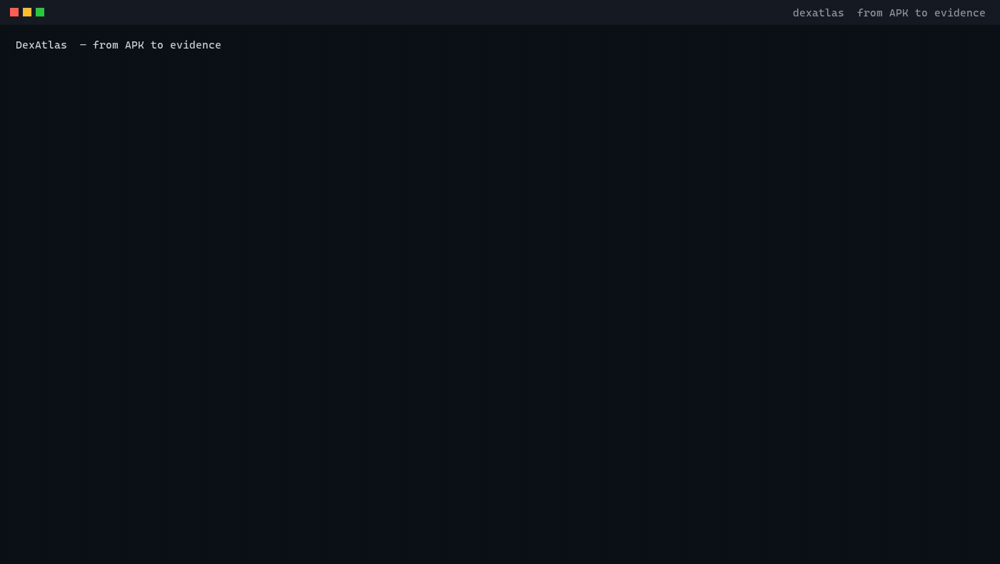
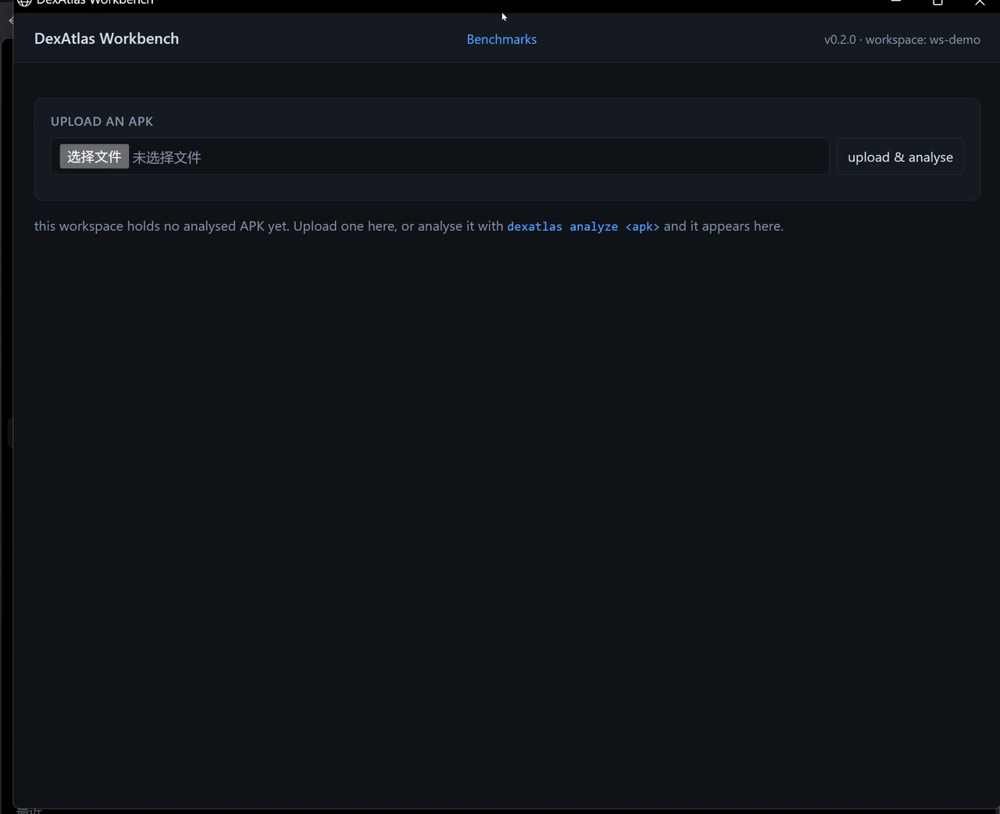

<div align="center">

# DexAtlas

**From APK to Evidence — Powered by AI Agents.**

开源、证据优先的 Android 逆向工程与移动应用分析平台。

</div>

DexAtlas 把 Android 反编译、程序分析、AI Agent 与自动化能力整合进一套模块化、可复现的
工作流，面向开发者、安全研究员，以及对自己拥有或已获授权的应用进行分析的工程师。

> [!IMPORTANT]
> **当前状态：早期开发（Phase 2 进行中）。** CLI、分析内核与报告流水线在 `v0.1.0`
> 发布，此后每个版本都在交付。MCP server 与证据优先的 Agent 已经建成；Web 工作台
> 的 M4 八屏——项目面板、上传与分析进度、检索与证据溯源、单方法调用关系、
> Agent 工作区、报告导出、M3 基准视图——已全部建成并随 `v0.2.0` 发布。
> 详见[路线图](#路线图)。本文档不会声称任何尚未实际可运行的功能。

<p align="center">
  
</p>

上面每一帧都是针对 [`examples/demo-app/demo.apk`](examples/demo-app/) 的真实运行结果——
该应用由同目录下的 smali 源码构建而成，不是预先编排的录像。完整的 85 秒端到端会话——
上传、分析、符号检索、证据溯源、调用关系、Agent 工作区与报告导出——见
[视频](docs/assets/demo.mp4)与下方 [GIF](docs/assets/demo.gif)，两者出自同一次录制。

<details>
<summary><b>完整流程</b> —— 上传、分析、检索、证据、调用关系、Agent 与报告</summary>

<p align="center">
  
</p>

</details>

---

## 为什么是 DexAtlas？

传统 Android 逆向意味着在 JADX、Apktool、十六进制编辑器和一份记录笔记的表格之间反复切换，
再手工追踪每条结论究竟来自哪个方法。证据散落在各个工具里，会话一结束就消失了。

DexAtlas 要解决的正是这个问题：

- **统一的 Android 分析**——反编译、APK 资源、DEX 元数据与代码导航收敛到同一套接口，
  同时保留各后端的原始输出。
- **证据优先的结论**——每条发现都带有来源工具、工具版本、项目哈希与精确代码位置。
  无法点回原处的结论，不算结论。
- **面向自动化**——CLI 与 REST API 共用同一个分析内核，让分析结果可在 CI 中复现，
  而不是每次手工重敲一遍。
- **为 Agent 而生的架构**——标准化的工具接口与结构化 JSON，是已建成的 AI Agent 消费的
  契约，从第一天就按这个目标设计。
- **可扩展的设计**——分析后端是统一接口之后的适配器，新增引擎无需重写内核。

## 原则

1. 证据优于推测。
2. 可复现性优于炫技演示。
3. 模块化工具优于紧耦合框架。
4. 敏感操作需要人工确认。
5. 开放协作，透明评估。

## 路线图

| 阶段        | 版本      | 主题           | 范围                                                                                              |
| ----------- | --------- | -------------- | ------------------------------------------------------------------------------------------------- |
| **Phase 1** | `v0.1.0`  | 基础能力建设   | APK 导入、JADX/Apktool/Androguard 后端、统一索引、代码检索、CLI、REST API、JSON/Markdown 报告      |
| **Phase 1** | `v0.1.1`  | 基础能力加固   | 修复了此前对任何 APK 都从未生效过的 Smali 回退                                                    |
| **Phase 1** | `v0.1.2`  | 验收清单补齐   | 5 个自建测试 APK、演示视频，并把退出清单恢复成计划书的原话                                        |
| **Phase 1** | `v0.1.3`  | 证据能指回原处 | 交叉引用成为证据、locator 随报告迁移、文档与代码互相校验                                          |
| **Phase 2** | `v0.5.0`  | Agent 智能分析 | Agent 任务规划、MCP Server、证据校验、可恢复任务、React 工作台                                       |
| **Phase 3** | `v1.0.0`  | 生产级开源平台 | Native（Ghidra）与动态（Frida）分析、插件生态、HTML/PDF 报告、公开 Benchmark                        |

完整内容、退出清单与评审机制：**[docs/roadmap/ROADMAP.md](docs/roadmap/ROADMAP.md)**。

阶段推进依据证据而非日历。每个阶段以一次源码评审结束，下一阶段的任务清单由评审结果
推导而来，而非照搬既有假设。

## 架构

```text
APK 导入 ──► 哈希 + 校验 ──► 任务调度器
                                 │
               ┌─────────────────┼─────────────────┐
               ▼                 ▼                 ▼
             JADX             Apktool          Androguard
        （Java 伪代码）    （Manifest/Smali）  （DEX 元数据/交叉引用）
               └─────────────────┼─────────────────┘
                                 ▼
                         统一符号索引
                                 ▼
                  代码检索 / 方法引用查询
                                 ▼
                           证据关联
                                 ▼
                    JSON / Markdown 报告
```

外部分析引擎以**独立进程**方式调用，绝不内嵌或随仓库分发。它们的输出保持原生形态——
DexAtlas 统一的是索引与元数据接口，而不是抹平不同表示之间的差异。JADX 无法可靠反编译的
方法会被标注为错误，并保留回退到 Smali 的能力。

```
src/dexatlas/
├── core/          模型、索引、证据、存储、流水线
├── tools/         jadx/、apktool/、androguard/ 适配器
├── api/           FastAPI 应用
├── cli/           Typer 应用
├── reports/       JSON / Markdown 渲染器
└── config/        配置与后端工具发现
```

## 快速开始

完整说明（含后端安装与故障排查）：**[docs/install.md](docs/install.md)**。

```bash
git clone https://github.com/gg320324492-lgtm/dexatlas.git
cd dexatlas
uv sync --extra analysis

uv run dexatlas backends              # 哪些后端可用、版本号是多少
uv run dexatlas analyze app.apk -o report.md --json report.json
uv run dexatlas manifest  <project-id>
uv run dexatlas search   <project-id> "yourTerm"
uv run dexatlas xrefs    <project-id> "com.example.Foo.bar(Ljava/lang/String;)V"
```

REST API 是同一套分析内核的 HTTP 接口：

```bash
uv run uvicorn dexatlas.api.app:app --reload
# 交互式文档：http://localhost:8000/docs
```

**后端是可选且互相独立的。** DexAtlas 会报告它用现有后端能做什么，并把做不到的部分
作为证据记录进报告。一个后端都不装时，仍能得到哈希、校验和 APK 自身元数据；三个都装
时，则能获得完整的符号索引、反编译源码和交叉引用。

### MCP server

DexAtlas 可以通过 Model Context Protocol 对外提供分析能力。这个 server 是**只读的**：
它读取一个工作区，从不写入、从不运行 shell，任何返回都有数量上限。**它不需要任何
模型 provider**——它是一个工具服务器，而一个需要模型才能跑的工具服务器就不叫工具
服务器了。

```bash
uv sync --extra analysis --extra mcp
uv run dexatlas-mcp                 # 通过 stdio 说 MCP
```

十个工具，以及调用方在提问之前必须知道的三件事：
**[MCP server 架构](docs/architecture/mcp-server.md)**。

可以直接试用的客户端：

```bash
uv run --no-sync python examples/mcp_client.py
```

在 MCP host 里把它注册为 stdio server：

```json
{
  "mcpServers": {
    "dexatlas": {
      "command": "uv",
      "args": ["--directory", "/path/to/dexatlas", "run", "dexatlas-mcp"]
    }
  }
}
```

Docker 镜像已预装 JADX 与 Apktool：

```bash
docker build -t dexatlas . && docker run --rm dexatlas dexatlas backends
```

仓库内已附带一个演示应用，无需下载任何东西：

```bash
uv run dexatlas analyze examples/demo-app/demo.apk -o report.md
```

它由 [`examples/demo-app/`](examples/demo-app/) 下的 smali 源码构建而成，可用
`scripts/build-demo-apk.sh` 重新构建——不是来历不明的二进制文件。体积更大的测试样本
则通过 `scripts/fetch-fixtures.sh` 获取。

## Web 工作台

DexAtlas 可以在浏览器里展示分析工作区。工作台直接 in-process 调用 MCP server
暴露的那十个只读工具函数，浏览器拿到的 JSON 与 MCP server 返回的形状完全相同；
唯一接受输入的是上传屏，它把 APK 交给与 REST API、CLI 相同的分析管线。这是
[Phase 2 计划](docs/roadmap/phase2-plan.md) 的 M4 屏幕清单，八屏已全部建成并随
`v0.2.0` 发布：

- **项目面板**：工作区里的每个项目，以及各自参与的后端与分析产出的计数；
- **上传屏**：在浏览器里选择一个 APK，它按与 REST API 相同的策略入库——同样的大小
  上限、同样的校验、同样的拒绝措辞——后台运行分析，前端轮询项目状态直到发布；
- **检索与证据视图**：一次查询返回索引符号，点开类或方法看 Java / Smali 源码，
  证据记录的 provenance locator 能解析回这次分析里的具体位置；
- **单方法调用关系视图**：谁调用它、它调用谁，按调用点画出——每条调用来自哪个
  DEX 文件、哪条指令——点一个调用方或被调方就能走过去；
- **Agent 工作区**：`#/projects/{id}/agent`——向证据优先的 agent 提一个关于该项目的
  问题；问题作为后台任务运行，屏幕轮询计划、工具调用时间线与预算消耗，直到任务
  到达终态并展示报告；
- **报告导出**：项目页下载的 Markdown / JSON 报告与 CLI、REST API 写出的是同一份，
  基于同一个已发布快照——没有第二种格式，也没有被改动的字段；
- **基准视图**：`#/benchmarks` 呈现 M3 对比的两份已提交测量（脚本化 provider 与
  真实模型），带各自的八项指标、失败成因与限定披露——每个数字都由对比 harness
  从已提交的 trace 重算，从不转述。

```bash
uv sync --extra dev --extra analysis --extra mcp --extra demo
uv run dexatlas analyze examples/demo-app/demo.apk   # 准备一个示例工作区
uv run dexatlas-workbench            # 打开 http://127.0.0.1:8618
```

首次启动会用 npm 构建前端（只需一次），之后每次都是这一条命令。工作区仍由
`DEXATLAS_WORKSPACE` 指定，与其余命令一致。在项目列表上传一个 APK，它按 REST API
同一套策略入库（大小限制、校验、拒绝措辞都一致），后台跑分析，前端轮询项目状态
直到完成；打开项目后进入 **search & evidence**、**调用关系**，或在项目页点
**ask the agent** 提问：一次查询返回索引符号，点开类或方法查看 Java / Smali 源码，
再打开 evidence 记录并解析它的 provenance locator，回到这次分析里的具体位置。
屏幕清单与建屏决策详见 **[Web 工作台架构](docs/architecture/workbench.md)**。

### Agent

DexAtlas 还能回答关于一个 APK 的问题。agent 接收一个问题，规划一串有预算上限的
工具调用去访问 MCP server，检查自己得出的每条结论是否都有依据，然后报告结果——
**分成「已确证」「线索」「未确证」三类**。模型的输出永远只是线索，不能被提升为
finding；APK 里发现的指令是数据，不是命令。

它是一个库而不是一条命令：目前还没有 `dexatlas agent "..."`，调用方需要在一个
工作区和一个模型端点之上构建 `Orchestrator`。它做什么、不做什么、还没测什么：
**[Agent 架构](docs/architecture/agent.md)**。

Web 工作台的每个项目页都有 **ask the agent** 入口（`#/projects/{id}/agent`）。
模型端点是配置而不是约定——`DEXATLAS_AGENT_BASE_URL`、`DEXATLAS_AGENT_MODEL`，
端点需要时再加 `DEXATLAS_AGENT_API_KEY`——什么都没配置时，提问会被
`503 agent_not_configured` 拒绝，而不是由一个替身模型回答。

一条如实的披露，来自 M4 端到端实测：当时试用的真实模型（MiniMax-M3.1-Flash）
在 5/5 个任务里于写出带引用的结论之前耗尽了默认预算。链路每一环都按设计工作，
每份报告都如实标注 *did not finish* 而不是编造答案；随后已落地串行工具修复与
`DEXATLAS_AGENT_MAX_STEPS` 预算开关。缺口与证据：
**[M4 端到端实测报告](docs/reports/m4-e2e-run.md)**。

## 文档

- **[安装指南](docs/install.md)** —— 每条命令都在全新克隆上验证过
- **[架构说明](docs/architecture/README.md)** —— 项目如何组织，以及为什么这样设计
- **[Web 工作台](docs/architecture/workbench.md)** —— 只读浏览器界面：已有的屏幕、启动方式与选型
- **[MCP server](docs/architecture/mcp-server.md)** —— 十个只读工具，以及调用方在提问前要知道的三件事
- **[证据优先的 Agent](docs/architecture/agent.md)** —— 一个循环、一份预算、一份状态机，以及线索与 finding 的边界
- **[当前状态](docs/status.md)** —— 项目现在在哪，还剩什么
- **[分析覆盖度与证据来源](docs/analysis-provenance.md)** —— 每条结论由哪个后端支撑，以及怎么自己核对
- **[路线图](docs/roadmap/ROADMAP.md)** —— 三个阶段与当前位置
- **[Phase 2 计划](docs/roadmap/phase2-plan.md)** —— 源码评审之后、对着真实代码写的
- **[大型 APK 基准](docs/benchmarks/large-apk.md)** —— 20 万个方法的 APK 上分析会变成什么样，
  它拒绝声称什么，以及它没有测量什么

源码评审已经做完：三份审核共 44 条发现，每一条都在发现它的那棵树上复验过。

- **[Phase 1 验收记录](docs/releases/phase1-acceptance-2026-10-21.md)** —— 验收了什么，以及它**没有**声称什么

- **[评审报告](docs/reports/phase1-review-report.md)** —— 发现了什么、修了什么、推迟了什么
- **[成熟度评估](docs/reports/phase1-maturity-assessment.md)** —— 六个加权维度，只用能跑出来的证据打分
- **[Phase 2 任务清单](docs/reports/phase2-issue-list.md)** —— 推迟的发现，每条带两个方案和推荐

## 参与贡献

欢迎提交 Issue、Bug 报告与 Pull Request——详见 [CONTRIBUTING.md](CONTRIBUTING.md)。
规划 Phase 1 的 8 个任务已归档在
[`.github/issues/v0.1.0/planned/`](.github/issues/v0.1.0/planned/) 下，每个文件都记着
背后的设计决策；当前的工作是 Phase 2 计划。

请勿提交包含 APK、反编译源码，或任何来自你无权分析的应用程序的代码。参见
[SECURITY.md](SECURITY.md)。

## 预期用途

DexAtlas 用于教育、经授权的软件分析、移动应用安全评估与防御性研究。

本平台不授权访问任何第三方应用、账户、服务或数据。签名伪造、许可证绕过、保护机制
规避与未授权数据提取被明确列为**非目标**——它们不是功能，不是卖点，也不会出现在演示中。

## 许可证

[Apache-2.0](LICENSE)。第三方分析引擎以独立进程方式调用，不随本项目分发；审计说明见
[路线图](docs/roadmap/ROADMAP.md#license)中的许可证章节。
