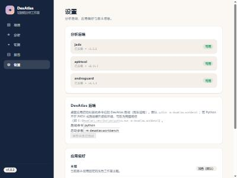
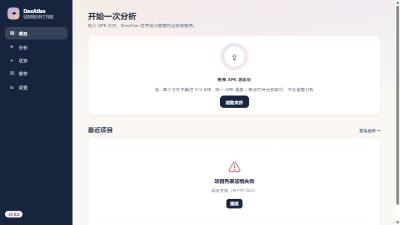

# Phase 5 验收报告 — 桌面应用自包含与阶段级可观测

**日期：** 2026-11-25 · **性质：** Phase 5 验收记录 · **基线：** `origin/main` @ `9614cb0`（PR #14 合入后的树）
**验收对象：** [Phase 5 执行单](../roadmap/phase5-plan.md) W1–W4 与端到端验收
**上游素材：** [Q2 验收报告](phase4-q2-acceptance.md)（八维度口径）· [桌面应用设计规范](../architecture/desktop-app.md) · 端到端走查报告 `.scratch/q2-final-e2e-walkthrough.md`（工作区文件，不入库；截图已复制到 `docs/assets/phase5/`）

> **本文的地位。** Phase 5 执行单 §2.1 为每项工作列了验收判据，§5 给了「完成定义」。本文逐项写判据、证据与结论。**诚实优先于好看**：没有证据的判据标「未验证」并写清缺什么；判据只满足一部分的，写「部分满足」，不把「在途中」改写成「完成」。

## 0. 一页结论

| 工作项 | 结论 | 一句话依据 |
|---|---|---|
| W1 侧车进程真接入 | ⚠ **部分通过** | `tauri dev` 真机链路通过（侧车自动拉起、崩溃如实呈现、导出落盘）；**打包后的 exe 未构建、未验证**，§2.1 的「不预先手动起后端」判据仍未满足 |
| W2 阶段级进度契约 | ✅ 通过（1 项判据部分满足） | `GET …/runs/{run_id}/stages` 已合入（PR #14 / `9614cb0`）；11 例契约测试全过；五阶段顺序与 pipeline 一致；桌面分析页改读真实阶段事件，时间模拟只保留为「无任何 run 数据」时的兜底，未删除 |
| W3 C12 仓库内备料 | ✅ 备料完成（渠道核实按指示未做） | `docs/outreach/scope-ai-mcp-compact.md` 2,674 字节（≤5,000 字符）；核对表模板 `c12-field-check-template.md` 可直接填 |
| W4 发版后运营清单 | ✅ 落盘（1 处口径出入，见 §5.2） | `docs/ops/post-release-checklist.md` 覆盖发布当天、发布后一周、反馈渠道与下一版触发条件；清单仍含「需作者账号」的行，与执行单「不含需要作者账号的执行步骤」不完全一致 |
| 端到端验收走查 | ✅ 通过（带 4 项遗留） | 2026-11-25 实测：首页 → 详情/证据抽屉 → 分析 → 报告导出 → 设置，数据全部来自真实 API；过程发现 P1–P4，P1/P3/P4 仍开着 |

**总体判定：Phase 5 的工程交付（W1–W4）已合入 main，但「Phase 5 验收完成」尚不能宣布。** 未完成的是两件验收动作，不是猜测：**打包 exe（无预置后端）全链路的真机验收**，以及 **W2 合入后的端到端复测**。本报告 §6 逐项列出未覆盖面。

## 1. 验收环境与基线

- **代码基线：** `origin/main` @ `9614cb0`（`Merge pull request #14`），本报告在 `docs/phase5-closure` 分支上写；该分支只改文档、截图与 CHANGELOG，不改 `src/`、`tests/`、`desktop/src`。
- **最后一次完整测量（发布树，带 JADX 1.5.2 + Apktool 2.11.1）：** 测试 <!--fig:tests.total-->1830<!--/fig--> 个（<!--fig:tests.fast-->1681<!--/fig--> 快 + <!--fig:tests.slow-->149<!--/fig--> 集成），`suite.passed` <!--fig:suite.passed-->1829<!--/fig-->、`skipped` <!--fig:suite.skipped-->1<!--/fig-->、`failed` 0，一方代码覆盖率 <!--fig:coverage.pct-->93.3%<!--/fig-->（`docs/reports/phase1-execution-report.md` 的生成值）。**本分支是文档分支，没有重跑完整测量**；数字引用的是这棵树上的最后一次生成记录，不是本次新测。
- **端到端走查环境（2026-11-25）：** workbench 后端 `127.0.0.1:8618`（`uv run dexatlas-workbench`，带 JADX/Apktool 环境变量）+ 桌面前端 Vite dev `http://localhost:5173`（HashRouter）。**这条链路不是侧车链路**：后端是手动起的，前端跑在浏览器里。侧车链路的证据在 §2.3（`tauri dev`）。
- **W1 侧车验证环境（2026-11-25）：** `npm run tauri dev` 的真 Tauri 窗口，CDP 调试端口 `:9223`；侧车由 Rust 壳自动 spawn，`--port 0` 由系统分配端口（实测每次重启端口变化，如 `49552`、`64167`）。
- **截图：** 走查的 4 张原图原样复制到 [`docs/assets/phase5/`](../assets/phase5/)（`01-home-page.jpg`、`02-project-detail-evidence-drawer.jpg`、`03-settings-page.jpg`、`04-backend-down-error.jpg`），尺寸为走查时的窗口缩略图（480×360 / 400×300 / 400×225）。图是证据，不是装饰：每张对应 §4 的一条走查结论。

## 2. W1 — 侧车进程真接入

### 2.1 判据与实现

执行单 §2.1 W1 的判据：

> 打包后的 exe 在**不预先手动起后端**的情况下能完成 上传 → 分析 → 证据 → 导出 全链路；侧车崩溃时页面显示可读错误而非静默白屏。

交付物与落点：

| 交付物 | 位置 | 说明 |
|---|---|---|
| Rust 侧车管理 | `desktop/src-tauri/src/sidecar.rs` | `spawn_sidecar`、端口抓取、`sidecar:status` 事件、进程树收尾、动态 capability |
| 后端命令配置与设置页 | `desktop/src-tauri/src/sidecar.rs` + `desktop/src/pages/SettingsPage.tsx` | 默认 `python -m dexatlas.workbench`（`desktop/src-tauri/src/sidecar.rs:120-125`），配置存 `%APPDATA%\io.github.dexatlas.desktop\backend.json`；保存即重启侧车 |
| 前端 baseUrl 适配 | `desktop/src/api/client.ts`、`desktop/src/api/sidecar.ts` | 解析顺序：侧车实际端口 → `127.0.0.1:8618` → dev vite 代理；`raw()` 等端口解析完成再发请求 |
| 文档 | `desktop/README.md` | 侧车一节（本次收口补 W2 端点，见 §3.5） |

设计上侧车只做三件事：拉起现有后端、把实际端口告诉前端、如实报告退出。分析逻辑仍在 `src/dexatlas/`，桌面壳不复制分析逻辑。

### 2.2 证据

| 证据 | 内容 |
|---|---|
| PR #13 / 合并提交 | `3625862`（`Merge pull request #13 from …/feat/desktop-sidecar`）；实现提交 `9d1c462` |
| Rust 门禁 | `cargo test` 12/12、`cargo check` 0 警告（W1 完成回执实测；本分支未重跑，桌面构建需 MSVC 环境） |
| 前端构建 | `npm run build` 0 错误（W1 完成回执） |
| 真机侧车拉起 | `get_sidecar_status` → `{running:true, port:49552}`；WebView 内经 plugin-http 取 `/api/health` → 200；每次重启端口变化，证明 `--port 0` 生效 |
| 真实全链路 | 首页真实项目列表（含 TestActivity 340 类/443 证据、multidex 7 证据）、详情证据列表、导出 Markdown 落盘 `~/Downloads/apk_*.md` |
| 崩溃如实呈现 | 手动 `taskkill` 侧车进程树 → 状态事件显示「已异常退出（exit code 1）…」；`restart_sidecar` 后恢复新端口 |
| 设置页 | 保存后端命令 → 按新命令重启侧车；3s 轮询状态行 |

### 2.3 结论：部分通过

- **通过的部分：** `tauri dev` 形态下，侧车在应用启动时自动拉起，前端经实际端口取数；进程被杀时 UI 如实显示错误，可重启恢复。这是执行单 W1 的核心行为，**有真机证据**。
- **未满足的部分：** 执行单要求的是**打包后的 exe**在不预先手动起后端的情况下完成全链路。到本报告写成为止：
  1. **没有 W1 之后的打包产物。** 主检出里的 `desktop/src-tauri/target/release/dexatlas-desktop.exe` 构建于 2026-11-24 20:58（W1 合入前），不含侧车；W1 的验证日志里没有 `tauri build`。
  2. **默认侧车命令是开发形态。** 默认 `python -m dexatlas.workbench`，工作目录从 exe 路径上溯 4 级找含 `src/dexatlas` 的仓库根（`desktop/src-tauri/src/sidecar.rs:380-389`）；安装到 Program Files 的打包产物没有这个仓库根，侧车会以「未找到 DexAtlas 仓库根」失败。执行单 §4 风险 1 写的方案是拉起用户机器上已装的 `dexatlas-workbench` 入口，这一步**没有落地**。
  3. 因此「不预先起后端 → 上传 → 分析 → 证据 → 导出」这条验收判据**未验证**，按项目纪律不能写成通过。
- **其它未验证：** macOS/Linux 未验证（执行单明确不纳入，第一验收平台是 Windows）。

## 3. W2 — 阶段级进度契约

### 3.1 判据与实现

执行单 §2.1 W2 的判据：

> 分析一次 demo.apk 后，stages 端点返回 ≥5 个阶段且顺序与 pipeline 一致；桌面分析页用真实 stages 渲染时间线，前端模拟代码删除；REST/MCP 既有契约零改动（纯新增）。

实现落点：

| 层 | 位置 | 说明 |
|---|---|---|
| 阶段模型 | `src/dexatlas/core/runs.py:75-100` `anchor: class RunStage` | `RunStage` 五值：`inspect`、`parse-apktool`、`index-androguard`、`decompile-jadx`、`publish`；`RunStageEvent`（`src/dexatlas/core/runs.py:102-120`）带 `started_at` / `finished_at` |
| 记录 | `src/dexatlas/core/runs.py:226-258` `anchor: def record_stage_start` | 同一阶段至多一次；`finished_at` 为 null = 阶段未结束（进行中，或失败/取消时停在那里） |
| 埋点 | `src/dexatlas/core/pipeline.py:186-187`、`:207`、`:248-250`、`:267-269`、`:284-288`、`:383-385` | 在 `Analyzer.analyze` 的既有推进点记录，不改分析行为 |
| 持久化 | `src/dexatlas/core/storage.py:269`、`:549-554` | schema v8：`analysis_runs.stages` JSON 列；旧库迁移后旧行读作空数组（「无阶段事实」，不是「没走过阶段」） |
| REST 只读端点 | `src/dexatlas/api/app.py:471-503` `anchor: def get_run_stages` | `GET /projects/{project_id}/runs/{run_id}/stages` |
| workbench 只读端点 | `src/dexatlas/workbench/app.py:603-616` `anchor: def get_run_stages` | `GET /api/projects/{project_id}/runs/{run_id}/stages`，同形状 |
| MCP 契约形状 | `src/dexatlas/mcp/tools/projects.py:74-92` `anchor: def run_stages`、`src/dexatlas/mcp/schemas.py:139-170` | `RunStages{project_id, run_id, run_status, stages[]}`，元素 `{stage, started_at, finished_at}` |
| 桌面分析页 | `desktop/src/pages/Analysis.tsx:507-543`、`:585-596` | `useRunStagesPolling` 轮询 stages 端点；角标如实区分「后端真实阶段事件 / run 状态 + 前端粒度模拟 / 前端模拟」 |

### 3.2 契约在评审中改过一次形状（重要）

W2 的第一版（`fa61cc4`）把 `stages` 加进既有 `RunResponse` / `RunSummary` 对象，声称「纯扩展字段」。CI 的公共契约活检（`verify-public-contracts.py`，无 Java 后端配置）判红：既有 run 对象的字段集合断言被破坏。修复提交 `81a33d7` 把 stages 撤出 run 对象，改为**独立只读端点**，run 契约字段集复原。

这不是坏事，但它意味着：

- 对外契约的最终形态是**独立端点**，不是执行单 §4 风险 3 原写的「同一个端点加字段」；
- 「既有 REST/MCP 契约零改动（纯新增）」这条判据**最终满足**——run 详情与 workbench run 摘要的字段集合完全不变（`tests/test_public_contracts.py:77-100` 的 `EXPECTED_REST_ROUTES` 含新路由，`tests/test_public_contracts.py:345` 断言路由全集；`tests/test_run_stages.py:279-316` 明确断言 run 详情自身不含 stages）；
- 评审过程的这一反转应记录在案，避免后来的读者以为 stages 一直在 run 对象上。

### 3.3 测试证据

`tests/test_run_stages.py` 在基线上 **11 passed**（本分支 2026-11-25 重跑：`11 passed in 8.64s`）：

- `test_a_completed_run_records_the_pipeline_stages_in_order`（`tests/test_run_stages.py:62`）——顺序与 `PIPELINE_ORDER` 一致，时间戳单调不减；
- `test_a_completed_run_with_every_backend_records_five_stages`（`tests/test_run_stages.py:84`）——两个外部后端在 adapter 层打桩，完整管线录满五阶段；
- `test_stage_facts_survive_the_database`（`:125`）、`test_a_workspace_before_stages_still_opens`（`:142`）——数据库往返与旧库迁移；
- `test_stage_recording_does_not_change_the_analysis`（`:200`）——埋点前后分析结果一致（执行单 §4 风险 2 的断言）；
- `test_the_rest_api_run_stages_endpoint_carries_stages`（`:279`）、`test_the_workbench_run_stages_endpoint_carries_stages`（`:318`）、`test_the_stages_endpoint_of_an_unknown_run_is_404`（`:345`）——两个传输的端点形状与 404。

另有 `tests/test_analysis_runs.py` 的 `SCHEMA_VERSION` 守卫随 v8 更新。

### 3.4 结论：通过（1 项判据部分满足）

- **通过：** stages 端点返回五阶段且顺序与 pipeline 一致；数据经 SQLite 与两个传输原样读回；埋点不改变分析结果；run 既有契约字段集零变化。
- **部分满足：** 「前端模拟代码删除」没有字面完成。`desktop/src/pages/Analysis.tsx` 保留了一段按时间近似推进的模拟（`desktop/src/pages/Analysis.tsx:306-330`），**只作为「连 run 数据都拿不到」时的最后兜底**；有 run 时优先用真实 stages，旧 run（无 stages 字段）回退 `run.status` 粗粒度映射，三种来源在角标文案里如实区分（`desktop/src/pages/Analysis.tsx:585-596`）。把「删除」写成「降级为兜底并如实标注」是准确的说法；它不构成状态造假。
- **W2 合入前执行的端到端走查**（§4）当时测到 stages 端点 404，那是历史状态，不是当前缺陷。

### 3.5 契约文档的陈旧陈述（本分支已修）

`81a33d7` 只把 `docs/architecture/public-contracts.md` 的行号重映射，没有改 stages 段落，导致该段仍写着「`RunResponse.stages[]` 与 workbench `RunSummary.stages[]` … 纯扩展字段」——与最终实现相反。本次收口把该段改为独立端点描述（`docs/architecture/public-contracts.md:132-150`），并在 §2.3 端点表补充一行（`docs/architecture/public-contracts.md:110`）。这是文档与实现的陈述不一致，不是运行缺陷。

另有一处未覆盖：`scripts/verify-public-contracts.py` 的实跑清单没有请求新 stages 路由（静态路由全集由 `tests/test_public_contracts.py` 守住）。实跑活检目前只证明既有端点未变，不证明新端点可用；后者由 §3.3 的端点测试承担。按本轮范围（不改 `scripts/`），记为后续项。

## 4. 端到端验收走查（2026-11-25）

完整记录在工作区 `.scratch/q2-final-e2e-walkthrough.md`（不入库，原因是不把临时工作文件当项目证据）；结论与截图入库如下。

### 4.1 逐页结论

| 页面 | 结论 | 证据（截图） |
|---|---|---|
| 首页 `#/` | ✅ 通过 | 侧栏五项导航 + skip-link；上传卡（拖拽/512MB/重复上传提示）；最近项目 5 行与 `GET /api/projects` 逐行一致，`strings.apk` 的 failed 状态如实显示。空态与加载骨架未单独验证（库里有 5 个项目，非阻塞） |
| 项目详情 + 证据抽屉 | ✅ 通过（带 P3） | 头部元信息与 API 一致；12/12 条证据、类型筛选；抽屉 `role="dialog"`、`aria-modal="true"`；E-0001 的编号/级别/摘要/来源后端/detail JSON/locator 逐字段正确；Esc 关闭、resolve 按钮可用 |
| 分析页 | ✅ 符合当时预期 | 空态、真实 APK 上传（命中已有项目）、伪 ZIP 前端拦截；五阶段时间线与 run 状态；角标如实标注「前端粒度模拟」。**当时 W2 未合入（PR #14 在途），stages 端点 404** |
| 报告页 | ✅ 通过 | 5 个项目 × Markdown/JSON；Markdown 内容含 Summary、证据等级分布（verified 12 / lead 0 / insufficient 0）、Manifest、Evidence 逐条；JSON `schema_version` 3、三后端 `tool_versions` 齐全 |
| 证据页 | ✅ 通过 | 项目选择器 5 项；证据表逐条带 locator；wide.apk 11 条与 API 一致 |
| 设置页 | ✅ 通过（带 P1） | 三后端版本与可用状态（JADX 1.5.2 / Apktool 2.11.1 / Androguard 4.1.4）；侧车命令配置；关于区显示 v1.1.0 |

### 4.2 错误态与键盘

| 场景 | 结果 |
|---|---|
| 后端进程被杀 + 刷新 | 首页显示「项目列表加载失败 / 请求失败（HTTP 502）/ 重试」，不白屏，上传卡仍可用 |
| 后端恢复 + 点重试 | 错误消失，列表重新加载成功（自愈） |
| 非法文件上传 | 前端校验拦截并给出可读文案 |
| skip-link / focus 环 / 抽屉 Esc / aria-modal | 全部通过 |
| Tab 全量遍历 | ⚠ 未做逐元素全量遍历（P4；只验了 skip-link→main、列表项 focus、抽屉按钮 focus） |

### 4.3 走查截图

四张截图均来自 8618 真实 API，无 mock；原图在 [`docs/assets/phase5/`](../assets/phase5/)。

*图 1 — 首页。5 个真实项目、状态与证据数来自 `GET /api/projects`。左下角 `v1.0.2` 是 P1 的硬编码版本徽标，与 `/api/health` 的 v1.1.0 不一致。*

*图 2 — 项目详情三栏 + 证据抽屉（E-0001），locator、来源后端与 detail JSON 逐字段来自 API。*

*图 3 — 设置页。三后端版本与可用性、侧车命令配置；关于区的版本是真实 v1.1.0。*

*图 4 — 后端被杀后的错误态。页面显示可读错误与重试按钮，上传卡仍在，不白屏。*

### 4.4 走查发现的问题

由于本轮只做文档收口（不碰 `desktop/src`），这四项在本分支都不修，如实记录：

| # | 严重度 | 问题 | 当前状态 |
|---|---|---|---|
| P1 | 中 | 侧栏版本徽标硬编码 `v1.0.2`（`desktop/src/components/AppLayout.tsx:60`），与真实 v1.1.0 不一致；违反「数字是生成的」纪律 | **仍开着**；需从 `package.json` 或构建注入读取 |
| P2 | 中 | W2 stages 契约未合入 main（走查时 PR #14 在途） | **已由 `9614cb0` 解决**；但 W2 合入后的端到端复测未做（§6.2） |
| P3 | 低 | 证据抽屉「打开来源」对 `zip-entries` 这类包级 locator 无动作、无提示 | **仍开着** |
| P4 | 低 | Tab 逐元素全量遍历与 modal 焦点陷阱未完成 | **仍开着** |

### 4.5 结论：通过（走查对象是 W2 合入前的树）

所有页面的数据均来自真实 API，主链路可用，错误态如实呈现且可自愈。走查执行于 W2 合入前，因此它对分析页的结论（「前端模拟」）描述的是历史状态；W2 之后分析页的行为由 §3 的代码与契约测试证明，**没有**一份同等强度的合入后浏览器走查。

## 5. W3 / W4 — 备料项

### 5.1 W3 C12 仓库内备料：完成

| 判据 | 证据 | 结论 |
|---|---|---|
| 压缩稿 ≤5,000 字符且关键条款完整 | `docs/outreach/scope-ai-mcp-compact.md`（2,674 字节；验收与排除条款保留） | ✅ |
| 两个方案并排、取舍写明 | 同文件与 `docs/outreach/project-brief.md`、`publish-review.md`（`6b64411` 恢复） | ✅ |
| 核对表模板可直接填 | `docs/outreach/c12-field-check-template.md`（字段/实测长度/门限/结论） | ✅ |
| 真实渠道核实 | 按作者指示等待渠道与账号，本轮**不做** | 未做（按计划） |

### 5.2 W4 发版后运营清单：落盘，1 处口径出入

`docs/ops/post-release-checklist.md` 覆盖发布当天核对、发布后一周 triage 节奏、反馈渠道、指标与下一版触发条件。执行单的判据里有一句「不含任何需要作者账号的执行步骤」；清单本身也这么写，但表格第 1 行「核对 GitHub Release 页面」的账号需求标的是「作者（或已登录 CI）」，§4 又写「需作者账号查看」。**陈述与表格不一致**，属口径出入，不影响「只备料不执行」的结论；下一次维护清单时把这两处对齐即可。

## 6. 未覆盖与未验证（逐项）

1. **打包 exe（含侧车）的真机全链路 —— 未验证，且按当前代码预计不满足。** 没有 W1 之后的 `tauri build` 产物；默认侧车命令依赖仓库根 cwd，安装形态没有这个根。这是 Phase 5 完成定义的第一条，**当前是开放项**。
2. **W2 合入后的端到端复测 —— 未做。** 分析页读真实 stages 的行为有 11 例契约测试与代码路径证据，没有合入后的真机走查；走查截图与分析页结论均来自 W2 之前。
3. **「前端模拟代码删除」—— 未字面完成。** 模拟降级为无 run 数据时的兜底，并在角标中如实标注（§3.4）。
4. **P1 版本徽标硬编码 —— 未修。** 属 `desktop/src` 改动，不在本轮范围；用户可见的版本号目前仍是错的。
5. **P3/P4 —— 未修。** 低优先级遗留，见 §4.4。
6. **macOS/Linux —— 未验证。** 执行单明确不纳入。
7. **完整测量 —— 本分支未重跑。** 报告数字引用 `9614cb0` 树上的最后一次生成记录；文档篇数与代码指纹由下一次完整测量重新生成，**本分支没有手改生成值**（`docs/how-to-verify.md` 的 `documents.count` 仍显示上次测量的数）。
8. **实跑公共契约活检未请求 stages 路由。** 新端点的可用性由测试守，不由 `verify-public-contracts.py` 的实跑守（§3.5）。

## 7. 判定与下一步

**可以宣布的：** Phase 5 的 W1（开发形态）、W2、W3、W4 已实现并合入 main；W2 的契约是独立只读端点，既有 REST/MCP 字段集零变化；W2 的 11 例契约测试全绿；端到端走查在 W2 合入前完成，主链路与错误态均通过，遗留 P1/P3/P4 如实记录。

**不能宣布的：** 「Phase 5 验收完成」。挡住它的是两条可执行的验收动作，不是未知数：

1. 构建含侧车的打包产物，在**不预先起后端**的机器上完成上传 → 分析 → 证据 → 导出；若默认命令在安装形态不可用，先把侧车入口改为已安装的 `dexatlas-workbench`（执行单 §4 风险 1 的方案）。
2. W2 合入后跑一次与 §4 同口径的端到端走查，重点复核分析页的真实阶段时间线与角标文案。

这两项完成之前，本文的结论是：**工程交付完成，验收未完成。**