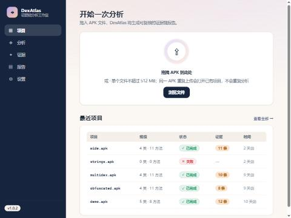
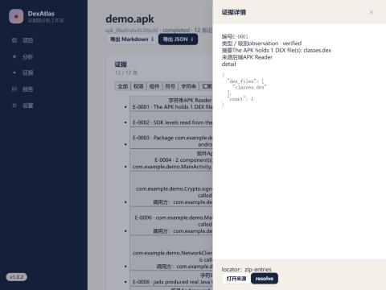
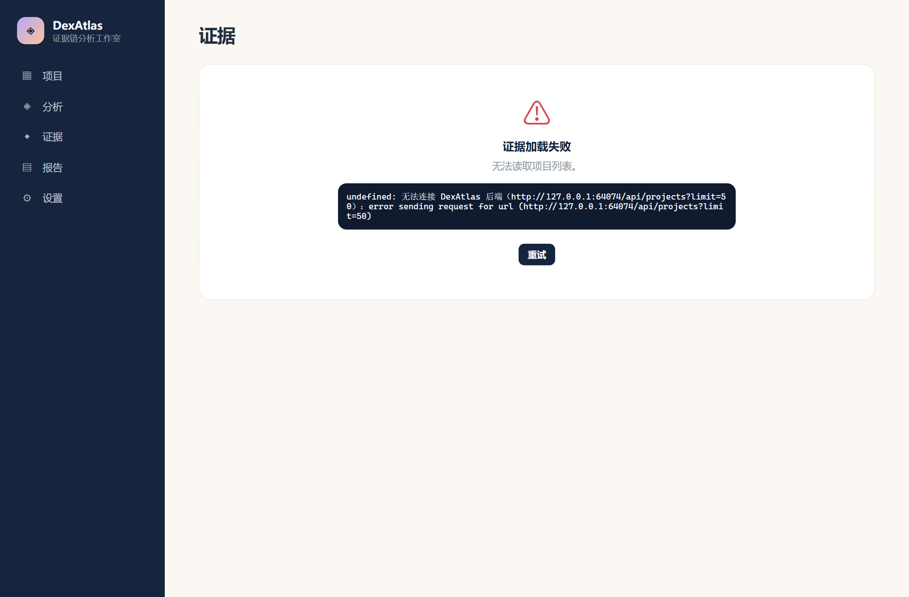
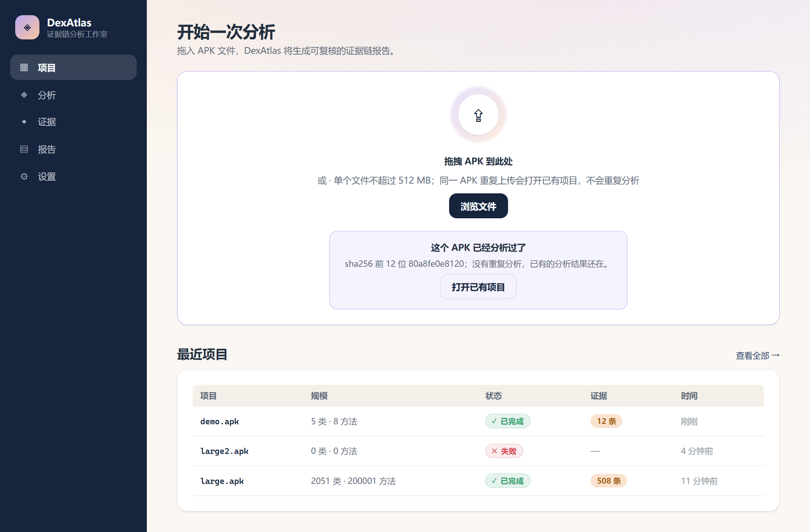
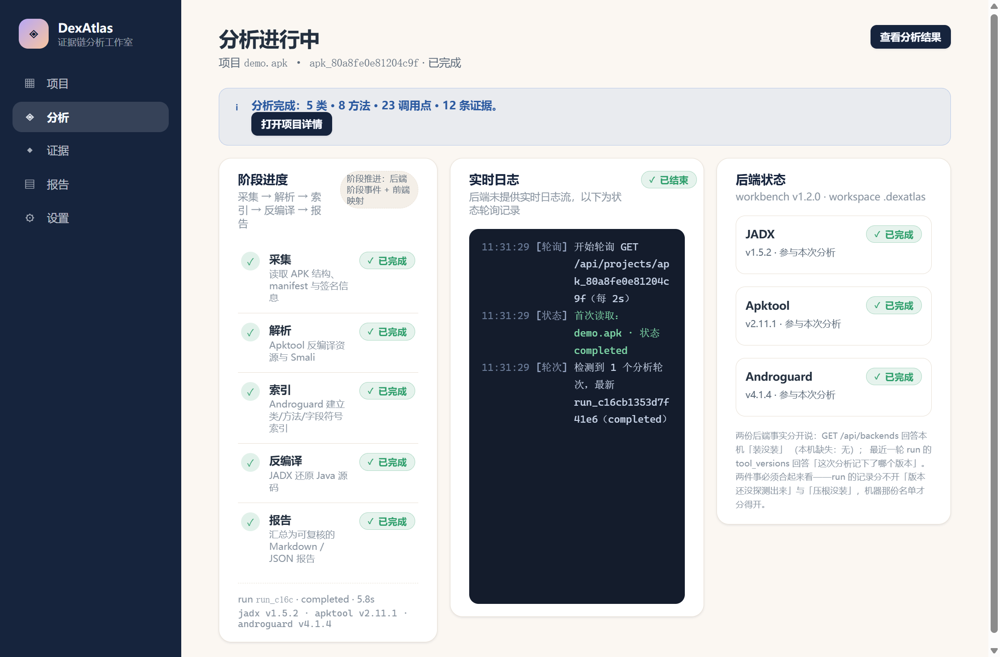
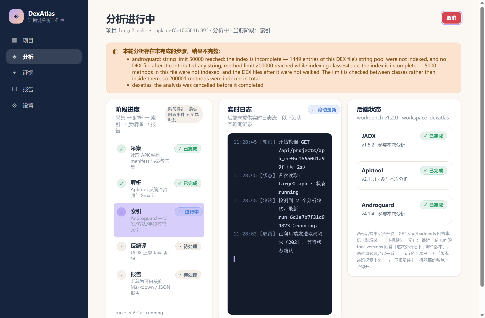
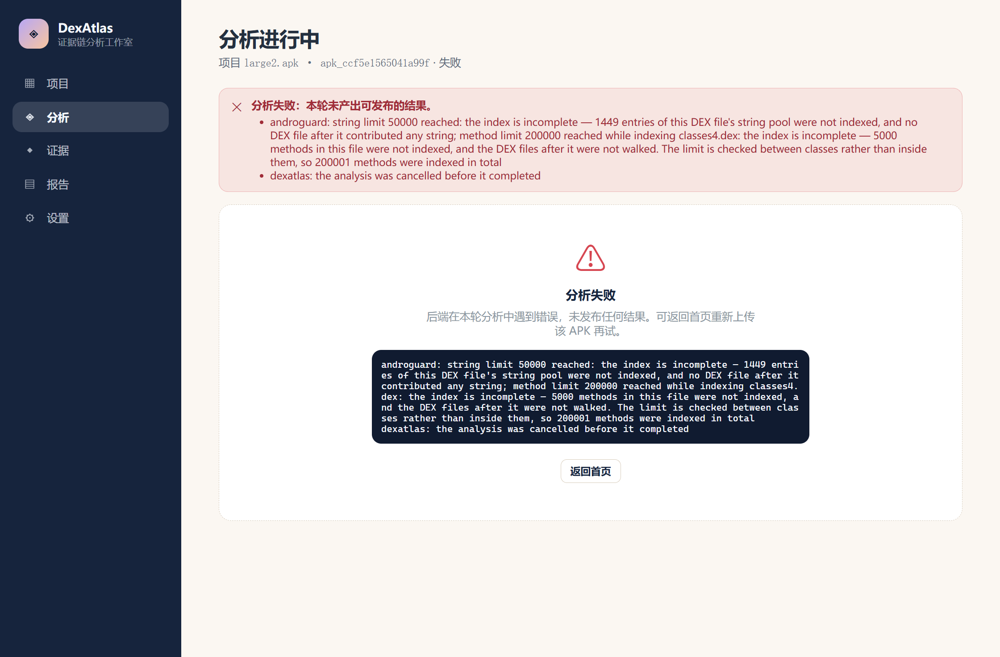
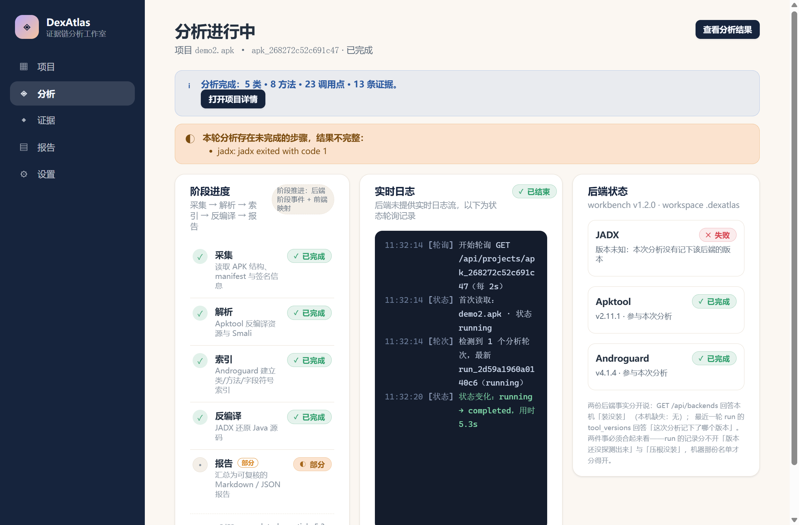
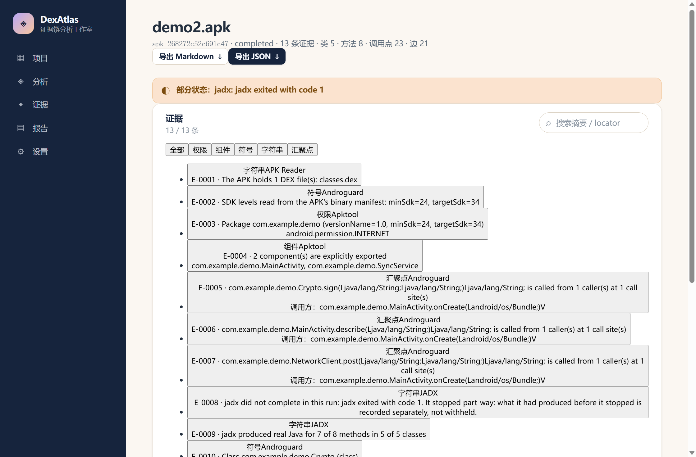
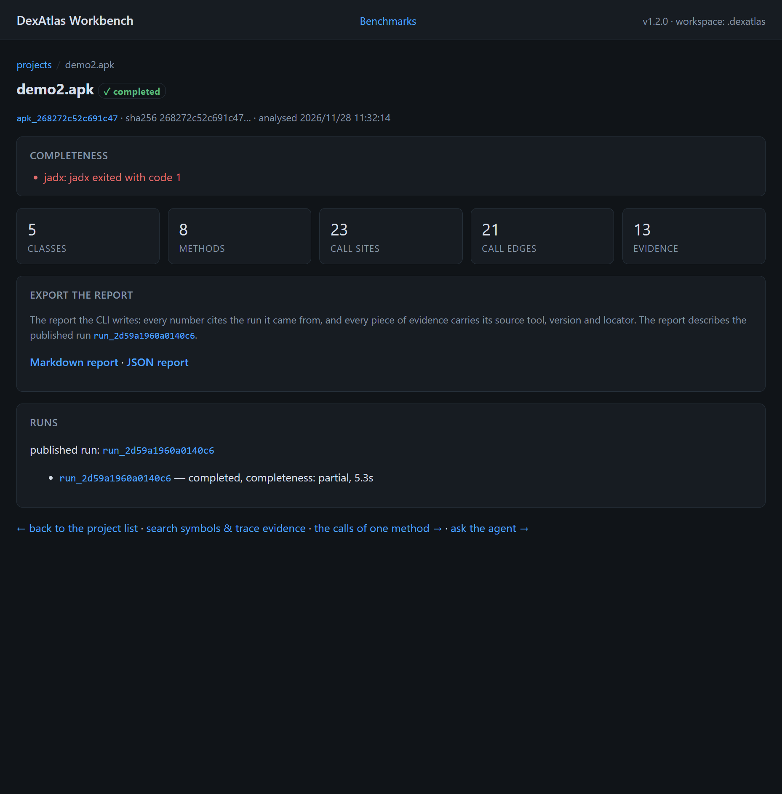

# Phase 5 验收报告 — 桌面应用自包含与阶段级可观测

**日期：** 2026-11-26 · **性质：** Phase 5 验收记录 · **基线：** `origin/main` @ `3cda93e`（PR #25 合入后的树）+ 本分支的收尾批次
**验收对象：** [Phase 5 执行单](../roadmap/phase5-plan.md) W1–W4 与端到端验收
**上游素材：** [Q2 验收报告](phase4-q2-acceptance.md)（八维度口径）· [桌面应用设计规范](../architecture/desktop-app.md) · 端到端走查报告 `.scratch/q2-final-e2e-walkthrough.md`（工作区文件，不入库；截图已复制到 `docs/assets/phase5/`）· W2 合入后复测 `.scratch/phase5-w2-retest.md` · 打包 exe 首轮验收 `.scratch/phase5-exe-acceptance.md` 与二次验收 `.scratch/phase5-exe-recheck.md`（后三份为工作区文件，不入库；二次验收截图已复制到 `docs/assets/phase5/`）

> **本文的地位。** Phase 5 执行单 §2.1 为每项工作列了验收判据，§5 给了「完成定义」。本文逐项写判据、证据与结论。**诚实优先于好看**：没有证据的判据标「未验证」并写清缺什么；判据只满足一部分的，写「部分满足」，不把「在途中」改写成「完成」。
>
> **本文相对上一版的修订。** 上一版写在 `9614cb0` 上，把「打包 exe 未验证」「W2 未复测」「P1/P3/P4 未修」「契约活检不覆盖 stages」记为开放项。再上一版把「前端模拟代码删除」记为开放，本版已收尾。**本版（收尾批次）**又关闭了七项：打包形态在完整后端配置下可用、MSI 安装路径、强杀 exe 时的孤儿后端、failed/cancelled 时间线真机走查、「打开来源」内联展示、角标不再夸大、run 完成后的多余轮询；并修掉走查带出的一个后端缺陷（分析失败的状态从不落库）。§7 逐项列出**仍然开放**的验收项（现在只剩四项）与本轮关闭的证据。

## 0. 一页结论

| 工作项 | 结论 | 一句话依据 |
|---|---|---|
| W1 侧车进程真接入 | ✅ **通过** | 首轮打包 exe 验收暴露的两个真实缺陷（侧车在安装形态下从未被拉起；前端把 baseUrl 锁死到 8618 回退）已由 PR #20（`4c86b2f`）修好；修复后的二次真机验收判据 (a)–(d) **全通过**——侧车自动拉起且端口为侧车自己的 64074（三处交叉印证），上传→分析→证据→导出全链路可用，杀侧车后 UI 如实报错且进程树被清理 |
| W2 阶段级进度契约 | ✅ **通过** | 复测已完成：判据 ①–④ 通过；⑤（文档与实际一致）当时不通过，已由 PR #18 修正；③ 附带的完成态缺陷（证据格停在「待处理」）已由 PR #19 修好。契约活检已覆盖 stages 路由，静态条数 55（31 REST + 6 MCP + 18 CLI） |
| W3 C12 仓库内备料 | ✅ **备料完成**（渠道核实按指示未做） | `docs/outreach/scope-ai-mcp-compact.md` 2,674 字节（≤5,000 字符）；核对表模板 `c12-field-check-template.md` 可直接填 |
| W4 发版后运营清单 | ✅ **落盘**（1 处口径出入，见 §6.2） | `docs/ops/post-release-checklist.md` 覆盖发布当天、发布后一周、反馈渠道与下一版触发条件；清单仍含「需作者账号」的行，与执行单「不含需要作者账号的执行步骤」不完全一致 |
| 端到端验收走查 | ✅ **通过**（遗留 P1/P3/P4 已修） | 2026-11-25 走查发现 P1–P4；P1 由 PR #15 修好，P3/P4 由 PR #17（`369fb89`）修好，W2 完成态缺陷由 PR #19 修好。走查本身的对象是 W2 合入前的树，W2 后由 §3 的复测覆盖 |
| 收尾批次（2026-11-26） | ✅ **通过** | 关闭 §7 的七项开放项：打包 exe 完整后端配置（12 条证据）、MSI 安装、强杀孤儿后端（作业对象 + CI 门禁）、失败/取消时间线真机走查、「打开来源」内联、角标不说谎、终态停止轮询；并修掉走查带出的一个后端缺陷（失败状态从未落库） |

**总体判定：Phase 5 的工程交付（W1–W4）与验收动作都已完成。** 首次验收挡在前面的两条——「打包 exe 全链路未验证」与「W2 合入后未复测」——都已做完并留下证据；2026-11-26 的收尾批次又关闭了 §7 里的七项（打包形态在完整后端配置下可用、MSI 能装、强杀不留孤儿、失败与取消的时间线真机走通、「打开来源」内联展示、角标不说谎、终态停止轮询），并修掉走查带出的一个后端缺陷（分析失败的状态从来没有落库，界面会永远停在「分析中」）。

**剩下的只有两项**（§7.3）：平台覆盖（macOS/Linux 明确不纳入）、取消对话框上的 Esc 键（机制上验不到）。**这些都不是挡住 Phase 5 的东西**——一项在执行单范围之外，一项没有可验的入口。此前的「非 MSIX 容器下的启动」已于 2026-11-27 关闭（证据见[真机补测报告](phase5-machine-verification.md) §5），「版本号递增的 MSI 升级路径」已于 2026-11-28 关闭（同报告 §5.9）；MCP 面的取舍与 W4 的账号口径也已关闭，见 §7.3 的已关闭清单。**前端时间模拟兜底已于 2026-11-26 收尾删除**（§3.5 与 §7.1 就地标注）。

> **2026-11-28 补记（NSIS 首装/卸载补测轮）：** §7.3 第 2 项当时明写「没验到的：NSIS 的卸载与首次安装」
> ——**这两条已于 2026-11-28 补上**（[真机补测报告](phase5-machine-verification.md) §5.8）：
> NSIS 静默首装退出码 0，装到 `%LOCALAPPDATA%`，装完的应用起来、侧车起来、
> 一次真实分析跑出 **12 条证据**、五阶段全完成、三后端参与；
> 静默卸载退出码 0，安装目录与注册表卸载项都清干净，`%APPDATA%` 的 `backend.json` 逐字节保留。
> **顺带验实了 NSIS 的 `ProductVersion` 跟着发版号走**（§5.8.2）。
> **同时查出一个新缺陷：NSIS 用过一次之后卸载卸不干净**（§7.3 第 16 项，§5.8.4）——
> 装完之后**没改产品代码、没加测试**，这一轮只做验证与记录。
>
> **2026-11-28 补记（MSI 版本号递增升级轮）：** §7.3 里的「版本号递增的 MSI 升级路径」
> （原第 4 项）**已关闭**（[真机补测报告](phase5-machine-verification.md) §5.9）：
> 同一棵临时树先后打出 1.2.0 与 1.2.1 两个 MSI，在已提升会话里静默安装两次都退出
> **0**；升级后 ARP `DisplayVersion` **1.2.1**、产品码换新、安装的 exe 与 1.2.1 包里的
> payload **逐字节相同**、`%APPDATA%` 的 `backend.json` 逐字节保留；装完的应用起来、
> 侧车起来、一次真实分析跑出 **12 条证据**。**顺带实测的降级没有被拒绝**：当前打包
> 配置下旧 MSI 会**静默**把应用退回旧版（§5.9.4）——这是打包策略问题，是否要改成
> 拒绝降级留给作者决定。**这一轮只做验证与记录，没有改产品代码、没有加测试。**

## 1. 验收环境与基线

- **代码基线：** `origin/main` @ `33e4ba9`（`Merge pull request #22`）。本报告在 `docs/phase5-closure` 分支上写，该分支相对 `origin/main` **只改文档与截图**，不改 `src/`、`tests/`、`desktop/src`、`scripts/`。
- **打包形态（二次验收）：** Windows 11 10.0.26300；MSVC 2022 Build Tools；`npm run tauri build` 退出码 0，产出 NSIS 与 MSI 两个 bundle；NSIS 安装器静默安装到用户目录，退出码 0。**验收全程 8618 端口无任何监听**——因此前端只要能取到数据，就必然是打到了侧车自己的端口。
- **开发形态（复测与走查）：** 后端 `uv run dexatlas-workbench`（`127.0.0.1:8618`），前端 Vite dev（`5173`，HashRouter）；JADX 1.5.2 / Apktool 2.11.1 / Androguard 4.1.4。
- **最后一次完整测量（本分支重跑，发布树，带 JADX 1.5.2 + Apktool 2.11.1）：** 测试 <!--fig:tests.total-->1964<!--/fig--> 个（<!--fig:tests.fast-->1815<!--/fig--> 快 + <!--fig:tests.slow-->149<!--/fig--> 集成），`suite.passed` <!--fig:suite.passed-->1963<!--/fig-->、`skipped` <!--fig:suite.skipped-->1<!--/fig-->、`failed` 0，一方代码覆盖率 <!--fig:coverage.pct-->93.3%<!--/fig-->（<!--fig:coverage.covered-->7510<!--/fig-->/<!--fig:coverage.total-->8047<!--/fig--> 行，见 `docs/reports/phase1-execution-report.md`）。**本分支新增了 Markdown 文件，文档篇数随之变化，已在本分支重跑完整测量刷新**（`scripts/refresh-report-figures.py`），本报告的所有生成数字均由该脚本写入，没有手写。

## 2. W1 — 侧车进程真接入

### 2.1 判据与实现

执行单 §2.1 的 W1 判据：打包后的 exe 在**不预先手动起后端**的情况下完成 上传 → 分析 → 证据 → 导出 全链路；侧车崩溃时页面显示可读错误而非静默白屏。

实现落在两处：Rust 侧 `desktop/src-tauri/src/sidecar.rs`（拉起子进程、转发端口、状态事件）与前端 `desktop/src/api/client.ts`（解析并使用侧车实际端口）。

### 2.2 首轮验收发现的两个真实缺陷（已修）

首轮打包 exe 验收（`.scratch/phase5-exe-acceptance.md`，基线 `9614cb0`）判据 (a) **不通过**、(b) 仅**部分通过**：侧车在安装形态下**从未被拉起**，前端即使在能起侧车的仓库形态下也会在启动瞬间把 baseUrl 锁死到 8618 回退端口。两个根因：

| 缺陷 | 根因 | 修法（PR #20） |
|---|---|---|
| 侧车在安装形态下起不来 | `backend_cwd()` 推断不出仓库根就返回错误，而 spawn 处用的是短路写法——推断失败时进程**从未被尝试启动** | cwd 改为可选（`None` = 不设 cwd，不是「不启动」），新增 `spawn_backend()`（`desktop/src-tauri/src/sidecar.rs:261`）与 `spawn_failure_reason()`（`:287`）把 spawn 失败翻译成人话 |
| 前端把 baseUrl 锁死 8618 | `DexAtlasClient` 是模块级单例，构造那一刻侧车还在启动、端口尚未出现 ⇒ `port: null` ⇒ 落回 `FALLBACK_BASE_URL` | 首次请求前**有界等待**端口（`desktop/src/api/client.ts:202` `waitForSidecarPort()`），订阅 `sidecar:status` 在端口变化时重解析（`:222`） |

同批还修了第三个同源问题：重启侧车时旧实例的退出线程会覆盖新实例状态，把「未能启动」显示成「已异常退出」。

### 2.3 二次验收：判据 (a)–(d) 全通过

修复后的二次真机验收（`.scratch/phase5-exe-recheck.md`，基线 `f880eff`）：

| 判据 | 结论 | 证据 |
|---|---|---|
| (a) 侧车自动拉起；Rust 侧 `get_sidecar_status` 返回真实端口 | ✅ | 进程树显示 `python.exe -m dexatlas.workbench --port 0` 是 exe 的**直接子进程**，监听 `127.0.0.1:64074`；`get_sidecar_status` 返回 `{"running":true,"port":64074,…,"failed":false}`；设置页渲染同一个端口（截图 `exe-02-settings-sidecar.png`） |
| (b) 前端请求打在侧车自己的端口上（非 8618） | ✅ | **三处交叉印证，都是 64074**：Rust 权威端口 / 侧车 uvicorn 访问日志 / 前端错误文案里的实际 baseUrl；全程 8618 无监听 |
| (c) 上传 demo.apk → 分析 → 证据 → 导出全链路可用 | ✅ | 新轮次 `run_2fbf3ba0f8914635`（访问日志 `POST /api/analyze → 202`）；导出 Markdown 落盘（4,849 B，文件头 `**Run:** run_2fbf3ba0f8914635 (completed, partial)`）；截图 `exe-03-uploaded.png`、`exe-06-evidence.png`、`exe-07-reports.png` |
| (d) 杀侧车后 UI 如实显示可读错误；关闭 exe 后整棵进程树被清理 | ✅ | 杀掉侧车后页面显示「无法连接 DexAtlas 后端（http://127.0.0.1:64074/…）」而不是白屏（截图 `exe-09-evidence-sidecar-killed.png`）；**正常关闭 exe** 后进程树快照里 `dexatlas-desktop.exe` 与两个 `python.exe` 子进程**全部消失**，端口无残留监听；侧车重启换端口到 59532 后前端**不刷新**即恢复，新请求打在 59532（截图 `exe-11-evidence-after-sidecar-restart.png`） |

> **判据 (c) 的一条环境事实（不是缺陷）：** 打包 exe 拉起的侧车在本机**没有装 jadx 与 apktool**（设置页如实显示「jadx 缺失 / apktool 缺失 / androguard 可用 v4.1.4」），因此这轮分析是 `completeness=partial`、证据 **10 条**（后端齐全时是 12 条）。后端与 UI 都如实标注了缺失——证据 E-0002、E-0006 写明「apktool/jadx did not complete in this run」。这是「后端失败是一个值，不是一个异常」的正确表现，但**覆盖度低于装了后端时的水平**，见 §7。
>
> **首轮验收已通过的一项：** 安装形态 + 完全没有后端（8618 真空、全新安装态）时，首页 / 上传 / 报告 / 设置四页**全部是可读中文错误 + 重试按钮，不是白屏**（首轮验收判据 (e)）。该场景在首轮是因侧车起不来而退化的；PR #20 修好侧车后这个场景不再复现——但首轮那次**失败得体面**本身是一条独立的结论。

### 2.4 结论：通过

**W1 的验收判据已满足**，且是在**安装形态**（NSIS 安装器真装）下满足的，不是在 `tauri dev` 下。首轮验收的 (a)/(b) 失败项已由 PR #20 修好，二次验收 (a)–(d) 全通过。

## 3. W2 — 阶段级进度契约

### 3.1 契约形状（两次改过）

W2 的 stages 契约在评审中改过一次形状：`fa61cc4` 初版把 stages 做成 run 对象的扩展字段（`RunResponse.stages[]` / `RunSummary.stages[]`），`81a33d7` 改为**独立只读端点**并复原 run 契约字段集。当前形状：

- 端点：`GET /api/projects/{id}/runs/{run_id}/stages`
- 响应：`{"project_id","run_id","run_status","stages":[{"stage","started_at","finished_at"}]}`
- 实现：`src/dexatlas/api/app.py:471-499` `anchor: get_run_stages`；workbench 同形状端点 `src/dexatlas/workbench/app.py:621-634` `anchor: get_run_stages`
- 阶段枚举：`src/dexatlas/core/runs.py:75` `anchor: RunStage`（inspect → parse-apktool → index-androguard → decompile-jadx → publish）
- 既有 run 对象**零改动**：`RunResponse` 与 `RunSummary` 都不带 stages 字段

### 3.2 复测：判据 ①–⑤（`.scratch/phase5-w2-retest.md`）

W2 合入 `9614cb0` 后做过一次只读端到端复测，逐条判据的结论：

| 判据 | 当时结论 | 证据 |
|---|---|---|
| ① stages 端点存在、返回真实阶段、顺序与 pipeline 一致 | ✅ | HTTP 200；完成态返回 5 个阶段，顺序与 `RunStage` 枚举一致；`started_at` 严格递增、`finished_at ≥ started_at`；**运行中未结束阶段 `finished_at` 为 null**；旧 run 返回 `stages:[]`（读作「无阶段事实」，不是错误）；未知 run 404 |
| ② 既有 `/runs`、`/runs/{rid}` 字段集未被加上 stages | ✅ | 实测 `/runs/{rid}` 8 字段、`/runs` 信封 4 键，**均无 stages**；`RunResponse`、`RunSummary` 代码侧同样无该字段 |
| ③ 桌面时间线的状态与顺序来自真实 stages | ✅（带一处缺陷，见下） | 页面网络面板出现 `GET …/stages → 200`；**分析进行中**时对页面 DOM 连续采样（80ms），「进行中」格严格跟随后端尚未结束的那一个阶段 |
| ④ 角标如实说明数据来源 | ✅（按当时的三种来源） | 当时三种来源分别标注：有 stages → 「后端真实阶段事件」；旧 run → 「后端 run 状态 + 前端粒度模拟」；无 run → 「前端模拟」。**2026-11-26 收尾删除了无 run 的模拟一支**：角标只剩真实来源（stages / run-status） |
| ⑤ 文档与实际一致 | ❌ **当时不通过** | `public-contracts.md` 关于 stages 的整段描述与实现**相反**（把独立端点写成 run 对象的扩展字段），端点表也缺 stages 一行 |

### 3.3 当时的两处缺陷与它们的修复

| 缺陷 | 现象 | 修法 |
|---|---|---|
| **W2 完成态缺陷**（判据 ③ 附带） | completed 的 run，时间线显示「证据 • 待处理」，而同一页面顶部写「已完成」、横幅写「12 条证据」——9/9 复现 | 阶段映射抽成纯函数 `desktop/src/stages.js`（`deriveStagesFromRun()` `:115`）：完成态按 `publish` 的结束事件置完成（证据在 publish 之前产出，见 `desktop/src/stages.js:25`），运行中的推断保持不变。**PR #19**（`416e4fb`） |
| **契约文档过时**（判据 ⑤） | `docs/architecture/public-contracts.md` 把 stages 写成 `RunResponse.stages[]` 扩展字段，与实现相反；端点表缺一行；§2.3 与 §7 的条数也不同步 | 改写为真实形状并补端点表行；**PR #18** |

### 3.4 契约活检现在覆盖 stages（PR #18）

`scripts/verify-public-contracts.py` 的 REST 段新增 3 个调用点，对新端点发真实 HTTP：响应形状、阶段事实按 pipeline 顺序与时间戳排列、无此 run → 404 带 detail。**静态条数由 52 升至 55**（31 REST + 6 MCP + 18 CLI），由 `tests/test_public_contracts.py:765-768` 盯着。

### 3.5 结论：通过

**W2 的验收判据已满足。** 判据 ⑤ 在复测当时不通过，现已由 PR #18（`5a94d43`）修正；判据 ③ 附带的完成态缺陷已由 PR #19（`416e4fb`）修好。**「前端模拟代码删除」这条判据在验收当时不字面成立**——当时模拟仍作为「连 run 状态都拿不到」时的兜底，并在角标与横幅中如实标注来源。**2026-11-26 收尾已删除该路径**：无 run 数据时五格如实显示「待处理」（状态未知），runs 请求失败时显示「后端不可用，阶段进度无法取得」与重试入口，角标只标注真实来源（stages / run-status）；见 [phase5-plan §5 修订注 ②](../roadmap/phase5-plan.md)。

## 4. 端到端验收走查（2026-11-25）

### 4.1 逐页结论

走查（`.scratch/q2-final-e2e-walkthrough.md`，对象是 **W2 合入前**的树，数据全部来自 8618 真实 API，无 mock）：

| 页面 | 结论 | 关键观察 |
|---|---|---|
| 首页 | ✅ | 侧栏五项导航 + skip-link；上传卡（拖拽 / 512MB 限制 / 重复上传提示）；最近项目表格与 `GET /api/projects` 逐行一致，含 failed 状态如实显示 |
| 项目详情三栏 + 证据抽屉 | ✅ | 头部元信息与 API 一致；证据列表 12/12 条 + 类型筛选 chip；抽屉 `role="dialog"` / `aria-modal="true"` / `aria-label="证据详情"`，字段逐条核验正确；Esc 关闭、resolve 后显示「resolved：true」 |
| 分析页 | ✅ | 真实 APK 上传命中已有项目；非法文件被前端拦截并给出可读文案；五阶段时间线全部渲染 |
| 报告页 | ✅ | Markdown 导出内容为完整报告（Summary / Evidence 三级分布 / Manifest / Exported components / Evidence 逐条）；JSON 导出 schema_version 3、三后端 `tool_versions` 齐全 |
| 证据页 | ✅ | 项目选择器、符号检索入口、证据表逐条带 locator，与 API 一致 |
| 设置页 | ✅ | 三个分析后端卡（jadx / apktool / androguard）与最近 run 的 `tool_versions` 一致；侧车进程配置可改可重启 |

错误态与健壮性：后端被杀后首页显示「项目列表加载失败 / HTTP 502 / 重试」，**不白屏**且上传卡仍可用；后端恢复后点「重试」自愈；非法文件上传被前端拦截。

### 4.2 走查发现的问题及其修复

| | 问题 | 修法 |
|---|---|---|
| **P1**（中） | 侧栏版本徽标硬编码 `v1.0.2`，与真实版本 v1.1.0 不一致——违反「数字是生成的」纪律 | **PR #15**：删掉侧栏那块硬编码的版本徽标（`git diff cd846cf^1 cd846cf -- desktop/src/components/AppLayout.tsx` 显示整块 `sidebar-footer` 被移除），版本号只留在设置页「关于」区，读的是 `GET /api/health` 的真值（`desktop/src/pages/SettingsPage.tsx:12`、`:232`） |
| **P2**（中） | W2 契约未合入 main（`stages` 端点 404） | 随 PR #14 合入；见 §3 |
| **P3**（低） | 证据抽屉「打开来源」对非文件内 locator（`zip-entries` 等）点了没反应 | **PR #17**：新增 `desktop/src/locators.ts`（`classifyLocator()` `:53`、`openSourceState()` `:133`）镜像后端 `core/locators.py` 的工具词汇判定落点；没有单文件落点时按钮禁用并给出可见说明（`desktop/src/pages/ProjectDetail.tsx:422`），文件内 locator 行为不变 |
| **P4**（低） | 键盘全量遍历未做；且 skip-link 落点没有焦点指示 | **PR #17**：补 `.app-main:focus-visible` 规则（`desktop/src/components/AppLayout.css:130`，同特异度下排在 `:focus` 之后才赢），并按逐页 Tab 遍历复核六页的焦点环、抽屉焦点陷阱与 Esc 归还 |

### 4.3 走查截图

四张走查截图入库 `docs/assets/phase5/`（来自真实 API，非侧车链路）：

| 截图 | 证明什么 |
|---|---|
| `01-home-page.jpg` | 首页：侧栏五项导航 + 上传卡 + 最近项目表，数据与 API 逐行一致 |
| `02-project-detail-evidence-drawer.jpg` | 详情三栏 + 证据抽屉：抽屉为 `role="dialog"`，字段逐条可核 |
| `03-settings-page.jpg` | 设置页：三个分析后端卡与侧车进程配置 |
| `04-backend-down-error.jpg` | 后端被杀后的错误态：如实报错 + 重试按钮，不白屏 |

### 4.4 结论：通过

主链路与错误态全部通过，遗留问题已修。**注意走查的对象是 W2 合入前的树**——W2 之后的桌面行为由 §3 的复测与 §2 的打包验收覆盖。

## 5. 打包 exe 二次验收截图（2026-11-26）

十二张截图入库 `docs/assets/phase5/`（原样复制自 `.scratch/phase5-exe-recheck-screens/`，文件名加 `exe-` 前缀与走查截图区分；原始抓屏文件仍留在 `.scratch/`）。下表逐张说明它**证明什么**，正文嵌入其中关键的六张，其余在 `docs/assets/phase5/` 里可查：

| 截图 | 证明什么 |
|---|---|
| `exe-01-home.png` | 安装形态下打开 exe 即进入首页，无需任何设置 |
| `exe-02-settings-sidecar.png` | **判据 (a)**：设置页渲染侧车实际端口 `127.0.0.1:64074` 与「已就绪」状态 |
| `exe-03-uploaded.png` | **判据 (c)**：上传 demo.apk 后进入项目详情 |
| `exe-04-analysis-running.png` | **判据 (c)**：**分析页**——五格阶段进度按**后端真实阶段事件**推进（角标原文「阶段推进：后端真实阶段事件」），实时日志如实记录 `running → completed · 0.9s`；橙色横幅点名未参与的后端（apktool / jadx `not installed or not on PATH`），「后端状态」卡逐个写 JADX ❌失败 / Apktool ❌失败 / Androguard ✓已完成 v4.1.4 |
| `exe-05-analysis-done.png` | 与 `exe-04` **逐字节相同**（见下）：抓屏时页面标题还停在「分析进行中」，内容已是完成态 |
| `exe-06-evidence.png` | **判据 (c)**：证据列表（**10 条**，含来源 locator 如 `androguard:classes.dex#com.example.demo.Crypto`） |
| `exe-07-reports.png` | **判据 (c)**：报告页，Markdown/JSON 导出可用 |
| `exe-08-export-clicked.png` | 点击导出后；与 `exe-07` 逐字节相同（见下） |
| `exe-09-evidence-sidecar-killed.png` | **判据 (d)**：杀掉侧车后如实显示可读错误（实际 baseUrl 原样出现在文案里） |
| `exe-10-settings-sidecar-exited.png` | **判据 (d)**：设置页显示侧车「已退出」而不是仍说运行中 |
| `exe-11-evidence-after-sidecar-restart.png` | 侧车换端口重启后，证据页**不刷新**即恢复 |
| `exe-12-findings-sidecar-killed.png` | **PR #21 那处陈旧文案的现场**：证据页错误态的**描述行**硬编码「请确认 DexAtlas 后端（`127.0.0.1:8618`）正在运行」，而下面 detail 行里的**真实端口是 59011**（侧车重启后的新端口）——描述与事实当场对不上 |

> **关于重复：** 这十二张里有**三对逐字节相同**（`exe-04`=`exe-05`、`exe-06`=`exe-11`、`exe-07`=`exe-08`），是抓屏时同一画面被存了两份。它们的**文件名与判据的对应关系仍然成立**（每一张都是那一判据的现场），所以照原样入库，未做去重。

**关键的六张：**

### 5.1 结论：通过

二次验收 (a)–(d) 全通过，见 §2.3。首轮验收撞出的两处真实缺陷已由 PR #20（`4c86b2f`）修好；二次验收又撞出**三处陈旧文案**，已由 PR #21（`b21b028`）修好（见 §6.3）。

**这些截图还顺手证明了两件事：**

1. **W2 的阶段契约在打包形态下同样成立。** `exe-04` 的时间线角标原文是
   「阶段推进：**后端真实阶段事件**」——不是「前端模拟」，也不是「run 状态
   映射」。侧车这条链路读的是 stages 端点。
2. **「后端失败是一个值，不是异常」在真机上是对的。** 同一个画面里：分析照常
   完成并产出 10 条证据、页面顶部写「已完成」；同时橙色横幅逐条点名
   `apktool is not installed or not on PATH` 与 `jadx is not installed or not on
   PATH`，「后端状态」卡把 JADX / Apktool 标成「失败 · 未参与本次分析」，
   Androguard 标成「已完成 · 参与本次分析」。**结果不完整这件事，页面自己说。**

## 6. W3 / W4 — 备料项

### 6.1 W3 C12 仓库内备料：完成

| 判据 | 证据 | 结论 |
|---|---|---|
| 压缩稿 ≤5,000 字符且关键条款完整 | `docs/outreach/scope-ai-mcp-compact.md`（2,674 字节；验收与排除条款保留） | ✅ |
| 两个方案并排、取舍写明 | 同文件与 `docs/outreach/project-brief.md`、`publish-review.md` | ✅ |
| 核对表模板可直接填 | `docs/outreach/c12-field-check-template.md`（字段/实测长度/门限/结论） | ✅ |
| 真实渠道核实 | 按作者指示等待渠道与账号，本轮**不做** | 未做（按计划） |

### 6.2 W4 发版后运营清单：落盘，1 处口径出入

`docs/ops/post-release-checklist.md` 覆盖发布当天核对、发布后一周 triage 节奏、反馈渠道、指标与下一版触发条件。执行单的判据里有一句「不含任何需要作者账号的执行步骤」；清单本身也这么写，但表格第 1 行「核对 GitHub Release 页面」的账号需求标的是「作者（或已登录 CI）」，§4 又写「需作者账号查看」。**陈述与表格不一致**，属口径出入，不影响「只备料不执行」的结论；下一次维护清单时把这两处对齐即可。

### 6.3 二次验收撞出的三处陈旧文案：已修（PR #21）

打包 exe 二次验收在真机上撞出三处与实现不符的文案，PR #21 已全部修好：

| 位置 | 原写法 | 现写法 |
|---|---|---|
| `desktop/src/pages/FindingsPage.tsx:123` | 错误描述硬编码回退端口 `127.0.0.1:8618` | 取实际后端地址（`desktop/src/backendAddress.js:27` `backendAddress()`），端口不可知时显示「后端地址未知」 |
| `desktop/src/pages/Analysis.tsx`（后端状态脚注） | 「8618 为只读 workbench API，无 `/api/backends` 端点」（实测返回 **200**） | 改述 `/api/backends` 的语义：它只说明「装没装」，「这次分析实际用了哪个版本」仍取自 `tool_versions` |
| `desktop/src/pages/ReportsPage.tsx:123` | 「生成时间」显示 UTC 原始串 | 本地时区 + 一行 UTC 标注（`desktop/src/datetime.js:118` `timestampParts()`） |

> **PR #21 的状态：** 已于 2026-11-26 合入 main（合并提交 `59bb9c9`），本报告基线 `33e4ba9` 已包含它。
>
> **脚注那处有截图作证：** `docs/assets/phase5/exe-04-analysis-running.png` 的右栏底部就写着那句「8618 为只读 workbench API，无 `/api/backends` 端点；以上由最近分析轮次的 `tool_versions` 推断。」——而同一张截图左边的日志显示请求打的是侧车自己的端口。**文字与事实当场对不上**，这正是 PR #21 改的那一句。
>
> **描述行那处也有截图作证：** `docs/assets/phase5/exe-12-findings-sidecar-killed.png` 里，错误态的描述行硬编码「`127.0.0.1:8618`」，detail 行里的真实端口却是 `59011`。**同一屏上两行自相矛盾**——而读者若只看描述行，会以为前端在打 8618 回退端口，那正是首轮验收假阳性的同类陷阱。

## 7. 未覆盖与未验证（逐项）

本节分几块：**本轮关闭的七项**（连同它们的证据）、**走查带出并已修的一个后端缺陷**、**收尾复验带出并已修的三个界面缺陷**（§7.5–§7.8），以及**仍然开放的项**（2026-11-27 非容器补测轮关闭了其中「非 MSIX 容器下的启动」一项，§7.3 第 2 条就地标注）。已关闭的项目不在「仍然开放」里。

### 7.1 本轮（2026-11-26 收尾批次）关闭的七项

| 原编号 | 项目 | 怎么关闭的 | 证据 |
|---|---|---|---|
| 2 | 打包 exe 在「装了 jadx + apktool」的配置下未跑 | 用 JADX 1.5.2 + Apktool 2.11.1 + Androguard 4.1.4 齐全的配置跑打包 exe：五个阶段全「已完成」，**12 条证据**、`missing_backends: []`、`complete: true`（缺后端那档实测 10 条） | [真机补测报告](phase5-machine-verification.md) §2 + 24 张截图 |
| 3 | MSI 安装路径未验证 | `msiexec /i … /passive` 退出码 **0**，装到 `C:\Program Files\DexAtlas Studio\`；装完启动应用，侧车起来、连上后端、跑出同样的 12 条证据。**前提后来被复验改准了**（2026-11-27）：装不上的是**未提升的会话**，不是 `/qn` 本身——在已提升的会话里 `/qn` 退出码 **0**；未提升时的 1603 有两个失败点（`Error 1730` / `Error 1925`）。**升级 / 卸载 / repair 三条路径也已实跑通过** | 同上 §3；[真机补测报告](phase5-machine-verification.md) §3、§4.1、§4.2 |
| 4 | 「强制结束 exe」（`taskkill /F`）时的孤儿后端未测 | 改由 Windows **作业对象**兜底：后端挂起创建 → 加入作业 → 恢复主线程，于是它自己拉出来的后代也继承作业身份；宿主一死，系统关闭作业句柄，整棵进程树随之终止。**同时补上一扇门**：`cargo test --lib` 进 CI（`desktop-rust` 作业，只跑在 Windows 上）——此前 24 个 Rust 测试**没有任何门禁在跑** | PR #25；新增回归测试摘掉 `KILL_ON_JOB_CLOSE` 即红；机器对照：修复前测试跑完留下 **9 个**孤儿 `cmd` 进程，修复后 **0 个** |
| 7 | failed / cancelled run 的时间线未实跑 | 在浏览器 + 真后端上走通：「取消」这条路径**存在**（红色取消按钮 → 确认 → `POST /cancel` → 管线在下一个检查点才停 → run 记 cancelled、项目记 failed）；「失败」分叉成三种界面结果（上传被拒 / 分析跑完却读到空 / 后端失败但分析完成） | [走查报告](phase5-failure-timeline.md) + 9 张截图。**边界**：走查在开发模式（vite + 浏览器）里做，**未在打包的 exe 里复验** |
| 9 | 文件内 locator 的「打开来源」仍走 `window.alert` | 改为在文件内**内联展示后端返回的源码**：真实路径、行数与字节数等可核对信息、可滚动代码块、截断时明示上限；无落点 locator 仍禁用且说明可见 | PR #24 |
| 10 | 角标正文夸大（只在悬停提示里说清） | 角标改成「阶段推进：后端阶段事件 + 前端映射」，并把「哪一格算推进到位」是前端推断这件事写进 title | 前端收尾批次（`desktop/src/stages.js`）；vitest 61 例 |
| 11 | run 完成后仍每 2s 轮询 | 三处轮询（项目状态 / runs 列表 / 阶段事件）统一走**唯一一份终态口径**（`completed` / `failed` / `cancelled`；未知状态按「不是终态」处理），进终态即清定时器 | 同上；vitest 61 例 + 跨语言回归 6 例 |

### 7.2 走查带出的一个后端缺陷（已修）

管线在「分析跑完却什么也没读到」时算出了 `FAILED`，却**只在 `COMPLETED` 时调 `publish_run`**——失败状态从来没落库，项目行留在 `running`，界面在分析结束 **4 分 44 秒**后仍显示「分析中」，首页列表也显示「◌ 进行中」。只有后端进程重启时的孤儿轮次对账才把它改成 failed，而那句话说的是「服务端进程在分析结束前就结束了」，对这一次的情况恰好说反了。

现在失败状态与失败原因都写进数据库；「读到空的 run 不发布、已发布快照保持原样」这条不变量**不变**（取消路径与异常路径的行为也不变）。

### 7.3 仍然开放的条目

2026-11-28 复核：这一节此前把已经关掉的条目留在「开放」里；2026-11-28 第五轮又关闭了
原第 4 项「版本号递增的 MSI 升级路径」。下面是**现在真的还开着**的两项，以及两条
已关闭、留在这里供查的（用删除线标出）。

1. **macOS / Linux —— 明确不纳入。** 执行单 §2.2 的范围只写了 Windows；所有真机
   验收都在 Windows 11 上完成。Linux 侧只有 CI 的单元测试跑过，**没有打包产物的
   真机验证**。要关它得有一台 Mac 与一台 Linux 机器。
2. **取消对话框上的 Esc 键 —— 机制上验不到。** 那个确认框**不是独立窗口**：弹起
   前后枚举全部顶层窗口没有多出任何一扇，它是 WebView2 在自己窗口里画的，没有
   窗口可递键盘；往页面派发 Esc 事件到不了它（渲染进程卡在 `confirm()` 里），
   调试协议也只有「替用户回答」的接口。能验的是浏览器自己的两个回答：「取消」→
   分析继续跑、「确定」→ 发出取消请求。逐字证据见[失败/取消走查报告]
   (phase5-failure-timeline.md) §7 第 3 条。
3. ~~**NSIS 用过一次之后，卸载卸不干净。**~~ **已关闭**（2026-11-28）：根因是
   安装形态下侧车没有自己的 cwd、继承了快捷方式的 `WorkingDirectory`（就是
   安装目录），于是相对路径的工作区 `.dexatlas` 建在安装目录里，而卸载器最后
   一句 `RMDir "$INSTDIR"` 只删空目录。**两层修复**：侧车的 cwd 与
   `DEXATLAS_WORKSPACE` 显式指到 `%LOCALAPPDATA%\<bundle id>\workspace`
   （根因），卸载钩子在确认本应用目录且非升级时 `RMDir /r "$INSTDIR"`（兜底，
   两道守卫各挡一件事）。真机复验：首装 → 启动一次 → 静默卸载，**安装目录
   整个消失**、`%APPDATA%` 的 `backend.json` 逐字节保留；旧包同日复现作对照。
   回归测试 `tests/test_nsis_uninstall_cleanup.py` 7 例，去掉修复即红。
4. ~~**版本号递增的 MSI 升级路径 —— 只跑了 NSIS。**~~ **已关闭**（2026-11-28 第五轮）：
   同一棵临时树先后打出 1.2.0 与 1.2.1 两个 MSI（只差版本号），`Property` 表的
   `ProductVersion` 分别是 1.2.0 / 1.2.1；在已提升会话里静默安装两次都退出 **0**，
   升级后 ARP `DisplayVersion` **1.2.1**、产品码换新、安装的 exe 与 1.2.1 包里的
   payload **逐字节相同**、`%APPDATA%` 的 `backend.json` 逐字节保留；装完的应用
   起来、侧车起来、一次真实分析跑出 **12 条证据**。版本号三处各说各的已在此前修掉
   （`4769076`，见[桌面打包文档](../desktop-packaging.md) §1.3）。

> **2026-11-28 补记（降级行为，本轮顺带实测）：** 在 1.2.1 已安装的机器上再装 1.2.0，
> `msiexec /i … /qn` 退出码 **0**、**没有任何报错**，ARP 与 exe 都回到 1.2.0，应用
> 「关于」页显示 `v1.2.0`。原因是 Tauri 的 `bundle.windows.allowDowngrades` **默认为
> true**、项目没有关它，生成的 WiX 因此是 `AllowDowngrades="yes"`，MSI 里也没有
> `LaunchCondition`。**这不是新增的验收项**；要不要设置为 false 以拒绝降级，留给
> 作者决定。证据见[真机补测报告](phase5-machine-verification.md) §5.9.4。

**已关闭、留在这里供查的**：NSIS 卸载残留安装目录（2026-11-28，两层修复）；非 MSIX 容器下的启动（2026-11-27）；MCP 面是否暴露
阶段工具（取舍已记在[公共契约文档](../architecture/public-contracts.md)，作者
2026-11-27 定为「不暴露」）；W4 运营清单的账号口径（2026-11-26 按实测改准）；
引文核对器不查桌面端行号（2026-11-28 补上，6 例回归）；发布数字核对核写死的
v1.0.0（2026-11-28 改为按被推的 ref 选）；重复上传提示看不见（2026-11-27 修）；
侧车 stderr 线程遇坏字节就停（2026-11-27 修）；`/fa` 修不回快捷方式
（2026-11-27 修，根因是 `REINSTALLMODE` 的 `s` 标志）；版本号三处各说各的
（2026-11-27 修）；并发重复上传与不可取消（2026-11-27 修）；把「版本探测失败」
的后端说成「没参与」（2026-11-28 修，`missing_backends()`；打包 exe 复验见
§7.12 第 3 条）。

### 7.4 一项已知且如实标注的低危残留（2026-11-27 已关闭）

**~~阶段格与后端阶段不是一一对应 —— 未拆格。~~ 已关闭。** 以前前端五格是
「采集/解析/索引/证据/报告」，后端五阶段是 `inspect / parse-apktool /
index-androguard / decompile-jadx / publish`：「解析」格**合并了两个后端阶段**，
「证据」格**在后端没有对应阶段**、状态是推断的。

现在**一一对应**：`inspect` → 采集、`parse-apktool` → 解析、
`index-androguard` → 索引、`decompile-jadx` → 反编译、`publish` → 报告，
各占一格。「解析」格拆成了「解析」与「反编译」两格，「证据」格去掉了——
证据仍然产出（pipeline 在 publish 之前建证据），只是不再占一格说自己没有
对应阶段的进度。

因此两处推断都不见了：格上的状态**就是后端报的事实**，角标也不必再解释
「哪一格是推断值」。这一改动经作者决定（2026-11-27）——按「部分解冻 B」，
它是新功能，需要重新评审才做。

### 7.5 A1 复验（2026-11-26 收尾）带出并已修的一个界面缺陷

**现象：** 在**打包 exe** 里跑一次分析，右栏「后端状态」区把三个后端全说成
「✕ 失败 未安装或未配置，未参与本次分析」——而那台机器上三个后端都装着：
侧车自己的 `GET /api/backends` 同一时刻回的是
`{"available":["jadx","apktool","androguard"],"missing":[],"versions":{...1.5.2/2.11.1/4.1.4}}`。

**根因：** 那一轮 run 的 `tool_versions` 在库里还是**空的**。版本是在管线
开头探测的，但落库要等 run 的行下一次被保存——而下一次保存是**第一次阶段
转换**。于是从 run 建立到第一次阶段转换之间的这段窗口里，读者读到的是
run 创建时那份空 map。前端把「键不存在」与「值为 null」当成同一件事，
一律说成「未安装」。

**修法（两处）：**

1. **后端**：探测**之前**先把三个后端的**名字**写进 run 并落库，探测完成
   后再把**版本**写进去并落库。名字在探测之前就知道，版本在探测之后才
   知道——读者落在窗口里时读到的是「这个后端参与了，版本还没探测出来」。
2. **前端**：把后端状态区从两态改成**三态**——键不存在 = 没参与这一轮；
   键在、值为 null = 参与了但版本还在探测；键在、值是版本号 = 参与了，
   版本已知。「版本探测中」不再被说成「未安装」。

**回归测试：** 后端 4 例（`tests/test_running_run_backend_versions.py`，
两个窗口各一例，红→绿已证），前端 4 例（`desktop/src/stages.test.ts`）。

**顺带关闭的走查未覆盖项**（[走查报告](phase5-failure-timeline.md) §7）：
第 1 条（打包 exe 里的失败/取消路径）与第 2 条（`window.confirm` 在
WebView2 里的样子）——本轮在打包 exe 里复验了取消路径，并捕获到确认框的
原文「确认取消本次分析？已生成的中间结果将被丢弃。」；取消后项目记 failed、
错误为 `the analysis was cancelled before it completed`、**未发布任何结果**。

### 7.6 A5：一个窄栏里的布局缺陷（2026-11-27 收尾，已修）

**现象：** 分析进行中页左栏（280px）的卡片头里，「阶段进度」四个字**一个一个
竖着排**下来，标题被压到约 20px 宽。角标「阶段推进：后端阶段事件 + 前端映射」
是一句 `nowrap` 的长话，占去大半宽度。

**根因：** 卡片头的三块（标题 / 副标题 / 角标）是并排的 flex，而
`.da-card__actions` 写着 `flex-shrink: 0`（不缩），标题那一块
`.da-card__heading` 只有 `min-width: 0`、没有 `flex: 1`——于是让路的永远是
标题。

**修法：** 标题块 `flex: 1 1 auto`（占满角标让出的空间），actions 允许收缩并
有自己的 `min-width: 0`，阶段角标允许换行。全应用只有阶段进度卡用了长角标，
其余卡片（链接、按钮、徽章、搜索框）不受影响。

**验证：** 重新打包的 exe 里复验，标题横排、角标在自己的框里折成三行，左栏
读起来是完整的（阶段进度 → 五格 → run 记录）。

**回归测试：** `tests/test_desktop_card_header_layout.py` 2 例——读 CSS 钉住
那两条规则（与 `test_desktop_keyboard_accessibility.py` 读 CSS 断言焦点环同一
种做法）。布局没有单元测试能测，所以规则本身被钉在这里。

### 7.7 收尾复验（2026-11-27 子任务会话实测）带出的两个缺陷（均已修）

§7.5 修的是「版本还在探测」被说成「未安装」。这一轮复验在同一台机器、同一
个打包 exe 上又撞出**它的另一半**：分析**结束**、而机器上确实没装 jadx 与
apktool 时，右栏仍然说「◌ 进行中 · 参与本次分析 · 版本探测中」。探测在分析
的头几秒就结束了，值还是 `null`，而那句话一直在说。

**根因：** `run.tool_versions` 的值可能是 `null`，这有两种完全不同的意思——
「还没探测出来」与「压根没装」——而 run 的记录**分不开**这两件事：它只记了
键，键在而值为空。分不开就要说错，于是两头都说错过（§7.5 是把「还在探测」
说成「没装」，这一条是把「没装」说成「还在探测」）。

**修法：** 机器那份名单（`GET /api/backends` 的 `missing`）是唯一能分开的证据，
于是把它读进来一起判（`desktop/src/stages.js:386` 的 `deriveBackends`，
页面侧在 `desktop/src/pages/Analysis.tsx:472` 把名单交给它）：

| 事实 | 说法 |
|---|---|
| 键在、值是版本号 | `v1.5.2 · 参与本次分析` |
| 键在、值为空、机器说它没装 | `未安装或未配置，未参与本次分析` |
| 键在、值为空、机器说它装着、run 还在跑 | `参与本次分析 · 版本尚未记录` |
| 键在、值为空、机器说它装着、run 已结束 | `版本未知：本次分析没有记下该后端的版本` |
| 键不存在 | `本次分析未记录该后端的参与情况` |

「版本尚未记录」而不是「版本探测中」：探测只发生在分析的头几秒，分析还在跑
的时候探测多半早就结束了，这时候说「探测中」是说谎——而「尚未记录」在探测
中与探测失败两种情形下都对。机器名单读不到时（如实拿不到），卡片退回只看
run 的记录，并在说明里写出来。

**回归测试：** `desktop/src/stages.test.ts` 的 `deriveBackends` 组（vitest）5 例
新断言——去掉修复后必红（已实测：把旧逻辑换回去，这 5 例全红）；
`tests/test_desktop_backend_status_truth.py` 4 例钉住**接线**（页面确实读了
机器名单、确实把它交给映射），去掉修复后 3 例红。

**打包 exe 复验（2026-11-28）：** 另用一个「装着、但 `--version` 探测失败」的
jadx（wrapper 只对 `--version` 失败，真正的反编译仍交给真的 jadx）跑了一次真实
分析：`missing_backends` 为空，桌面分析页、项目详情页与工作台网页版都不写
「缺失后端：jadx」。逐条证据见 §7.12 第 3 条。

### 7.8 同一轮复验带出的一个键盘可达性缺陷（已修）

**现象：** 打包 exe 里用键盘走到「取消」按钮（7 次 Tab：跳转链接 → 5 个侧栏
链接 → 按钮），按下之后取消一开始，**焦点掉到了 `<body>`**——键盘用户被扔回
页面开头，刚走过来的那几步路白走。

**根因：** 取消按钮在取消进行中变成 `disabled`，而原生 `disabled` 会让浏览器
把焦点收走。

**修法：** 按钮改用 `aria-disabled`（`desktop/src/components/Button.tsx:60`）
——按钮留在原地、也留在 Tab 序列里，屏幕阅读器仍念「不可用」；点击由处理
函数拦下（`event.preventDefault()`），顺带也拦掉这次点击的默认动作。样式从
`:disabled` 补上 `[aria-disabled="true"]`（`aria-disabled` 不匹配 `:disabled`
选择器，不补就看不出不可用）。

**回归测试：** `tests/test_desktop_keyboard_accessibility.py` 新增 3 例（去掉修复
后全红）；`desktop/src/stages.test.ts` 仍 70 例全绿。

**打包 exe 复验（2026-11-28）：** 键盘 Enter → 浏览器自己的确认框 → 取消受理；
逐帧采样里按钮处于 `aria-disabled` 的那几帧，焦点仍在**同一个**按钮元素上
（没有一帧落到 `<body>`），取消真的发生（run 记 `cancelled`、未发布任何结果）。
采样与后端事实见 §7.12 第 2 条。

### 7.9 复验带出并已修的两个核心缺陷（2026-11-27）

这一轮复验查出的六个缺陷里，两件改的是分析核心，作者已决定一并修；这两件
已经修完（**作者授权于 2026-11-27**）。

**一、脱敏在 Windows 上对 `OSError` 无效 —— 工作区绝对路径原样漏出去。**
`OSError.__str__` 用 `repr()` 渲染文件名（反斜杠加倍），消息里是
`E:\work\ws` 而路径是 `E:\work\ws`；`redact_workspace` 只找后者那一种
形状，于是没换掉——路径原样进了消息、进了数据库、进了界面。探针实测
`redaction changed msg: False`。漏在最常见的失败上（「这个文件不在那儿」），
而且**在 CI 的 Linux 上不复现**：门禁是绿的，机器上是漏的。
修法：脱敏在替换普通形状之外，再替换 `repr()` 形状；路径里分析自身的那一段
照旧保留（工作区根点名的是机器，根下面的位置是分析本身）。
回归测试：`tests/test_workspace_redaction.py` 4 例（去掉修复 2 例红；规则写成
平台无关的形状，所以每个平台都守着它）。

**二、管线抛异常时，轮次行的 `errors` 是空的。**
「读到空」那条路一直会写 `run.errors = list(project.errors)`，异常那条路没写：
轮次被存成 failed、自己的 errors 一条没有，而项目行写着原因。读轮次的人
（workbench 的 run 列表与 stages 端点递出去的就是它）看到的是一场没有理由
的失败。修法：异常路径同样把原因写进轮次。
回归测试：`tests/test_analysis_failure.py` 新增 1 例（去掉修复即红）。

其余四件（A8–A11）与并发那三件都已修完，见 §7.10 与 §7.11。
已由分析核心那一轮修完，见 §7.10。

### 7.10 并发那三件核心缺陷（2026-11-27，分析核心那一轮）

「一并修核心三件」里的第三件，也是最后一件。缺陷与逐字证据在
[崩溃与竞态报告](phase5-crash-and-race-paths.md) §5.3、§5.5 与 §6.1 第 2 条；
修复的过程记在该报告的 §10。

**一、同一 APK 被同时上传会重复分析。** 「同一 APK 重复上传不会重复分析」这句
在并发下是假的：4 个同时上传，4 次分析都跑起来（串行才对），各自写自己的轮次，
最后发布的那一轮说了算；被发布的那一轮的 `tool_versions.jadx` 还被并发读成 `null`，
界面于是说「JADX 没装」——可它明明参与了。去重检查（`find_project_by_hash`）与
后台启动之间**没有原子性**：项目行要到后台任务里才写，于是四个请求都在任何一行
项目记录存在之前通过了检查。修法：workbench 端点**在返回 202 之前**同步认领这份
APK（认领与检查在同一把锁里），后来的上传看见认领就回 `already_analysed=true`、
**不再起第二次分析**；端点的响应形状没改（`already_analysed` 是端点已有的字段）。
**顺带**修掉一个 Windows 专属的竞态：四个并发上传把各自的临时文件搬到同一个
目标路径，`os.replace` 撞车会抛 `WinError 5`——实测修复前四个上传里有的直接 500。

**二、`RUNNING` 表按项目号建键 → 正在跑的分析变得不可取消。** 项目号是内容寻址的
（`apk_<sha256[:16]>`），同一个 APK 的并发分析共用一个键：先结束的那次 `finish()`
把还在跑的那次摘掉，于是取消端点开始答 409。修法：注册表按**一次分析**建键，
`finish(token)` 只注销它自己；`cancel(project_id)` 把该项目号下的**每一轮**都取消。

**三、参与了的后端被并发读成没有版本。** 后端适配器在探测**开始前**就置「已探测」
的标记，并发读者拿到还是 `None` 的版本——发布的轮次于是说 JADX 没装，而它明明
参与了（界面据此还把它的证据判成「未参与」）。修法：版本探测在一把锁里做一次，
答案留着 everybody 读。

回归测试：`tests/test_concurrent_uploads.py` 三例，**全部用真线程**（没有改代码
加测试钩子，竞态是线程自己撞出来的），去掉修复三例全红——红字分别是「4 个上传里
只有 0 个答了话」「**409** `no analysis is running for …`」「`None == 'jadx 1.5.2'`」。

**边界（如实记录）**：REST 传输的**响应形状没变**，它对「已经在分析」不说话，但
它的后台任务现在会认领这份 APK，第二次分析不会跑；界面那句「该 APK 已分析过」在
并发时其实是「该 APK 正在分析」，措辞属界面侧、不在本轮范围；**没有**真机复测打包
exe 的并发上传，**没有**验多进程写同一个工作区。

### 7.11 打包与桌面端的四件（2026-11-27）

**A8 —— MSI 的 `/fa` 修不回被删掉的卸载快捷方式。** 上一轮记的根因（组件
KeyPath 是注册表键）**是错的**，这一轮用三组对照量出来了：决定快捷方式能不能
被修回来的是 `REINSTALLMODE` 里的 **`s` 标志**——`/fa`（生效的 `a`）修不回，
`/fas`（生效的 `as`）修得回；而且标志必须排在**成本计算**（`CostInitialize`）
之前，补在 `CostFinalize` 之后属性值虽变成 `as`，快捷方式仍然修不回。顺带
纠正上一轮一处误读：`CreateShortcuts` 的 `Return value 1` 不能当「被跳过」的
证据——它重建了快捷方式时返回的也是 1；证据是**日志里一条 `ShortcutCreate`
都没有**。修法：WiX 模板里加一个排在 `CostInitialize` 之前的 type 51 自定义
动作补 `s`，删掉 `ARPNOREPAIR`（控制面板的修复入口回来，`ARPNOMODIFY` 保留）。
真机复验（产物 `DexAtlas Studio_1.2.0_x64_en-US.msi`）：三个快捷方式全删 →
`/fa` → 三个都回来了，日志三条 `ShortcutCreate`；`/fas` 也回；连 exe 一起删
也回；升级路径 0.1.0 → 1.2.0 通过（exe 的 `ProductVersion` 变成 1.2.0，ARP 里
`NoRepair` 为空）。记录在[打包说明](../desktop-packaging.md) §2。

**A9 —— 重复上传的提示用户看不见。** 首页在 `setError(...)` 之后紧接
`navigate(...)`，路由一变首页被卸载，那句话跟着组件一起消失（打包 exe 实测
802 次采样 0 次抓到）。修法：不再跳转，提示以 `role="alert"` 的告示块留在首页，
并给一个「打开已有项目」的显式入口，由用户自己决定去不去。

**打包 exe 复验（2026-11-28）：** 同一个已分析过的 APK 再拖一次，提示留在首页、
地址不变、后端没有第二次分析，点「打开已有项目」落到既有项目。见 §7.12 第 1 条。

**A10 —— 侧车转发后端 stderr 的线程遇非 UTF-8 一行就整个停掉。** 旧实现用
`read_line` 往 `String` 里读，一行坏字节就让它返回 `Err(InvalidData)`，代码
随即 `break`——整条流就此停止，那一行之后的 traceback 再也到不了运营者手里。
修法：按字节读、按行容错解码（坏字节换成 U+FFFD），只有真正的 I/O 错误才结束
转发（`Interrupted` 重试而不是结束）。

**A11 —— 版本号在三个地方各说各的。** 设置页显示的是**侧车后端**的版本，桌面
exe 自身与 MSI 的 `ProductVersion` 一直是 0.1.0。修法：发版号单一来源仍是
`src/dexatlas/__init__.py`，桌面的四个文件由 `scripts/sync-desktop-version.py`
统一改（并有回归测试守着它们一致）；设置页分成「应用版本 / 后端版本（分析
核心）」两行。**「桌面版本要不要跟着发版号走」已由作者拍板为「跟随」**
（2026-11-27），另外两种做法与代价存档在[打包说明](../desktop-packaging.md)
§1.3。

### 7.12 三件已修界面问题的打包 exe 复验（2026-11-28）

**对象与做法。** 工作树 `exciting-chaum-4cb5a1`（HEAD `3262f65`，应用版本 1.2.0）
用 `npm run tauri build` 产出的打包 exe（`desktop/src-tauri/target/release/dexatlas-desktop.exe`，
14,833,152 字节；NSIS 与 MSI 同批产出）。侧车按 `backend.json` 拉起本工作树
`.venv` 里的 `python -m dexatlas.workbench`——该文件先做临时备份再改写，验完
逐字节还原。界面经 WebView2 远程调试端口
（`WEBVIEW2_ADDITIONAL_BROWSER_ARGUMENTS=--remote-debugging-port=9222`）用 CDP
驱动；工作台网页版由**同一个侧车端口**提供，在 Edge 里打开（它是浏览器界面，
不是 Tauri 窗口里的内嵌视图）。**没有改产品代码，也没有加测试。** 三件都已有
单测；这一节只记录它们在**打包 exe**上的行为。

#### 7.12.1 重复上传的提示看得见（§7.11 的 A9）

`examples/demo-app/demo.apk`（sha256 前 12 位 `80a8fe0e8120`）先经首页的文件
输入分析完成（12 条证据，已发布）。随后把同一个文件**拖回**首页拖拽区
（真实 `DragEvent` + `File`）：

- 提示块出现且 `role="alert"`，原文：「这个 APK 已经分析过了 / sha256 前 12 位
  80a8fe0e8120；没有重复分析，已有的分析结果还在。」/「打开已有项目」；
- 地址**没有变**（仍是 `#/`），首页没有被卸载；
- 后端没有第二次分析：该项目的 run 总数仍是 1（`completed`，且是已发布轮次）；
- 用真实鼠标点击「打开已有项目」，落到 `#/analysis/apk_80a8fe0e81204c9f`
  （既有项目的分析页，显示「已完成」）。

#### 7.12.2 不可用的按钮不夺走焦点（§7.8 的复验）

用 `scripts/generate-large-apk.py --scale large` 现场生成一个合成大 APK；另复制
一份、在 zip 里加一个无害条目得到不同 hash（这样取消来得及落在分析中间，且不会
被「已分析过」挡下）。在页面显示「当前阶段：索引」时：

1. 用 DOM 给「取消」按钮键盘焦点（计算样式
   `outline: rgb(184, 167, 245) solid 1.71429px`，与 §7.8 记录的一致）；
2. 用 CDP `Input.dispatchKeyEvent` 按 Enter——这是**浏览器自己的**
   `window.confirm`，`Page.javascriptDialogOpening` 原文：「确认取消本次分析？
   已生成的中间结果将被丢弃。」；由 CDP 的 `Page.handleJavaScriptDialog`
   替用户回答「确定」；
3. 按键前先装一个**只读**的 `requestAnimationFrame` 采样器，逐帧记录
   `document.activeElement` 是否仍是按键前那个元素、以及它的 `aria-disabled`。

**结果：** 采样 119 帧（约 0.73 秒）；其中 2 帧按钮处于 `aria-disabled="true"`
（带 `loading` 类）。**这 2 帧的 `activeElement` 都是按键前那个按钮元素**
（记录 `same: true`、`tag: BUTTON`、`hasFocus: true`），没有任何一帧焦点落到
`<body>`；取消流程结束后同一个节点仍在焦点上。后端侧：本轮 run（`run_a035d62a5de748b4`）
记 `cancelled`、项目 `failed`、`published_run` 为 null。取消**真的发生**了，不只是
按钮换了样式；同一路径的上一轮（`run_6c1e7b7f31c94873`）里，页面日志出现了
「已向后端发送取消请求（202），等待状态确认」——下图第二张就是那一刻的截图。

> 复验方法上的两句限定：① 单独发 `rawKeyDown` 不会激活按钮，必须带 `text: "\r"`
> 的 `keyDown`——这是驱动脚本的细节，不是产品行为；② 本地侧车的 `POST /cancel`
> 有时几帧就返回，所以「焦点没被夺走」的证据是**逐帧采样**，截图只是旁证。

#### 7.12.3 核心修复：「探测失败」不再被说成「没参与」

构造「装着、但 `--version` 探测失败」的 jadx：一个 `.cmd` wrapper 只对
`--version` 返回 3，其余参数原样交给真的 jadx，等它写完输出后返回 1——于是 run
在 jadx 名下记 `EXIT_NONZERO`，版本保持 `null`。用一份内容与 demo 相同、hash
不同的副本（`apk_268272c52c691c47`）跑一次真实分析：

| 后端事实（`GET /api/projects/{id}`） | 实测值 |
|---|---|
| 项目状态 / 证据数 | `completed` / 13 条 |
| `tool_versions.jadx` | `null`（探测失败） |
| `errors` | `jadx: jadx exited with code 1` |
| `missing_backends` | `[]` |
| 按旧判据（`tool_versions` 里 null 的键）推演 | `["jadx"]` |

- **桌面应用·分析页**：JADX 卡是「✕ 失败 / 版本未知：本次分析没有记下该后端的
  版本」；页面上没有「缺失后端」四个字。
- **桌面应用·项目详情页**：横幅是「部分状态：jadx: jadx exited with code 1」，
  **没有**「缺失后端：jadx」。
- **工作台网页版**（`#/projects/{id}`）：COMPLETENESS 一行就是
  `jadx: jadx exited with code 1`；没有「the jadx backend did not take part」，
  项目列表行也没有 missing 标记。

**这条复验的边界：** 用的是仓库形态（exe 的祖先链里有 `src/dexatlas`，侧车工作区
是 `<repo>/.dexatlas`），不是 NSIS 安装形态；被测的三处界面行为与安装位置无关，
但「安装形态下的同一组界面」没有在这一轮重新截图。合成 APK 由仓库脚本现场生成
并留在工作树 `.scratch/`，没有入库；截图只进了 `docs/assets/phase5/`。

## 8. 判定与下一步

**可以宣布的：**

- Phase 5 的 W1（**安装形态**）、W2、W3、W4 已实现并合入 main；W1 的首轮验收失败项已由 PR #20 修好，二次真机验收 (a)–(d) 全通过；W2 的复测五条判据已全部有结论（⑤ 当时不通过，已由 PR #18 修正），完成态缺陷已由 PR #19 修好；契约活检覆盖 stages 路由（静态条数 55）；端到端走查的 P1/P3/P4 已分别由 PR #15/#17 修好；打包 exe 二次验收撞出的三处陈旧文案已由 PR #21 修好。
- **打包形态在完整后端配置下可用**：JADX + Apktool + Androguard 齐全时，打包 exe 跑出 12 条证据、`complete: true`（§7.1 第 2 项）。
- **MSI 安装路径可用**：`msiexec /i … /passive` 装得上、装完能启动能分析（§7.1 第 3 项）。
- **强杀宿主不留孤儿后端**：Windows 作业对象兜底，且这一层**进了 CI 门禁**（`desktop-rust` 作业，`cargo test --lib`，只跑在 Windows 上）——此前 24 个 Rust 测试没有任何门禁在跑（§7.1 第 4 项）。
- **失败与取消两条时间线真机走通**，「取消」这条路径确实存在（§7.1 第 7 项）。
- **MSI 的四条路径（安装 / 升级 / 卸载 / repair）都在真机上跑通**（2026-11-27）：`/qn` 在**已提升**的会话里退出码 **0**——先前那句「`/qn` 装不上」说的是未提升的会话，不是 `/qn` 本身；升级换产品码并保持 `backend.json` 逐字节未变，卸载清干净安装目录 / 注册表 / 快捷方式，repair 修得回 exe（[真机补测报告](phase5-machine-verification.md) §4.1、§4.2）。
- **管线自己崩掉那条分支第一次被真的走到**（2026-11-27）：故障注入（把一个普通文件放在本该是目录的地方），**没改代码也没加测试钩子**；实测项目行 failed、未发布、**轮次自己的 errors 是空的**、HTTP 层没有错误码。这一轮连同并发那条一共查出 **6 个缺陷**（[崩溃与竞态报告](phase5-crash-and-race-paths.md)，逐条列在 §7.3 第 8–13 项）。
- **界面不再有夸大与多余**：角标说明「后端阶段事件 + 前端映射」，run 进终态即停止轮询（§7.1 第 10、11 项）。
- **「前端时间模拟兜底」已删除**（2026-11-26 收尾）：模拟路径已删除，无 run 数据时五格如实显示状态未知，runs 请求失败时显示可读错误与重试入口。
- **后端状态区不再把「版本还在探测」说成「未安装」**（2026-11-26 收尾，§7.5）：打包 exe 里实测到的界面假话，后端补落库、前端改三态，两边都有回归测试。
- **后端状态区也不再把「压根没装」说成「还在探测」**（2026-11-27 收尾，§7.7）：机器那份名单（`GET /api/backends`）与 run 的记录一起判，两种说法各归各的事实；分析结束后不再显示「进行中」。
- **按钮不可用时焦点不丢**（2026-11-27 收尾，§7.8）：取消按钮在取消进行中改用 `aria-disabled`，键盘用户不会被扔回页面开头。
- **窄栏里的卡片标题不再被角标挤成竖排**（2026-11-27 收尾，§7.6）：重新打包的 exe 里复验，标题横排、角标折行。

**不能宣布的：**

- 不宣布「Phase 5 在 macOS/Linux 上可用」——执行单明确不纳入，未验证。
- ~~不宣布「阶段格与后端阶段一一对应」~~——**现已一一对应**（§7.4，2026-11-27 拆格后）。
- 不宣布「失败的分析在所有路径下都会被记成失败」——空结果那条路已修（§7.2），
  「非 MSIX 容器下的启动」也已于 2026-11-27 单独验证（§7.3 第 2 项已关闭）。

**仍然开放的验收项**（详见 §7.3）：平台覆盖（macOS/Linux）、MCP 面是否暴露阶段工具的取舍记录、
W4 清单的账号口径，以及 2026-11-27–28 两轮补测带出的其余条目
（引文核对器不查桌面端、CI 按被推的 tag 核发布数字、Esc 键机制上验不到、
`/fa` 修不回卸载快捷方式、
**NSIS 用过一次之后卸载卸不干净**、NSIS 不删「记住安装位置」的键）。
**这些都不是挡住 Phase 5 的东西**——要么在执行单范围之外，要么是一处口径出入。
**这张清单是当时的记录；此后 §7.3 已关闭其中多项（含 2026-11-28 第五轮关闭的
MSI 版本号递增升级路径），最新状态以 §7.3 为准。**

**接下来该做的是定界，不是补 Phase 5 的边角**：桌面端已经能装、能跑、能说清自己在做什么；
剩下的条目要么需要别的平台，要么需要一次决策记录，要么是一条已经查清楚、修法清楚的缺陷。
下一轮叫什么、装什么，现在还没有定——按 Q2 收尾单 §5 的做法，那是一次「三选一」的决定，
不是在报告里先替它起名。
