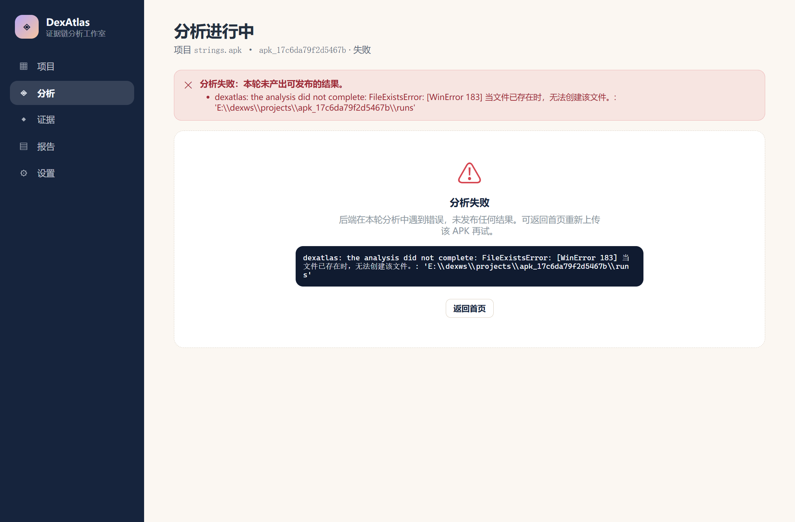
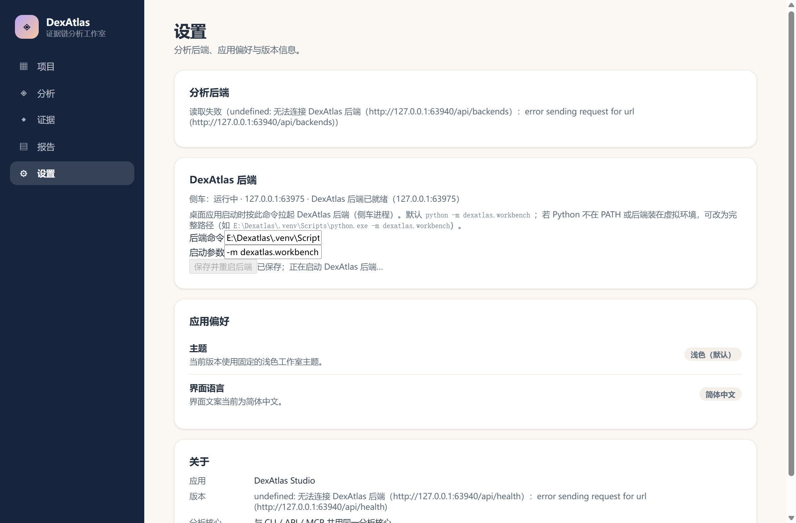
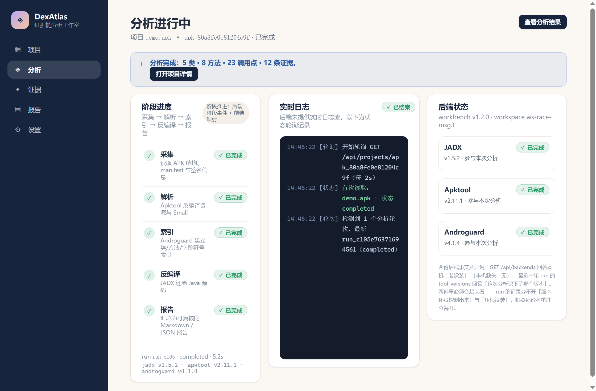

# Phase 5 崩溃与竞态路径 — 打包 exe 实测

**日期：** 2026-11-27 · **性质：** Phase 5 走查报告 §7 第 6、7 条开放项的补测 · **基线：** `2e75d5e`（本 worktree `claude/optimistic-bhabha-9a5551` 的 HEAD）
**验收对象：** [Phase 5 失败与取消时间线走查](phase5-failure-timeline.md) §7「本次走查**没有**覆盖的」里的第 6 条（管线自身抛异常）与第 7 条（并发与竞态）
**上游素材：** [Phase 5 验收报告](phase5-acceptance.md) · 走查报告 §8 的逐字文案（本文不与之矛盾）

> **本文的边界，先说清楚。**
> 这次走查在**打包后的 Tauri exe** 里完成：`desktop/src-tauri/target/release/dexatlas-desktop.exe`
> （14,822,400 字节），由应用自己拉起侧车（workbench 后端），界面经 WebView2 的
> 远程调试端口驱动。**不是**浏览器 + vite 开发服务器。
>
> 本文只写**我看到了什么**。凡是推断的、没验到的，都写在 §7，不用「应该」「预计」混过去。
> 没验到的就是没验到。

---

## 0. 一页结论

| 问题 | 答案 |
|---|---|
| 第 6 条：管线自己崩了，界面看到什么？ | **看到了。** 项目行终态 `failed`；界面显示「分析失败：本轮未产出可发布的结果。」+ `ErrorState`；错误原文是 `dexatlas: the analysis did not complete: FileExistsError: [WinError 183] 当文件已存在时，无法创建该文件。: '<工作区路径>'`。**HTTP 层面没有任何错误**：`POST /api/analyze` 答 202，失败只从 `GET /api/projects/{id}` 的 200 里读出来。§3 |
| 第 6 条：故障怎么注入的？ | 在 `<工作区>/projects/<项目号>/runs` 放一个**普通文件**，让 Apktool 建自己的输出目录时抛 `FileExistsError`。**没有改任何代码、没有加测试钩子**，故障是文件系统的事实。§3.1 |
| 第 6 条顺手查到的缺陷 | **`redact_workspace` 在 Windows 上对 `OSError` 无效**：`OSError.__str__` 用 `repr()` 渲染路径（反斜杠全部加倍），脱敏函数替换的是**没有加倍**的那一份，于是工作区的绝对路径**原样出现在界面和数据库里**。§3.4 |
| 第 7 条：并发取消 | **8 个并发取消全部答 202**；12 个串行取消也全部答 202；分析结束后再取消答 **409**。**取消是幂等的**：第一个取消就被接受，其余的也是 202，但它们都说的是「请求已受理」，不是「已停止」。§5.1 |
| 第 7 条：取消与进程退出同时发生 | **两个方向都验了。** 取消先到 → 分析被记为 `cancelled`；进程先死 → 取消**送不出去**（连接被拒），工作区留下 `running` 的行，**由应用自己的启动对账修好**。§5.2 |
| 第 7 条：同一 APK 并发上传 | **「不会重复分析」这句话在并发下不成立。** 4 个同时上传 → **4 次分析都被调度了**（3 轮 × 4 个上传全部如此），5 个同时上传 → 5 次分析。**页面上那句提示也到不了用户眼前**（§5.4）。§5.3 |
| 第 7 条：`RUNNING` 表留下孤儿行 | **留下了一行，但不是数据库里的。** 两次并发分析共享同一个键（项目号），先结束的那次 `finish()` 把**后一次**的登记也一起摘掉了，于是后一次还在跑的时候取消端点开始答 409 —— **一个正在跑的分析变得不可取消**。§5.5 |

**一句话总结：** 崩溃与取消这两条路，界面表现都是诚实的；真正的缺陷在两处：
**脱敏在 Windows 上对 `OSError` 失效**（服务端路径漏进界面），以及
**「同一 APK 重复上传不会重复分析」这句话在并发下是假的**（多次分析被调度，
且已开始的分析会被后来的登记摘掉，变成不可取消）。

---

## 1. 走查环境

| 项 | 实际值 |
|---|---|
| 机器 | Windows 11 Pro 10.0.26300 |
| 仓库 | worktree `E:\Dexatlas\.claude\worktrees\optimistic-bhabha-9a5551`，HEAD `2e75d5e` |
| 被测程序 | `desktop/src-tauri/target/release/dexatlas-desktop.exe`（14,822,400 字节） |
| 侧车 | 应用自己拉起的 `python -m dexatlas.workbench`，`--port 0`，端口由操作系统分配，从 exe 的日志里读（`Uvicorn running on http://127.0.0.1:<port>`） |
| 分析后端 | `DEXATLAS_JADX_PATH=E:\Dexatlas\.scratch\backends\jadx\bin\jadx.bat`、`DEXATLAS_APKTOOL_JAR=E:\Dexatlas\.scratch\backends\apktool.jar`。`GET /api/backends` 实测：`{"available":["jadx","apktool","androguard"],"missing":[],"versions":{"jadx":"1.5.2","apktool":"2.11.1","androguard":"4.1.4"}}` |
| 工作区 | 每个场景一个专用工作区，全部在 `.scratch/crash-race/` 下；另有一个 `E:\dexws` 专门用来把工作区路径变短（§3.4，测完没删：留了一个 `dexatlas.db` 在那儿） |
| 界面驱动 | WebView2 远程调试（`WEBVIEW2_ADDITIONAL_BROWSER_ARGUMENTS=--remote-debugging-port=9222`），CDP 的 `Runtime.evaluate` / `Page.captureScreenshot` |
| 压测客户端 | **普通 HTTP 客户端**（Python），直接打侧车端口 |

> **为什么压测不用页面里的 `fetch`。**
> workbench **不发 CORS 头**（`src/dexatlas/workbench/app.py` 里没有 `CORSMiddleware`），
> 打包形态的页面 origin 是 `tauri://localhost/`，页面自己的 `fetch` 会被浏览器拦掉
> （`MissingAllowOriginHeader`）——这正是前端改用 `@tauri-apps/plugin-http` 的原因
> （`desktop/src/api/client.ts:61`）。所以**并发压测从外面打后端**，UI 文案与截图
> 仍由 CDP 驱动。这是两个不同的通道，不是两套结论。

### 1.1 被测代码就是被审的代码

侧车跑的是**主检出**的源码（`E:\Dexatlas\.venv\Lib\site-packages\_editable_impl_dexatlas.pth`
里写死的是 `E:\Dexatlas\src`），不是本 worktree 的。本轮用 `diff -rq` 比过：

```
diff -rq --exclude=__pycache__ --exclude=node_modules --exclude=dist \
         --exclude=.scratch --exclude=.venv --exclude=target \
         E:\Dexatlas\src <worktree>\src      → 无输出（完全相同）
```

`desktop/src` 与 `desktop/src-tauri` 同理相同。所以侧车执行的正是本报告引用的那份代码。

---

## 2. 怎么打并发：两个已知的事实

**事实一：`RUNNING` 是进程内的字典，不是数据库表。**
`RunningAnalyses`（`src/dexatlas/api/uploads.py:135`）是一个带 `threading.Lock` 的
内存字典，键是**项目号**。项目号由 APK 的 sha256 决定（`apk_<前 16 位>`），
所以**同一个 APK 的两次分析共用一个键**。

**事实二：上传的「查—改」不是原子的。**
`POST /api/analyze`（`src/dexatlas/workbench/app.py:326-362` `anchor: @app.post("/api/analyze"`）先
`find_project_by_hash`（:350），再 `background.add_task`（:362）——两步之间没有锁。
（**§10 已改**：现在端点在返回 202 之前同步认领这份 APK，认领与检查在同一把锁里。）

**事实三：每个上传都存到同一个路径。**
`stage_upload`（`src/dexatlas/api/uploads.py:353`）把文件放在
`uploads/<sha256>/<客户端给的文件名>`，然后 `staged.replace(target)`（:356）。
同一个 APK 的两次上传，目标路径**完全一样**。

---

## 3. 第 6 条：管线自身抛异常

### 3.1 故障怎么注入的

管线把每一轮分析写进自己的目录（`src/dexatlas/core/pipeline.py:221` `anchor: workspace = self._settings.projects_dir`）：

```python
workspace = self._settings.projects_dir / project.id / "runs" / run.id
```

这个目录下的**第一样东西**是 Apktool 自己的输出目录——
`output_dir.mkdir(parents=True, exist_ok=True)`
（`src/dexatlas/tools/apktool/adapter.py:160`，`output_dir = workspace / "apktool"`）。

于是在 `<工作区>/projects/<项目号>/runs` 放一个**普通文件**（不是目录），
这个 `mkdir` 就会抛，抛在管线 `try:` 块**之内**，于是走到
`except Exception`（`src/dexatlas/core/pipeline.py:436`）——正是走查报告说
「没有触发过」的那条分支。

**没有改任何产品代码，没有加测试钩子。** 故障是文件系统的一个事实，
从外面放进去的。异常的类型与文案是**从跑出来的结果里读出来的**，不是推断的
（先用一个同形状的探针确认了会抛，再由真实运行确认了实际是什么）。

### 3.2 界面看到什么（逐字）

项目详情 / 分析页（`desktop/src/pages/Analysis.tsx:612` 的失败横幅 + `:622` 的 `ErrorState`）：

```
分析失败：本轮未产出可发布的结果。
dexatlas: the analysis did not complete: FileExistsError: [WinError 183] 当文件已存在时，无法创建该文件。: 'E:\dexws\projects\apk_17c6da79f2d5467b\runs'
```

```
分析失败
后端在本轮分析中遇到错误，未发布任何结果。可返回首页重新上传该 APK 再试。
dexatlas: the analysis did not complete: FileExistsError: [WinError 183] 当文件已存在时，无法创建该文件。: 'E:\dexws\projects\apk_17c6da79f2d5467b\runs'
返回首页
```



页面上其它两处措辞与走查报告 §8 一致：**分析失败**这个 `ErrorState` 的标题、
描述、按钮，与取消时看到的那一套**完全相同**；**能分辨的只有详情那一句**。

### 3.3 项目行与轮次的终态

| | 值 |
|---|---|
| `projects.status` | `failed` |
| `projects.published_run_id` | `null`（这一轮什么也没发布） |
| `projects.errors` | `[{"tool": "dexatlas", "code": "analysis_failed", "message": "the analysis did not complete: FileExistsError: [WinError 183] 当文件已存在时，无法创建该文件。: 'E:\\dexws\\projects\\apk_17c6da79f2d5467b\\runs'", "detail": null}]` |
| `analysis_runs.status` | `failed` |
| `analysis_runs.finished_at` | 有值（`demo.apk` 那一轮：`2026-11-27T06:25:29.135242+00:00`；`strings.apk` 那一轮：`2026-11-27T06:30:50.746358+00:00`） |
| `analysis_runs.errors` | `[]`（**轮次行自己的 errors 是空的**；失败原因只在项目行上） |
| `analysis_runs.tool_versions` | `{"jadx": "1.5.2", "apktool": "2.11.1", "androguard": "4.1.4"}`（版本探测在崩溃点之前就完成了） |

**HTTP 层面没有任何错误状态码。** 实测（`demo.apk` 那一轮，项目号 `apk_80a8fe0e81204c9f`）：

| 请求 | 状态码 | 响应 |
|---|---|---|
| `POST /api/analyze` | **202** | `{"project_id": "apk_80a8fe0e81204c9f", "status": "pending", "apk_sha256": "80a8…", "already_analysed": false}` |
| `GET /api/projects/{id}` | **200** | `{"project": {…,"status": "failed"}, "completeness": {"complete": false, "errors": ["dexatlas: the analysis did not complete: FileExistsError: …"]}}` |
| `GET /api/projects/{id}/runs` | **200** | `{"total": 1, "published_run_id": null, "runs": [{"id": "run_c691957a14d540ef", "status": "failed", …}]}` |

原因在代码里：后台任务 `run_background_analysis`（`src/dexatlas/api/uploads.py:407`）
把 `AnalysisFailed` **吞掉**了——

```python
except Exception:
    logger.exception("background analysis of %s failed", apk_path)
    return
```

管线在抛之前已经把这个失败记在项目上了（`src/dexatlas/core/pipeline.py:478`
→ `_record_failure`），所以界面拿得到失败，但 HTTP 从来不知道有过失败。

**exe 的日志里能看到后端自己也知道**：

```
[backend-stderr] background analysis of E:\...\uploads\80a8fe0e…\demo.apk failed
[backend-stderr] Traceback (most recent call last):
[backend-stderr]   File "C:\Users\pc\AppData\Local\Programs\Python\Python312\Lib\pathlib.py", line 1311, in mkdir
[backend-stderr]     os.mkdir(self, mode)
```

> **日志被截断了。** 上面这段 traceback 只有两行框架就断了，紧跟着的是
> `[backend-stderr] 读取失败：stream did not contain valid UTF-8`。
> 侧车的 stderr 读取线程（`desktop/src-tauri/src/sidecar.rs:878`）用 `BufReader`
> 按行读，而 `read_line` 要求**整行是合法 UTF-8**；traceback 里那条中文的
> `[WinError 183] 当文件已存在时…` 在这台机器上是 GBK 编码的，一读到非 UTF-8
> 就抛，线程 `break` 掉，**后面的日志一行都不再转发**。
> 实测：崩溃那一轮的 exe 日志里，stderr 转发在第 12 行断了，之后全是
> `[backend-stdout]` 的访问日志；stderr 转发在第 12 行断掉（断点前 8 行 stderr、
> 断点后 10 行 stdout、stderr 0 行），崩溃之后再无一行 stderr。
> **后果**：侧车自己的 traceback 在界面上永远看不到，运营者拿不到根因。

### 3.4 顺手查到的缺陷：脱敏在 Windows 上对 `OSError` 无效

`_record_failure`（`src/dexatlas/core/pipeline.py:478`）在把失败写下去之前要脱敏：

```python
message = f"the analysis did not complete: {type(exc).__name__}"
if str(exc):
    message = f"{message}: {exc}"
roots = [self._settings.workspace]
if run.workspace is not None:
    roots.append(run.workspace)
redacted = redact_workspace(message, *roots)
```

`redact_workspace`（`src/dexatlas/core/paths.py:121`）是**普通字符串替换**：

```python
for root in roots:
    for candidate in (str(root), str(root.resolve())):
        message = message.replace(candidate, "<workspace>")
```

而 `OSError.__str__` 是用 **`repr()`** 渲染文件名的（CPython 的 `Objects/exceptions.c`
用 `%R`），于是 Windows 上的路径**每个反斜杠都被加倍**：

| | 值 |
|---|---|
| 脱敏函数要找的 | `E:\dexws` |
| 消息里真正有的 | `E:\\dexws` |
| 两者相等吗 | **否** |

实测（探针 `probe_redaction4.py`，把跑出来的真实消息原样喂回脱敏函数）：

```
EXC TYPE              : FileExistsError
plain root in raw msg : False
doubled root prefix   : True
redaction changed msg : False
doubled root survives : True
```

**结论：工作区的绝对路径原样出现在项目行的 `errors` 里、经 API 读出来、
显示在界面上。** 这与 `paths.py` 里那段注释许下的诺言相反：

> The message is redacted here, where it is written. … The workspace root is
> the part that names the machine; what is left of the path is a place inside
> the analysis, and that is worth keeping.

顺带查到的第二件事：**这条脱敏对 `ValueError` 之类不走 `OSError` 的异常是有效的**——
同一段探针里，消息里带**没有加倍**的路径时，脱敏照常把它换成 `<workspace>`。
所以缺陷的边界是「**异常自己的文案里带路径**」，不是「消息里带路径」。

**为什么这不是小事：** 走查报告与桌面应用的其它文案都把「不把服务器路径漏给用户」
当作契约（`/api/health` 只回工作区的**名字**，`display_path` 只回文件名）。
管线崩溃这一条路上，服务端的绝对路径**第一次**原样漏到了界面上。

### 3.5 第 6 条的小结

- **崩溃形态是通的、界面是诚实的**：项目行 `failed`、界面「分析失败」、错误原文一字不差。
- **HTTP 层面没有失败**：202 + 200，界面靠轮询项目状态才知道。这与取消、孤儿对账
  是同一套语义，不是新问题。
- **新发现的两个缺陷**：脱敏对 `OSError` 无效（§3.4）；侧车的 stderr 转发线程
  在遇到非 UTF-8 的一行时**整个停掉**，后端的 traceback 到不了运营者手里（§3.3）。

---

## 4. 并发压测的规模

| 场景 | 规模 | 轮次 |
|---|---|---|
| 并发取消 | 8 个取消同时发出；另有 12 个串行取消 | 各 1 轮 |
| 取消 × 进程退出 | 取消与杀进程同时（1 轮）；先杀后取消（1 轮）；杀整个 exe（1 轮） | 3 轮 |
| 同一 APK 并发上传 | 6 个同时（1 轮）、4 个同时 ×3 轮、4 个串行（1 轮）、6 个串行（1 轮） | 6 轮 |
| `RUNNING` 表的边界 | 2 次并发分析 + 连续取消（慢后端） | 3 轮 |

「慢后端」是一个 JADX 包装脚本（先 `ping` 若干秒再调真正的 `jadx.bat`），
用来把「几 KB 的示例 APK 秒完」变成「分析真的活着十几秒」。
**这是替身，不是真的大 APK**——§7 里写明了它证明不了什么。

---

## 5. 第 7 条：并发与竞态

### 5.1 并发取消

**8 个取消同时发出**（分析刚起、还在跑）：

| 状态码 | 个数 | 响应 |
|---|---|---|
| **202** | **8** | `{"project_id": "apk_d342e11b7931077d", "status": "cancelling"}` |

**12 个取消串行发出**（慢后端，分析还活着，间隔 0.8 s）：**12 个全是 202**。

**分析结束之后再取消**：

```
409 {"detail": "no analysis is running for 'apk_80a8fe0e81204c9f'"}
```

**终态**：项目 `failed`，轮次 `cancelled`，错误原文
`dexatlas: the analysis was cancelled before it completed`。

**读法：** 202 的意思是「请求已受理」，不是「已停止」。第 2 个到第 12 个取消
拿到的 202 **不构成任何新信息**——`RunningAnalyses.cancel`
（`src/dexatlas/api/uploads.py:195`）拿到 token 就 `token.cancel()`，
而 `CancellationToken` 是 `threading.Event`，**幂等**。
取消端点（`src/dexatlas/workbench/app.py:618`）不检查「这一轮是不是已经停过了」。
所以**界面上的「已向后端发送取消请求（202），等待状态确认」（走查报告 §8 的逐字文案）
是对的**：它说的是「请求已受理」，不是「已停止」。

**没有验到的：** 取消落在**哪个阶段**会不会改变停的位置——走查报告第 4 条已经单验过，
本文不重复。

### 5.2 取消与进程退出同时发生

**方向 A：取消先到，杀进程后到**（杀的是**侧车进程**，不是整个 exe）：

| | 结果 |
|---|---|
| 取消 | **202** `{"status": "cancelling"}` |
| 杀侧车后 `GET /api/health` | 连接被拒（`WinError 10061`） |
| 杀侧车后工作区数据库 | 项目 `failed`，轮次 `cancelled`，错误 `dexatlas: the analysis was cancelled before it completed` |

**方向 B：进程先死，取消后到**：

| | 结果 |
|---|---|
| 杀侧车后工作区数据库 | 项目 **`running`**、轮次 **`running`**、`finished_at` 为 `null` —— **孤儿行** |
| 这时的取消 | **送不出去**：连接被拒（`WinError 10061`），没有任何 HTTP 状态码 |
| 界面上 | 首页「最近项目」里那一行仍显示 **「◌ 进行中」**（侧车已死，界面读不到新状态） |

**方向 B 的收尾**：在设置页点「保存并重启后端」把侧车拉起来，新进程启动时的
对账（`_reconcile_orphaned_runs`，`src/dexatlas/workbench/app.py:87`）把两行
都改成 `failed`，错误原文是：

```
workbench: the server process running this analysis ended before the analysis finished; the run was never completed or cancelled
```

**读法：** 孤儿行**确实会留下**，但应用自己有对账把它修好，而且修得对。
**没验到的是**：如果用户**不重启**侧车，那一行会一直说「进行中」——这与走查报告
§4 记的「后端不写失败状态」是同一族问题，但成因不同（那一族是分析跑完了没写状态，
这一族是进程死了没人写）。

**顺带查到的一处界面不一致**（不是缺陷，是「已经如此」）：侧车被杀掉、应用还活着时，
设置页的**侧车状态**说「运行中 · 127.0.0.1:63975 · DexAtlas 后端已就绪」，
而同一个页面的「分析后端」与「版本」两栏却在报错：

```
读取失败（undefined: 无法连接 DexAtlas 后端（http://127.0.0.1:63940/api/backends）：error sending request for url (http://127.0.0.1:63940/api/backends)））
```



截图里那一行读的是**旧端口 63940**（被杀的那个），而侧车状态读的是**新端口 63975**。
前端有订阅侧车端口变化的机制（`desktop/src/api/client.ts:206`），
但**设置页这一次的读取发生在端口变化被应用之前**，于是两个数字同时出现在屏幕上。

### 5.3 同一 APK 并发上传：「不会重复分析」这句话不成立

首页写着（`desktop/src/pages/HomePage.tsx:149`）：

> 或 · 单个文件不超过 {MAX_UPLOAD_MB} MB；同一 APK 重复上传会打开已有项目，不会重复分析

**6 个同时上传**（第一个答 `already_analysed: true`，其余 5 个答 `false`）：

| # | 状态码 | `already_analysed` | `status` |
|---|---|---|---|
| 0 | 202 | **true** | `running` |
| 1 | 202 | **false** | `pending` |
| 2 | 202 | **false** | `pending` |
| 3 | 202 | **false** | `pending` |
| 4 | 202 | **false** | `pending` |
| 5 | 202 | **false** | `pending` |

**结果：`analysis_runs` 里有 5 行**（5 次分析真的跑起来了），项目行的
`published_run_id` 指向其中一行。

**4 个同时上传 × 3 轮**（慢后端，让它们真的重叠）：

| 轮次 | 上传应答 | 跑起来的轮次数 | 最后发布的轮次 |
|---|---|---|---|
| 0 | 4 个 **202**、全部 `already_analysed: false` | **4** | `run_6a962bc17e9f46ba` |
| 1 | 4 个 **202**、全部 `already_analysed: false` | **4** | `run_c3a8578232d94e10` |
| 2 | 4 个 **202**、全部 `already_analysed: false` | **4** | `run_411bcf3c95684d5a` |

三轮都是 **4 次分析同时跑**（`started_at` 相差不到 5 毫秒），项目最后落到
**其中一轮**的快照上——**哪一轮取决于谁最后发布**，不是哪一轮先开始。

**所以「同一 APK 重复上传会打开已有项目，不会重复分析」这句话，在并发下是假的。**
根因是 §2 的事实二：`find_project_by_hash` 与 `add_task` 之间没有锁，
而项目行要等**第一个后台任务**跑到 `begin_run` 才变成 `running`——
在它变成 `running` 之前，`existing.status` 是 `pending`（或者压根还没有行），
于是每个并发上传都认为「还没分析过」，各自调度了一个。

**串行上传就不重复**（4 次串行、间隔 1.2 s）：第 1 个答 `already_analysed: false`，
后面 3 个全答 `true`，只跑了 **1** 次分析。这条路径是对的。

**还有一件更糟的**：并发时**发布出去的那一份快照可能缺东西**。
6 个同时上传那一轮里，5 轮里有 4 轮的 `tool_versions` 记成了
`{"jadx": null, "apktool": null, "androguard": "4.1.4"}`——
**JADX 和 Apktool 的版本是 `null`**。而**被发布的那一轮**恰好就是
`{"jadx": null, "apktool": "2.11.1", "androguard": "4.1.4"}`——JADX 也是 `null`。

原因在代码里：`Analyzer` 只有**一套**后端适配器（`src/dexatlas/core/pipeline.py:116-133`
`anchor: self._backends = BackendRegistry(`），
所有分析共用；而 `JadxBackend.version()`（`src/dexatlas/tools/jadx/adapter.py:221`）
是这样写的：

```python
if self._version_probed:
    return self._version
self._version_probed = True
...probe...
```

`_version_probed` 在探测**之前**就被置位，所以并发进来的第二个线程读到的是
**还没填上的** `self._version`，也就是 `None`，而这个 `None` 被写进了那一轮的
`tool_versions`。探针实测（6 个线程同时调一个适配器）：

```
thread 0: None
thread 1: None
thread 2: None
thread 3: None
thread 4: None
thread 5: '1.5.2'
```

**后果**：被发布的那一轮的 `tool_versions.jadx` 是 `null`，于是项目详情页的
`missing_backends` 变成 `["jadx"]`，`completeness.complete` 是 `false`——
**界面如实说「JADX 没装」，可 JADX 明明装了、也明明参与了这一轮**
（那一轮的 `jadx/sources` 目录里确实有 4 个 `.java`）。

> **这一条与走查报告 §7 第 5 条是同一族。** 那一条记的是「后端没装时，
> `tool_versions` 的值也是 `null`，前端分不清『没装』和『版本还在探测』」。
> 这里是第三种含义：**版本探测到了，但被并发读成了 `null`**。
> 走查报告里主会话已修的 PR #33（前端改拿机器那份名单一起判）**修不掉这一种**——
> 机器名单说 JADX 装着，但这一轮确实**没有**记下它的版本，
> 于是「参与本次分析 · 版本未知」和「未参与」还是分不开。

### 5.4 页面上那句「不会重复分析」到不了用户眼前

首页对重复上传的回答是（`desktop/src/pages/HomePage.tsx:94`）：

```tsx
setError(`该 APK 已分析过（sha256 前 12 位 ${accepted.apk_sha256.slice(0, 12)}），正在打开已有项目，不会重复分析。`);
void navigate(`/analysis/${accepted.project_id}`);
```

`setError` 之后**紧接着** `navigate`，首页随即被卸载。

实测：**消息确实被渲染过，但只存在于一次 DOM 变更里，5 ms 的采样一次都没抓到。**
用 `MutationObserver` 盯着首页自己的根节点（不是 `document.body`）：

```json
[
  {"at": 1795761982462, "text": null, "still_connected": true},
  {"at": 1795761982484,
   "text": "该 APK 已分析过（sha256 前 12 位 80a8fe0e8120），正在打开已有项目，不会重复分析。",
   "still_connected": true}
]
```

同一次运行里，页面的 `innerText` 以 5 ms 的间隔采了 **802 次**，
含「不会重复分析」这 6 个字的：**0 次**。

**读法：** 消息**渲染了**，但页面在用户能看见它之前就跳走了。
用户实际看到的是分析页上**旧项目的结果**——他以为刚才那次上传重新分析了一遍，
其实是打开的旧项目（这正是那句提示想说的），**但他没被告知**。



### 5.5 `RUNNING` 表的边界：一次分析会变得不可取消

`RunningAnalyses` 的键是**项目号**（`src/dexatlas/api/uploads.py:135`），
而同一个 APK 的两次分析**共用一个项目号**。于是：

- `start()`（:149）是**覆盖**：`self._analyses[project_id] = RunningAnalysis(...)`，
  第二次分析把第一次的登记顶掉；
- `finish()`（:156）是**摘除**：`self._analyses.pop(project_id, None)`，
  **先结束的那次分析，把还在跑的那次的登记一起摘了**。

实测（2 次并发分析 + 每 0.5 秒一次取消，慢后端；共 47 次取消）：

| 时刻 | 取消的应答 | 当时轮次的状态 |
|---|---|---|
| 第 1–40 次取消（21 秒） | **202** | 两轮都 `running`（其中 39 次采样时两轮都还在跑） |
| 第 41–47 次取消 | **409** `no analysis is running for 'apk_d342e11b7931077d'` | **一轮 `cancelled`、另一轮 `running`** |

**这就是那个窗口：一次分析还在跑（`running`），取消端点却开始答 409
「没有分析在跑」。** 端点问的是**进程内的登记表**，
而登记表已经被另一轮分析的收尾摘掉了。

**后果**：那一轮还在跑的分析**取消不了**。它会一直跑到自然结束。
它的结果**照样会被发布**（实测：`published_run_id` 指向跑完的那一轮），
但跑它的人**中途叫不停它**。

**没有留下数据库里的孤儿行**：两轮结束后，项目 `completed`，
两行 `analysis_runs` 一行 `completed`（被发布）、一行 `cancelled`，都不是 `running`。
**孤儿在内存里，不在数据库里**——所以**下次重启看不出来**，
而这一次分析**期间**它是不可取消的。

**另一面**（同一机制的另一头）：两次并发分析时，取消**只能停住其中一轮**。
实测那一轮里前 40 次取消全是 202，随后轮次 A `cancelled`、轮次 B `completed`——
**被停住的是先登记的那一轮，另一轮跑完了**。

### 5.6 第 7 条的小结

| 问 | 答案 |
|---|---|
| 并发取消 | 全部 202；取消是幂等的；结束后 409。**202 = 请求已受理**，界面文案与之一致。 |
| 取消 × 进程退出 | 两个方向都验了。取消先到 → 记 `cancelled`；进程先死 → 取消送不出去，工作区留 `running`，**由应用自己的启动对账修好**。 |
| 同一 APK 并发上传 | **「不会重复分析」在并发下不成立**：3 轮 × 4 个同时上传 → 每轮 4 次分析都跑起来了。串行上传才是对的。 |
| 重复上传的提示 | **渲染了，但用户看不见**（页面在消息出现后立刻跳走）。 |
| 并发带来的第二处后果 | 共享适配器上的版本探测被并发读成 `null`，**被发布的那一轮因此说「JADX 没装」**。 |
| `RUNNING` 孤儿 | **内存里有、数据库里没有**：先结束的那轮把后一轮的登记摘掉，后一轮**变得不可取消**。 |
| 数据库孤儿行 | 场景 B 里留下过 `running`，但被应用自己的启动对账修好。 |

---

## 6. 建议的回归测试（**本轮不加**，留给主会话）

按项目规矩，这些测试要能在**去掉修复之后变红**。本轮**没有改任何产品代码**，
所以下面每一条都还是「红的」。

### 6.1 后端

1. **脱敏对 `OSError` 生效**（对应 §3.4）。
   在 `tests/` 里造一条 `OSError`，其消息里带一个 Windows 风格的路径
   （反斜杠加倍的形式），断言 `redact_workspace` 之后**工作区的名字不再出现**。
   今天会红：函数只替换没有加倍的那一份。
   修法建议：`redact_workspace` 除了替换 `str(root)`，还要替换 `repr(root)` 的
   去掉引号的那一份（即 `str(root).replace("\\", "\\\\")`）。

2. **并发分析不会把版本记成 `null`**（对应 §5.3）。
   一个测试起 N 个线程同时调**同一个**适配器的 `version()`，断言**每一个**返回值
   都是版本号而不是 `None`。今天会红：`_version_probed` 在探测之前置位。

3. **同一 APK 的并发上传只调度一次分析**（对应 §5.3）。
   用 `TestClient`（或 httpx 的 ASGI 传输）同时发 N 个 `POST /api/analyze`，
   断言**后台任务被调用了恰好一次**。今天会红：`find_project_by_hash` 与
   `add_task` 之间没有锁。

4. **分析进行中时取消永远答 202**（对应 §5.5）。
   两个并发分析 + 一次取消，断言在**还有一轮 `running`** 的整个窗口里，
   取消端点都不答 409。今天会红：`finish()` 摘掉了别的分析的登记。
   修法建议：`RunningAnalyses` 的键改成 `(project_id, run_id)`，
   取消时对该项目号下的**每一轮**发取消。

5. **崩溃的失败原因落在轮次行上**（对应 §3.3）。
   断言 `analysis_runs.errors` 也带着失败原因。今天会红：轮次行的 `errors` 是空的。

### 6.2 前端（`desktop/`）

6. **重复上传的提示看得见**（对应 §5.4）。
   一个 vitest 用例：让 `analyzeUpload` 返回 `already_analysed: true`，
   断言**提示文本出现在渲染结果里**。今天会红：`setError` 之后紧跟着 `navigate`。

7. **首页那句「不会重复分析」与后端的实际行为一致**（对应 §5.3）。
   这条更像是**文案降级**的建议而不是测试：并发下它不成立，
   要么改成「重复上传会复用已有项目」，要么后端把并发的那一次也复用掉。

8. **轮次 `tool_versions` 里 `null` 的三种含义分得开**（对应 §5.3 与走查报告 §7 第 5 条）。
   前端今天靠 `null` 猜「版本还在探测」；PR #33 之后靠机器名单补，
   但**并发读成 `null`** 这一种还是分不开。
   建议后端在 run 行上补一个**明确的字段**（例如 `tool_versions_state`），
   或者把探测与「没装」分开记。

---

## 7. 本轮**没有**验到的

写清楚，是为了不让这份报告被当成比它更宽的承诺。

1. **没有验**：取消落在不同阶段会停在哪里。走查报告第 4 条已经单验过，本文不重复。
2. **没有验**：真实大 APK 下的并发。示例 APK 只有 1.4–3.0 KB，分析 5 秒就完；
   本文的「慢后端」是一个 **JADX 包装脚本**（先 `ping` 再调真正的 `jadx.bat`），
   它只能把**时间**拉长，**证明不了**真实大 APK 的表现（例如内存、文件句柄、
   反编译器的真实耗时）。
3. **没有验**：两个**不同的** exe 同时跑（应用没有 `single-instance` 插件），
   指向**同一个工作区**时会发生什么。本轮每次只有一个 exe 在跑。
4. **没有验**：多线程下 `Store` 的事务隔离。本轮所有 SQLite 访问都是同一个进程里的
   后台线程，**没有**多进程写同一个数据库的场景。
5. **没有验**：网络中断、超时、代理、`Content-Length` 与实际长度不符等上传层的失败。
6. **没有验**：Linux / macOS 上的同一组场景。**本轮全部在 Windows 11 上**——
   而 §3.4 那条脱敏缺陷恰恰是 **Windows 特有**的（`repr()` 加倍反斜杠）；
   POSIX 上 `repr()` 的路径与 `str()` 相同，脱敏**是**有效的。
   **这条缺陷在 CI 的 Linux 上不会复现。**
7. **没有验**：界面在「侧车被杀」之后**不重启**侧车会怎样。实测里侧车被杀了、
   界面还开着，首页那一行仍显示「◌ 进行中」；**没有量**它会这样多久、
   界面会不会自己恢复。
8. **没有验**：§5.3 里「哪一轮最后发布」是否**可预测**。实测三轮各自由不同的一轮胜出，
   **没有**找到规律，也没有找到能稳定控制它的办法。
9. **没有验**：MCP / REST API（`src/dexatlas/api/app.py`）那两条传输的并发行为。
   本轮只打了 workbench 的端点。

---

## 8. 门禁

| 门禁 | 结果 |
|---|---|
| `uv run --no-sync python scripts/remap-citations.py` | `phase5-crash-and-race-paths.md: 0 citation(s) moved`（跑第二遍也是 0） |
| `uv run --no-sync python scripts/check-doc-citations.py` | **绿**：`unresolved paths: 0`、`drifted: 0`、`values not matching: 0` |
| `pytest -q tests/test_docs.py` | **71 passed, 1 failed** |

**那一条失败是本 worktree 里既有的，与本轮无关**：
`test_execution_report_coverage_figures_describe_the_current_code` 报的是
「覆盖率数字是在另一棵树上测的」。本 worktree 的 HEAD 是 `2e75d5e`，
而主检出在 `63ec129`（多了一次重测量 `f89707d`），所以两边记录的指纹不同：

| | 记录的指纹 | 树的指纹 |
|---|---|---|
| 本 worktree | `sha256:b2f4244a…` | `sha256:b2f4244a…`（一致） |
| 主检出 | `sha256:af2cd093…` | `sha256:af2cd093…`（一致） |

**证明它与本轮无关**：把本轮新增的文件全部 `git stash` 之后**在干净的 worktree 上**
再跑那条测试，**照样红**。而且本轮只动了 `docs/` 下的东西，
而指纹只覆盖 `src/`、`tests/`、`pyproject.toml` 与 `scripts/refresh-report-figures.py`
——`docs/` 本来就不在指纹里（见 `CLAUDE.md`）。

**本轮没有改任何产品代码、没有加测试、没有 commit、没有 push、没有切分支。**
工作区里只有本报告与 4 张新截图（`docs/assets/phase5/crash-*.png`）。

---

## 9. 附录：本文引用的源码位置

> **行号是对着当前工作区重新推导的**（`scripts/remap-citations.py` 的活儿）。
> §0–§9 讲的是**走查那一轮**当时的行为；§10 记的是**分析核心那一轮**把其中
> 三条改掉的过程——表里带「§10 已改」字样的几行，说的就是改动前后的对照。

| 位置 | 内容 |
|---|---|
| `src/dexatlas/core/pipeline.py:221` | 每一轮分析自己的目录 |
| `src/dexatlas/core/pipeline.py:132` | `Analyzer` 只有一套后端适配器（并发共用） |
| `src/dexatlas/core/pipeline.py:465` | `except Exception` —— 走查报告说没触发过的那条分支 |
| `src/dexatlas/core/pipeline.py:469` | `raise AnalysisFailed(self._record_failure(...))` |
| `src/dexatlas/core/pipeline.py:478` | `_record_failure`：记失败并脱敏 |
| `src/dexatlas/core/paths.py:121` | `redact_workspace`：普通字符串替换 |
| `src/dexatlas/tools/apktool/adapter.py:160` | Apktool 建自己的输出目录（故障落点） |
| `src/dexatlas/tools/jadx/adapter.py:221` | `version()` 的并发不安全 |
| `src/dexatlas/api/uploads.py:135` | `RunningAnalyses`：进程内、带锁的字典 |
| `src/dexatlas/api/uploads.py:156` | `claim()`：认领与检查在同一把锁里（§10 之前这里是 `start()`，它覆盖同一个键） |
| `src/dexatlas/api/uploads.py:185` | `finish(token)`：只注销它自己（§10 之前是 `finish(project_id)`，摘的是同一个键） |
| `src/dexatlas/api/uploads.py:195` | `cancel()`：把这个项目号下的每一轮都取消 |
| `src/dexatlas/api/uploads.py:390` | 每个上传都存到 `uploads/<sha256>/<名字>` |
| `src/dexatlas/api/uploads.py:407` | `run_background_analysis`：吞掉 `AnalysisFailed` |
| `src/dexatlas/workbench/app.py:87` | `_reconcile_orphaned_runs`：启动对账 |
| `src/dexatlas/workbench/app.py:326` | `POST /api/analyze` |
| `src/dexatlas/workbench/app.py:350` | `find_project_by_hash`（查—改不原子；§10 已改成先认领） |
| `src/dexatlas/workbench/app.py:362` | `background.add_task`：调度后台分析 |
| `src/dexatlas/workbench/app.py:635` | `POST /api/projects/{id}/cancel` |
| `desktop/src/pages/HomePage.tsx:94` | 重复上传的提示（渲染了，看不见） |
| `desktop/src/pages/HomePage.tsx:149` | 首页那句「不会重复分析」 |
| `desktop/src/pages/Analysis.tsx:612` | 失败横幅 |
| `desktop/src/pages/Analysis.tsx:622` | `ErrorState` |
| `desktop/src/api/client.ts:61` | 打包形态为什么用 `plugin-http`（没有 CORS 头） |
| `desktop/src/api/client.ts:206` | 侧车端口变化时重解析 baseUrl |
| `desktop/src-tauri/src/sidecar.rs:878` | 侧车 stderr 的转发线程（遇非 UTF-8 就停） |

---

## 10. 修复：并发那三条（2026-11-27，分析核心那一轮）

**这一节是后来补写的。** §0–§9 是走查那一轮的实测证据，那一轮**没有改任何
产品代码、没有加测试、没有 commit**（§8 末尾原话）。下面记的是**分析核心**
那一轮把 §5.3、§5.5 与 §6.1 第 2 条修掉的过程。

### 10.1 三条缺陷，三处根因，三处改法

| 缺陷（本文出处） | 根因 | 改法 |
|---|---|---|
| §5.3 同一 APK 并发上传会重复分析 | 去重检查与后台启动之间**没有原子性**：`find_project_by_hash` 先跑，项目行要到后台任务里才写，四个请求都在任何一行项目记录存在之前通过了检查 | `RunningAnalyses.claim()`（`src/dexatlas/api/uploads.py:156`）：检查与登记**在同一把锁里**，在 workbench 端点**返回 202 之前**同步占位；后来的上传看见占位，回 `already_analysed=true`，**不再起第二次分析** |
| §5.5 `RUNNING` 表按项目号建键 | 注册表用 `self._analyses[project_id]`，而 `Project.new_id(sha256)` 是内容寻址的 → 同一个 APK 的并发分析共用一个键，先结束的那次 `finish()` 把还在跑的那次摘掉 | 注册表按**一次分析**建键（键是它自己的取消令牌）：`finish(token)`（`src/dexatlas/api/uploads.py:185`）只注销它自己；`cancel(project_id)`（`src/dexatlas/api/uploads.py:195`）把该项目号下的**每一轮**都取消 |
| §6.1 第 2 条 `tool_versions.jadx` 被并发读成 `null` | `JadxBackend.version()`（`src/dexatlas/tools/jadx/adapter.py:221`）在探测**开始前**就置 `_version_probed`，并发读者拿到还是 `None` 的 `self._version` | `Analyzer.tool_versions()`（`src/dexatlas/core/pipeline.py:161`）：探测在一把锁里做**一次**、答案留着 everybody 读；管线的项目记录改从它取（`src/dexatlas/core/pipeline.py:252`） |

### 10.2 顺带修掉的一个 Windows 专属竞态

四个并发上传把各自的临时文件搬到**同一个**目标路径（`uploads/<sha256>/<名字>`）。
Windows 上 `os.replace` 撞上另一场搬运会抛 `WinError 5`（拒绝访问）——**修复前
实测到的第一个后果就是它**：四个上传里有的直接 500（§10.3 的红字证据）。`stage_upload`
现在把这种失败读作「同一份字节已经在那儿了」：目标在，就丢掉自己那份
（`src/dexatlas/api/uploads.py:394`）。

### 10.3 回归测试：真并发，去掉修复必红

`tests/test_concurrent_uploads.py`，三例，**全部用真线程**（没有改代码加测试钩子，
竞态是线程自己撞出来的）。

| 测试 | 断言 | 去掉修复后 |
|---|---|---|
| `test_four_concurrent_uploads_of_one_apk_start_one_analysis` | 4 个同时上传 → 恰好 **1** 次分析、另外 3 个 `already_analysed=true`、**1** 个轮次行 | 红：`only 0 of the four uploads answered while the analysis was running`——每个上传都在等自己那一次分析（旧的注册表让它们全都通过了检查） |
| `test_an_analysis_that_ends_does_not_unregister_the_one_that_is_still_running` | 一个分析结束后，另一个**仍可取消**（202）且令牌**真被取消** | 红：**409** `no analysis is running for 'apk_abababababababab'`——正是 §5.5 记的那句 |
| `test_a_backend_that_took_part_is_never_recorded_without_a_version` | 参与了的后端不会被记成没有版本 | 红：`None == 'jadx 1.5.2'`——正是 §6.1 第 2 条记的那个 `null` |

第二例用的是**两个哈希前 16 位相同**的 APK：项目号就是哈希的前 16 位，所以
「同一个项目号下的两次分析」就是这么来的（同一份字节，或者两份哈希前缀撞了的
不同字节）。注册表必须把两者分清。

### 10.4 动了 `core/pipeline.py`——按本轮的规矩说明

版本探测那一条的改法落在 `src/dexatlas/core/pipeline.py`（`Analyzer.tool_versions()`）
而不在适配器上。原因是**适配器那一层不在本轮的边界内**；Analyzer 一层已经把
窗口关上了：**分析核心读版本的路径只有这一条**，而 REST `/backends` 与 workbench
`/api/backends` 各自**新建**一套注册表（`src/dexatlas/api/app.py:123`、
`src/dexatlas/workbench/app.py:582`），与 Analyzer 那套**不共享适配器**，
因此不共享那个「探测前置位」的窗口。

**残留（低危，如实记录）**：适配器自己的 `_version_probed` 仍然是「探测前置位」。
今天没有别的读法能撞上它，但这是**同一个形状的隐患留在原地**；要彻底关掉，得改
`src/dexatlas/tools/jadx/adapter.py:221` 等三个适配器（**不在本轮边界内**）。
后端版本探测还多了一条读法：`Analyzer.tool_versions()` 的答案**在进程内缓存**，
与适配器自己缓存探测结果的时长一致。

### 10.5 边界：这一轮**没有**动的东西

- **REST 传输的响应形状没变**（`src/dexatlas/api/app.py` 没改）：它的 `AnalyzeJobResponse`
  里**没有** `already_analysed` 字段，所以它对「已经在分析」这件事**不说话**。
  但它的后台任务（`run_background_analysis`）现在会**认领**这份 APK：并发上传时
  第二次分析**不会跑**，客户端轮询项目时看到的是第一次分析的结果。
- **界面那句「该 APK 已分析过」在并发时其实是「该 APK 正在分析」**
  （`desktop/src/api/types.ts` 的 `already_analysed` 注释写的是前者）。
  端点的响应形状按规矩没改，前端那一句措辞属于界面侧，不在本轮范围。
- **§7 的「没有验到」那九条仍然成立**：本轮没有真机验证并发上传（没有打包 exe 复测），
  也没有验多进程写同一个工作区。
- **认领有一个已知的窄口子：客户端在「请求收完、响应发出」之间断开。** 认领是在端点
  里做的（在返回 202 之前），而分析是**后台任务**——Starlette 是先把响应发出去、再跑
  后台任务，所以客户端恰好在这中间断开时，那个后台任务**不会跑**，认领也就**没人归还**：
  这一份 APK 在这个进程里会被当成「正在被分析」，直到进程重启。窗口是**毫秒级**
  （客户端要么在上传途中断开——那时端点根本不会被调用，认领也不会发生——要么在响应
  那一刻断开）。桌面端那条路上它**几乎不可能发生**：客户端没有超时设置（客户端不主动
  放弃），而客户端死了的时候侧车也一起死了（作业对象），注册表跟着进程一起没了。
  **没有为它加代码**：加「认领过期」会带来另一种更常见的错（一次分析还没被后台任务
  取走就被下一次上传接管，同一份字节又分析两遍）；加中间件则要动传输的结构。
  这里**如实记下**，由作者决定要不要处理。

