# Phase 5 失败与取消时间线 — 真机走查

**日期：** 2026-11-26 · **性质：** Phase 5 验收报告开放项的补测（失败 / 取消两条时间线） · **基线：** `bb04ac5`（本 worktree `claude/gallant-lamport-59989d` 的 HEAD）
**验收对象：** [Phase 5 验收报告](phase5-acceptance.md) 里「failed / cancelled 时间线未实走」这一条开放项

> **本文的边界，先说清楚。**
> 这次走查在**开发模式**下完成：浏览器打开 vite 开发服务器（`http://127.0.0.1:5173`），
> workbench 后端跑在 `http://127.0.0.1:8618`，前端经 vite 代理把 `/api` 转发到后端。
> **没有在打包后的 Tauri exe 里复验过任何一条**。因此本文回答的是
> 「这套前端代码 + 这套后端，在真实浏览器里，失败与取消各是什么表现」，
> 不能替代「装出来的 exe 里是不是也这样」。§7 把没覆盖的部分逐条列出来。
>
> 本文只写**我看到了什么**。凡是推断的、没验的，都写在 §7，不用「应该」「预计」混过去。

---

## 0. 一页结论

| 问题 | 答案 |
|---|---|
| 产品里有没有「取消」这条路径？ | **有。** 分析页有红色「取消」按钮 → 浏览器原生确认框 → `POST /api/projects/{id}/cancel` → `202 {"status":"cancelling"}` → 管线在下一个检查点停下 → 项目变 `failed` → 界面显示「分析失败」。这条路径本次走通了，截图在 §5。 |
| 一次真实失败分析，界面显示什么？ | **取决于后端发生了什么，三种结果不一样**：①上传被拒 → 停在首页，只有一行红字；②分析跑完但什么也没读到 → 界面**永远停在「分析中」**；③分析被取消或管线抛异常 → 界面显示「分析失败」。 |
| 失败原因从哪来？ | 两处，都是后端的事实，前端一字不改地显示：上传拒绝来自 `validate_apk` 的英文原文；分析失败/取消来自管线记在项目上的 `ToolError`，API 把它转成 `工具名: 消息` 的字符串。**前端不加工、不翻译、不补解释。** |
| 附带发现 | 后端「分析跑完但没读到东西」这条路**不写失败状态**：项目行留在 `running`，界面无限轮询。实测 4 分 44 秒后仍显示「分析中」，后端重启才被「孤儿轮次对账」改成 `failed`。§4 详述。 |

**一句话总结：** 取消这条路径是通的、界面表现是诚实的；失败这条路径**分叉成了三种**，其中一种是坏的（界面卡在「分析中」），根因在后端不写失败状态，不在前端。

---

## 1. 走查环境

| 项 | 实际值 |
|---|---|
| 机器 | Windows 11 Pro 10.0.26300 |
| 仓库 | `E:\Dexatlas`，本次走查在 worktree `E:\Dexatlas\.claude\worktrees\gallant-lamport-59989d`（分支 `claude/gallant-lamport-59989d`，HEAD `bb04ac5`） |
| 后端 | `E:\Dexatlas\.venv\Scripts\python.exe -m dexatlas.workbench --port 8618`，工作目录 `E:\Dexatlas` |
| 后端工作区 | `DEXATLAS_WORKSPACE=<worktree>/.scratch/workspace`（空的、专用的，不碰主检出） |
| 分析后端 | `DEXATLAS_JADX_PATH=E:\Dexatlas\.scratch\backends\jadx\bin\jadx.bat`、`DEXATLAS_APKTOOL_JAR=E:\Dexatlas\.scratch\backends\apktool.jar`。`GET /api/backends` 实测：`{"available":["jadx","apktool","androguard"],"missing":[],"versions":{"jadx":"1.5.2","apktool":"2.11.1","androguard":"4.1.4"}}` |
| 前端 | `<worktree>/desktop` 下 `npm ci` + `npm run dev`（vite 8.3.8），`http://127.0.0.1:5173`，`/api` 代理到 8618 |
| 浏览器 | Claude 桌面应用自带的 Browser 面板（Chromium 内核，视口 800×600）。**不是** DexAtlas 桌面端自己的 webview —— 打包形态的 webview 本次没有参与 |
| 后端与前端是不是同一套代码 | 是。前端是本 worktree 的 `desktop/`；后端跑的是 `E:\Dexatlas\.venv` 里指向 `E:\Dexatlas\src` 的可编辑安装。**`E:\Dexatlas\src\dexatlas\workbench` 与本 worktree 的同名目录逐文件相同**（diff 只有 `__pycache__` 与 `web/dist`、`web/node_modules` 这些构建产物）。 |

**为什么走开发模式：** 另一个窗口正在打 release 包，抢 CPU 会让两边都慢；开发模式跑的是同一份前端源码。

---

## 2. 坏样本怎么造的

样本全部生成在**本 worktree 的 `.scratch/samples/`**，一个字节都没有进仓库（`.scratch/` 在 `.gitignore:89`）。造样本的脚本是 `.scratch/make_samples.py`，原料只有仓库自带的 `examples/demo-app/demo.apk`（第一方样本，规则 7 允许）。没有引入任何第三方 APK/DEX/so。

| 样本 | 做法 | 用途 |
|---|---|---|
| `notanapk.apk`（19 字节） | 一个文本文件（`this is not an apk`）改名成 `.apk` | 上传阶段被拒（不是 ZIP） |
| `corrupt.apk`（461 字节） | 一个**合法 ZIP**，含 `AndroidManifest.xml`、`classes.dex`、`resources.arsc`，三个文件的内容全是垃圾字节 | 过了上传校验，三个后端全部读不出东西 → 分析跑完但没有产出 |
| `partial.apk`（1 207 字节） | `demo.apk` 的全部条目照抄，只把 `classes.dex` 换成垃圾字节 | manifest 有效（Apktool 能读），DEX 无效（Androguard/JADX 读不了）→ 后端失败但分析完成 |
| `many-dex-120.apk`（59 KB）/ `many-dex-1200.apk`（1.7 MB） | `demo.apk` 的 DEX 复制 N 份成 `classes.dex`、`classes2.dex`… | 分析够长（1200 份时 `parse-apktool` 单阶段约 39 秒），取消才来得及落在分析中间 |

样本是怎么进到前端的：浏览器的 file input 用 `DataTransfer` 塞进**从磁盘原样取到的字节**（经一个只服务 `.scratch/samples/` 的本地静态服务器 `.scratch/sample_server.py`，带 CORS 头），然后派发 `change` 事件。前端拿到的 `File` 与磁盘上的文件逐字节相同。

---

## 3. 时间线 A：上传被拒（HTTP 422）

**后端返回**（`curl` 实测，不是界面推测）：

```
POST /api/analyze   file=notanapk.apk
HTTP 422
{"detail":"notanapk.apk is not a ZIP archive; APKs are ZIP archives"}
```

**界面显示**（首页，逐字）：

```
notanapk.apk is not a ZIP archive; APKs are ZIP archives
```

就这一行，红色，在拖拽区下面。**没有分析页、没有时间线、没有项目**——项目根本没建（`GET /api/projects` 查不到它）。

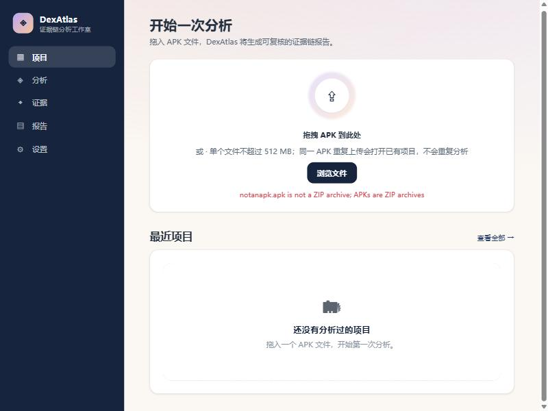

**这句话从哪来：** `validate_apk`（`src/dexatlas/core/ingest.py:139`）抛出 `ApkValidationError`（`src/dexatlas/core/ingest.py:82`），`stage_upload`（`src/dexatlas/api/uploads.py:336`）把它转成 `HTTPException`（`src/dexatlas/api/uploads.py:361`）并定下 422（`src/dexatlas/api/uploads.py:342`）；前端 `messageFromBody`（`desktop/src/api/client.ts:117`）把错误体里的 `detail` 原样取出，首页红字显示的就是它。**界面没有中文、没有"这个文件不是 APK"之类的解释，只有一句后端原文。**

---

## 4. 时间线 B：分析跑完但什么也没产出 → 界面停在「分析中」

这是本次走查里**最值得记的一条**。

**发生了什么：**

1. `corrupt.apk` 过了上传校验（合法 ZIP、有 Android 标记），`POST /api/analyze` 返回 202，项目建立。
2. 三个后端依次跑过、三个都没能读出东西。同一份样本用 CLI 直跑（另开一个 `.scratch/cli-probe/` 工作区，不动本次走查的工作区），后端自己的话是：
   ```
   !  apktool exited with code 1: Exception in thread "main"
   !  androguard could not parse classes.dex: ValueError: This is not a DEX file!
   !  jadx exited with code 1: … JadxException: Error decode: resources.arsc …
   ```
   （走查的浏览器界面**看不到**这三句：它们在项目上，但项目状态没被写进去，见下一条。）
3. 管线的结论是「没有 classes 也没有 manifest」→ 项目状态判为 `FAILED`（`src/dexatlas/core/pipeline.py:401`）。
4. **但是这个 `FAILED` 从来没被写进工作区数据库**：管线只对 `COMPLETED` 的项目调用 `publish_run`（`src/dexatlas/core/pipeline.py:427-429`），失败的那一支不发布（`src/dexatlas/core/pipeline.py:405` 只删掉暂存库）。管线自己注释里写明了这个取舍："A run that found nothing is not published… reading back the row a `begin_run` wrote would report a failed analysis as one still running"。
5. 后端日志如实记了一句：`background analysis of E:\...\uploads\bdb138...\corrupt.apk completed but produced no symbols`。
6. 数据库里这个项目**仍然是** `status: 'running'`，它的 run 也是 `status: 'running'`、`finished_at: NULL`。

**界面因此显示什么（逐字）：**

```
分析进行中

项目 corrupt.apk · apk_bdb1385451cf35b4 · 分析中

取消
```

阶段格停在半路：`采集`/`解析`/`索引` 是「已完成」，`证据`/`报告` 是「待处理」；run 行显示 `run run_2803 · running`；日志区只有轮询记录，没有错误：

```
20:01:22 [轮询] 开始轮询 GET /api/projects/apk_bdb1385451cf35b4（每 2s）
20:01:22 [状态] 首次读取：corrupt.apk · 状态 running
20:01:22 [轮次] 检测到 1 个分析轮次，最新 run_2803a7f0e98c4d8f（running）
```

分析在 **19:56:38** 就结束了；界面在 **20:01:22** 仍然显示「分析中」（**4 分 44 秒之后**）。首页「最近项目」里它也显示为「◌ 进行中」。

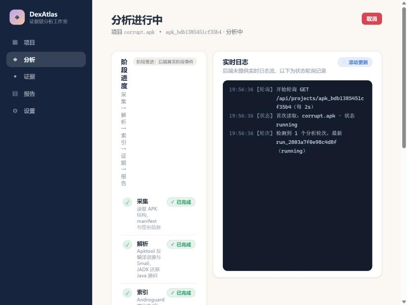

**点「取消」会怎样**（因为界面还以为它在跑）：

```
✕ 取消失败：no analysis is running for 'apk_bdb1385451cf35b4'
```

后端返回 `HTTP 409 {"detail":"no analysis is running for 'apk_bdb1385451cf35b4'"}`——因为分析确实早跑完了，进程内的运行表里没有它。这个提示本身是对的，但它把上面那条真正的病（状态没被写）暴露成了「你的取消来晚了」。

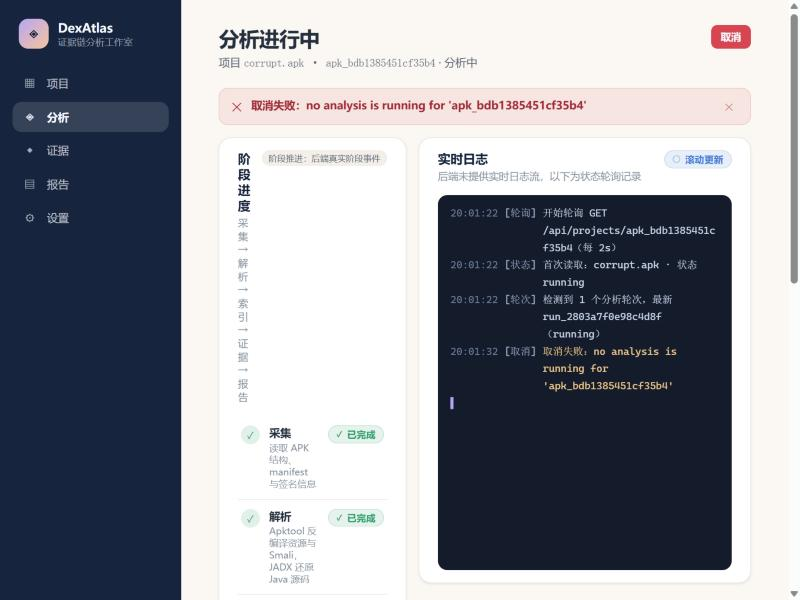

**什么时候才会变成「失败」：** 只有**后端进程重启**。重启时 workbench 的孤儿轮次对账（`src/dexatlas/workbench/app.py:87`）把它改成失败：

```
reconciled orphaned run run_2803a7f0e98c4d8f for project apk_bdb1385451cf35b4 as failed
```

项目变成 `failed`，错误是：

```
workbench: the server process running this analysis ended before the analysis finished; the run was never completed or cancelled
```

界面这才显示「分析失败」（见 §5 的失败态截图，措辞完全一样，只有那句原因不同）。

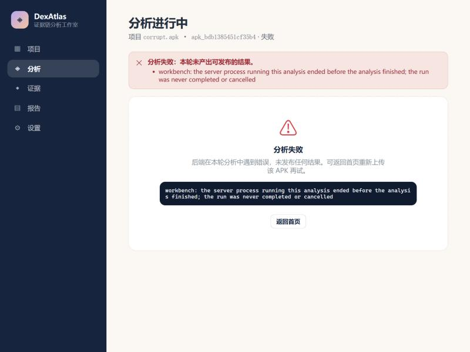

> **对账那句话说得对吗？** 它是从数据库能看见的东西推出来的——run 留在 `running`，所以对账只能认为「进程没了」。但这次的事实是**分析跑完了、只是没读到东西，而失败状态没被写**。这句话因此把病说反了：读者会以为进程崩了。这不是界面文案的问题，是后端写状态的问题。

---

## 5. 时间线 C：取消（这条路径是通的）

**触发方式：** 分析页右上角的红色「取消」按钮。只在项目状态是 `pending`/`running` 时出现（`desktop/src/pages/Analysis.tsx:522`）。

**确认框：** 点击后先弹**浏览器原生 `window.confirm`**（`desktop/src/components/Button.tsx:61`），文案逐字：

```
确认取消本次分析？已生成的中间结果将被丢弃。
```

**后端返回**（`curl` 实测）：

```
POST /api/projects/apk_74e0f43447c30346/cancel
HTTP 202
{"project_id":"apk_74e0f43447c30346","status":"cancelling"}
```

**界面此时显示**（逐字，日志区新增一行）：

```
19:59:35 [取消] 已向后端发送取消请求（202），等待状态确认
```

副标题同时显示当前阶段：`项目 many-dex-1200.apk · apk_74e0f43447c30346 · 分析中 · 当前阶段：解析`。

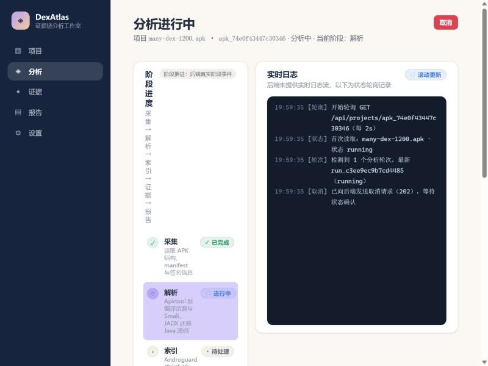

**管线怎么停的：** 取消不是立刻掐断。请求只是把取消令牌置位，管线在**下一个检查点**才停——`src/dexatlas/core/pipeline.py:1150` 的 `_check_cancelled`。实测：`parse-apktool` 阶段从 11:59:35 跑到 12:00:14（39 秒，这个阶段本身要解 1200 个 dex），阶段结束后管线抛出 `AnalysisCancelled`，`_record_cancellation`（`src/dexatlas/core/pipeline.py:543-544`）把项目记成失败、把 run 记成 `cancelled`。阶段事件里因此**没有** `index-androguard` 和 `decompile-jadx`（阶段事件与数据库里的时间是 UTC，界面日志里的时间是本地时间，差 8 小时）：

```
inspect           11:59:35.44 -> 11:59:35.44
parse-apktool     11:59:35.46 -> 12:00:14.02
```

数据库：

```
projects:      status=failed  errors=[{"tool":"dexatlas","code":"analysis_failed","message":"the analysis was cancelled before it completed","detail":null}]
analysis_runs: status=cancelled  finished_at=2026-11-26T12:00:14.041302+00:00
```

**界面最终显示**（逐字，全部）：

```
分析进行中

项目 many-dex-1200.apk · apk_74e0f43447c30346 · 失败

✕
分析失败：本轮未产出可发布的结果。
dexatlas: the analysis was cancelled before it completed
⚠
分析失败
后端在本轮分析中遇到错误，未发布任何结果。可返回首页重新上传该 APK 再试。
dexatlas: the analysis was cancelled before it completed
返回首页
```

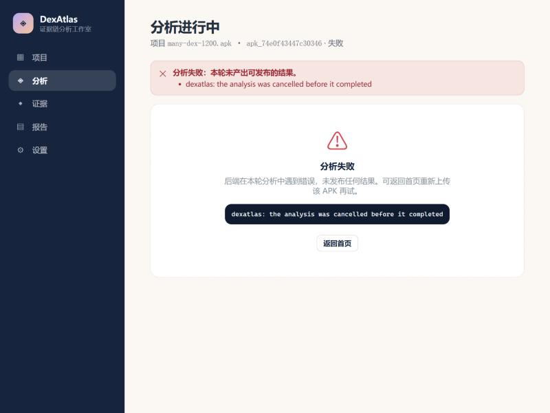

**两处值得记的文案事实：**

1. **标题没跟着变。** 页面 H1 始终是「分析进行中」，即使状态已经是「失败」——状态词在副标题里（`· 失败`）。读者第一眼看到的是「分析进行中」，要读到副标题才知道已经结束了。
2. **「失败」不等于「崩了」。** 取消导致的是 `failed` 状态 + `dexatlas: the analysis was cancelled before it completed` 这句原因。界面没有把「取消」和「失败」分成两种视觉，也没有「已取消」这个状态词——项目状态字段里**没有 cancelled**，被取消的分析在项目上就是 failed。

---

## 6. 时间线 D：后端失败，但分析完成了（「部分」）

这条是**项目招牌行为**（"后端失败是一个值，不是一个异常"）的界面表现，所以一并走了。

**样本：** `partial.apk`——`demo.apk` 的 manifest 有效（Apktool 读得出来），DEX 是垃圾字节。

**后端：** 项目 `completed`，`completeness.complete = false`，错误两条：

```
apktool: apktool exited with code 1
androguard: androguard could not parse classes.dex
```

**界面显示**（逐字）：

```
分析完成：1 类 · 0 方法 · 0 调用点 · 7 条证据。
打开项目详情
◐
本轮分析存在未完成的步骤，结果不完整：
apktool: apktool exited with code 1
androguard: androguard could not parse classes.dex
```

阶段格里 `报告` 一格标的是「**部分**」，不是「已完成」。

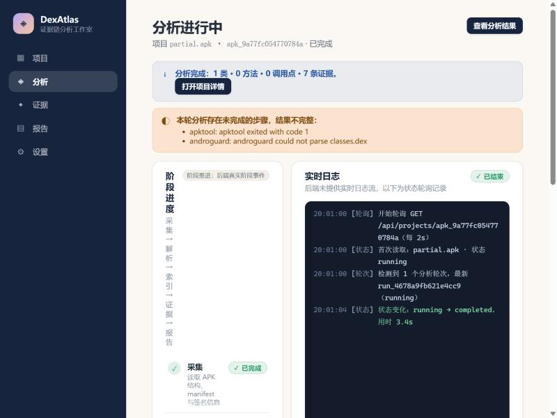

**失败原因从哪来：** 管线把每个后端的失败记成项目上的一个 `ToolError`；API 在 `src/dexatlas/mcp/tools/projects.py:125` 把它转成 `f"{error.tool}: {error.message}"` 的字符串；前端原样显示。**注意 `ToolError.detail` 里有完整的 Java 堆栈和 Androguard 的异常原文，但 API 只送 `tool: message`，界面因此看不到堆栈。**（堆栈在数据库的 `projects.errors` 里，也进 JSON 报告。）

---

## 7. 本次走查**没有**覆盖的

这些是真的没验，不能算已验证：

1. ~~**打包后的 Tauri exe 里的同一条路径。**~~ **已关闭（2026-11-26 收尾）**：在打包 exe 里复验了取消路径——侧车自动拉起并用系统分配的端口、前端请求打在侧车自己的端口上、`POST /cancel` 返回 202、取消后项目记 failed 且**未发布任何结果**。见[验收报告 §7.5](phase5-acceptance.md)。
2. ~~**原生 `window.confirm` 在 exe 里的样子。**~~ **已关闭（2026-11-26 收尾）**：确认框的原文在打包 exe 里被捕获——「确认取消本次分析？已生成的中间结果将被丢弃。」见[验收报告 §7.5](phase5-acceptance.md)。
3. ~~**「取消」按钮在真机上被手指点到的路径。**~~ **已覆盖（2026-11-27 收尾）**：在打包 exe 里用**键盘**把这条路径走了一遍。
   **基线：** 本轮实测的 exe 由 `8140661` 这棵树构建（`desktop/src-tauri/target/release/dexatlas-desktop.exe`），侧车按 `backend.json` 拉起 `E:\Dexatlas\.venv\Scripts\python.exe -m dexatlas.workbench`；WebView2 开远程调试口，键盘事件用 CDP 的 `Input.dispatchKeyEvent` 派发——**不是** `Runtime.evaluate` 造一个 `KeyboardEvent`：合成事件的 `isTrusted` 为 false，浏览器不会对它跑默认处理，也就不会移动焦点环。为了让分析窗口足够长，上传的是 `scripts/generate-large-apk.py` 现生成的合成 APK（300 个类 / 12,000 个方法 / 300 个 dex 文件；一次分析约 18 秒，其中 `parse-apktool` 4.3 秒、`index-androguard` 4.4 秒、`decompile-jadx` 6.7 秒）。

   **Tab 的落点。** 从页面顶部开始按 Tab，`document.activeElement` 实测依次是：

   | 第几次 Tab | 元素 | 文字 |
   |---|---|---|
   | 1 | `A.skip-link` | 跳到主内容 |
   | 2 | `A.sidebar-link` | ▦ 项目 |
   | 3 | `A.sidebar-link is-active` | ◈ 分析 |
   | 4 | `A.sidebar-link` | ◆ 证据 |
   | 5 | `A.sidebar-link` | ▤ 报告 |
   | 6 | `A.sidebar-link` | ⚙ 设置 |
   | 7 | `BUTTON.da-btn.da-btn--danger.da-btn--sm` | 取消 |

   **焦点环看得见。** 焦点落在「取消」上时，它的计算样式是 `outline: rgb(184, 167, 245) solid 1.71429px`——就是 `desktop/src/components/Button.css:29` 的 `outline: 2px solid var(--color-lavender)`；截图里那圈淡紫色的框肉眼可见。

   **Shift+Tab 退得回去。** 从「取消」按 Shift+Tab，落回侧栏的「⚙ 设置」。

   **Enter 与 Space 都触发。** 两者都把**浏览器自己的** `window.confirm` 拉起来（`desktop/src/components/Button.tsx:70`）。CDP 侧收到的原文：

   ```
   Page.javascriptDialogOpening
   {"message": "确认取消本次分析？已生成的中间结果将被丢弃。", "type": "confirm", "hasBrowserHandler": true}
   ```

   确认框在的时候**页面是冻住的**：任何发往页面的 CDP 命令都超时，`Page.captureScreenshot` 也超时。

   **确认框出现时焦点落在哪。** 确认框是**浏览器自己的**对话框（上面那个事件就是它），**不是**应用自己的 `Dialog` 组件——所以 `desktop/src/components/useDismissable.ts` 里那套焦点陷阱与 Esc 处理**在这条路径上根本没有运行**。应用这一侧能观察到的只有一件事：确认框关掉之后，**焦点回到了「取消」按钮上**（实测 `document.activeElement` 仍是那个 `BUTTON`，焦点环还在）。

   **Esc 能不能取消确认——这一问没验到，说清楚为什么。**
   在打包 exe 里，这个确认框**不是一扇独立的窗口**：确认框弹起前后枚举全部顶层窗口，没有多出任何一扇（没有 `#32770`，也没有别的）。它是 WebView2 在自己的窗口里画的。因此：
   - 没有窗口可以递键盘：往页面上派发 Esc 键事件**到不了它**（渲染进程正卡在 `confirm()` 里，事件排在队列里出不去）。实测按 Esc 之后页面仍然冻着。
   - CDP 只有「替用户回答」的接口，没有「递一个物理按键」的接口。

   所以「人手按 Esc 取消确认框」这一问**没验到**。能验的是**浏览器自己的两个回答**：
   - 回答「取消」（Chromium 里 Esc 的含义）：**分析继续跑**，日志区没有取消那一行，焦点仍在「取消」按钮上。
   - 回答「确定」（Chromium 里 Enter 的含义）：日志区出现

     ```
     11:05:46
     [取消]
     已向后端发送取消请求（202），等待状态确认
     ```

     随后项目记 `failed`、run 记 `cancelled`、**未发布任何结果**，界面显示「分析失败」。

   **最终界面（逐字）：**

   ```
   分析进行中

   项目 large.apk · apk_5b8b5f363ea5c75a · 失败

   分析失败：本轮未产出可发布的结果。
   dexatlas: the analysis was cancelled before it completed
   ```

   ```
   分析失败
   后端在本轮分析中遇到错误，未发布任何结果。可返回首页重新上传该 APK 再试。
   dexatlas: the analysis was cancelled before it completed
   返回首页
   ```

   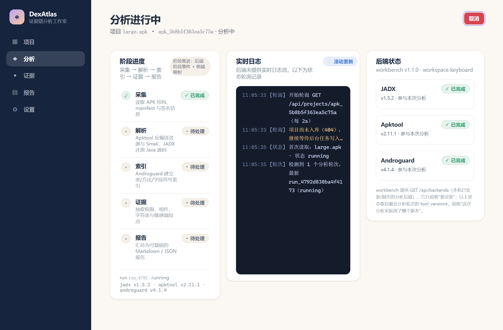

   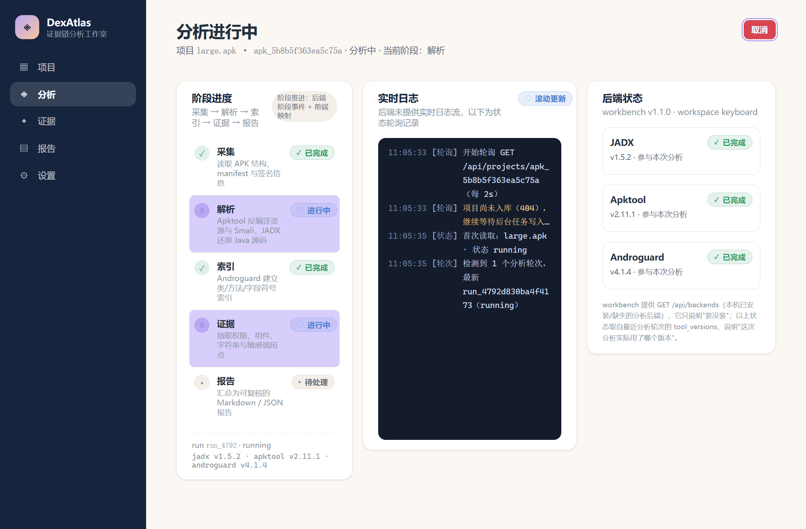

   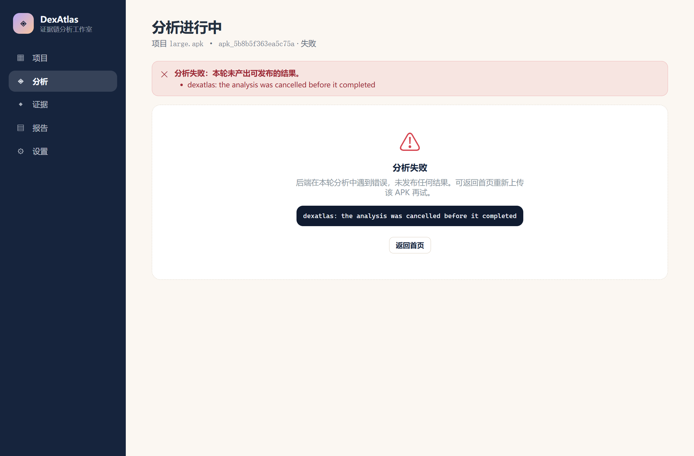

   **顺带查到的一条界面缺陷（已由主会话修复，PR #33）：** 确认框被「确定」回答后，「取消」按钮立刻进入 `loading`（`desktop/src/pages/Analysis.tsx:568`），按钮随即被**原生 `disabled`** 禁用——按钮一被禁用，浏览器就把焦点收走，**键盘焦点因此掉到 `<body>` 上**（实测 `document.activeElement` 从 `BUTTON` 变成 `BODY`），没有落回任何可操作元素。主会话已改用 `aria-disabled` 代替原生 `disabled`（`desktop/src/components/Button.tsx:60`；分支 `fix/backend-status-truth-and-focus`，提交 `ec5de0a`）。

   **建议的回归测试（留给主会话，本轮不加）：** 仓库里已有的 `tests/test_desktop_keyboard_accessibility.py` 断言的是**应用自己的** `Dialog` / `Drawer` 覆盖层的键盘契约（源码级断言），它**不覆盖**这条路径——「取消」走的是浏览器原生 `window.confirm`，应用那份焦点陷阱与 Esc 处理在这里根本不运行。能钉住的只有两条可观察的事实：① Tab 七次能走到「取消」，焦点环可见；② 确认框关闭后焦点回到「取消」按钮。
4. ~~**取消发生在别的阶段。**~~ **已覆盖（2026-11-27 收尾）**：在打包 exe 里造出了「取消发生在索引期」与「取消发生在反编译期」两个场景，各跑一遍。
   **基线：** 本条**测了两棵树**，两次都是当轮 `npm run tauri build` 出来的 exe：① `8140661`（PR #32 之前）；② `b6c0438`（`main` 合了 PR #32 `4ddf469`「阶段格与后端推进点一一对应」，再合 PR #33 `ec5de0a`、复测量 `0a231d0`、外发材料 `b6c0438`）。上传的是与第 3 条同一个合成 APK（300 个类 / 12,000 个方法 / 300 个 dex 文件）。取消用**真实鼠标点击**（CDP `Input.dispatchMouseEvent`）按下，不是键盘。

   **怎么造的场景：** 取消不是立刻掐断的——请求只是把取消令牌置位，管线在**下一个检查点**才停（`src/dexatlas/core/pipeline.py:1150`）。所以「在哪个阶段取消」不是靠盯着界面猜的：脚本轮询后端自己的阶段事件端点 `GET /api/projects/{id}/runs/{run_id}/stages`，**等到目标阶段的 `finished_at` 还是 `null`（也就是它正在跑）的那一刻**，再用真实鼠标点击按下「取消」。

   前端每 2 秒轮询一次，所以界面会比后端的阶段事实**最多晚一个轮询周期**。第二轮（`b6c0438`）在点了取消之前**额外等页面自己把这一格点着**（等到那格的徽标变成「◌ 进行中」再截屏、再点），这样截到的是「读者读得到的那句话」，而不是页面还停在上一格时的样子。

   - 场景 A：**`index-androguard` 正在跑**时点取消。
   - 场景 B：**`decompile-jadx` 正在跑**时点取消。

   **终态：两边的表现完全一样——这一条的预期得到了证实。**（运行途中那一行「当前阶段：」在两棵树上不一样，见本条最后一段。）

   取消请求受理后，日志区新增一行（`b6c0438` 场景 B 的实测原文）：

   ```
   11:42:30
   [取消]
   已向后端发送取消请求（202），等待状态确认
   ```

   最终界面（两个场景**逐字相同**）：

   ```
   分析进行中

   项目 large.apk · apk_5b8b5f363ea5c75a · 失败

   分析失败：本轮未产出可发布的结果。
   dexatlas: the analysis was cancelled before it completed
   ```

   ```
   分析失败
   后端在本轮分析中遇到错误，未发布任何结果。可返回首页重新上传该 APK 再试。
   dexatlas: the analysis was cancelled before it completed
   返回首页
   ```

   后端侧两个场景也一致：`projects.status = failed`、`analysis_runs.status = cancelled`、`published_run = null`（**未发布任何结果**）、`completeness.errors` 只有一条 `dexatlas: the analysis was cancelled before it completed`。

   **终态一样，差的是停在哪一步——而这一步在后端的阶段事件里看得见。** 取消令牌在哪一个检查点被读到，管线就在那之后停下（时间为本地时间，`b6c0438` 那一次；`8140661` 那一次落库的阶段事件与这张表逐项相同）：

   | 场景 | 取消后落库的阶段事件 |
   |---|---|
   | A：取消落在 `index-androguard` 期间 | `inspect` 11:37:04 → `parse-apktool` 11:37:05–11:37:08 → `index-androguard` 11:37:08–11:37:12（**没有 `decompile-jadx`，没有 `publish`**） |
   | B：取消落在 `decompile-jadx` 期间 | `inspect` 11:42:21 → `parse-apktool` 11:42:21–11:42:24 → `index-androguard` 11:42:24–11:42:27 → `decompile-jadx` 11:42:27–11:42:34（**没有 `publish`**） |

   场景 A 停在那处取消检查（`src/dexatlas/core/pipeline.py:326` `anchor: _check_cancelled(cancellation)`）——**JADX 根本没跑**；场景 B 停在另一处取消检查（`src/dexatlas/core/pipeline.py:371` `anchor: _check_cancelled(cancellation)`）——**JADX 跑完了，但结果一步也没进暂存库**。

   **界面上分不分得开？`8140661` 分不开，`b6c0438` 分得开了。**

   - **`8140661`（PR #32 之前）：分不开。** 两个场景在按下取消的那一刻，界面副标题**一字不差**：

     ```
     项目 large.apk · apk_5b8b5f363ea5c75a · 分析中 · 当前阶段：解析
     ```

     阶段五格也都是「解析 ◌ 进行中」。原因是那棵树的五格把 `parse-apktool` 与 `decompile-jadx` **合并成了一格「解析」**——读者在界面上既分不出当时跑的是 Apktool 还是 JADX，也分不出这次取消落在索引期还是反编译期。

   - **`b6c0438`（PR #32 之后）：分得开了。** 两个场景的副标题**不再一样**：

     ```
     项目 large.apk · apk_5b8b5f363ea5c75a · 分析中 · 当前阶段：索引
     ```

     ```
     项目 large.apk · apk_5b8b5f363ea5c75a · 分析中 · 当前阶段：反编译
     ```

     阶段五格也一一对上了——场景 A 是「采集 ✓已完成 · 解析 ✓已完成 · **索引 ◌ 进行中** · 反编译 •待处理 · 报告 •待处理」，场景 B 是「采集 ✓已完成 · 解析 ✓已完成 · 索引 ✓已完成 · **反编译 ◌ 进行中** · 报告 •待处理」。五格与后端的五个推进点一一对应（`desktop/src/stages.js:84` 的 `STAGE_TO_SLOT`），每格的状态就是后端那条阶段事件说的事实。

     **PR #32 的效果因此被实测确认**：读者在界面上能分出这次取消落在索引期还是反编译期，不必再去翻后端的阶段事件。

   

   

   

   

   

   

   

   

   **终态在两棵树上都一样**：横幅、错误卡片、错误原文 `dexatlas: the analysis was cancelled before it completed`、`projects.status = failed`、`analysis_runs.status = cancelled`、`published_run = null` 全部逐字相同——「界面表现应当相同（状态与错误一样）」这个预期在两棵树上都成立。**变的只是运行途中那一行「当前阶段：」**：PR #32 之前它分不出阶段，之后它分得出了。

   （一处如实记下：前端每 2 秒轮询一次，所以界面上的那一格会比后端的阶段事实**最多晚一个轮询周期**。`8140661` 那次截图里「索引」格显示「待处理」就是这个原因——截图是界面当时的样子，不是后端当时的样子。`b6c0438` 那次在点取消之前先等页面自己把那一格点着，截到的才是读者读得到的那句话。）
5. ~~**JADX/Apktool 缺失的失败形态。**~~ **已覆盖（2026-11-27 收尾）**：在打包 exe 里把 JADX 与 Apktool 两个后端都做成不可用，走了一遍完整的分析。
   **基线：** `8140661` 构建的 exe；上传的是 `examples/demo-app/demo.apk`。

   **怎么造的场景：** 启动 exe 时把两个环境变量置空——`DEXATLAS_JADX_PATH=` 与 `DEXATLAS_APKTOOL_JAR=`。`Settings` 的 `jadx_path` / `apktool_jar` 读的就是这两个变量（`src/dexatlas/config/settings.py:33`）。空字符串不是「没配」，而是**明确禁用**：`which_or_none` 见到空串就直接返回 `None`，不再做 PATH 查找（`src/dexatlas/tools/base.py:509`）。这一步是确定的——JADX 与 Apktool 在本机 PATH 上本来也没有，禁用之后侧车的 `GET /api/backends` 回到：

   ```json
   {"available": ["androguard"], "missing": ["jadx", "apktool"], "versions": {"jadx": null, "apktool": null, "androguard": "4.1.4"}}
   ```

   **首页：一个字都不提后端。** 上传卡、拖拽区、最近项目表全部照常。这个页面上没有任何地方说「少装了两个后端」。

   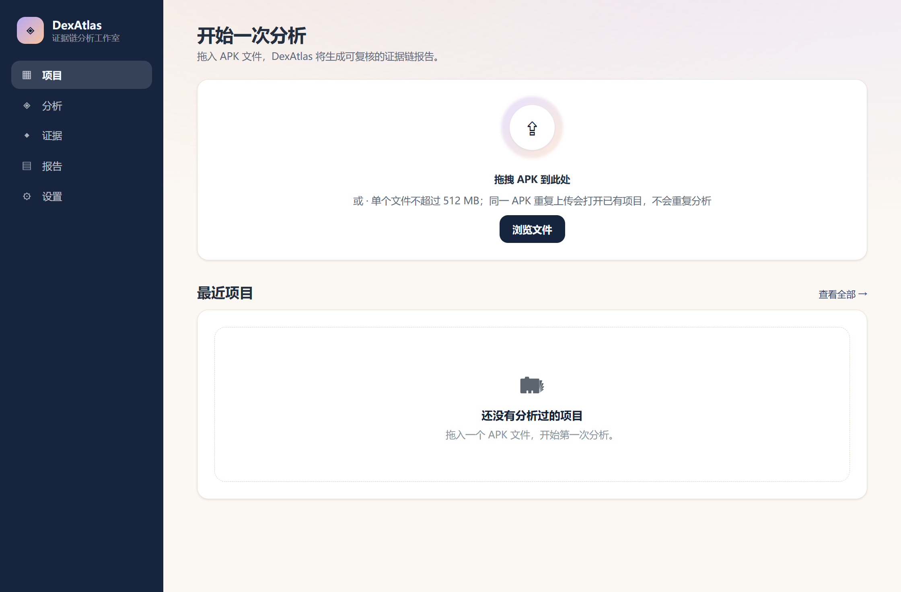

   **设置页：唯一一处如实说「装没装」的地方**（`GET /api/backends` 就是给它用的，`desktop/src/pages/SettingsPage.tsx:113`）。逐字：

   ```
   分析后端
   jadx
   未安装或未配置
   缺失
   apktool
   未安装或未配置
   缺失
   androguard
   已安装 · v4.1.4
   可用
   缺失后端：jadx、apktool
   ```

   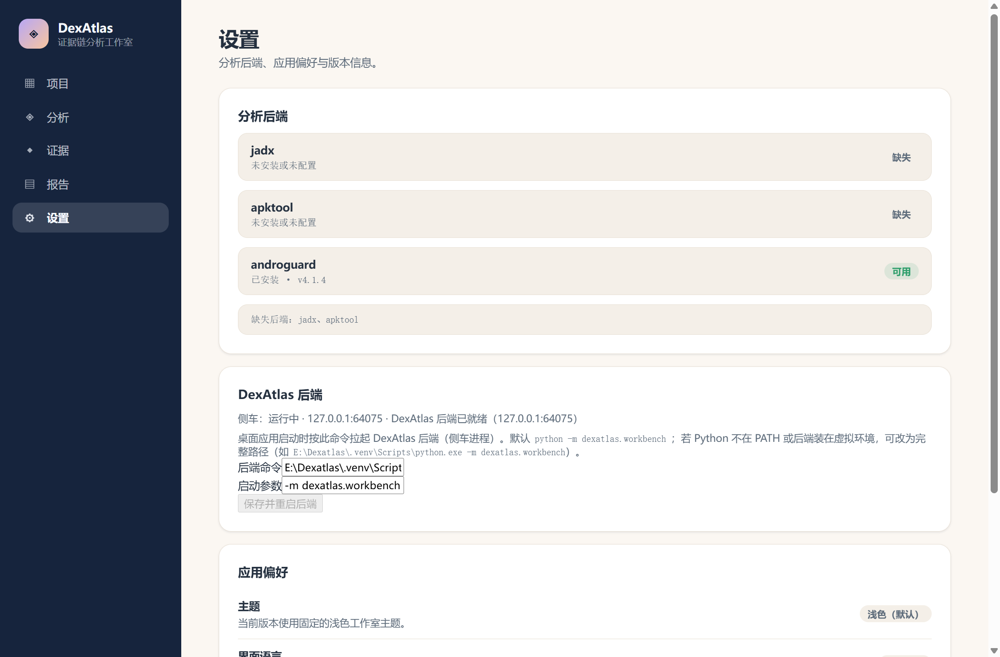

   **分析页：分析是「完成但结果不完整」，不是失败。** 分析跑完了：run 的 `status` 是 `completed`、`completeness` 是 `partial`、**发布了结果**（10 条证据）。横幅如实说了缺什么：

   ```
   分析完成：4 类 · 8 方法 · 23 调用点 · 10 条证据。
   ```

   ```
   本轮分析存在未完成的步骤，结果不完整：
   apktool: apktool is not installed or not on PATH
   jadx: jadx is not installed or not on PATH
   ```

   **但同一屏的「后端状态」卡说的是另一回事——这里有一处界面假话（已由主会话修复，PR #33）。** 它把两个**根本没装**的后端写成：

   ```
   JADX
   ◌ 进行中
   参与本次分析 · 版本探测中
   ```

   ```
   Apktool
   ◌ 进行中
   参与本次分析 · 版本探测中
   ```

   两句话都是假的：JADX 与 Apktool **没有参与**这一轮（run 的完整性错误原文是「jadx is not installed or not on PATH. It never ran, so it produced nothing.」），而这一轮**早就结束了**，版本不会再被探测。徽标还是「进行中」加一个跳动的圆点，停在一个已经完成的分析上。

   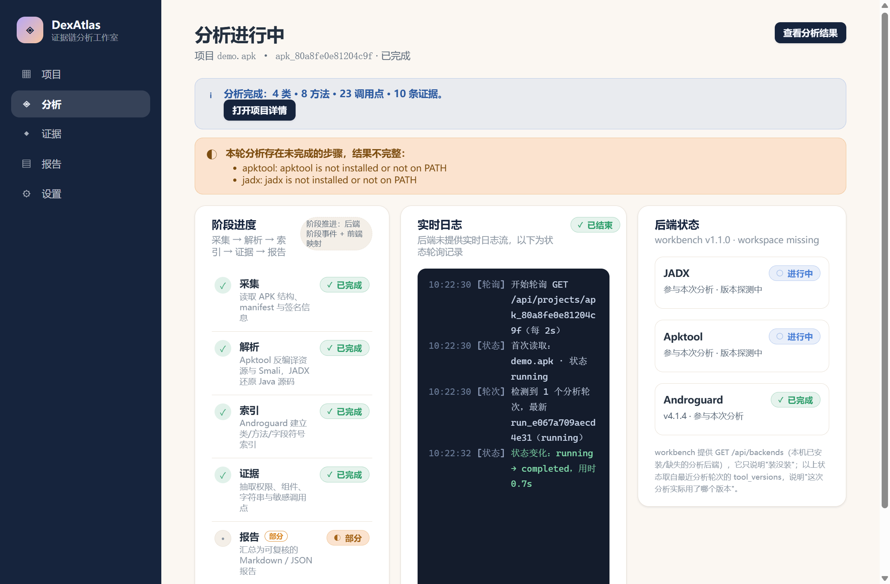

   **项目详情页是对的。** 同一轮分析的项目详情页把话说准了：

   ```
   部分状态：缺失后端：apktool、jadx；apktool: apktool is not installed or not on PATH；jadx: jadx is not installed or not on PATH
   ```

   证据表里也有对应两条（E-0002、E-0006）：

   ```
   apktool did not complete in this run: apktool is not installed or not on PATH. It never ran, so it produced nothing.
   ```

   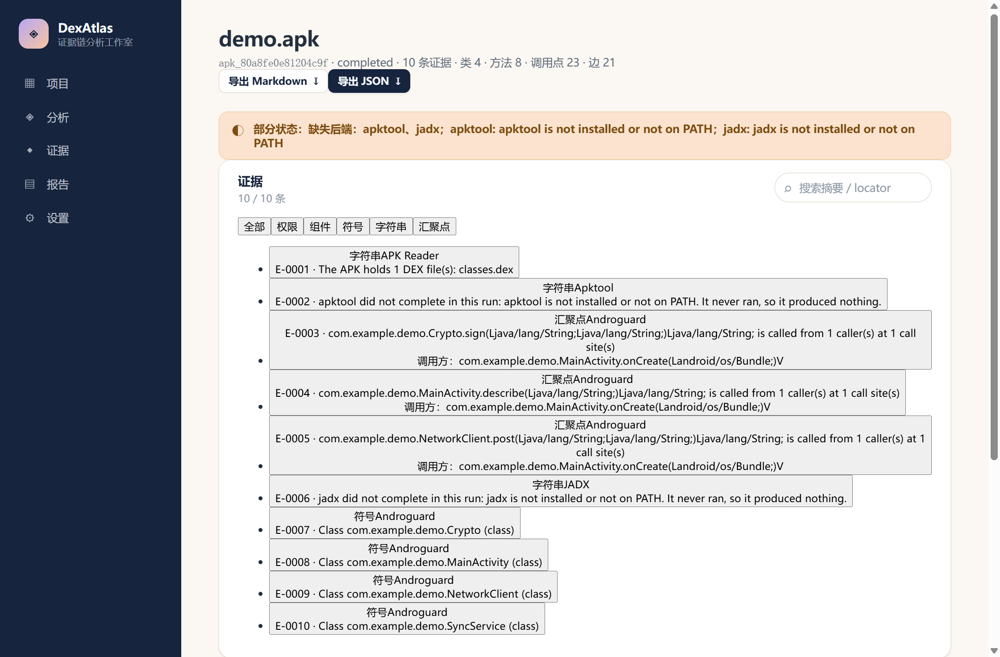

   **根因（写清楚，交给主会话定修法）：** 后端在探测版本**之前**就把**全部三个后端的名字**写进这一轮的 `tool_versions`（`src/dexatlas/core/pipeline.py:161`）：

   ```python
   run.tool_versions = {backend.name: None for backend in self._backends.all()}
   ```

   所以 `tool_versions[name] == null` 有**两种**含义，而前端只认一种。`8140661` 那棵树的 `desktop/src/stages.js` 上是三态映射：键不存在 = 这一轮没带上它；键在、值为 `null` = 参与了但版本还在探测；键在、值是版本号 = 参与了、版本已知。**「键在」证明的是「这一轮计划里带着它」，不是「它参与了」**——后端根本没装时，键也在、值也是 `null`。于是 `deriveBackends` 把「没装」误判成「版本还在探测」，说了两句关于机器的假话。

   后端自己知道真相：`missing_backends()`（`src/dexatlas/mcp/tools/projects.py:26`）就是按「版本为 null」把没装的后端挑出来，项目详情页用的正是它；分析页的后端状态卡没有用它。

   **主会话已修（PR #33，提交 `ec5de0a`）：** `deriveBackends` 改为同时看机器那份名单（`GET /api/backends`）与 run 的记录（`desktop/src/stages.js:386`），别再靠 `null` 猜——「机器说没装」那一支现在读出来就是「未安装或未配置，未参与本次分析」（`desktop/src/stages.js:398`）。

   **建议的回归测试（留给主会话，本轮不加）：**
   - 前端 `desktop/src/stages.test.ts`：`deriveBackends` 收到一个**已结束**的轮次（`status: "completed"`）、`tool_versions: {jadx: null, androguard: "4.1.4"}` 时，JADX 应当是「未安装或未配置，未参与本次分析」而不是「参与本次分析 · 版本探测中」。今天这条会红。
   - 后端：`GET /api/projects/{id}/runs` 的 run 行若带上 `missing_backends`（或 `errors`），前端就不必靠猜。
6. **管线自身抛异常（`AnalysisFailed`）的失败形态。** 本次能触发 `failed` 的后端动作是「取消」和「孤儿对账」；`src/dexatlas/core/pipeline.py:420` 那条 `except Exception` 分支（管线自己崩了）**没有触发过**——三个后端的失败都被各自的适配器接住了，不会走到那里。
7. **并发与竞态。** 取消与收尾同时发生、`RUNNING` 表的边界，没有压测。
8. **本次走查的树不是最新的树。** 走查基线是 `bb04ac5`。另一条并行分支（`claude/adoring-wilbur-bb6688`）已经把阶段角标文案从「阶段推进：后端真实阶段事件」改成「阶段推进：后端阶段事件 + 前端映射」，并把三处轮询改成终态即停。**本文截图里的角标文案与轮询行为，反映的是 `bb04ac5`；合并后角标会变，轮询停止后「卡在分析中」的表象也会变——但 §4 那条「后端不写失败状态」的病不受影响，因为那是后端的事。**

---

## 8. 交接给验收报告的逐字文案

主会话要把下面这些**一字不差**写进 `docs/reports/phase5-acceptance.md`：

**上传被拒（首页红字）**

```
notanapk.apk is not a ZIP archive; APKs are ZIP archives
```

**取消确认框（浏览器原生 `window.confirm`）**

```
确认取消本次分析？已生成的中间结果将被丢弃。
```

**取消已受理（日志区）**

```
[取消] 已向后端发送取消请求（202），等待状态确认
```

**取消被拒（红色横幅）**

```
取消失败：no analysis is running for 'apk_bdb1385451cf35b4'
```

**分析失败（红色横幅 + 卡片）**

```
分析失败：本轮未产出可发布的结果。
```
```
分析失败
后端在本轮分析中遇到错误，未发布任何结果。可返回首页重新上传该 APK 再试。
```
```
dexatlas: the analysis was cancelled before it completed
```
（后端重启对账之后，同一张卡片里的原因换成
`workbench: the server process running this analysis ended before the analysis finished; the run was never completed or cancelled`）

**部分完成（蓝色横幅 + 橙色横幅）**

```
分析完成：1 类 · 0 方法 · 0 调用点 · 7 条证据。
```
```
本轮分析存在未完成的步骤，结果不完整：
apktool: apktool exited with code 1
androguard: androguard could not parse classes.dex
```

**状态词与标题**

```
分析进行中          ← 页面 H1，失败时也不变
排队中 / 分析中 / 已完成 / 失败   ← 副标题里的状态词
```

---

## 9. 文件与命令清单

**新增文件（本次产出，未 commit、未 push）**

| 文件 | 内容 |
|---|---|
| `docs/reports/phase5-failure-timeline.md` | 本文 |
| `docs/assets/phase5/timeline-01-upload-rejected.png` | 时间线 A：上传被拒的首页红字 |
| `docs/assets/phase5/timeline-02-analysis-running.png` | 分析进行中（取消按钮可见） |
| `docs/assets/phase5/timeline-03-analysis-still-running.png` | 分析早已结束、界面仍显示「分析中」 |
| `docs/assets/phase5/timeline-04-cancel-requested.png` | 取消已受理（202），分析仍在跑 |
| `docs/assets/phase5/timeline-05-analysis-failed.png` | 取消后的「分析失败」卡片 |
| `docs/assets/phase5/timeline-06-partial-backend-failure.png` | 后端失败但分析完成（部分） |
| `docs/assets/phase5/timeline-07-cancel-conflict.png` | 对已结束的分析点取消 → 409 |
| `docs/assets/phase5/timeline-08-project-list.png` | 首页「最近项目」四种状态并列 |
| `docs/assets/phase5/timeline-09-reconciled-after-restart.png` | 后端重启对账后的「分析失败」 |

**工作区文件（不进仓库，`.scratch/` 已在 `.gitignore:89`）**

`.scratch/make_samples.py`（造样本）· `.scratch/sample_server.py`（给浏览器取样本字节用的本地静态服务器）· `.scratch/save_shot.py`（抓屏转 PNG）· `.scratch/samples/*`（坏样本）· `.scratch/workspace/`（本次专用工作区）· `.scratch/cli-probe/`（用 CLI 直跑同一样本、只看后端自己说了什么的旁路工作区）

**复现用的命令**

```bash
# 后端（工作目录 E:\Dexatlas）
export DEXATLAS_WORKSPACE="E:/Dexatlas/.claude/worktrees/gallant-lamport-59989d/.scratch/workspace"
export DEXATLAS_JADX_PATH="E:/Dexatlas/.scratch/backends/jadx/bin/jadx.bat"
export DEXATLAS_APKTOOL_JAR="E:/Dexatlas/.scratch/backends/apktool.jar"
E:/Dexatlas/.venv/Scripts/python.exe -m dexatlas.workbench --port 8618

# 前端（工作目录 <worktree>/desktop）
npm ci && npm run dev          # vite，http://127.0.0.1:5173，/api 代理到 8618

# 造样本
E:/Dexatlas/.venv/Scripts/python.exe <worktree>/.scratch/make_samples.py

# 取后端的原始回答
curl -s -X POST -F "file=@<worktree>/.scratch/samples/notanapk.apk" http://127.0.0.1:8618/api/analyze
curl -s -X POST http://127.0.0.1:8618/api/projects/<project_id>/cancel
```

---

## 10. 给验收报告的建议措辞

验收报告里那条开放项可以这样收口（**建议**，最终措辞由主会话定）：

> **失败 / 取消时间线：已实走（开发模式），并已于 2026-11-26 收尾在打包 exe 中复验。**
> 「取消」路径存在且走通：分析页「取消」按钮 → 原生确认 → `POST /api/projects/{id}/cancel` 202 →
> 管线在下一个检查点停下（run 记为 `cancelled`，项目记为 `failed`）→ 界面显示「分析失败」，
> 原因逐字为 `dexatlas: the analysis was cancelled before it completed`。
> 「失败」有三种界面结果，取决于后端发生了什么：上传被拒停在首页（422 原文）、
> 分析无产出则**界面一直停在「分析中」**（后端不写失败状态，只有重启后的孤儿对账才改成 `failed`）、
> 后端失败但分析完成则显示「结果不完整」并列出各后端的错误。
> **遗留缺口（2026-11-26 收尾后）：**①「分析无产出 → 界面卡在分析中」是后端不写失败状态造成的，不是前端问题——**该缺陷已由 Phase 5 收尾批次修好**（失败状态现在落库，见[验收报告 §7.2](phase5-acceptance.md)）；
> ②失败/取消在打包 exe 里未复验——**已于 2026-11-26 收尾复验**（见[验收报告 §7.5](phase5-acceptance.md)）。
