# Phase 5 真机补测：打包 exe + 完整后端配置，MSI 安装，非 MSIX 容器启动

**日期：** 2026年11月26日（第一、二轮）；2026年11月27日（提升会话/升级/卸载/repair 补测）；2026年11月27日（非 MSIX 容器补测）；2026年11月28日（NSIS 首装/卸载补测，§5.8）；2026年11月28日（MSI 版本号递增升级与降级补测，§5.9）
**机器：** Windows 11 Pro 10.0.26300（x64）
**代码基线：** `bb04ac5`（Merge PR #24），worktree `.claude/worktrees/elegant-bouman-297a2f`；非容器轮（§5）基线 `d9f2f24`，worktree `strange-ardinghelli-f4f02c`；NSIS 首装/卸载轮（§5.8）基线 `273536b`，worktree `zen-sammet-4b7f5e`；MSI 版本号递增升级轮（§5.9）基线 `3262f65`，worktree `loving-pike-73c47a`
**本文补的是：** [Phase 5 验收报告](phase5-acceptance.md) §7 的第 2 项与第 3 项——「打包 exe 在装了 jadx + apktool 的配置下未跑」与「MSI 安装路径未验证」；§5 补的是 §7.3 第 2 项——「非 MSIX 容器下的启动未单独验证」；§5.9 补的是 §7.3 的「版本号递增的 MSI 升级路径」（原第 4 项），并顺带实测了降级。

> **本文的地位。** 验收报告是判定书；本文是那两条空白项的**原始记录**：配了什么、跑了什么命令、看到了什么、以及**哪些没看到**。本文只做记录与取证，不改判定——两条空白项的结论由验收报告的作者在看过本文后写。
> **本文不含新的生产声明。** 每一个数字都来自本次运行的日志或截图，命令与路径都可复现（见 §6）。

---

## 0. 结论

| 补测项 | 结论 | 一句话证据 |
|---|---|---|
| 打包 exe + 完整后端（JADX + Apktool + Androguard） | **通过** | 打包 exe 走完「上传 → 分析 → 项目详情 → 证据」，5 个阶段全部「已完成」，**12 条证据**、`missing_backends: []`、`complete: true`；设置页三个后端都显示「已安装 · 参与本次分析」（§2） |
| MSI 安装 | **通过（有一个前提要说清）** | `msiexec /i … /passive` 退出码 **0**，装到 `C:\Program Files\DexAtlas Studio\`；装完启动应用，侧车起来、连上后端、跑出同样的 **12 条证据**（§3） |
| 非 MSIX 容器下的启动（2026-11-27 第三轮） | **通过** | 无包身份的进程（`GetCurrentPackageFullName` rc=15700）启动 exe：判别实验证明读的是**真实路径**的 `backend.json`（§5.3）；同样跑出 **12 条证据**、五阶段全完成、三后端参与（§5.4）；NSIS per-user 静默升级 0.1.0→1.2.0 成功、用户数据保留（§5.5） |
| NSIS 首次安装（2026-11-28 第四轮） | **通过** | 机器清到首装形态后静默 `/S` 退出码 **0**，装到 `C:\Users\pc\AppData\Local\DexAtlas Studio\`；装完的应用起来、侧车起来、一次真实分析跑出同样的 **12 条证据**、五阶段全完成、三后端参与（§5.8.1） |
| NSIS 卸载（2026-11-28 第四轮） | **通过，但查出一个缺陷** | 静默卸载退出码 **0**，安装目录整个没了、注册表卸载项没了、两份快捷方式都没了，**`%APPDATA%` 的 `backend.json` 逐字节保留**；但 `HKCU\Software\github\DexAtlas Studio`（记住安装位置的键）**没删**，判别实验证明它决定下一次装到哪（§5.8.3）。**缺陷：用户用过一次之后，卸载就卸不干净**——工作区建在安装目录里，而 NSIS 的 `RMDir` 只删空目录，卸完还剩 `.dexatlas\`（§5.8.4） |
| NSIS 的 `ProductVersion` 跟着发版号走（2026-11-28 第四轮） | **通过** | 另建一棵树把发版号抬到 1.2.1，由**项目自己的** `sync-desktop-version.py` 推到四个文件，打出的包 `ProductVersion` **1.2.1**——不是巧合，是跟着走（§5.8.2） |
| MSI 的 `ProductVersion` 跟着发版号走 + 版本号递增升级 1.2.0 → 1.2.1（2026-11-28 第五轮） | **通过** | 同一棵临时树先后打出 1.2.0 与 1.2.1 两个 MSI，`Property` 表的 `ProductVersion` 分别是 **1.2.0 / 1.2.1**；在已提升会话里 `msiexec /i … /qn` 两次都退出 **0**；升级后 ARP `DisplayVersion` **1.2.1**、产品码换新、安装的 exe 与 1.2.1 包内 payload **逐字节相同**；`backend.json` 在两次动作前后都是 `D6C4B32F…`（§5.9.1–§5.9.3） |
| MSI 降级 1.2.1 → 1.2.0（2026-11-28 第五轮） | **与预期相反：没有被拒绝** | 装 1.2.1 后再装 1.2.0，`/qn` 退出码 **0**、**无任何报错**，ARP 回到 1.2.0、exe 也退回 1.2.0，应用「关于」页显示 `v1.2.0`。原因是 Tauri 的 `bundle.windows.allowDowngrades` **默认为 true**，生成的 WiX 是 `AllowDowngrades="yes"`；MSI 里**没有**降级拦截行，也**没有** `LaunchCondition`（§5.9.4） |

**两条空白项都能填上，但 MSI 那一项带一个前提：`msiexec /i … /qn`（静默）装不上，退出码 1603；换成 `/passive` 才装得上。** 原因与边界写在 §3.5——不是包的毛病，是「静默模式下 Windows Installer 不做凭据提升」这条机制。

> **2026-11-27 补测更正：** 上面这句话里的「装不上」只对**未提升的会话**成立。**在已提升的会话里 `/qn` 装得上**
> （退出码 0，见 §4.1）；而且未提升会话里的 1603 有**两个不同的失败点**（`Error 1730` / `Error 1925`），
> 原先笼统的「1603」没有区分它们。**升级 / 卸载 / repair 三条路径也已实跑过，见 §4.2。**
>
> **2026-11-27 非容器补测（§5）：** 验收报告 §7.3 第 2 项「非 MSIX 容器下的启动」在本轮补上——
> 无包身份的进程启动 exe，判别实验证明配置读的是**真实路径**，分析同样跑出完整一档
> （12 条证据、`complete: true`），NSIS per-user 升级路径也验过。**结论（是否关闭该验收项）
> 仍由验收报告的作者写**，本文只交证据。
>
> **2026-11-28 NSIS 首装/卸载补测（§5.8）：** §5.6 当时明写「没验到」的两条——
> **NSIS 的首次安装**与 **NSIS 的卸载**——在本轮补上，并顺带实测了 NSIS 的
> `ProductVersion` 是否跟着发版号走（跟着走：另建一棵树抬到 1.2.1，打出的包就是 1.2.1）。
> **这一轮只做验证与记录，没有改产品代码、没有加测试**（主会话在并行发版，改源码会让
> 源码指纹变、测量要重跑）。机器状态**已恢复到本轮开始之前**，逐项核对过（§5.8.6）。
> **结论（是否关闭相应验收项）仍由验收报告的作者写。**
>
> **2026-11-28 MSI 版本号递增升级补测（§5.9）：** 验收报告 §7.3 的「版本号递增的 MSI
> 升级路径」（原第 4 项）在本轮补上。1.2.0 与 1.2.1 两个 MSI 由**同一棵临时树**构建
> （只差版本号），两次静默安装都退出 0；升级后 ARP 的 `DisplayVersion` 为 1.2.1、产品码换新、
> 安装的 exe 与 1.2.1 包里的 payload 逐字节相同、`backend.json` 逐字节保留，应用起来并跑出 12 条证据。
> **顺带实测了降级：它没有被拒绝**——Tauri 的 `allowDowngrades` 默认是 true，旧 MSI 会
> **静默**把应用换回旧版；这与本轮之前「MSI 默认不允许降级」的预期相反（§5.9.4）。
> **这一轮只做验证与记录，没有改产品代码、没有改仓库里的版本号文件、没有加测试，
> 也没有提交；机器已恢复（§5.9.5）。结论仍由验收报告的作者写。**

---

## 1. 这次测了什么、怎么测的

### 1.1 机器与工具链

| | |
|---|---|
| 操作系统 | Windows 11 Pro 10.0.26300（x64） |
| Node / npm | v24.16.0 / 11.13.0 |
| Rust / Cargo | rustc 1.96.0 / cargo 1.96.0（MSVC） |
| Python（侧车用） | `E:\Dexatlas\.venv\Scripts\python.exe`，CPython 3.12.10 |
| 桌面端依赖 | `npm ci` → 52 个包，0 漏洞 |
| 打包 | `npm run tauri build` → 退出码 0，Rust release 编译耗时 4m 23s |

**venv 的指向要写清楚：** `E:\Dexatlas\.venv` 里的 `dexatlas` 是 **editable 安装，指向 `E:\Dexatlas\src\dexatlas`**（主检出的源码）。主检出与本 worktree 同为 `bb04ac5`，所以侧车跑的是与桌面端**同一个 commit 的后端代码**。本轮**没有**在主检出目录执行 `uv sync`（那会把 Windows venv 变成 Linux 的且 uv 拒绝修复）。

### 1.2 分析后端：实际路径

后端通过环境变量交给后端进程——`Settings` 的环境前缀是 `DEXATLAS_`（`src/dexatlas/config/settings.py:22`），JADX 读 `DEXATLAS_JADX_PATH`（`src/dexatlas/tools/jadx/adapter.py:183`），Apktool 读 `DEXATLAS_APKTOOL_JAR`（`src/dexatlas/tools/apktool/adapter.py:106`）。

| 后端 | 本机实际路径 | 版本 | 怎么找到的 |
|---|---|---|---|
| JADX | `E:\Dexatlas\.scratch\backends\jadx\bin\jadx.bat` | **1.5.2** | `jadx-1.5.2-all.jar`（`…\jadx\lib\`） |
| Apktool | `E:\Dexatlas\.scratch\backends\apktool.jar` | **2.11.1** | `apktool.jar`（24,562,875 B） |
| Androguard | venv 内置（`E:\Dexatlas\.venv`） | **4.1.4** | 无需环境变量 |

> **`DEXATLAS_JADX_PATH` 必须指到启动器 `bin\jadx.bat`，不是 jadx 目录。** 指到目录时后端被判定为「装了但版本查不到」，`/api/backends` 的 `versions.jadx` 是 `None`。这是上一轮验收记录里的教训，本轮沿用。

启动桌面 exe 之前设的这三个变量：

```
DEXATLAS_JADX_PATH=E:\Dexatlas\.scratch\backends\jadx\bin\jadx.bat
DEXATLAS_APKTOOL_JAR=E:\Dexatlas\.scratch\backends\apktool.jar
DEXATLAS_WORKSPACE=E:\Dexatlas\.claude\worktrees\elegant-bouman-297a2f\.scratch\ws-desktop
```

**继承链**（为什么这三个变量能到后端进程里）：桌面端 `spawn` 侧车时没有清空环境（`desktop/src-tauri/src/sidecar.rs`），侧车进程再把它继承给 `python -m dexatlas.workbench`，后端进程最终在 `Settings` 里读到它们。

### 1.3 打包产物

`npm run tauri build` 退出码 0，`bundle.targets: "all"` → 同时产出 NSIS 与 MSI：

| 产物 | 路径 | 大小 | sha256 |
|---|---|---|---|
| 主程序 | `desktop/src-tauri/target/release/dexatlas-desktop.exe` | 14,817,280 B | `a81057cad0ed6107d28baeaf58a9b5492e9c7e5b00e486cdcd66c1ec34c92857` |
| MSI | `desktop/src-tauri/target/release/bundle/msi/DexAtlas Studio_0.1.0_x64_en-US.msi` | 5,431,296 B（5.18 MiB） | `259a78222701c03f4ffd9e74457ee91b3dbe94022953f5ae6bf7751444479ded` |
| NSIS | `desktop/src-tauri/target/release/bundle/nsis/DexAtlas Studio_0.1.0_x64-setup.exe` | 3.61 MiB | （本轮没装，不记指纹） |

**WiX 工具链是现成的**：`%LOCALAPPDATA%\tauri\WixTools314\candle.exe` / `light.exe`（Tauri 缓存，WiX 3.14）→ MSI 编译不需要联网下载。NSIS 同样有缓存（`%LOCALAPPDATA%\tauri\NSIS`）。**本轮没有改 `desktop/src-tauri/tauri.conf.json`**——MSI 打包不需要改 bundle 配置。

### 1.4 工作区、端口与后端命令

| | |
|---|---|
| 工作区 | `E:\Dexatlas\.claude\worktrees\elegant-bouman-297a2f\.scratch\ws-desktop`（每轮开始前清空，保证每次都是一次新的完整分析，而不是复用已有项目） |
| 侧车后端命令 | `E:\Dexatlas\.venv\Scripts\python.exe -m dexatlas.workbench`（来自应用配置目录的 `backend.json`） |
| 侧车实际端口 | **58854**（release exe 这一轮）、**57651**（安装态那一轮）——`--port 0` 由系统分配 |
| 8618 | **本轮开工时**被一个与本次验收无关的工作台占着（PID 34340，`C:\Users\pc\AppData\Local\Programs\Python\Python312\python.exe -m dexatlas.workbench --port 8618`）；那个进程在本轮结束前已退出，8618 现在空闲。**桌面侧车全程没有用过它**——侧车自己的 uvicorn 访问日志逐条记着前端请求（`GET /api/projects/apk_80a8fe0e81204c9f` 等），那些请求落在 58854 / 57651 上 |

---

## 2. 补测一：打包 exe + 完整后端配置

### 2.1 怎么跑起来的

```powershell
# 在 worktree 里
$env:DEXATLAS_JADX_PATH   = 'E:\Dexatlas\.scratch\backends\jadx\bin\jadx.bat'
$env:DEXATLAS_APKTOOL_JAR = 'E:\Dexatlas\.scratch\backends\apktool.jar'
$env:DEXATLAS_WORKSPACE   = 'E:\Dexatlas\.claude\worktrees\elegant-bouman-297a2f\.scratch\ws-desktop'
& '.\desktop\src-tauri\target\release\dexatlas-desktop.exe'
```

界面用 CDP 驱动（WebView2 的 `--remote-debugging-port=9222`）：`DOM.setFileInputFiles` 真的把 `examples/demo-app/demo.apk` 塞进了首页的 `<input type="file">`，然后等分析、翻页、截图。**没有直接调后端 API 冒充「分析完成」**——截图里的每一页都是应用自己渲染出来的。

### 2.2 观察到什么

**① 首屏（拖入 APK）**


*整窗原生截图（真机上的窗口本体，含标题栏）：* 

**② 分析完成 —— 这一张是本轮的核心证据**

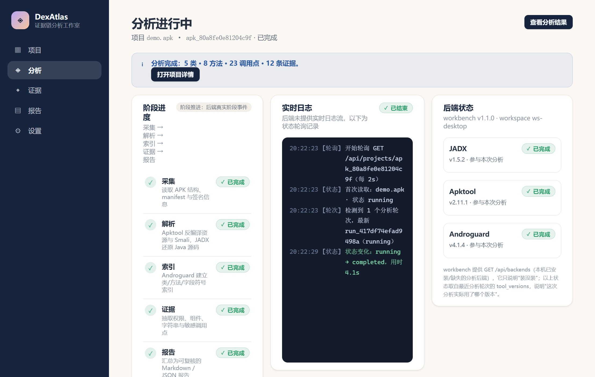

页面上写着：

- 横幅：**分析完成：5 类 · 8 方法 · 23 调用点 · 12 条证据。**
- 阶段进度：采集 / 解析 / 索引 / 证据 / 报告 **五格全是「已完成」**
- 轮次：`run run_417d · completed · 4.1s`
- 右上「后端状态」卡：
  - `JADX ✓ 已完成 · v1.5.2 · 参与本次分析`
  - `Apktool ✓ 已完成 · v2.11.1 · 参与本次分析`
  - `Androguard ✓ 已完成 · v4.1.4 · 参与本次分析`
- 页脚注明「以上状态取自最近分析轮次的 `tool_versions`，说明**这次分析实际用了哪个版本**」——不是「装没装」的推断

*整窗原生截图：* 

**③ 项目详情：12 / 12 条证据，每条标着它出自哪个后端**


页头是 `apk_80a8fe0e81204c9f · completed · 12 条证据 · 类 5 · 方法 8 · 调用点 23 · 边 21`，下面是 12 条证据，每条带后端标签：`字符串 APK Reader` / `权限 Apktool` / `组件 Apktool` / `汇聚点 Androguard` / `字符串 JADX` / `符号 Androguard`……

其中 **E-0008 的正文就是 JADX 参与的实证**：

> `E-0008 · jadx produced real Java for 7 of 8 methods in 5 of 5 classes`

这条证据只有 JADX 真的跑过并还原出 Java 源码才会出现——后端齐全时它才在，缺 JADX 时不在。

*整窗原生截图：* 

**④ 证据页**


**⑤ 设置页：侧车状态与后端版本**

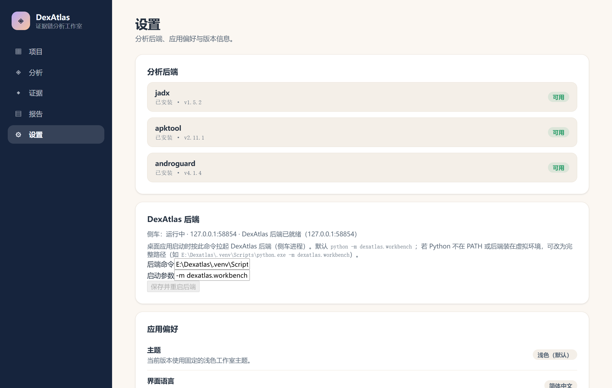

设置页把两件事分开说清楚了：

- 「分析后端」：`jadx 已安装 · v1.5.2 可用`、`apktool 已安装 · v2.11.1 可用`、`androguard 已安装 · v4.1.4 可用`
- 「DexAtlas 后端」：**侧车：运行中 · 127.0.0.1:58854 · DexAtlas 后端已就绪（127.0.0.1:58854）**

*整窗原生截图：* 

### 2.3 侧车那侧的数字（直连 58854 查的）

```
GET http://127.0.0.1:58854/api/backends
{
  "available": ["jadx", "apktool", "androguard"],
  "missing": [],
  "versions": { "jadx": "1.5.2", "apktool": "2.11.1", "androguard": "4.1.4" }
}

GET http://127.0.0.1:58854/api/projects/apk_80a8fe0e81204c9f
  status            : completed
  class_count       : 5
  method_count      : 8
  call_site_count   : 23
  call_edge_count   : 21
  evidence_count    : 12
  missing_backends  : []
  truncated         : false
  completeness      : { "complete": true, "missing_backends": [], "truncated": false, "errors": [] }
```

`missing_backends` 是空数组、`complete` 是 `true`、`errors` 是空数组——**这一轮没有任何后端缺席，也没有任何一步报错。**

### 2.4 对照：后端齐全 vs 后端缺失（两组都实测过，不是推断）

验收报告 §7 第 2 项记的是：二次验收时侧车环境里没有这两个后端，结果是 `partial`、**证据 10 条**。本轮把**缺后端的那一档也重跑了一遍**（同一份 `demo.apk`，只把 `DEXATLAS_JADX_PATH` 与 `DEXATLAS_APKTOOL_JAR` 置空——空串即禁用该后端），于是两档都有实测数字：

| | 后端齐全 | 后端缺失（JADX / Apktool 关掉） |
|---|---|---|
| `/api/backends` | `available [jadx, apktool, androguard]`、`missing []` | `available [androguard]`、`missing [jadx, apktool]` |
| 证据条数 | **12** | **10** |
| `complete` | `true` | `false` |
| `missing_backends` | `[]` | `[apktool, jadx]` |

**两条证据集合的差集（实测，不是推测）**——全后端多出 4 条真证据：

| 证据 | 内容 | 需要谁 |
|---|---|---|
| E-0002 | `SDK levels read from the APK's binary manifest: minSdk=24, targetSdk=34` | 反编译后的 manifest |
| E-0003 | `Package com.example.demo (versionName=1.0, minSdk=24, targetSdk=34)` + `android.permission.INTERNET` | Apktool |
| E-0004 | `2 component(s) are explicitly exported` | Apktool |
| E-0008 | `jadx produced real Java for 7 of 8 methods in 5 of 5 classes` | JADX |

而缺后端那一档**多出来的是两条「说明后端没跑成」的占位证据**（不是分析结论）：

```
E-0002 | observation | apktool did not complete in this run: apktool is not installed or not on PATH. …
E-0006 | observation | jadx did not complete in this run: jadx is not installed or not on PATH. …
```

`12 − 4 + 2 = 10`——两边条数对得上。

### 2.5 对照组：绕开桌面端，直接起后端

为了把「环境变量配得对不对」和「打包后的 exe 有没有把环境变量传下去」分开，额外跑了一次**不经桌面端**的对照：同样的三个环境变量，直接 `python -m dexatlas.workbench --port 0`，用同样的 `demo.apk` 走 HTTP。

结果**完全一致**：`available: [jadx, apktool, androguard]`、`missing: []`、`versions` 同上、`evidence_count: 12`、`complete: true`。

**这条对照说明的是：** 12 条证据这个结果由**后端集合**决定，与「是不是打包形态」无关；而桌面端跑出了同一个结果，说明**打包后的 exe 确实把环境变量原样传到了后端进程**。

---

## 3. 补测二：MSI 安装

### 3.1 安装包

`desktop/src-tauri/target/release/bundle/msi/DexAtlas Studio_0.1.0_x64_en-US.msi`（5,431,296 B）。MSI 是 Tauri 用缓存的 WiX 3.14 编出来的；Tauri 生成的 WiX 模板里 `InstallScope="perMachine"`（模板落在 `desktop/src-tauri/target/release/wix/x64/main.wxs`，是**构建产物**，不入库）。

### 3.2 逐条安装尝试

| # | 命令 | 退出码 | 结果 |
|---|---|---|---|
| A | `msiexec /i "….msi" /qn /l*v "…-silent.log"` | **1603** | **装不上**。日志里写得很直白：*MSI_LUA: Installation UI level is silent, no credential elevation is possible* |
| B | `msiexec /i "….msi" /passive /l*v "…-passive.log"` | **0** | **装上了**。日志：*MSI_LUA: Elevation required to install product, will prompt for credentials* → *MSI_LUA: Elevated credential consent provided. Install will run elevated* → *Running product '{680674BE-…}' with elevated privileges* |

（第一次尝试前，先用一个自制的最小探针 MSI 验证过「这个会话能不能装 per-machine 包」，探针同样 `/qn` 失败、`/passive` 成功——所以卡点跟 DexAtlas 这个包无关，是 Windows Installer 的机制。）

### 3.3 安装结果

| | |
|---|---|
| 安装路径 | **`C:\Program Files\DexAtlas Studio\`** |
| 产品名 / 版本 | `DexAtlas Studio` / `0.1.0` |
| 产品码 | `{680674BE-75AC-4D95-8397-32757BBB8C62}` |
| 卸载串 | `MsiExec.exe /X{680674BE-75AC-4D95-8397-32757BBB8C62}` |
| 装进去的文件 | `C:\Program Files\DexAtlas Studio\dexatlas-desktop.exe`（14,817,280 B，与 `target/release` 里那个**逐字节同大小**）、`C:\Program Files\DexAtlas Studio\Uninstall DexAtlas Studio.lnk` |

注册表卸载项：`HKLM\SOFTWARE\Microsoft\Windows\CurrentVersion\Uninstall\{680674BE-75AC-4D95-8397-32757BBB8C62}`。

### 3.4 装完能启动、能连上后端

从安装目录启动 `C:\Program Files\DexAtlas Studio\dexatlas-desktop.exe`（同样带上 §1.2 的三个环境变量），走了一遍同样的全链路：

- 侧车起来，**端口 57651**（`--port 0` 动态分配）
- 上传 `demo.apk` → 分析 → **12 条证据**，`complete: true`，`missing_backends: []`
- 五个阶段全「已完成」，`run run_ba16 · completed · 4.2s`
- 设置页照旧显示三个后端「已安装 · 参与本次分析」与「侧车：运行中 · 127.0.0.1:57651」


*整窗原生截图：* 


**安装形态的一个关键差别**：`desktop/src-tauri/src/sidecar.rs:462` 的 `repo_root_from_exe()` 从 exe 路径反推仓库根；装到 Program Files 后祖先链里没有 `src/dexatlas`，于是 `backend_cwd()`（`desktop/src-tauri/src/sidecar.rs:453`）返回 `None`——**侧车不再有工作目录**。这不影响可用性：`backend.json` 里存的是绝对路径 `E:\Dexatlas\.venv\Scripts\python.exe`，后端命令与 cwd 无关。本轮实测正是这一条路径。

### 3.5 为什么 `/qn` 装不上、`/passive` 装得上

> **2026-11-27 补测更正：** 这一节讲的是**未提升的会话**里的现象，结论仍然成立但**不是完整结论**。
> 在**已提升**的会话里 `/qn` **装得上**（退出码 0）——见 §4.1。所以「不要加 `/qn`」要改成
> **「在未提升的会话里不要加 `/qn`；要无人值守 + 静默，就先拿到一个已提升的会话」**。

**这不是 DexAtlas 的包有问题，是 Windows Installer 的机制：**

- Tauri 2.12.7 的 `bundle.windows.wix` 配置里**没有 `installMode` 选项**（只有 NSIS 有，默认 `currentUser`）→ **MSI 只能是 per-machine**，装到 Program Files 必须提权。
- 本次会话的令牌是**未提升的**：用户 `pc` 是本机 `Administrators` 组主组成员，但当前令牌是过滤后的（`IsInRole(Administrator)` = False）。**会话本身不是管理员令牌。**
- `/qn`（完全静默）下，Windows Installer **不做凭据提升**，日志原话是 *no credential elevation is possible* → 退出码 1603。
- `/passive`（被动 UI）下，Installer 走 LUA 路径，日志记着 *Elevation required … will prompt for credentials* 与 *Elevated credential consent provided. Install will run elevated* → **实际的写入动作由 SYSTEM 身份的安装服务完成** → 退出码 0。

**给使用者的一句话：** 装这个 MSI 时**不要加 `/qn`**；用 `/passive`（或双击走 UI）即可。**这与打包配置无关，不需要改 `tauri.conf.json`。**

> **2026-11-27 补测更正：** 上面这句「不要加 `/qn`」只对**未提升的会话**成立。**在已提升的会话里 `/qn` 装得上**
> （退出码 0，见 §4.1）——无人值守部署要的是「静默 **且** 管理员令牌」，而不是「静默」本身。

---

## 4. 这次测量看不到什么

诚实地列出来，不要在别处被当成已验证：

1. **macOS / Linux 的打包产物真机验证——没做**，也不在执行单范围内。本轮所有结论只对 Windows 11 成立。
2. **`msiexec /i … /qn` 的无人值守安装——已覆盖（2026-11-27 补测）**：在**已提升**的会话里 `/qn` **装得上**，退出码 **0**；在**未提升**的会话里 `/qn` 仍然失败（1603），但失败点有两个，日志分别写得很清楚：已装旧版时是 `Error 1730`（移除旧产品需管理员权限），空场时是 `Error 1925`（权限不足）。原先「`/qn` 装不上」的结论要改成：**装不上的是未提升的会话，不是 `/qn` 本身**。详见 §4.1。
3. **MSI 的升级 / 卸载 / repair 路径——已覆盖（2026-11-27 补测）**：升级（卸旧装新）、卸载、repair（`/fa`）三条路径都实跑过，退出码与落地状态见 §4.2。**发现一个缺陷**：`/fa` 修不回被删掉的 `Uninstall DexAtlas Studio.lnk`，而控制面板的「修复」入口被 `ARPNOREPAIR=yes` 关掉——详见 §4.2.3。
4. **代码签名**——MSI 与 exe 都没签名（`SOFTWARE RESTRICTION POLICY: … is not digitally signed`，本机策略是 `unrestricted`，所以没拦）。**在有签名要求的机器上会怎样，未知。**
5. **强制结束 exe 时的孤儿后端——仍未实测**（验收报告 §7 第 4 项，本轮不涉及）。本轮所有退出都是正常退出路径。
6. **failed / cancelled run 的时间线——仍未实跑**（验收报告 §7 第 7 项）。本轮只跑成了 completed 的路径。
7. **应用配置目录读的是哪一份**（`C:\Users\pc\AppData\Roaming\io.github.dexatlas.desktop\backend.json` vs MSIX 容器下的 `…\Packages\Claude_pzs8sxrjxfjjc\LocalCache\Roaming\…\backend.json`）——**本轮没做判别实验**。两份文件逐字节相同，所以结论不依赖读的是哪一份；但「非 MSIX 容器下的启动」这一项（验收报告 §7 第 5 项）**仍然开放**。
8. **样例只有 `examples/demo-app/demo.apk`**（2,951 B，一方样例）。**没有**拿真实第三方 APK 测过——项目规则 7 不让第三方 APK 进仓库，本轮也没有绕过这条。
9. **多轮 / 大体量 APK**——只跑了一轮 3 KB 的样例。**并发上传、大文件（>100 MB）、畸形 APK 的桌面端表现未测。**
10. **本轮跑的是 `dexatlas-desktop.exe` 这个「裸」可执行文件**（`target/release/`），以及它的 MSI 安装态。**NSIS 安装器本轮没有装**（上一轮验收已装过）。

### 4.1 `/qn` 在提升会话里能不能装——能（2026-11-27 补测）

**怎么做的提升：** 本机 `HKLM\SOFTWARE\Microsoft\Windows\CurrentVersion\Policies\System` 的
`ConsentPromptBehaviorAdmin` = **0**、`EnableLUA` = 1——管理员组成员**静默提升，不弹 UAC**。
用户 `pc` 在本机 `Administrators` 组里，所以 `Start-Process -Verb RunAs` 直接拿到了提升令牌，
**全程无人值守、没有人工点任何按钮**：

```
Start-Process -FilePath powershell.exe -Verb RunAs -ArgumentList "<脚本>"
```

提升后的会话自报身份（写进结果文件，不是推断）：

```
ELEVATED=True
USER=DESKTOP-BJJHSDF\pc
INTEGRITY=Mandatory Label\High Mandatory Level 标签   S-1-16-12288
```

**计划任务那条路走不通，如实记下：** 先试了「计划任务 `-RunLevel Highest`」，
`Register-ScheduledTask` 直接返回 **`PermissionDenied`（HRESULT 0x80070534 / 0x80070005）**——
注册一个以最高权限运行的任务需要管理员权限，而**发起注册的那个会话本身没有管理员令牌**。
所以本轮走的是 `Start-Process -Verb RunAs`（第 2 条）。

**四组对照，每组都记了 msiexec 的退出码：**

| # | 会话 | 机器状态 | 命令 | 退出码 | 日志里的失败点 / 成功点 |
|---|---|---|---|---|---|
| 1 | 未提升 | 已装旧版 | `msiexec /i <msi> /qn` | **1603** | `Error 1730`：移除旧产品需要管理员权限；失败动作是 `RemoveExistingProducts` |
| 2 | 未提升 | 空场 | `msiexec /i <msi> /qn` | **1603** | `Error 1925`：权限不足；失败动作是 `InstallFinalize` |
| 3 | **已提升** | 已装旧版 | `msiexec /i <msi> /qn` | **0** | 装上了（旧产品被移除、新产品装上） |
| 4 | **已提升** | 空场 | `msiexec /i <msi> /qn` | **0** | 装上了（干净安装） |

第 1 组与第 2 组的**失败点不是同一个**：第 1 组死在「移除旧版本」，第 2 组死在「安装新版本」。
两组的共同前置条件都是 `MSI_LUA: Installation UI level is silent, no credential elevation is possible`
——**静默模式不做凭据提升**；而 `/passive` 会做，日志原话是：

```
MSI_LUA: Elevation required to install product, will prompt for credentials
MSI_LUA: Credential Request return = 0x0
MSI_LUA: Elevated credential consent provided. Install will run elevated
```

（`/passive` 在本机同样**不需要人工交互**——凭据请求直接返回 0x0。）

**给使用者的一句话（与 §3.5 那句要一起读）：** 装这个 MSI **要么用 `/passive`**，**要么在已提升的会话里用
`/qn`**。在**未提升**的会话里 `/qn` 一定失败——这不是 DexAtlas 的包有问题，是 Windows Installer 的机制。

**本轮没验到的：** `/qn` 在**已提升**会话里装**旧版**（产品码 `{680674BE-…}`）的 MSI 是什么样——本轮没有那份
旧 MSI（见 §4.2.1 的说明），所以这条路径没有数据。


### 4.2 升级 / 卸载 / repair 三条路径（2026-11-27 补测）

#### 4.2.1 先说清楚「旧版本」是哪一份

执行单里写的是「旧版从 GitHub Release 的 v1.1.0 拿」。**本轮做不到——v1.1.0 的 Release 没有任何资产**，
而且**本仓库所有 Release 都没有资产**（`gh release list` 逐个查过，9 个 Release 的 assets 全为空数组）。
所以「旧版本」用的是**机器上原本装着的那个 0.1.0**：

| | 旧版（升级前） | 新版（本轮构建） |
|---|---|---|
| 来源 | 上一轮（2026-11-26）装的 | 本轮 `npm run tauri build` 产出 |
| 源码基线 | `bb04ac5` | `f5ccff6`（本 worktree HEAD） |
| 产品码 | `{680674BE-75AC-4D95-8397-32757BBB8C62}` | `{A8D5B3E6-03C0-4D1A-9A6F-030AC98DA30D}` |
| ProductVersion | 0.1.0 | 0.1.0 |
| UpgradeCode | `{1C8C5729-38FC-513A-8777-CB10AB067608}` | 同左 |

**两版 ProductVersion 相同**（`desktop/src-tauri/tauri.conf.json` 的 `"version": "0.1.0"` 在两个基线上都没变过），
所以这次「升级」实际走的是 **same-version major upgrade**：MSI 模板里有
`<MajorUpgrade Schedule="afterInstallInitialize" AllowDowngrades="yes" />`（WiX 模板落在
`desktop/src-tauri/target/release/wix/x64/main.wxs`，是构建产物、不入库），新旧产品码不同 → 卸旧装新。

**这与将来的 v1.1.0 → v1.2.0 是同一条路径**：产品码随每次构建变、UpgradeCode 不变、版本号由
`tauri.conf.json` 决定。**本轮验的是 same-version 的那一种；版本号递增的那种没有单独验过。**

#### 4.2.2 升级：卸旧装新，退出码 0，数据目录没丢

```
msiexec /i "<msi>" /qn /l*v <log>      # 在 §4.1 第 3 组的已提升会话里
```

| | 升级前 | 升级后 |
|---|---|---|
| 注册的产品码 | `{680674BE-75AC-4D95-8397-32757BBB8C62}` | `{A8D5B3E6-03C0-4D1A-9A6F-030AC98DA30D}` |
| 安装目录 | `C:\Program Files\DexAtlas Studio\`（旧 exe 14,817,280 B） | 同一路径（**新 exe 14,822,400 B**） |
| `InstallDate` | 20261126 | 20261127 |
| `%APPDATA%\io.github.dexatlas.desktop\backend.json` | sha256 `d358dbc4…` | sha256 `d358dbc4…`（**未变**，mtime 也未变） |
| 开始菜单 / 公共桌面快捷方式 | 在 | 在 |

**新 exe 的字节来源追到了底**：装进机器的那份 exe sha256 = `875a21841caa40e193452660c60a31fe90bfa29bb2f5494da1b3e2c3fd444e00`；
用 `msiexec /a`（行政安装，只解包不注册产品）把 MSI 解出来，里面 `PFiles\DexAtlas Studio\dexatlas-desktop.exe`
的 sha256 **与装进机器的那份逐字节相同**。它与 `target/release/dexatlas-desktop.exe` 的 sha256
（`aeeda776…`）不同，原因是 Tauri 打包时对 exe 打了 bundle-type 补丁（构建日志里写着
*Patching … with bundle type information: msi*，随后又 patch 成 nsis，留在构建目录里的是 nsis 那一份）。

**升级后应用能起来、能连上后端**（从 `C:\Program Files\DexAtlas Studio\dexatlas-desktop.exe` 启动，
CDP 读页面）：标题 `DexAtlas Studio`、origin `http://tauri.localhost/`、首页渲染完整；
设置页显示 **侧车运行中 · 127.0.0.1:55759 · DexAtlas 后端已就绪**，三个后端
（jadx v1.5.2 / apktool v2.11.1 / androguard v4.1.4）都是「已安装 · 可用」。


> **一个容易读错的地方：** 设置页「关于」里的 **v1.2.0 是侧车后端的版本**，不是被测的桌面 exe 的版本——
> 它来自 `src/dexatlas/__init__.py:11` 的 `__version__`（主检出里主会话正在做的发版改动），经 workbench 的
> health 接口回到前端。**桌面 exe 自己的版本是 0.1.0**（`Cargo.toml` 与 `tauri.conf.json`）。

#### 4.2.3 repair：`/fa` 修得回 exe，修不回卸载快捷方式（缺陷）

**破坏**（在提升会话里，删掉安装目录里的两个文件）：`dexatlas-desktop.exe` 与 `Uninstall DexAtlas Studio.lnk`。

```
msiexec /fa "<msi>" /qn /l*v <log>      # 退出码 0
```

| | 结果 |
|---|---|
| `dexatlas-desktop.exe` | **修回来了**，14,822,400 B，sha256 `875a2184…`（与 §4.2.2 里 MSI 内含的那份一致） |
| `Uninstall DexAtlas Studio.lnk` | **没修回来**（仍然缺失） |
| 注册的产品码 | `{A8D5B3E6-…}`，不变 |
| repair 后应用能不能启动 | **能**：首页渲染完整，侧车起来、后端三个都「已安装 · 可用」 |


**为什么修不回（从 MSI 表里读出来的，不是猜的）：** `File` 表**只有一行**——`dexatlas-desktop.exe`；
那个 `Uninstall DexAtlas Studio.lnk` 在 **`Shortcut` 表**里（`UninstallShortcut` 行，组件 `CMP_UninstallShortcut`），
而该组件的 **KeyPath 是注册表键**（`reg8F92A735…`）而不是这个 lnk 文件。于是 repair 时 MSI 认为
「组件已安装（`Installed: Local`）」→ **不重写快捷方式**；日志里 `CreateShortcuts` 动作
`Return value 1`（跳过），且全文 **0 次**提到那个 lnk 文件名。

**影响面（决定了这是不是一个真缺陷）：** MSI 里 `ARPNOREPAIR = yes`、`ARPNOMODIFY = 1`，
注册表卸载项里对应着 `NoRepair = 1`、`NoModify = 1`——**控制面板「程序和功能」里的「修复」与「更改」入口
都被关掉了**。于是用户遇到「卸载快捷方式不见了」时：
**控制面板点不到修复，只能命令行 `msiexec /fa`（要管理员），而命令行这条路也修不回那个 lnk。**

**这不是本轮引入的**：那个 lnk 是 `UninstallShortcut` 快捷方式，MSI 只在 `INSTALLDIR` 写一份；
用户桌面上的 `C:\Users\pc\Desktop\DexAtlas Studio.lnk` **指向 `D:\Users\pc\AppData\Local\…`
且创建于 2026-11-25 17:06:58**（早于本轮，也早于上一轮的 MSI 安装），是更早一次别的安装方式留下的孤儿，
**本轮原样留着没动**。卸载后它依然在——**不是 MSI 卸不干净**。

**建议（留给修的人，本轮不改代码）**：把卸载快捷方式从 `Shortcut` 表挪进 `File` 表（让它成为受管文件），
或者在 `REINSTALLMODE`/`REINSTALL` 属性上让 repair 强制重建快捷方式；至少要在发布说明里写明
「控制面板没有修复入口」。**回归测试建议**：装好后删掉 `Uninstall DexAtlas Studio.lnk`，
跑 `msiexec /fa`（提升会话），断言该文件回来且哈希与安装态一致。

#### 4.2.4 卸载：退出码 0，安装目录与注册表都清干净，用户配置目录保留

```
msiexec /x "{A8D5B3E6-03C0-4D1A-9A6F-030AC98DA30D}" /passive /l*v <log>    # 退出码 0
```

| | 卸载后 |
|---|---|
| `C:\Program Files\DexAtlas Studio\` | **整个目录没了** |
| 注册表卸载项 | 没了（`STILL_REGISTERED=none`） |
| 开始菜单快捷方式 / 公共桌面快捷方式 | 没了 |
| `%APPDATA%\io.github.dexatlas.desktop\` | **还在**，`backend.json` sha256 与卸载前逐字节相同 |

**用户配置目录保留是对的**——那是用户自己的数据（后端命令），不属于安装产物。

**用旧产品码卸载会失败（升级后的必然结果）：**

```
msiexec /x "{680674BE-75AC-4D95-8397-32757BBB8C62}" /passive    # 退出码 1605
```

1605 = 「此产品未安装」——升级换掉了产品码，旧码不再是注册的产品。**执行单 §3 里那条卸载命令在升级之后
不再适用**，得用当前产品码。**这次 1605 没有动到安装**（产品码仍是 `{A8D5B3E6-…}`，exe 完好）。

#### 4.2.5 机器已恢复原状

测试结束时的状态：安装目录不存在、注册表无卸载项、开始菜单与公共桌面快捷方式不存在、
`%APPDATA%\io.github.dexatlas.desktop\backend.json` 与本轮开始时的备份**逐字节相同**
（sha256 `d358dbc4…`）、无遗留的 dexatlas 进程与侧车进程。

---

## 5. 补测三：非 MSIX 容器下的启动（2026-11-27，第三轮）

**补的是验收报告 §7.3 第 2 项——「非 MSIX 容器下的启动未单独验证」。**

### 5.1 为什么这一轮就是「非容器」：进程没有包身份

前两轮（§2、§3、§4）的 exe 都是由 Claude 桌面应用拉起的。Claude 桌面应用本身是 MSIX 包
（`Get-AppxPackage`：`Claude_pzs8sxrjxfjjc`，`SignatureKind: Developer`），它启动的子进程被
放进 MSIX 容器，配置写入被文件系统虚拟化重定向到
`C:\Users\pc\AppData\Local\Packages\Claude_pzs8sxrjxfjjc\LocalCache\Roaming\…`——这就是那一项
当初「未单独验证」的原因。

本轮的驱动进程**没有包身份**，用 `GetCurrentPackageFullName` 直接量过：

```
rc = 15700 (APPMODEL_ERROR_NO_PACKAGE)   # 本会话的 shell 进程
```

这个进程用 `subprocess.Popen` 启动的 `dexatlas-desktop.exe` 因此也不在任何容器里——
它读写的 `%APPDATA%\io.github.dexatlas.desktop\` 就是**真实路径**，不是虚拟化路径。
这不是推断：§5.3 的判别实验把它证死了。

### 5.2 被测对象：本 worktree 构建的 v1.2.0

| | |
|---|---|
| 仓库基线 | worktree `strange-ardinghelli-f4f02c`，HEAD `d9f2f24`；`src/`、`desktop/src/`、`desktop/src-tauri/src/` 与主检出 `diff -rq` **无输出**（完全相同） |
| 被测 exe | `desktop/src-tauri/target/release/dexatlas-desktop.exe`，14,823,424 B，sha256 `0f843b8b…`（完整：`0f843b8bd357c73a0dd229dfc27a2bc5d6e44b532630331fac22474be9f38a98`） |
| 版本 | `1.2.0`（`tauri.conf.json`——4769076 之后版本号三处对齐发版号） |
| 侧车 python | `E:\Dexatlas\.venv\Scripts\python.exe`（editable 指向主检出 `E:\Dexatlas\src`，与上表同一份代码） |
| 工作区 | 本 worktree `.scratch\ws-nonmsix`（每轮开始前为空） |
| 驱动 | 与 §2 同一套 CDP 手法（`--remote-debugging-port=9222`）；上传走 `<input type=file>` + `DataTransfer`，与用户操作同构 |

三个后端环境变量与 §1.2 相同（JADX 1.5.2 / Apktool 2.11.1 / Androguard 4.1.4）。

### 5.3 判别实验：exe 读的是真实路径的 backend.json，不是虚拟化那份

**问题所在：** 真实路径与虚拟化路径的两份 `backend.json` 逐字节相同
（都是 sha256 `c1387ed5…`，`fsutil file queryfileid` 显示两者在文件系统层面也是同一个文件——
虚拟化视图是真实文件的投影）。读哪份结论都一样，所以**必须人为制造差别**才能判别。

**手法：** 把真实路径的 `backend.json` 改成指向一个 wrapper 批处理——wrapper 先往标记文件
追加一行，再把参数原样转发给真 python（stdio 继承，侧车照常工作）；虚拟化路径那份**不碰**。

```
改动前（真实路径）：{"command": "E:\\Dexatlas\\.venv\\Scripts\\python.exe", "args": ["-m","dexatlas.workbench"]}
改动后（真实路径）：{"command": "<worktree>\\.scratch\\nonmsix-findings\\backend-wrapper.bat", "args": ["-m","dexatlas.workbench"]}
虚拟化路径：        不动（仍是 python.exe 那份）
```

**结果（逐字）：**

```
wrapper-marker.txt: started 21:20:45.04 E:\Dexatlas\.claude\worktrees\strange-ardinghelli-f4f02c
exe-log2.txt:       [backend-stderr] INFO:  Uvicorn running on http://127.0.0.1:53421
```

**标记文件出现了**——侧车经 wrapper 启动，即非容器 exe 读的是**真实路径**的 `backend.json`
（`sidecar.rs` 的 `backend_config_path()` 走 `app_config_dir()`，在无包身份的进程里就是
`%APPDATA%\io.github.dexatlas.desktop\`）。测完真实路径已恢复，与备份逐字节相同
（sha256 `c1387ed5…`）；虚拟化路径全程未动。

### 5.4 观察到什么（与 §2 同一档证据）

> **三次启动，先说清。** 本轮的观察来自同一 exe 的**三次独立启动**：第一次跑了完整分析
> （上传 → 分析 → 12 条证据，下表与两张截图）；第二次是 §5.3 的判别实验（真实
> `backend.json` 被 wrapper 替换的那次启动）；第三次补拍项目详情 / 证据 / 设置页的导航
> 截图。三次都是无包身份的进程拉起，工作区同一个（`ws-nonmsix`），分析只跑了第一次那次。

从本 worktree 构建的 exe（非容器）启动 → 上传 `examples/demo-app/demo.apk` → 等分析完成：

- 横幅：**「分析完成：5 类 · 8 方法 · 23 调用点 · 12 条证据。」**
- 阶段进度：采集 / 解析 / 索引 / 反编译 / 报告 **五格全是「已完成」**
- `run run_ce4c · completed · 3.0s`；`jadx v1.5.2 · apktool v2.11.1 · androguard v4.1.4`
- 右上「后端状态」卡：三个后端全「✓ 已完成 · 参与本次分析」

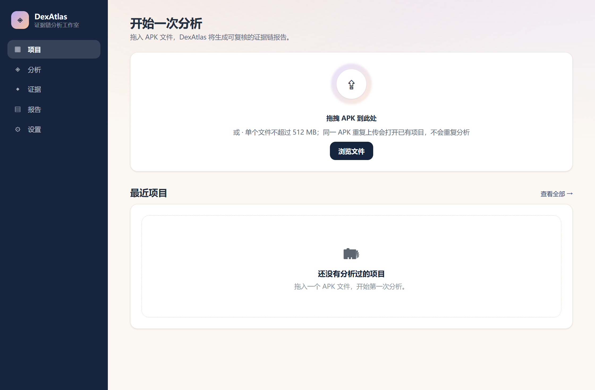
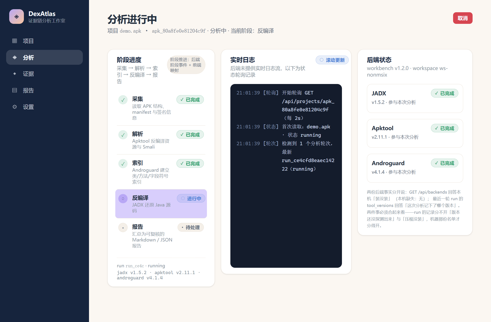
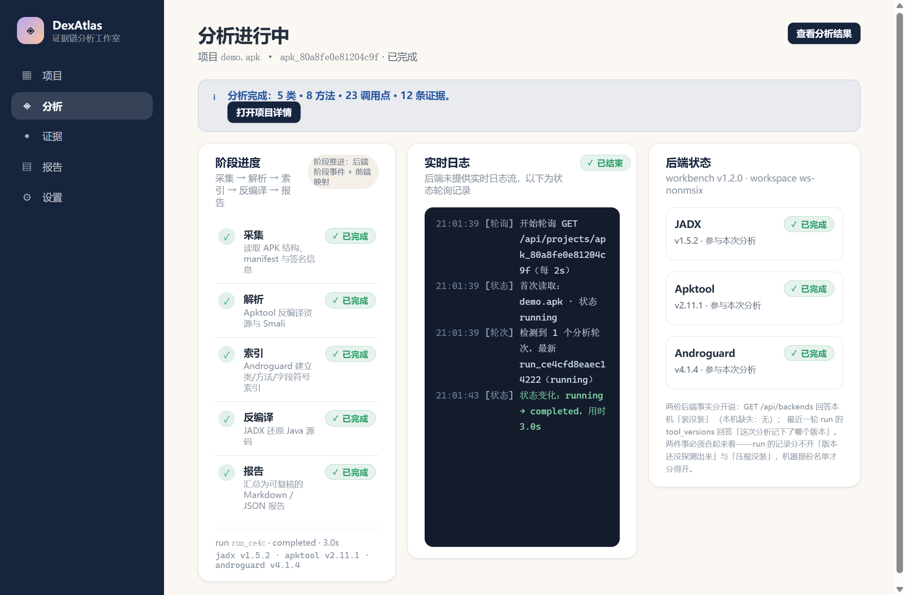
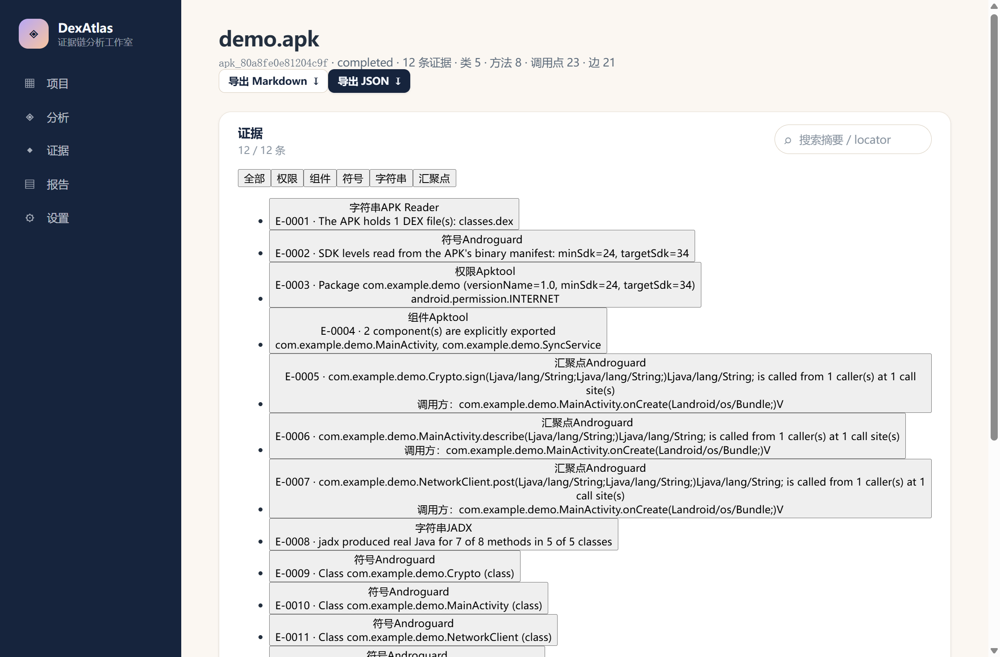
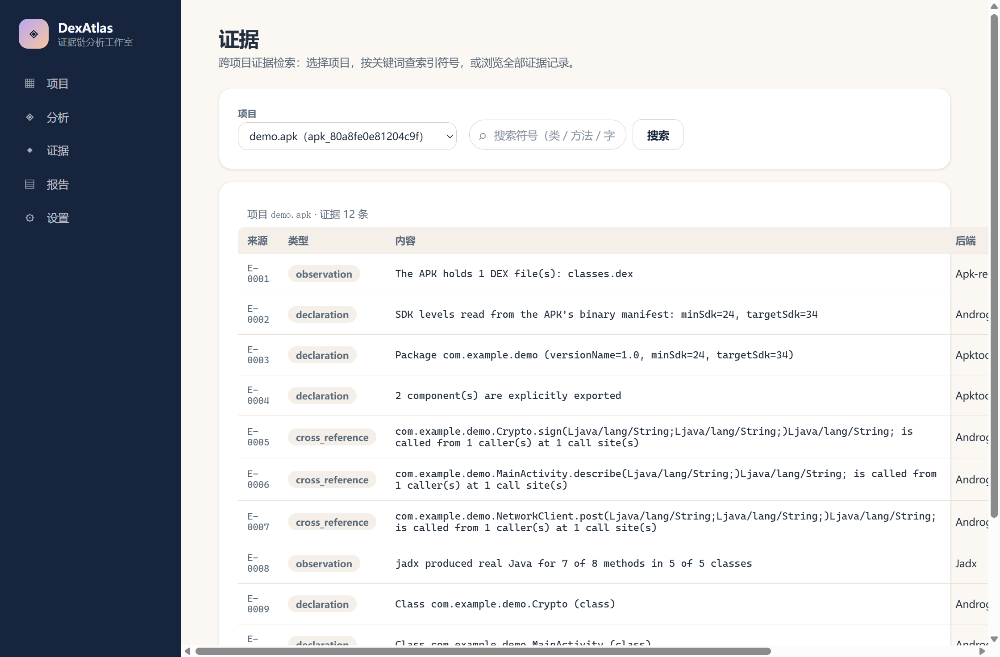

**工作区数据库里的数字（直查 `.scratch/ws-nonmsix/dexatlas.db`）：**

```
project apk_80a8fe0e81204c9f  status = completed
  class_count = 5   method_count = 8   evidence_count = 12
run run_ce4cfd8eaec14222  status = completed  completeness = complete  errors = []
  tool_versions = {"jadx": "1.5.2", "apktool": "2.11.1", "androguard": "4.1.4"}
```

**侧车那侧（判别实验那一次启动，从 exe 日志读出端口 53421，shell 直连——shell 同样无包身份）：**

```
GET http://127.0.0.1:53421/api/health
{"version":"1.2.0","workspace":"ws-nonmsix"}

GET http://127.0.0.1:53421/api/backends
{"available":["jadx","apktool","androguard"],"missing":[],"versions":{"jadx":"1.5.2","apktool":"2.11.1","androguard":"4.1.4"}}
```

**设置页**（第三次启动，侧车状态卡）：**「侧车：运行中 · 127.0.0.1:55999 · DexAtlas 后端已就绪」**，
三个后端「已安装 · 可用」，关于区显示 `v1.2.0 · 桌面应用（exe 与 MSI 安装包）`。

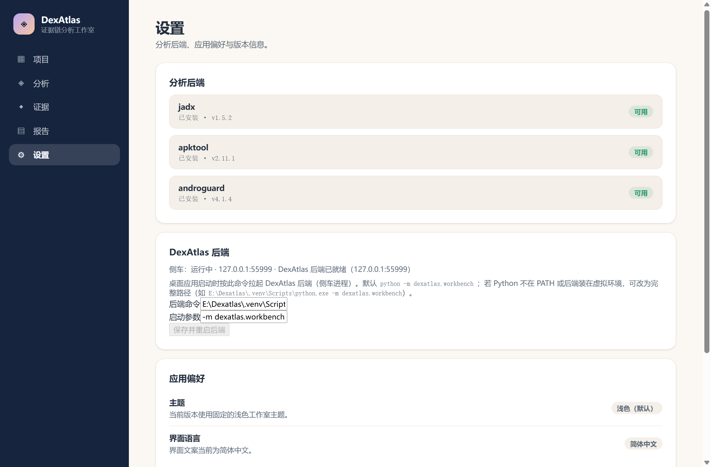

### 5.5 升级路径在非容器形态下同样成立（NSIS per-user）

§4.2 验的升级是 MSI（per-machine，要提升会话）。非容器形态还有一条对应路径：
**NSIS per-user 升级**——机器上从 2026-11-25 就装着 NSIS 0.1.0
（`D:\Users\pc\AppData\Local\DexAtlas Studio\`，HKCU 注册表，per-user、不提权），
本轮用本 worktree 构建的 NSIS 包静默升级它：

```
& '…\bundle\nsis\DexAtlas Studio_1.2.0_x64-setup.exe' '/S'    # 退出后核对
```

| | 升级前 | 升级后 |
|---|---|---|
| 注册表 `DisplayVersion` | 0.1.0 | **1.2.0** |
| 安装目录 | `D:\Users\pc\AppData\Local\DexAtlas Studio\` | 同一路径 |
| 装进去的 exe | 14,816,256 B，sha256 `14e5f7fd…` | 14,823,424 B，sha256 `8c355d29…` |
| `.dexatlas\dexatlas.db`（用户数据） | sha256 `a020626f…` | **逐字节相同** |

装进去的 exe 与 `target/release` 那份（`0f843b8b…`）**同尺寸（14,823,424 B）不同哈希**——
与 §4.2.2 里 MSI 那份的现象一致：打包器给 exe 打了 bundle-type 补丁
（构建日志：*Patching … with bundle type information: nsis*）。

**升级后从安装目录启动**（安装态 + 非容器；`repo_root_from_exe()` 从
`D:\Users\pc\AppData\Local\DexAtlas Studio` 反推不出仓库根 → `backend_cwd()` 返回 `None`，
与 §3.4 记录的机制相同）：

```
GET http://127.0.0.1:65207/api/health     → {"version":"1.2.0","workspace":"ws-nonmsix"}
GET http://127.0.0.1:65207/api/backends   → 三个后端齐全（同 §5.4）
```

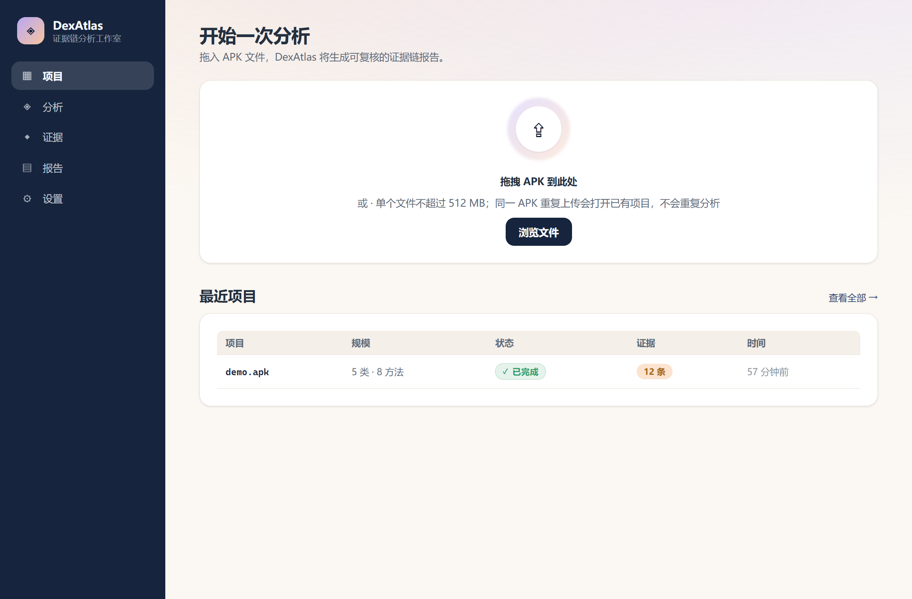


### 5.6 这一轮没验到的

> **2026-11-28 更新：** 本节的前两条（NSIS 卸载、NSIS 首次安装）**已在 §5.8 补上**——
> 2026-11-28 那一轮把机器清到首装形态，跑了完整首装与卸载，并实测了 NSIS 的
> `ProductVersion` 是否跟着发版号走。剩下的两条仍然开放。

- ~~**卸载路径**：NSIS 卸载会把安装目录连同里面的 `.dexatlas` 用户数据一起删掉；那份 0.1.0
  时代的项目数据不是本轮创建的，删它要作者拍板，本轮没有执行卸载。MSI 的卸载路径 §4.2.4 已验过。~~
  **已验（§5.8.3）：** NSIS 静默卸载退出码 0，安装目录整个没了，注册表卸载项没了，
  两份快捷方式都没了，**`%APPDATA%` 的 `backend.json` 逐字节保留**（sha256 `c1387ed5…` 不变）。
  §5.6 当时担心的「`.dexatlas` 用户数据会被一起删掉」**只在安装目录里那份**成立，
  而那份不在 `%APPDATA%` 里。
- **修复（repair）路径**：NSIS 安装器没有 repair 模式（MSI 的 §4.2.3 已验）。
- ~~**首次安装（空机器 → 装上）**：本轮只验了「在已有 0.1.0 的机器上升 1.2.0」；
  全新机器的首次 NSIS 安装没验（主会话 2026-11-27 的打包复验轮已覆盖 MSI 首装）。~~
  **已验（§5.8.1）：** 机器清到首装形态后静默首装退出码 0，装到
  `C:\Users\pc\AppData\Local\DexAtlas Studio\`，装完的应用能起来、侧车起来、
  一次真实分析跑完（12 条证据、五阶段全完成、三后端参与）。
- **MSI 在非容器下的重装**：MSI 装卸都验过，但都是在（可能的）容器上下文里跑的命令行；
  本轮没有再走一遍 MSI。判断上 msiexec 的容器敏感性远低于 GUI 应用（它本来就是系统服务），
  但没有单独取证。

### 5.8 NSIS 的首次安装与卸载（2026-11-28 第四轮）

> **这一轮补的是 §5.6 当时明写「没验到」的两条**：NSIS 的**首次安装**与 NSIS 的**卸载**，
> 外加一件顺带核的事——**NSIS 的 `ProductVersion` 是否跟着发版号走**。
> **只做验证与记录，不改产品代码、不加测试。**

#### 5.8.0 被测对象与这一轮的做法

| | |
|---|---|
| 仓库基线 | worktree `zen-sammet-4b7f5e`，HEAD `273536b`；`src/`、`desktop/src/`、`desktop/src-tauri/src/` 与上一轮被测的那棵树 `diff -rq` **无输出** |
| NSIS 安装包 | **本 worktree 自建**（`npm run tauri build`，Rust 编译 3m01s），`desktop/src-tauri/target/release/bundle/nsis/DexAtlas Studio_1.2.0_x64-setup.exe`，3,785,587 B，sha256 `99f920b6…` |
| exe 的版本资源 | `FileVersion 1.2.0` / `ProductVersion 1.2.0` / `ProductName DexAtlas Studio` |
| 驱动进程 | **无包身份**：`GetCurrentPackageFullName` rc=**15700**（`APPMODEL_ERROR_NO_PACKAGE`）——与 §5.1 同一套量法，三种调用形状（`(len,buf,len)`、sizing 版、`(len,buf)`）都回 15700 |
| 机器形态 | **首装形态**：本轮开始前先把机器上原有的 NSIS 安装**卸掉**，再把残留（两棵安装目录、两个注册表键、两份快捷方式、`%APPDATA%` 配置目录）**移到一边**（不是删），并确认全部不在位 |

**这一轮为什么必须先把机器清干净：** 上一轮（§5.5）验的升级是「在已有 0.1.0 的机器上升 1.2.0」，
机器上留着 `HKCU\Software\github\DexAtlas Studio`（NSIS 用来**记住上次装到哪**的键）。
那个键还在，下一次静默安装就会被它带到旧目录去——那不是首装。
把键、目录、快捷方式都清掉之后，首装才真的是首装。

#### 5.8.1 首次安装：退出码 0，装到 `%LOCALAPPDATA%`，应用起来、侧车起来、一次真实分析跑完

```
'DexAtlas Studio_1.2.0_x64-setup.exe' '/S'      # 退出码 0，0.9 秒
```

| | 装完的样子 |
|---|---|
| 安装目录 | **`C:\Users\pc\AppData\Local\DexAtlas Studio\`**（NSIS `INSTALLMODE "currentUser"` ⇒ `$LOCALAPPDATA`） |
| 目录里有什么 | `dexatlas-desktop.exe`（14,823,424 B，sha256 `01bd3db5…`，`FileVersion 1.2.0`）与 `uninstall.exe`（79,493 B） |
| 注册表卸载项 | `HKCU\Software\Microsoft\Windows\CurrentVersion\Uninstall\DexAtlas Studio`：`DisplayVersion` **1.2.0**、`Publisher` github、`InstallLocation`/`UninstallString`/`DisplayIcon` 都指向 `C:\…`、`NoModify 1`、`NoRepair 1` |
| 记住位置的键 | `HKCU\Software\github\DexAtlas Studio`（默认值）= `C:\Users\pc\AppData\Local\DexAtlas Studio` |
| 快捷方式 | 桌面 `DexAtlas Studio.lnk` 与开始菜单 `DexAtlas Studio.lnk` **都建了**（静默安装器也建桌面快捷方式——`installer.nsi:741`） |
| **提权 / 重启** | **都没有**：per-user 安装不提权；**全程未遇 3010，未触发任何重启提示** |

**首装的第一次启动：侧车起不来——这是如实记下来的一条。**
新装的机器上 `%APPDATA%\io.github.dexatlas.desktop\backend.json` **不存在**，
应用于是用默认命令 `python -m dexatlas.workbench`（`sidecar.rs:658`）。本机 PATH 上的
`python` 是 `C:\Users\pc\AppData\Local\Programs\Python\Python310\python.exe`，它没有装 dexatlas：

```
[backend-stderr] C:\Users\pc\AppData\Local\Programs\Python\Python310\python.exe:
  Error while finding module specification for 'dexatlas.workbench'
  (ModuleNotFoundError: No module named 'dexatlas')
```

**这不是缺陷，是「首次安装后要配置一次」的真实形态**，而且设置页把这件事写了出来
（截图 `machine-11-11`：侧车「未运行 · 正在启动 DexAtlas 后端…」，后端命令那格里是默认的
`python`，「分析后端」那张卡还在加载）。本轮**按用户会做的做**：在设置页把后端命令填成
`E:\Dexatlas\.venv\Scripts\python.exe` 并点「保存并重启后端」——
**这一步是点 UI 做的**（`#backend-command-input` 里填值 + 点 `button.backend-command-save`，
事件是真实 DOM 事件，不是走后端 API 冒充）。保存后：

```
%APPDATA%\io.github.dexatlas.desktop\backend.json  ← 应用自己写的（§5.8.3 卸载后仍在）
  {"args": ["-m", "dexatlas.workbench"], "command": "E:\\Dexatlas\\.venv\\Scripts\\python.exe"}
```

侧车随即起来（`Uvicorn running on http://127.0.0.1:63621`），设置页显示
**「侧车：运行中 · 127.0.0.1:63621 · DexAtlas 后端已就绪」**。

**然后是一次真实分析**（上传 `examples/demo-app/demo.apk`，走 `<input type=file>` +
`DataTransfer` + `change` 事件，与用户操作同构）：

```
分析完成：5 类 · 8 方法 · 23 调用点 · 12 条证据。
采集 ✓ · 解析 ✓ · 索引 ✓ · 反编译 ✓ · 报告 ✓        （五阶段全「已完成」）
jadx v1.5.2 · apktool v2.11.1 · androguard v4.1.4   （三个后端全「参与本次分析」）
轮询记录：状态变化 running → completed，用时 3.3s
```

**工作区数据库里的数字**（直查 `.scratch/nsis-verify/ws-install/dexatlas.db`）：

```
project apk_80a8fe0e81204c9f  status = completed
  class_count = 5   method_count = 8   evidence_count = 12   call_edge_count = 21
  tool_versions = {"jadx": "1.5.2", "apktool": "2.11.1", "androguard": "4.1.4"}
  errors = []
run run_33202d5b3aca4bc7  status = completed  completeness = complete  errors = []
evidence 表 12 行
```

> **截图里有一处要读准：** 阶段进度下面那行在截图上写的是
> `run run_3320 · running`——**那一行是「最近一轮 run 的状态」，与横幅不是同一份读数**：
> 横幅来自项目状态轮询（它先看到 completed，于是画出「分析完成」），
> 而这一行来自**另一个**、每 2s 一次的 `GET /api/projects/{id}/runs` 轮询。
> 截图是在横幅一出现就拍的，**那次 runs 轮询还没回来**，所以它还停在上一轮读到的
> `running`。同一张截图里紧挨着的轮询记录写着「状态变化：running → completed，用时 3.3s」，
> 后端日志里 runs 端点被问了 **3 次**（第 16、20、23 行——**最后一次在转换之后**），
> 而**数据库里那一轮确实是 `completed` / `complete`**（上面那段是直查出来的）。
> **所以这不是「分析没跑完」，是一次转瞬即逝的显示滞后（最多一个轮询周期）。**
> 本轮没有去追那处滞后的成因——它属于界面状态的范畴，不在这次补测的两条里；
> 记在这里是因为**截图会被后来的人当证据读**，不写清楚会读成「分析没跑完」。


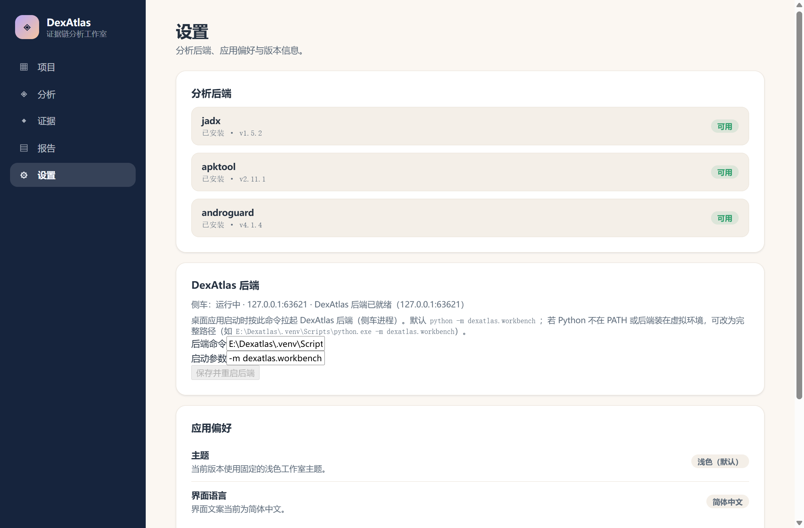
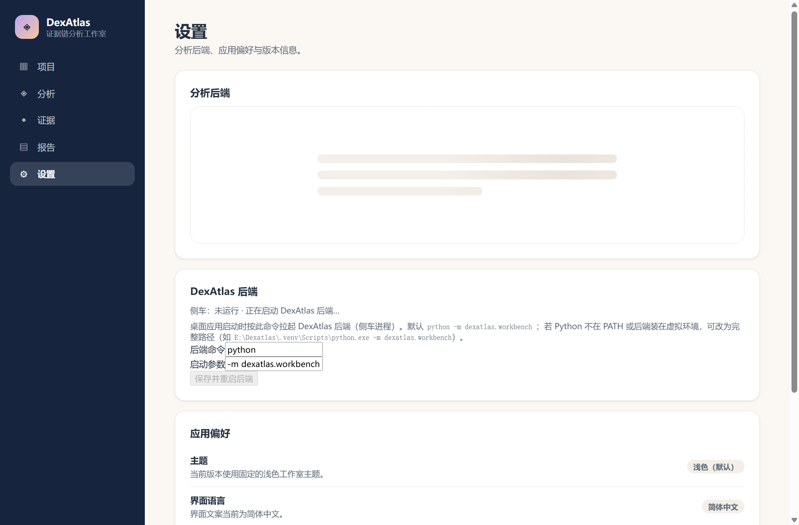

> **工作区落在哪：** 这一轮用 `DEXATLAS_WORKSPACE` 把工作区钉在
> `<worktree>/.scratch/nsis-verify/ws-install`（设置页那句「workspace ws-install」就是它）。
> **不钉会落在哪**：安装形态下 exe 在 `C:\Users\pc\AppData\Local\DexAtlas Studio\`
> —— 那里**反推不出仓库根**（`sidecar.rs:1003` 的 `repo_root_from_exe` 找的是
> 祖先链第 4 级下有没有 `src/dexatlas`），所以 `backend_cwd()` 返回 `None`，
> 侧车没有 cwd，`.dexatlas` 就落在**启动时的工作目录**。本轮第一遍没钉，
> 它就落在了驱动的 cwd（本 worktree 根）——那不是安装目录的错，是
> 「相对路径的工作区跟着 cwd 走」这条机制（`settings.py:43` 的 `_expand_workspace`
> 把它锚在进程启动的那一刻）。
>
> **「用户从开始菜单图标启动时它落在哪」——本轮也验了，答案是：落在安装目录里。**
> 开始菜单那份快捷方式的 `WorkingDirectory` **就是安装目录**
> （`D:\Users\pc\AppData\Local\DexAtlas Studio`——实测快捷方式属性），
> 于是侧车继承它的工作目录，`.dexatlas` 就被建在**安装目录里面**：
>
> ```
> 把已有的 .dexatlas 移开 → 从开始菜单图标启动（不设 DEXATLAS_WORKSPACE）
>   → 新建的 .dexatlas 出现在 D:\Users\pc\AppData\Local\DexAtlas Studio\.dexatlas
> ```
>
> **这条有后果，见 §5.8.4 那一节——它让卸载卸不干净。**

#### 5.8.2 NSIS 的 `ProductVersion` 跟着发版号走（实测，不是推断）

**只测一次 1.2.0 说明不了什么**：1.2.0 既是当下的发版号，也是打包时写进模板的那个数，
两者相同不能证明「跟着走」，只能证明「此刻对得上」。所以本轮**另建了一棵树**，
把发版号抬到 **1.2.1**，让**项目自己的** `scripts/sync-desktop-version.py` 把它推到
那四个带版本号的文件里，再打一个 NSIS 包：

```
src/dexatlas/__init__.py      __version__ = "1.2.1"     ← 发版号的唯一来源
desktop/package.json          "version": "1.2.1"
desktop/src-tauri/tauri.conf.json  "version": "1.2.1"  ← NSIS 的 !define VERSION 从这里来
desktop/src-tauri/Cargo.toml  version = "1.2.1"
desktop/src-tauri/Cargo.lock  version = "1.2.1"
```

打出来的包：**`DexAtlas Studio_1.2.1_x64-setup.exe`，`FileVersion 1.2.1` / `ProductVersion 1.2.1`**。

**结论：NSIS 这一侧的 `ProductVersion` 跟着发版号走。**
机制在 NSIS 模板里（`installer.nsi:37` `!define VERSION` 来自 `tauri.conf.json` 的 `version`，
`:89` `VIAddVersionKey "ProductVersion" "${VERSION}"`），
**从 MSI 那一侧一路到 NSIS 这一侧，中间没有第二个号。**

> **同一棵树顺带核到的两件事（同一台机器、同一棵树，只是版本号不同）：**
> - NSIS 安装包**文件名**里的版本号也跟着走（`DexAtlas Studio_1.2.1_x64-setup.exe`）；
> - 装进 `HKCU\…\Uninstall\DexAtlas Studio` 的 `DisplayVersion` 是打包时的号，
>   所以**卸载时它显示的是你装的那个号**。

#### 5.8.3 卸载：退出码 0，安装目录整个没了，配置保留；但有一个键没删

```
'C:\Users\pc\AppData\Local\DexAtlas Studio\uninstall.exe' '/S'    # 退出码 0，0.4 秒
```

| | 卸载后 |
|---|---|
| 退出码 | **0** |
| 安装目录 | **整个没了**（`C:\Users\pc\AppData\Local\DexAtlas Studio\` 不再存在）——**这一条只对「装完没用过」成立**，用过之后会留下 `.dexatlas\`，见 §5.8.4 |
| 注册表卸载项 | **没了**（`HKCU\Software\Microsoft\Windows\CurrentVersion\Uninstall\DexAtlas Studio` 整个键不存在） |
| 桌面 / 开始菜单快捷方式 | **两份都没了** |
| `%APPDATA%\io.github.dexatlas.desktop\` | **还在**，`backend.json` sha256 `c1387ed5…` **逐字节相同**（与卸载前、与本轮开始时都相同） |
| **提权 / 重启** | **都没有**：per-user 卸载不提权；**未遇 3010，无重启提示** |

**`backend.json` 保留是对的**，和 MSI 那条路一致（§4.2.4）：那是用户自己的数据
（后端命令是哪条路径），不是安装产物。NSIS 的卸载确认页上有个
**「删除应用数据」复选框**（`installer.nsi:449`），默认不勾；**静默模式下那一页被跳过
（`un.SkipIfPassive`），复选框保持未勾**，所以 `%APPDATA%` 与 `%LOCALAPPDATA%` 下
以 bundle id 命名的目录都没被删（`installer.nsi:865`）。

**但有一个键没删——而且它有后果。**
卸载后 `HKCU\Software\github\DexAtlas Studio` **还在**（默认值仍是
`C:\Users\pc\AppData\Local\DexAtlas Studio`）。
它就是 NSIS 用来**记住上次装到哪**的键（`installer.nsi:697`
`WriteRegStr SHCTX "${MANUPRODUCTKEY}" "" $INSTDIR`），
卸载时**只有在「删除应用数据」被勾上的情况下**才删（`installer.nsi:868`）。
静默卸载不勾 ⇒ 键留着。

**这不是推测——本轮做了一个判别实验把它钉死。**
把那个键的默认值改成**不是默认目录**的 `D:\Users\pc\AppData\Local\DexAtlas Studio`，
再静默装一次：

```
记住的键：D:\Users\pc\AppData\Local\DexAtlas Studio
默认目录：C:\Users\pc\AppData\Local\DexAtlas Studio
安装器退出码 0 之后：
  C:\Users\pc\AppData\Local\DexAtlas Studio  → 不存在
  D:\Users\pc\AppData\Local\DexAtlas Studio  → 存在，dexatlas-desktop.exe 在
判别结论：记住的键决定安装位置。
```

**所以「装在哪」不是固定的：** 第一次静默装到 `%LOCALAPPDATA%`；
**卸载之后再装，还是装到同一个地方**（因为键还记得）；
但**如果那个键被改过（或者从别的机器带来的），装到哪就跟着它走**——
§5.5 那个 D 盘的安装就是这么来的（本轮的机器上，D 盘那份是 2026-11-25 装的，
那个键从那时起就记着 D 盘）。

> **给使用者的一句话：** 卸载之后**再装一次不会装回默认目录**，而是装回上次那个地方。
> 想装到别处，先把 `HKCU\Software\github\DexAtlas Studio` 删掉，或者用图形安装器
> 手动选目录（图形模式会问）。

#### 5.8.4 顺带查出来的一个缺陷：**用过一次之后，NSIS 卸载卸不干净**

这一条是**在把上面的事做完之后**顺手查出来的，**不是推出来的**——是实跑出来的。

**先说机制（两个事实，各自单独看都没问题，合起来就有问题）：**

1. **工作区会落在安装目录里。** 开始菜单与桌面那份快捷方式的 `WorkingDirectory`
   **就是安装目录**（实测快捷方式属性：`TargetPath` 与 `WorkingDirectory` 都是
   `D:\Users\pc\AppData\Local\DexAtlas Studio`）。安装形态下侧车没有自己的 cwd
   （`sidecar.rs:994` 的 `backend_cwd()` 反推不出仓库根 ⇒ `None`），
   所以它继承启动器的 cwd；而工作区是**相对路径** `.dexatlas`，锚定在进程启动的那一刻
   （`settings.py:43`）。**三者一合 ⇒ `.dexatlas` 被建在安装目录里面。**
2. **NSIS 的卸载器最后一句是 `RMDir "$INSTDIR"`（`installer.nsi:815`），
   而 NSIS 的 `RMDir` 只在目录为空时才删掉它。**

**实跑（干净首装 → 正常启动一次 → 静默卸载）：**

```
0. 清到首装形态
1. 静默安装                                    → 退出码 0
     安装目录：dexatlas-desktop.exe, uninstall.exe
2. 配好后端命令（设置页写 backend.json 那一步）
3. 从开始菜单图标启动（不设 DEXATLAS_WORKSPACE）→ 侧车起来
     安装目录：.dexatlas\dexatlas.db, dexatlas-desktop.exe, uninstall.exe
     ⇒ 工作区确实建在安装目录里
4. 静默卸载                                    → 退出码 0
     安装目录还在：True
     剩下的文件：.dexatlas\dexatlas.db
     剩下的目录：.dexatlas, .dexatlas\projects
     注册表卸载项：没了
     %APPDATA% 配置目录：还在
     桌面快捷方式：没了
```

**结论：只要用户用过一次，NSIS 卸载就卸不干净——安装目录连同用户数据留在磁盘上，
而控制面板（注册表卸载项）里已经没有它了。** 用户看到的是「已从列表中删除」，
磁盘上却还留着 `DexAtlas Studio\` 目录。

**这与 §5.8.3 的「卸载干净」不矛盾——两条是不同条件下的两条路径：**

| 条件 | 卸载后安装目录 |
|---|---|
| **装完没用过**（§5.8.3 验的那条） | **整个没了**（目录本来就是空的，`RMDir` 删得掉） |
| **用过一次**（本节） | **留着**，里面有 `.dexatlas\dexatlas.db` 与 `.dexatlas\projects\` |

> **给修的人的提示（本轮不改代码）：** 三条路都能解——
> (a) NSIS 模板里把 `RMDir "$INSTDIR"` 换成 `RMDir /r "$INSTDIR"`；
> (b) 卸载时先删 `$INSTDIR\.dexatlas`；
> (c) **更根本的**：让工作区不再落在安装目录里——把 `backend_cwd()` 在安装形态下
> 指到一个稳定的用户目录（`%APPDATA%` 或 `%LOCALAPPDATA%`），
> 而不是让它继承快捷方式的 `WorkingDirectory`。
> **(c) 顺带解决另一个问题：** 安装目录里的用户数据在**升级**时也会跟着搬来搬去
> （§5.5 验过 `.dexatlas` 逐字节保留，代价是它住在安装目录里）。
> **回归测试建议：** 装好 → 从快捷方式启动 → 让它建出 `.dexatlas` → 卸载 →
> 断言安装目录不存在。（纯 NSIS 行为的话，NSIS 层面加一个断言即可。）

#### 5.8.5 这一轮仍然没验到的

- **图形安装器（不静默）的路径**：本轮全程 `/S`。首装的「选目录」页、
  升级的「如何安装」页都没有走——后者在 NSIS 模板里挂在
  `MULTIUSER_PAGE_INSTALLMODE` 上（`installer.nsi:174`），而那个页**只在
  `INSTALLMODE "both"` 时存在**（`installer.nsi:40` 是 `"currentUser"`），**所以本项目根本没有那一页**。
- **`/UPDATE` 模式**：NSIS 的 `/UPDATE` 与 `/R`（装完自动启动）没验。
- **「删除应用数据」勾上之后的卸载**：会连带删掉 `%APPDATA%\io.github.dexatlas.desktop\`
  与 `%LOCALAPPDATA%\io.github.dexatlas.desktop\`，本轮**没勾**，所以没验。
- **MSI 那条路有没有同样的「用过之后卸不干净」**：没查——本轮只查 NSIS。
- **NSIS 的 repair**：NSIS 安装器**没有** repair 模式（MSI 的 §4.2.3 已验）。

#### 5.8.6 机器状态（本轮结束时）

**机器已恢复到本轮开始之前的状态**，并且**逐项核对过**（不是「大概恢复」）：

| | 本轮开始时 | 本轮结束时 |
|---|---|---|
| `D:\Users\pc\AppData\Local\DexAtlas Studio\` | 4 个文件（含 `.dexatlas\dexatlas.db`） | **同 4 个文件，哈希逐一相同** |
| `C:\Users\pc\AppData\Local\DexAtlas Studio\` | 7 个文件（0.1.0 的孤儿） | **同 7 个文件，哈希逐一相同** |
| `HKCU\…\Uninstall\DexAtlas Studio` | 10 个值 | **同 10 个值，逐一相同** |
| `HKCU\Software\github\DexAtlas Studio` | 2 个值 | **同 2 个值，逐一相同** |
| 桌面 / 开始菜单快捷方式 | 在 | **在，哈希相同** |
| `%APPDATA%\io.github.dexatlas.desktop\backend.json` | sha256 `c1387ed5…` | **sha256 `c1387ed5…`，mtime 也相同** |

- 恢复的办法是**从备份拷回**（备份在 `.scratch/nsis-verify/backup/`，不入库），
  不是「把移走的东西搬回来」——因为卸载器已经把安装目录里的 exe 与 uninstaller 删了，
  搬回来搬不回原样；备份里才是原样。
- **无遗留 dexatlas / 侧车 / 安装器进程；全程没有一次重启。**
- 本 worktree 的产物留在 `desktop/src-tauri/target/release/`；
  抬到 1.2.1 的那棵**副本**在 `.scratch/nsis-verify/bumptree/`（`.scratch/` 不入库，
  **仓库里的文件一个都没改**）。

#### 5.8.7 修复与复验（2026-11-28，修复分支 `peaceful-liskov-141f8f`）

§5.8.4 的缺陷已经修掉，并在同一台机器上复验。修的是两件事，分开验证：
**根因**（工作区不再落在安装目录）在应用侧，**兜底**（卸载器删得掉非空
安装目录）在打包侧。

**1. 根因：安装形态的侧车有了自己的 cwd 与工作区。**
`desktop/src-tauri/src/sidecar.rs:1028` 的 `backend_launch()` 在安装形态
（exe 反推不出仓库根）把 cwd 与 `DEXATLAS_WORKSPACE` 都指到
`%LOCALAPPDATA%\io.github.dexatlas.desktop\workspace`
（`installed_workspace_dir()`，`sidecar.rs:1053`；环境变量在
`backend_command()`，`sidecar.rs:779`），并在 spawn 之前把目录建好
（`prepare_workspace()`，`sidecar.rs:1065`）。dev 形态的行为不变：cwd 仍是
仓库根，工作区仍是 `<repo>/.dexatlas`。

**2. 兜底：`NSIS_HOOK_POSTUNINSTALL` 递归删除安装目录。**
`desktop/src-tauri/nsis/installer-hooks.nsh`（由 `tauri.conf.json:44` 的
`bundle.windows.nsis.installerHooks` 接线，生成器把它 `!include` 在脚本
顶层）在卸载末尾执行 `RMDir /r "$INSTDIR"`
（`installer-hooks.nsh:47`），只在**确认过主程序 exe 曾在目录里**
（`NSIS_HOOK_PREUNINSTALL`，`installer-hooks.nsh:34`）且**不是升级**
（`$UpdateMode <> 1`）时执行。`%APPDATA%` 的 `backend.json` 不在
`$INSTDIR` 里，钩子不碰它。

**3. 回归测试与必红证明。**

- Rust（`cargo test --lib`：37 passed / 2 ignored）：
  `installed_form_keeps_the_workspace_out_of_the_install_directory`
  断言安装形态的 cwd/workspace 都在 `%LOCALAPPDATA%\…\workspace`、且不在
  安装目录里；`the_backend_process_receives_the_workspace_environment`
  起真进程读回 `DEXATLAS_WORKSPACE`；`dev_form_…` 断言 dev 形态不变。
  **必红**：临时把安装形态退回 `BackendLaunch::default()`（旧行为
  "不设 cwd"），该测试以 `left: None / right: Some("…\\workspace")` 失败；
  恢复后复跑 37 passed。
- Python（`tests/test_nsis_uninstall_cleanup.py`：7 passed）：
  `tauri.conf.json` 的接线、两个钩子宏、`RMDir /r "$INSTDIR"` 及其
  「主程序 exe + 非升级」守卫、钩子不碰 `%APPDATA%`、侧车源码里
  `app_local_data_dir()` 与 `DEXATLAS_WORKSPACE` 的存在。**必红**：
  删掉 `bundle.windows.nsis` 一段 ⇒ 6 条失败；把 `RMDir /r` 改回
  `RMDir` ⇒ 对应的那条失败。
- 静态断言的边界：NSIS 编译器不是 Python 套件的依赖，`installer.nsi`
  也只在 `tauri build` 时生成；行为由下面的真机复验补上。

**4. 真机复验（全程 `/S`，无重启）。**

对照组——**旧包**（本轮开工时机器上注册的那套 1.2.0）：
静默卸载退出码 0，注册表项与两份快捷方式没了，
`D:\Users\pc\AppData\Local\DexAtlas Studio\` **还在**，里面只剩
`.dexatlas\dexatlas.db`（208896 字节）与 `.dexatlas\projects\`。
§5.8.4 的缺陷原样复现。该 `.dexatlas` 已备份到本 worktree 的
`.scratch/nsis-verify/legacy-workspace/`（`dexatlas.db` sha256 `a020626f…`）。

修复后的包（`target/release/bundle/nsis/DexAtlas Studio_1.2.0_x64-setup.exe`，3.61 MiB）：

| 步骤 | 观察 |
|---|---|
| 干净基线 → 静默首装 | 退出码 0；1 秒内出现 `%LOCALAPPDATA%\DexAtlas Studio\dexatlas-desktop.exe` 与 `uninstall.exe`；两份快捷方式的 `WorkingDirectory` 仍是安装目录（Tauri 行为不变） |
| 从**开始菜单快捷方式**启动（继承安装目录 cwd） | 3 秒内 `%LOCALAPPDATA%\io.github.dexatlas.desktop\workspace\dexatlas.db` 出现；**安装目录里没有 `.dexatlas`**（只有 exe 与 uninstall.exe） |
| 正常关窗 → 静默卸载 | 退出码 0；**安装目录整个消失**；注册表卸载项与两份快捷方式消失；`%APPDATA%\io.github.dexatlas.desktop\backend.json` sha256 仍是 `c1387ed5…`（逐字节不变）；`workspace\` 按「不勾删除应用数据」保留 |
| 重装后人为造非空目录：`$INSTDIR\.dexatlas\dexatlas.db` 与 `$INSTDIR\unexpected-leftover.txt` → 静默卸载 | 退出码 0；2 秒内**连未知残留一起整个消失**——`RMDir /r` 确实删得掉非空安装目录，而不是只认 `.dexatlas` |

**5. 机器状态（本轮结束时）。** 两处历史安装目录（C: 与 D:）与
`HKCU\…\Uninstall\DexAtlas Studio`、`HKCU\Software\github\DexAtlas Studio`
都已清掉（历史残留是上一轮「逐字节恢复」保留下来的那套安装；其中的
`.dexatlas` 已先备份，程序文件由构建产物可再生成）；
`%APPDATA%\…\backend.json` 保持 sha256 `c1387ed5…`；
`%LOCALAPPDATA%\io.github.dexatlas.desktop\` 的 `.cookies` 与
`EBWebView\` 保留；本轮启动应用时新建的 `workspace\`（只含本轮测试数据）
在收尾时删除，恢复开工前「该目录下没有工作区」的形态；本轮启动的
桌面/侧车进程全部退出；无重启。旧工作区备份在
`.scratch/nsis-verify/legacy-workspace/`（`.scratch/` 不入库）。


### 5.7 机器状态（本轮结束时）

- 本 worktree 构建的 exe / MSI / NSIS 三件产物**留在 `target/release`**（主会话发版要用同一棵树的产物）；
- D 盘的 NSIS 安装**升到了 1.2.0 并保留**（这是机器上原有的安装，升级前是 0.1.0）；
- 真实路径与虚拟化路径的 `backend.json` 都与本轮开始时逐字节相同（sha256 `c1387ed5…`）；
- 无遗留 dexatlas / 侧车 / 安装器进程；wrapper 批处理与标记文件留在
  `<worktree>/.scratch/nonmsix-findings/`（`.scratch/` 不入库）。

### 5.9 版本号递增的 MSI 升级（1.2.0 → 1.2.1，2026-11-28 第五轮）

> **这一轮补的是验收报告 §7.3 的「版本号递增的 MSI 升级路径」**：2026-11-27 验的 MSI
> 升级是**同版本**的大版本升级（`ProductVersion` 一直是 0.1.0），NSIS 侧已在 §5.8.2
> 验过版本号递增（1.2.0 → 1.2.1），**MSI 侧没有**。本轮还实测了任务书里预期「会被拒绝」
> 的**降级**路径。**只做验证与记录，不改产品代码、不改仓库里的版本号文件、不加测试、
> 不提交。全程没有重启。**

#### 5.9.0 被测对象与这一轮的做法

| | |
|---|---|
| 仓库基线 | worktree `loving-pike-73c47a`，HEAD `3262f65`（本轮开始时 `main` 正指在这里；之后 `main` 又前进了） |
| 临时树 | **另建**一棵 detached worktree：`.scratch/msi-verify/bumptree`，起点也是 `3262f65`；**版本号只在这棵树里改**，用完即删，仓库里的文件一个没动 |
| 版本号同步 | 把 `src/dexatlas/__init__.py` 的 `__version__` 从 `"1.2.0"` 改成 `"1.2.1"`，再跑**项目自己的** `scripts/sync-desktop-version.py`；`git diff --stat` 正好 **5 个文件各 1 行**：`src/dexatlas/__init__.py`、`desktop/package.json`、`desktop/src-tauri/tauri.conf.json`、`desktop/src-tauri/Cargo.toml`、`desktop/src-tauri/Cargo.lock` |
| 1.2.0 的 MSI | 临时树**在抬版本号之前**构建：`npm run tauri -- build --bundles msi`，Rust 编译 4m39s；产物 `DexAtlas Studio_1.2.0_x64_en-US.msi`，5,443,584 B，sha256 `3cd02769…` |
| 1.2.1 的 MSI | 抬完版本号后在同一棵树重建（增量）；产物 `DexAtlas Studio_1.2.1_x64_en-US.msi`，5,443,584 B，sha256 `98981e9c…` |
| 驱动进程 | 无包身份（与 §5.1 同一套量法）；`msiexec` 在**已提升**会话里跑（`ConsentPromptBehaviorAdmin=0`，静默提升、无 UAC 弹窗，与 §4.1 同一前提） |
| 机器形态 | 本轮开始时**没有任何 DexAtlas 产品安装**：ARP（HKLM 64/32 + HKCU）无条目、`C:\Program Files\DexAtlas Studio` 不存在、NSIS 的 `HKCU\Software\github\DexAtlas Studio` 不存在 |

**两个包都由同一棵树构建，只差版本号**——升级的差异因此只剩版本，而不是「另一棵树的其它改动」。

**MSI 的 `Property` 表（用 Windows Installer COM 直接读，不按文件名猜）：**

| | 1.2.0 的包 | 1.2.1 的包 |
|---|---|---|
| `ProductVersion` | **1.2.0** | **1.2.1** |
| `ProductCode` | `{97060FAF-F1C5-4CDC-B562-FDA2C7CF62A3}` | `{82B6492C-1168-4806-8F31-4987276DDAED}` |
| `UpgradeCode` | `{1C8C5729-38FC-513A-8777-CB10AB067608}` | **同一个** |
| `ALLUSERS` / `REINSTALLMODE` | `1` / `amus` | `1` / `amus` |
| `File` 表里的 exe | `dexatlas-desktop.exe`，14,833,152 B，`FileVersion 1.2.0.0` | 同名同大小，`FileVersion 1.2.1.0` |
| `Upgrade` 表 | 1 行：`VersionMin='0'`、`VersionMax=''`、`Attributes=257`、`WIX_UPGRADE_DETECTED` | 同左（这一行的含义见 §5.9.4） |

**结论先说：MSI 的 `ProductVersion` 跟着发版号走（1.2.1），版本号递增的升级路径成立；
降级没有被拒绝——它会静默地把应用换回旧版，详见 §5.9.4。**

#### 5.9.1 1.2.0 的干净安装：退出码 0，装到 `C:\Program Files\DexAtlas Studio\`

```
msiexec /i "…\DexAtlas Studio_1.2.0_x64_en-US.msi" /qn /norestart /l*v install-1.2.0.log
```

| | 装完的样子 |
|---|---|
| 退出码 | **0**（1.2 s）；日志 `Installation completed successfully`、`MainEngineThread is returning 0` |
| ARP 条目（HKLM） | `{97060FAF-F1C5-4CDC-B562-FDA2C7CF62A3}`：`DisplayName DexAtlas Studio`、`DisplayVersion` **1.2.0**、`WindowsInstaller 1`、`NoModify 1`、`InstallLocation C:\Program Files\DexAtlas Studio\`、`UninstallString MsiExec.exe /X{97060FAF-…}` |
| 安装目录 | `dexatlas-desktop.exe`（14,833,152 B，sha256 `C4C7002F…`，`FileVersion/ProductVersion 1.2.0`）与 `Uninstall DexAtlas Studio.lnk`（963 B，sha256 `2E7ED220…`） |
| 快捷方式 | 公共桌面 `C:\Users\Public\Desktop\DexAtlas Studio.lnk`；开始菜单在 `C:\ProgramData\Microsoft\Windows\Start Menu\Programs\DexAtlas Studio\DexAtlas Studio.lnk`（**子目录里**，不在 `Programs\` 根下） |
| `%APPDATA%\…\backend.json` | sha256 **`D6C4B32F…`**（160 B），mtime `11:18:25`——**与安装前逐字节相同** |
| 提权 / 重启 | 提权用了静默提升的已提升会话；**未遇 3010，未触发重启** |

**关于 `MsiSystemRebootPending=1`（如实记）：** 安装日志里出现了
`PROPERTY CHANGE: Adding MsiSystemRebootPending property. Its value is '1'`。
这不是本次安装造成的：机器的 `PendingFileRenameOperations` 在本轮开始前就有 5 条
**ToDesk / Edge 的**待重命名项，安装前后**逐条相同**，没有新增任何 DexAtlas 路径；
命令带了 `/norestart`，退出码是 **0** 而不是 3010。**本轮没有重启，也不要求重启。**

**一个操作细节：** 同一个 MSI 用**正斜杠**路径（`E:/…/DexAtlas Studio_1.2.0_x64_en-US.msi`）
调用 `msiexec` 时返回 **1619**（`MainEngineThread is returning 2`），换成**反斜杠**路径后退出码 **0**。
两次调用的日志都在 `.scratch/msi-verify/`；本报告记录的是成功那次。

#### 5.9.2 升级到 1.2.1：退出码 0，产品码换新，exe 换成 1.2.1 的 payload

```
msiexec /i "…\DexAtlas Studio_1.2.1_x64_en-US.msi" /qn /norestart /l*v upgrade-1.2.1.log
```

| | 升级后 |
|---|---|
| 退出码 | **0**（1.2 s）；日志 `Installation completed successfully`、`MainEngineThread is returning 0` |
| ARP 条目 | 只剩**一条**：`{82B6492C-1168-4806-8F31-4987276DDAED}`，`DisplayVersion` **1.2.1**；旧的 `{97060FAF-…}` **已消失**（产品码换新） |
| exe | 14,833,152 B，sha256 **`64169227…`**，`FileVersion/ProductVersion` **1.2.1**——与 1.2.0 的 `C4C7002F…` 不同，**exe 确实被替换** |
| 与安装包内 payload 比对 | `msiexec /a` 把 1.2.1 的 MSI 解到 `extract-1.2.1\PFiles\DexAtlas Studio\dexatlas-desktop.exe`，sha256 **`64169227…`**——**安装后的 exe 与包里那份逐字节相同** |
| 快捷方式 | 公共桌面与开始菜单（子目录）**都还在** |
| `%APPDATA%\…\backend.json` | sha256 **`D6C4B32F…`**，mtime `11:18:25`——**升级前后逐字节相同**（MSI 不碰用户配置） |
| 提权 / 重启 | 同上：`MsiSystemRebootPending=1` 是机器原有的待重启项（ToDesk/Edge），队列逐条未变；退出码 0，**无重启** |

#### 5.9.3 升级后的应用：启动、侧车、一次真实分析，版本页显示 1.2.1

```
"C:\Program Files\DexAtlas Studio\dexatlas-desktop.exe"      # CDP 9333
```

- **环境说明（如实记）：** 本轮开始时机器上还有一个**兄弟会话的开发版实例**
  （另一个 worktree 的 `dexatlas-desktop.exe`）在运行，两个实例共用同一个
  `%LOCALAPPDATA%\io.github.dexatlas.desktop\EBWebView`。已装应用第一次启动时
  WebView2 创建失败（终端记录 `HRESULT(0x8007139F)`；该次日志已被后续成功运行覆盖，
  未保留）；等那个实例退出后重跑，应用正常起来。**这是「同一 bundle id 不能并发两个
  实例」的实际表现，本轮只记录，不修。**
- **侧车：** 设置页显示 `侧车：运行中 · 127.0.0.1:64311 · DexAtlas 后端已就绪`；
  三个后端 `jadx v1.5.2` / `apktool v2.11.1` / `androguard v4.1.4` 都是「已安装 · 可用」。
- **版本页：** 「关于」区块分两行——**应用版本 `v1.2.1`（桌面应用：exe 与 MSI 安装包）**、
  后端版本 `v1.2.0`（分析核心）。两行说的是两样东西，这正是 2026-11-27 修过的那个问题
  （见 [桌面打包文档](../desktop-packaging.md) §1.3）。

  

- **一次真实分析：** 通过首页的 `<input type=file>` 走用户同构的 `DataTransfer` 上传
  `examples/demo-app/demo.apk`（2,951 B），等待完成——**五阶段全部「已完成」**
  （采集 / 解析 / 索引 / 反编译 / 报告）、耗时 **4.6 s**、**12 条证据**、三后端都参与。

  

  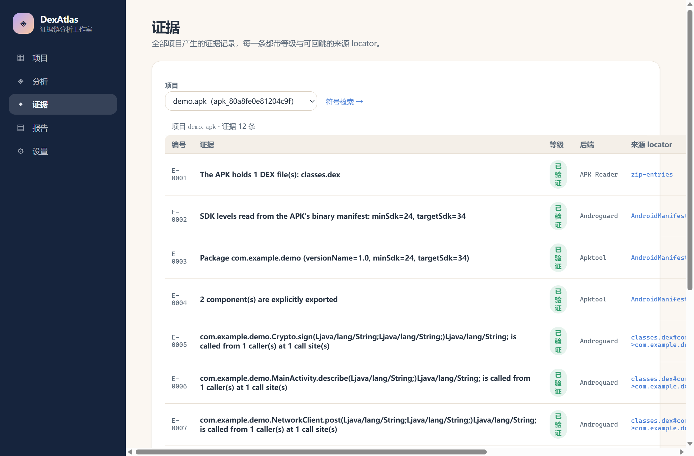

- **工作区落在哪：** 分析数据写在安装形态的固定工作区
  `%LOCALAPPDATA%\io.github.dexatlas.desktop\workspace`（§5.8.7 修过的 cwd/工作区行为），
  **不在**安装目录里。本轮结束时该目录已移到 `.scratch/msi-verify/workspace-aside/`。

**`backend.json` 的一处外部改写（与 MSI 无关，但要说清）：** 应用启动后，这个文件的哈希
变成了 `c1387ed5…`（111 B，指向 `E:\Dexatlas\.venv\Scripts\python.exe`），mtime `11:37:17`。
**两次 `msiexec` 动作前后它都是 `D6C4B32F…`**，所以这次改写不是 MSI 做的；本报告
**不推断**是谁写的（当时另一个兄弟会话的实例也在同一台机器上运行）。本轮的
「逐字节保留」结论只覆盖**安装与升级这两个 MSI 动作**。

#### 5.9.4 降级：预期是「被拒绝」，实测是**静默降级成功**

**任务书原本预期 MSI 默认不允许降级、要记录它的报错文案。实测没有报错文案可记——**
在 1.2.1 已安装的机器上再装 1.2.0：

```
msiexec /i "…\DexAtlas Studio_1.2.0_x64_en-US.msi" /qn /norestart /l*v downgrade-1.2.0.log
```

| | 结果 |
|---|---|
| 退出码 | **0**（1.2 s）；日志 `Installation completed successfully`、`MainEngineThread is returning 0`，**没有任何错误或警告** |
| ARP | `{97060FAF-…}`（1.2.0 的产品码）回来了，`DisplayVersion` **1.2.0**；1.2.1 的条目消失 |
| exe | sha256 **`C4C7002F…`**、`FileVersion/ProductVersion 1.2.0`——**退回旧版** |
| 应用自己怎么说 | 降级后启动应用，设置页「关于」显示 **应用版本 `v1.2.0`** |

  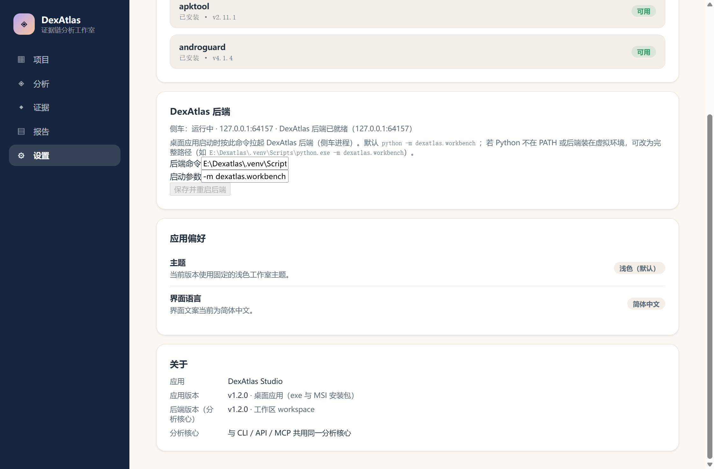

**机制（从打包产物与 Tauri 配置读出来的，不是猜的）：**

- 项目的 `desktop/src-tauri/tauri.conf.json` **没有**设置 `bundle.windows.allowDowngrades`；
  Tauri v2 的这个开关**默认是 `true`**（`tauri-utils-2.10.4/src/config.rs` 的
  `allow_downgrades` 字段，注释写明默认 true，并写明设为 false 时 MSI 才会拒绝旧版本）。
- 于是打包器生成 WiX 时走了 `allow_downgrades` 分支：本仓库模板
  `desktop/src-tauri/wix/main.wxs:70`–`:71` 是
  `<MajorUpgrade Schedule="afterInstallInitialize" AllowDowngrades="yes" />`。
- 产物里能对上：`Upgrade` 表**只有一行**（`VersionMin='0'`、`VersionMax=''`），
  **没有** `LaunchCondition` 表——既没有「降级被拒」的条件，也没有那句报错文案。

**这意味着什么（只陈述，不判定）：** 用户如果双击了旧的 MSI，应用会**静默退回旧版**，
`%APPDATA%` 的用户数据保留（与升级一致）。要不要把
`"bundle": {"windows": {"allowDowngrades": false}}` 写进配置、从而让旧包装不上，
是产品决定；**本轮没有改配置，也没有替作者做这个决定。**

> **与 NSIS 的对照（引自 Tauri 自己的字段注释，本轮没有复测 NSIS）：** 同一个开关设为
> false 时，「MSI 不会装旧版本」；NSIS 则「在静默 / passive / update 模式下不装旧版本，
> 交互式安装器只允许用户先卸载新版再装旧版」。**当前开关是默认的 true，所以 MSI 这一侧
> 没有这层保护。**

#### 5.9.5 机器状态（本轮结束时）

**已恢复**，逐项核对：

| | 本轮开始时 | 本轮结束时 |
|---|---|---|
| DexAtlas 的 MSI 产品 | 无（ARP 无条目） | **无**（`msiexec /x` 卸载，退出码 0） |
| `C:\Program Files\DexAtlas Studio\` | 不存在 | **不存在** |
| 公共桌面 / 开始菜单快捷方式 | 不存在 | **不存在**（含 `Programs\DexAtlas Studio\` 子目录） |
| `HKCU\Software\github\DexAtlas Studio` | 不存在 | **不存在** |
| `%APPDATA%\…\backend.json` | `D6C4B32F…` | **`c1387ed5…`**——差异来自 §5.9.3 说的那次**外部改写**（发生在两次 msiexec 之后、卸载之前），不是 MSI 动作；卸载前后它不变 |
| `%LOCALAPPDATA%\io.github.dexatlas.desktop\workspace` | 不存在 | 本轮分析建出（`dexatlas.db` 208,896 B）→ **已移到 `.scratch/msi-verify/workspace-aside/`**；`EBWebView` 与 `.cookies` 是轮前就有的，保留 |
| 进程 | 只有兄弟会话的开发版实例 | **无 DexAtlas / 侧车进程**（那个实例在本轮中途退出了） |
| `PendingFileRenameOperations` | 5 条 ToDesk/Edge 项 | **同样 5 条，逐条相同** |
| 重启 | — | **全程没有重启** |

- 临时树 `.scratch/msi-verify/bumptree` **已删除**（`git worktree remove --force`），
  两个 MSI、日志、快照、提取出的 payload 留在 `.scratch/msi-verify/`（`.scratch/` 不入库）。
- 仓库里的文件只改了本文与验收报告，外加 `docs/assets/phase5/machine-12-*.png`；
  `src/`、`tests/`、`desktop/` 一个字没动。

#### 5.9.6 这一轮没验到的

- **图形安装器 / passive 模式的升级与降级界面**：全程 `/qn`，没有走 WiX 的 UI。
- **降级在 `allowDowngrades=false` 下的表现**：配置没改，所以「拒绝降级」的那句文案
  本轮**没有机会出现**；要验它得先改配置重新打包（那是产品改动，不在本轮范围）。
- **MSI 的 repair**：§4.2.3 已验过（`/fa` 修不回快捷方式的问题已修）；本轮没再复测。
- **未提升会话**的安装 / 升级：本轮全部在已提升会话里跑；未提升的 1603 两个失败点见 §4.1。
- **同一 bundle id 两个实例并发**：只观察到 WebView2 创建失败（`0x8007139F`），
  没有做「第二个实例该不该被拦住 / 该提示什么」的产品判断。
- **签名**：MSI 与 exe 仍未签名（与 §4 第 4 条一致）。
- **第三方 APK**：仍然只用一方样例 `examples/demo-app/demo.apk`。

---

## 6. 复现命令

```bash
# 1) 桌面端依赖与打包（worktree 根目录）
cd desktop
npm ci
npm run tauri build          # → target/release/dexatlas-desktop.exe + bundle/{msi,nsis}/…

# 2) 跑打包 exe（PowerShell）
$env:DEXATLAS_JADX_PATH   = 'E:\Dexatlas\.scratch\backends\jadx\bin\jadx.bat'
$env:DEXATLAS_APKTOOL_JAR = 'E:\Dexatlas\.scratch\backends\apktool.jar'
$env:DEXATLAS_WORKSPACE   = '<worktree>\.scratch\ws-desktop'
& '.\desktop\src-tauri\target\release\dexatlas-desktop.exe'

# 3) MSI 安装（注意：不要加 /qn）
msiexec /i ".\desktop\src-tauri\target\release\bundle\msi\DexAtlas Studio_0.1.0_x64_en-US.msi" /passive /l*v "$env:TEMP\dexatlas-msi.log"

# 4) 卸载
msiexec /x "{680674BE-75AC-4D95-8397-32757BBB8C62}" /passive
```

**2026-11-27 补测用的命令**（升级 / 卸载 / repair / 提升会话里的 `/qn`）：

```powershell
# 5) 升级（产品码不同 → 走 MajorUpgrade，卸旧装新）。/qn 需要已提升的会话
msiexec /i "<msi>" /qn /l*v "<log>"

# 6) repair（要管理员）：修得回 exe，修不回被删掉的 Uninstall 快捷方式
msiexec /fa "<msi>" /qn /l*v "<log>"

# 7) 卸载（用**当前**产品码；升级后旧码会返回 1605）
msiexec /x "{A8D5B3E6-03C0-4D1A-9A6F-030AC98DA30D}" /passive /l*v "<log>"

# 8) 拿到一个已提升的会话（本机 ConsentPromptBehaviorAdmin=0 → 不弹 UAC）
Start-Process -FilePath powershell.exe -Verb RunAs -ArgumentList "<脚本>"
```

**2026-11-27 非容器补测用的命令**（§5）：

```powershell
# 9) 确认驱动进程没有包身份（rc=15700 = APPMODEL_ERROR_NO_PACKAGE）
$sig = @'
using System; using System.Runtime.InteropServices;
public class PkgId {
  [DllImport("kernel32.dll", SetLastError=true)]
  public static extern int GetCurrentPackageFullName(ref uint pn, [MarshalAs(UnmanagedType.LPWStr)] System.Text.StringBuilder b);
}
'@
Add-Type -TypeDefinition $sig
$sb = New-Object System.Text.StringBuilder 256; $len = [uint32]256
[PkgId]::GetCurrentPackageFullName([ref]$len, $sb)   # → 15700

# 10) NSIS per-user 静默升级（0.1.0 → 1.2.0；per-user 不提权，无重启环节）
& '<worktree>\desktop\src-tauri\target\release\bundle\nsis\DexAtlas Studio_1.2.0_x64-setup.exe' '/S'

# 11) 判别实验：把真实路径 backend.json 指向落标记的 wrapper，虚拟化那份不动
#    标记出现 ⇒ exe 读的是真实路径（脚本：<worktree>\.scratch\discriminate-nonmsix.py）
```

> **msiexec 的两个坑（本轮踩过）：** 包路径含空格要用引号包起来，否则 **1639**（命令行无效）；
> 包路径用正斜杠会得到 **1619**（打不开安装包）——用原生反斜杠。

**2026-11-28 NSIS 首装/卸载补测用的命令**（§5.8）：

```powershell
# 12) 备份机器现状（安装目录 / 两个注册表键 / 快捷方式 / %APPDATA% 配置）
#     脚本：<worktree>\.scratch\nsis-verify\backup_state.py

# 13) 把机器清到首装形态（移动，不是删除）
#     脚本：<worktree>\.scratch\nsis-verify\clean_to_first_install.py

# 14) NSIS per-user 静默首装（不提权，无重启环节）
& '<worktree>\desktop\src-tauri\target\release\bundle\nsis\DexAtlas Studio_1.2.0_x64-setup.exe' '/S'
#     → 退出码 0；装到 $env:LOCALAPPDATA\DexAtlas Studio\

# 15) 从安装目录启动应用，走 CDP 驱动 UI（填后端命令 → 上传 → 等分析 → 截图）
#     脚本：<worktree>\.scratch\nsis-verify\drive_installed.py

# 16) NSIS per-user 静默卸载（不提权，无重启环节）
& "$env:LOCALAPPDATA\DexAtlas Studio\uninstall.exe" '/S'
#     → 退出码 0；安装目录整个没了，%APPDATA%\io.github.dexatlas.desktop\ 保留

# 17) 判别实验：记住安装位置的键（HKCU\Software\github\DexAtlas Studio）决定装到哪
#     脚本：<worktree>\.scratch\nsis-verify\probe_remembered_location.py

# 18) 把机器恢复回轮前状态（从备份拷回）
#     脚本：<worktree>\.scratch\nsis-verify\restore_state.py
```

**取证脚本**（本轮用的，不入库，放在 worktree 的 `.scratch/`）：

| 脚本 | 作用 |
|---|---|
| `.scratch/cdp.py` | 极简 CDP 客户端（读 DOM / 塞文件 / 截图） |
| `.scratch/exe_run.py` | 全链路驱动：起 exe → 塞 APK → 等分析 → 翻页 → 截图（可传 exe 路径与截图前缀） |
| `.scratch/capture-window.ps1` | 原生整窗截图（`PrintWindow`；**必须先 `SetProcessDPIAware()`**，否则拿到的是虚拟化坐标，位图和窗口缓冲区对不上） |
| `.scratch/msi_install.ps1` | MSI 分级尝试（静默 → 被动 → RunAs）并记录退出码 |
| `.scratch/control_run.py` | 对照组 A：不经桌面端、后端齐全 |
| `.scratch/control_nobackends.py` | 对照组 B：不经桌面端、后端缺失（JADX / Apktool 置空） |

---

## 7. 本轮产出的文件

| 文件 | 说明 |
|---|---|
| `docs/reports/phase5-machine-verification.md` | 本文 |
| `docs/assets/phase5/machine-01-home.png` … `machine-06b-settings-window.png` | 打包 exe（`target/release`）全链路截图，CDP 截图 + 原生整窗截图 |
| `docs/assets/phase5/machine-07-*.png` | MSI 安装后从 `C:\Program Files\DexAtlas Studio\` 启动的应用截图 |
| `docs/assets/phase5/machine-08-repaired-settings.png` | 2026-11-27 补测：repair 之后的应用设置页（侧车运行中 · 三个后端「已安装 · 可用」） |
| `docs/assets/phase5/machine-09-upgraded-home.png` | 2026-11-27 补测：升级之后的应用首页 |
| `docs/assets/phase5/machine-10-01-home.png` … `machine-10-05-evidence.png`、`machine-10-07-settings.png` | 2026-11-27 非容器补测（§5）：无包身份进程启动 exe 的全链路截图 |
| `docs/assets/phase5/machine-10-08-installed-home.png`、`machine-10-09-installed-settings.png` | 2026-11-27 非容器补测（§5.5）：NSIS 静默升级到 1.2.0 后从安装目录启动的截图 |
| `docs/assets/phase5/machine-11-02-settings-saved.png` … `machine-11-09-settings-after-analysis.png` | 2026-11-28 NSIS 首装补测（§5.8.1）：首装后应用从「配好后端」到「跑出 12 条证据」的截图 |
| `docs/assets/phase5/machine-11-10-first-launch-home.png`、`machine-11-11-first-launch-settings-unconfigured.png` | 2026-11-28 NSIS 首装补测（§5.8.1）：**全新安装、还没有 `backend.json`** 时的首页与设置页——侧车起不来的真实形态 |
| `docs/assets/phase5/machine-12-01-home-after-upgrade.png` … `machine-12-06-home-recent-project.png` | 2026-11-28 MSI 版本号递增升级补测（§5.9.3）：从 `C:\Program Files\DexAtlas Studio\` 启动 1.2.1 应用、上传 demo.apk 到跑出 12 条证据的全链路截图 |
| `docs/assets/phase5/machine-12-02b-settings-about-1.2.1.png` | 2026-11-28 MSI 补测（§5.9.3）：「关于」区块的两行分列——应用 **1.2.1**（exe 与 MSI 安装包）、后端 **1.2.0**（分析核心） |
| `docs/assets/phase5/machine-12-08-settings-about-1.2.0-after-downgrade.png` | 2026-11-28 MSI 补测（§5.9.4）：**降级之后**「关于」区块显示应用版本 v1.2.0——静默降级成功的应用侧证据 |

**没有改任何生产代码**：`src/**`、`tests/**`、`desktop/src/**`、`desktop/src-tauri/src/**` 一个字没动；`desktop/src-tauri/tauri.conf.json` 也没动（MSI 打包不需要改 bundle 配置）。第三方 APK / DEX / `so` / 密钥没有进仓库（只用了仓库自带的一方样例）。

> **2026-11-28 那一轮（§5.8）同样没改任何生产代码，也没有加测试。** 那一轮把发版号抬到 1.2.1 的
> 做法是**复制一份树到 `.scratch/`** 再改那份，**仓库里的文件一个都没动**——
> 主会话在并行发版，改源码会让源码指纹变、测量要重跑。
>
> **2026-11-28 第五轮（§5.9）同样没改任何生产代码，也没有加测试。** 版本号只在
> `.scratch/msi-verify/bumptree` 那棵**临时树**里抬到 1.2.1，仓库里的版本号文件一字未动；
> 两个 MSI 与全部日志留在 `.scratch/msi-verify/`（不入库）。

**机器上留下的状态（2026-11-27 补测结束时）：** DexAtlas Studio **已经卸干净了**——安装目录 `C:\Program Files\DexAtlas Studio\` 不存在、注册表没有卸载项、开始菜单与公共桌面快捷方式不存在。**用户配置目录 `%APPDATA%\io.github.dexatlas.desktop\backend.json` 保留**（卸载不该删用户数据），内容与本轮开始时的备份逐字节相同（sha256 `d358dbc4…`）。没有遗留 dexatlas 进程或侧车进程，也没有遗留计划任务（本轮用来提权的任务始终**注册失败**，机器上从未存在过）。

> 2026-11-26 那一轮结束时的状态是「仍然装着、产品码 `{680674BE-…}`」；2026-11-27 的补测把它卸掉了，
> 并把产品码换成了 `{A8D5B3E6-…}`。**要再装回来，用本轮构建的 MSI 即可。**
>
> 2026-11-27 非容器补测结束时的状态见 §5.7：D 盘的 NSIS per-user 安装从 0.1.0 升到了
> 本 worktree 构建的 1.2.0 并保留；两份 `backend.json` 都与轮前逐字节相同。
>
> **2026-11-28 那一轮（§5.8）结束时，机器回到了那一轮开始之前的状态**——逐项核对过，
> 不是「大概恢复」：两棵安装目录、两个注册表键、两份快捷方式、`backend.json`
> **哈希与 mtime 都与轮前相同**（§5.8.6 的表）。**没有重启。**
>
> **2026-11-28 第五轮（§5.9）结束时：** MSI 产品已卸干净（ARP 无条目、`C:\Program Files\DexAtlas Studio\`
> 与快捷方式都不存在），临时树已删，**全程无重启**。`%APPDATA%\…\backend.json` 在本轮中途被
> **外部**改写为 `c1387ed5…`（两次 `msiexec` 前后都是 `D6C4B32F…`，见 §5.9.3）；本轮分析建出的
> `%LOCALAPPDATA%\…\workspace` 已移到 `.scratch/msi-verify/workspace-aside/`。
