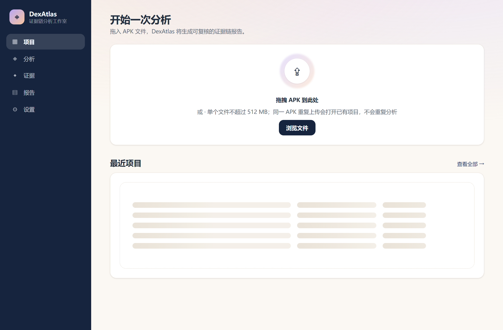
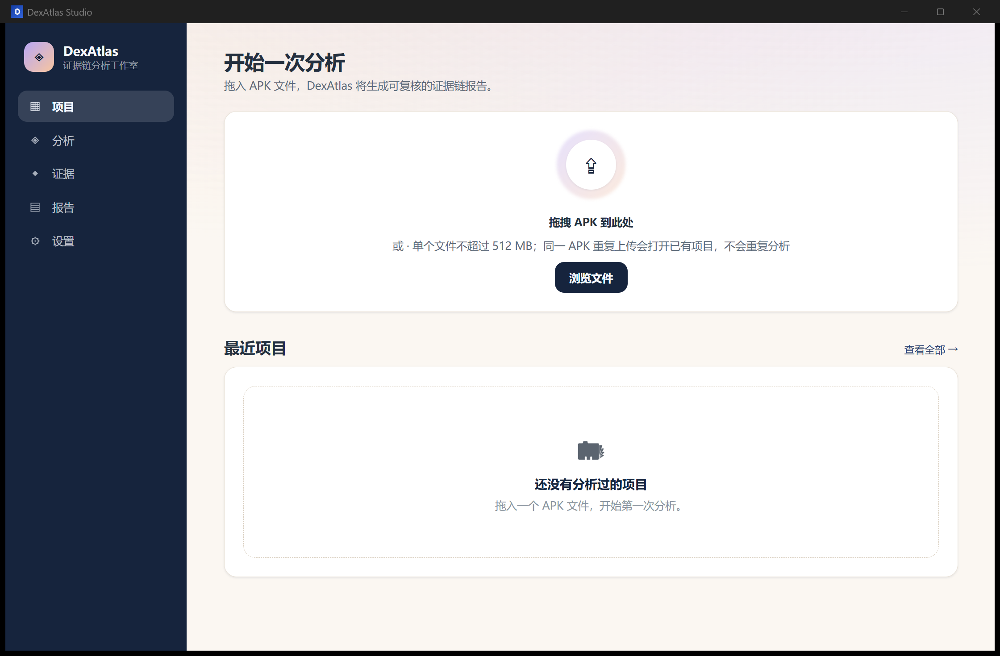
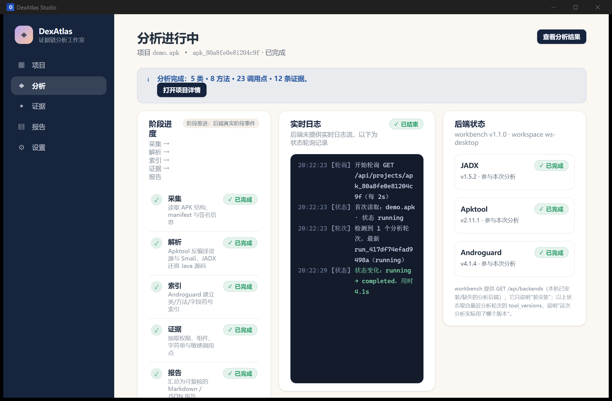
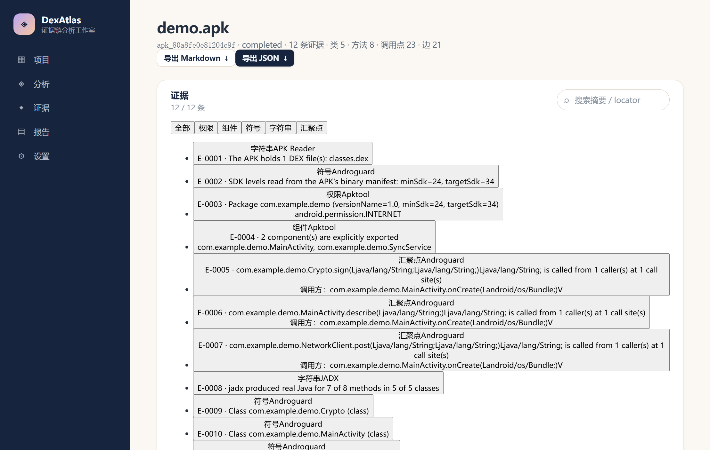
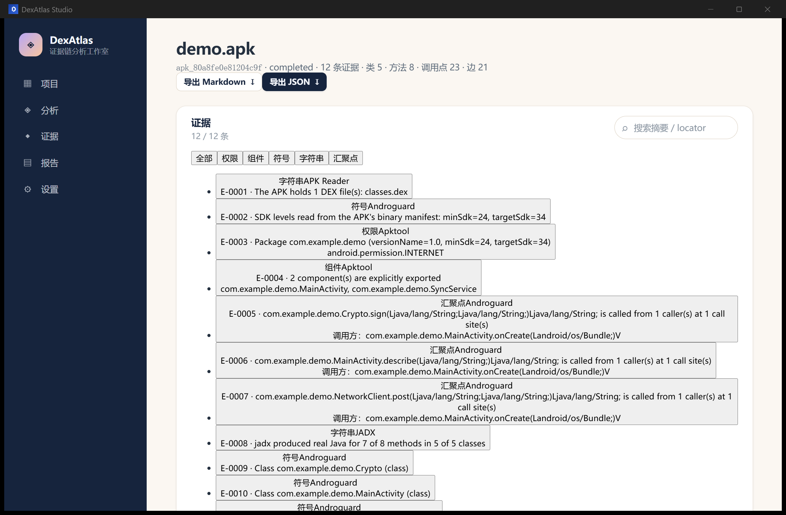
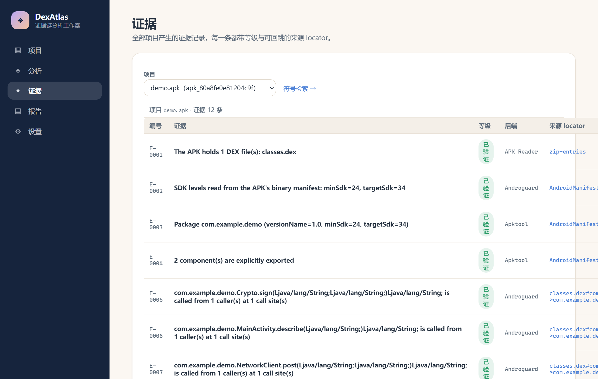
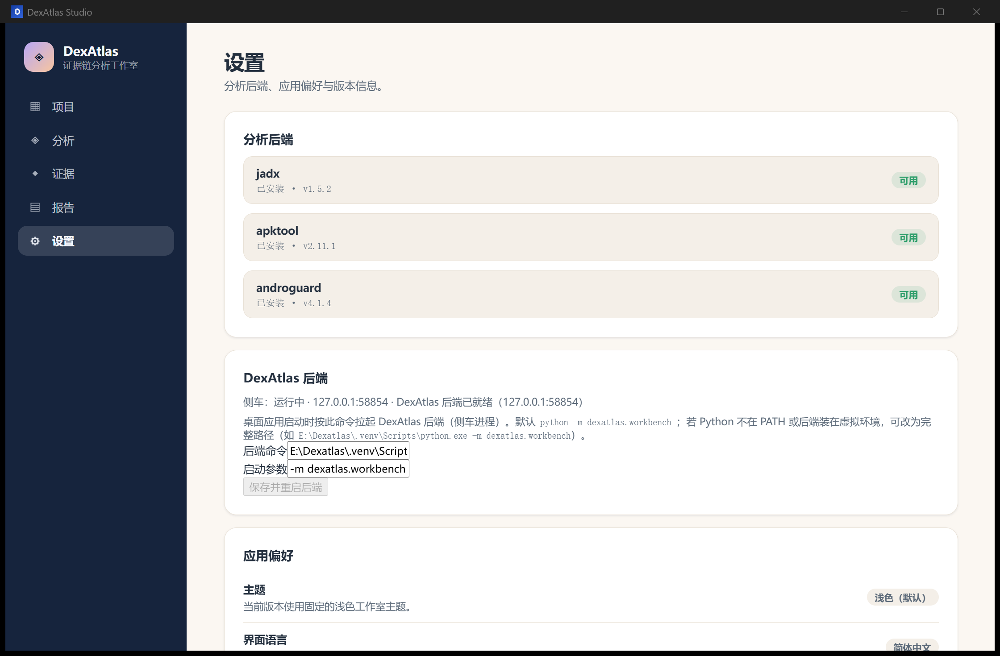

# Phase 5 真机补测：打包 exe + 完整后端配置，MSI 安装

**日期：** 2026年11月26日
**机器：** Windows 11 Pro 10.0.26300（x64）
**代码基线：** `bb04ac5`（Merge PR #24），worktree `.claude/worktrees/elegant-bouman-297a2f`
**本文补的是：** [Phase 5 验收报告](phase5-acceptance.md) §7 的第 2 项与第 3 项——「打包 exe 在装了 jadx + apktool 的配置下未跑」与「MSI 安装路径未验证」。

> **本文的地位。** 验收报告是判定书；本文是那两条空白项的**原始记录**：配了什么、跑了什么命令、看到了什么、以及**哪些没看到**。本文只做记录与取证，不改判定——两条空白项的结论由验收报告的作者在看过本文后写。
> **本文不含新的生产声明。** 每一个数字都来自本次运行的日志或截图，命令与路径都可复现（见 §5）。

---

## 0. 结论

| 补测项 | 结论 | 一句话证据 |
|---|---|---|
| 打包 exe + 完整后端（JADX + Apktool + Androguard） | **通过** | 打包 exe 走完「上传 → 分析 → 项目详情 → 证据」，5 个阶段全部「已完成」，**12 条证据**、`missing_backends: []`、`complete: true`；设置页三个后端都显示「已安装 · 参与本次分析」（§2） |
| MSI 安装 | **通过（有一个前提要说清）** | `msiexec /i … /passive` 退出码 **0**，装到 `C:\Program Files\DexAtlas Studio\`；装完启动应用，侧车起来、连上后端、跑出同样的 **12 条证据**（§3） |

**两条空白项都能填上，但 MSI 那一项带一个前提：`msiexec /i … /qn`（静默）装不上，退出码 1603；换成 `/passive` 才装得上。** 原因与边界写在 §3.5——不是包的毛病，是「静默模式下 Windows Installer 不做凭据提升」这条机制。

---

## 1. 这次测了什么、怎么测的

### 1.1 机器与工具链

| | |
|---|---|
| 操作系统 | Windows 11 Pro 10.0.26300（x64） |
| Node / npm | v24.16.0 / 11.13.0 |
| Rust / Cargo | rustc 1.96.0 / cargo 1.96.0（MSVC） |
| Python（侧车用） | `E:\Dexatlas\.venv\Scripts\python.exe`，CPython 3.12.10 |
| 桌面端依赖 | `npm ci` → 52 个包，0 漏洞 |
| 打包 | `npm run tauri build` → 退出码 0，Rust release 编译耗时 4m 23s |

**venv 的指向要写清楚：** `E:\Dexatlas\.venv` 里的 `dexatlas` 是 **editable 安装，指向 `E:\Dexatlas\src\dexatlas`**（主检出的源码）。主检出与本 worktree 同为 `bb04ac5`，所以侧车跑的是与桌面端**同一个 commit 的后端代码**。本轮**没有**在主检出目录执行 `uv sync`（那会把 Windows venv 变成 Linux 的且 uv 拒绝修复）。

### 1.2 分析后端：实际路径

后端通过环境变量交给后端进程——`Settings` 的环境前缀是 `DEXATLAS_`（`src/dexatlas/config/settings.py:22`），JADX 读 `DEXATLAS_JADX_PATH`（`src/dexatlas/tools/jadx/adapter.py:183`），Apktool 读 `DEXATLAS_APKTOOL_JAR`（`src/dexatlas/tools/apktool/adapter.py:106`）。

| 后端 | 本机实际路径 | 版本 | 怎么找到的 |
|---|---|---|---|
| JADX | `E:\Dexatlas\.scratch\backends\jadx\bin\jadx.bat` | **1.5.2** | `jadx-1.5.2-all.jar`（`…\jadx\lib\`） |
| Apktool | `E:\Dexatlas\.scratch\backends\apktool.jar` | **2.11.1** | `apktool.jar`（24,562,875 B） |
| Androguard | venv 内置（`E:\Dexatlas\.venv`） | **4.1.4** | 无需环境变量 |

> **`DEXATLAS_JADX_PATH` 必须指到启动器 `bin\jadx.bat`，不是 jadx 目录。** 指到目录时后端被判定为「装了但版本查不到」，`/api/backends` 的 `versions.jadx` 是 `None`。这是上一轮验收记录里的教训，本轮沿用。

启动桌面 exe 之前设的这三个变量：

```
DEXATLAS_JADX_PATH=E:\Dexatlas\.scratch\backends\jadx\bin\jadx.bat
DEXATLAS_APKTOOL_JAR=E:\Dexatlas\.scratch\backends\apktool.jar
DEXATLAS_WORKSPACE=E:\Dexatlas\.claude\worktrees\elegant-bouman-297a2f\.scratch\ws-desktop
```

**继承链**（为什么这三个变量能到后端进程里）：桌面端 `spawn` 侧车时没有清空环境（`desktop/src-tauri/src/sidecar.rs`），侧车进程再把它继承给 `python -m dexatlas.workbench`，后端进程最终在 `Settings` 里读到它们。

### 1.3 打包产物

`npm run tauri build` 退出码 0，`bundle.targets: "all"` → 同时产出 NSIS 与 MSI：

| 产物 | 路径 | 大小 | sha256 |
|---|---|---|---|
| 主程序 | `desktop/src-tauri/target/release/dexatlas-desktop.exe` | 14,817,280 B | `a81057cad0ed6107d28baeaf58a9b5492e9c7e5b00e486cdcd66c1ec34c92857` |
| MSI | `desktop/src-tauri/target/release/bundle/msi/DexAtlas Studio_0.1.0_x64_en-US.msi` | 5,431,296 B（5.18 MiB） | `259a78222701c03f4ffd9e74457ee91b3dbe94022953f5ae6bf7751444479ded` |
| NSIS | `desktop/src-tauri/target/release/bundle/nsis/DexAtlas Studio_0.1.0_x64-setup.exe` | 3.61 MiB | （本轮没装，不记指纹） |

**WiX 工具链是现成的**：`%LOCALAPPDATA%\tauri\WixTools314\candle.exe` / `light.exe`（Tauri 缓存，WiX 3.14）→ MSI 编译不需要联网下载。NSIS 同样有缓存（`%LOCALAPPDATA%\tauri\NSIS`）。**本轮没有改 `desktop/src-tauri/tauri.conf.json`**——MSI 打包不需要改 bundle 配置。

### 1.4 工作区、端口与后端命令

| | |
|---|---|
| 工作区 | `E:\Dexatlas\.claude\worktrees\elegant-bouman-297a2f\.scratch\ws-desktop`（每轮开始前清空，保证每次都是一次新的完整分析，而不是复用已有项目） |
| 侧车后端命令 | `E:\Dexatlas\.venv\Scripts\python.exe -m dexatlas.workbench`（来自应用配置目录的 `backend.json`） |
| 侧车实际端口 | **58854**（release exe 这一轮）、**57651**（安装态那一轮）——`--port 0` 由系统分配 |
| 8618 | **本轮开工时**被一个与本次验收无关的工作台占着（PID 34340，`C:\Users\pc\AppData\Local\Programs\Python\Python312\python.exe -m dexatlas.workbench --port 8618`）；那个进程在本轮结束前已退出，8618 现在空闲。**桌面侧车全程没有用过它**——侧车自己的 uvicorn 访问日志逐条记着前端请求（`GET /api/projects/apk_80a8fe0e81204c9f` 等），那些请求落在 58854 / 57651 上 |

---

## 2. 补测一：打包 exe + 完整后端配置

### 2.1 怎么跑起来的

```powershell
# 在 worktree 里
$env:DEXATLAS_JADX_PATH   = 'E:\Dexatlas\.scratch\backends\jadx\bin\jadx.bat'
$env:DEXATLAS_APKTOOL_JAR = 'E:\Dexatlas\.scratch\backends\apktool.jar'
$env:DEXATLAS_WORKSPACE   = 'E:\Dexatlas\.claude\worktrees\elegant-bouman-297a2f\.scratch\ws-desktop'
& '.\desktop\src-tauri\target\release\dexatlas-desktop.exe'
```

界面用 CDP 驱动（WebView2 的 `--remote-debugging-port=9222`）：`DOM.setFileInputFiles` 真的把 `examples/demo-app/demo.apk` 塞进了首页的 `<input type="file">`，然后等分析、翻页、截图。**没有直接调后端 API 冒充「分析完成」**——截图里的每一页都是应用自己渲染出来的。

### 2.2 观察到什么

**① 首屏（拖入 APK）**



*整窗原生截图（真机上的窗口本体，含标题栏）：* 

**② 分析完成 —— 这一张是本轮的核心证据**


页面上写着：

- 横幅：**分析完成：5 类 · 8 方法 · 23 调用点 · 12 条证据。**
- 阶段进度：采集 / 解析 / 索引 / 证据 / 报告 **五格全是「已完成」**
- 轮次：`run run_417d · completed · 4.1s`
- 右上「后端状态」卡：
  - `JADX ✓ 已完成 · v1.5.2 · 参与本次分析`
  - `Apktool ✓ 已完成 · v2.11.1 · 参与本次分析`
  - `Androguard ✓ 已完成 · v4.1.4 · 参与本次分析`
- 页脚注明「以上状态取自最近分析轮次的 `tool_versions`，说明**这次分析实际用了哪个版本**」——不是「装没装」的推断

*整窗原生截图：* 

**③ 项目详情：12 / 12 条证据，每条标着它出自哪个后端**



页头是 `apk_80a8fe0e81204c9f · completed · 12 条证据 · 类 5 · 方法 8 · 调用点 23 · 边 21`，下面是 12 条证据，每条带后端标签：`字符串 APK Reader` / `权限 Apktool` / `组件 Apktool` / `汇聚点 Androguard` / `字符串 JADX` / `符号 Androguard`……

其中 **E-0008 的正文就是 JADX 参与的实证**：

> `E-0008 · jadx produced real Java for 7 of 8 methods in 5 of 5 classes`

这条证据只有 JADX 真的跑过并还原出 Java 源码才会出现——后端齐全时它才在，缺 JADX 时不在。

*整窗原生截图：* 

**④ 证据页**



**⑤ 设置页：侧车状态与后端版本**


设置页把两件事分开说清楚了：

- 「分析后端」：`jadx 已安装 · v1.5.2 可用`、`apktool 已安装 · v2.11.1 可用`、`androguard 已安装 · v4.1.4 可用`
- 「DexAtlas 后端」：**侧车：运行中 · 127.0.0.1:58854 · DexAtlas 后端已就绪（127.0.0.1:58854）**

*整窗原生截图：* 

### 2.3 侧车那侧的数字（直连 58854 查的）

```
GET http://127.0.0.1:58854/api/backends
{
  "available": ["jadx", "apktool", "androguard"],
  "missing": [],
  "versions": { "jadx": "1.5.2", "apktool": "2.11.1", "androguard": "4.1.4" }
}

GET http://127.0.0.1:58854/api/projects/apk_80a8fe0e81204c9f
  status            : completed
  class_count       : 5
  method_count      : 8
  call_site_count   : 23
  call_edge_count   : 21
  evidence_count    : 12
  missing_backends  : []
  truncated         : false
  completeness      : { "complete": true, "missing_backends": [], "truncated": false, "errors": [] }
```

`missing_backends` 是空数组、`complete` 是 `true`、`errors` 是空数组——**这一轮没有任何后端缺席，也没有任何一步报错。**

### 2.4 对照：后端齐全 vs 后端缺失（两组都实测过，不是推断）

验收报告 §7 第 2 项记的是：二次验收时侧车环境里没有这两个后端，结果是 `partial`、**证据 10 条**。本轮把**缺后端的那一档也重跑了一遍**（同一份 `demo.apk`，只把 `DEXATLAS_JADX_PATH` 与 `DEXATLAS_APKTOOL_JAR` 置空——空串即禁用该后端），于是两档都有实测数字：

| | 后端齐全 | 后端缺失（JADX / Apktool 关掉） |
|---|---|---|
| `/api/backends` | `available [jadx, apktool, androguard]`、`missing []` | `available [androguard]`、`missing [jadx, apktool]` |
| 证据条数 | **12** | **10** |
| `complete` | `true` | `false` |
| `missing_backends` | `[]` | `[apktool, jadx]` |

**两条证据集合的差集（实测，不是推测）**——全后端多出 4 条真证据：

| 证据 | 内容 | 需要谁 |
|---|---|---|
| E-0002 | `SDK levels read from the APK's binary manifest: minSdk=24, targetSdk=34` | 反编译后的 manifest |
| E-0003 | `Package com.example.demo (versionName=1.0, minSdk=24, targetSdk=34)` + `android.permission.INTERNET` | Apktool |
| E-0004 | `2 component(s) are explicitly exported` | Apktool |
| E-0008 | `jadx produced real Java for 7 of 8 methods in 5 of 5 classes` | JADX |

而缺后端那一档**多出来的是两条「说明后端没跑成」的占位证据**（不是分析结论）：

```
E-0002 | observation | apktool did not complete in this run: apktool is not installed or not on PATH. …
E-0006 | observation | jadx did not complete in this run: jadx is not installed or not on PATH. …
```

`12 − 4 + 2 = 10`——两边条数对得上。

### 2.5 对照组：绕开桌面端，直接起后端

为了把「环境变量配得对不对」和「打包后的 exe 有没有把环境变量传下去」分开，额外跑了一次**不经桌面端**的对照：同样的三个环境变量，直接 `python -m dexatlas.workbench --port 0`，用同样的 `demo.apk` 走 HTTP。

结果**完全一致**：`available: [jadx, apktool, androguard]`、`missing: []`、`versions` 同上、`evidence_count: 12`、`complete: true`。

**这条对照说明的是：** 12 条证据这个结果由**后端集合**决定，与「是不是打包形态」无关；而桌面端跑出了同一个结果，说明**打包后的 exe 确实把环境变量原样传到了后端进程**。

---

## 3. 补测二：MSI 安装

### 3.1 安装包

`desktop/src-tauri/target/release/bundle/msi/DexAtlas Studio_0.1.0_x64_en-US.msi`（5,431,296 B）。MSI 是 Tauri 用缓存的 WiX 3.14 编出来的；Tauri 生成的 WiX 模板里 `InstallScope="perMachine"`（模板落在 `desktop/src-tauri/target/release/wix/x64/main.wxs`，是**构建产物**，不入库）。

### 3.2 逐条安装尝试

| # | 命令 | 退出码 | 结果 |
|---|---|---|---|
| A | `msiexec /i "….msi" /qn /l*v "…-silent.log"` | **1603** | **装不上**。日志里写得很直白：*MSI_LUA: Installation UI level is silent, no credential elevation is possible* |
| B | `msiexec /i "….msi" /passive /l*v "…-passive.log"` | **0** | **装上了**。日志：*MSI_LUA: Elevation required to install product, will prompt for credentials* → *MSI_LUA: Elevated credential consent provided. Install will run elevated* → *Running product '{680674BE-…}' with elevated privileges* |

（第一次尝试前，先用一个自制的最小探针 MSI 验证过「这个会话能不能装 per-machine 包」，探针同样 `/qn` 失败、`/passive` 成功——所以卡点跟 DexAtlas 这个包无关，是 Windows Installer 的机制。）

### 3.3 安装结果

| | |
|---|---|
| 安装路径 | **`C:\Program Files\DexAtlas Studio\`** |
| 产品名 / 版本 | `DexAtlas Studio` / `0.1.0` |
| 产品码 | `{680674BE-75AC-4D95-8397-32757BBB8C62}` |
| 卸载串 | `MsiExec.exe /X{680674BE-75AC-4D95-8397-32757BBB8C62}` |
| 装进去的文件 | `C:\Program Files\DexAtlas Studio\dexatlas-desktop.exe`（14,817,280 B，与 `target/release` 里那个**逐字节同大小**）、`C:\Program Files\DexAtlas Studio\Uninstall DexAtlas Studio.lnk` |

注册表卸载项：`HKLM\SOFTWARE\Microsoft\Windows\CurrentVersion\Uninstall\{680674BE-75AC-4D95-8397-32757BBB8C62}`。

### 3.4 装完能启动、能连上后端

从安装目录启动 `C:\Program Files\DexAtlas Studio\dexatlas-desktop.exe`（同样带上 §1.2 的三个环境变量），走了一遍同样的全链路：

- 侧车起来，**端口 57651**（`--port 0` 动态分配）
- 上传 `demo.apk` → 分析 → **12 条证据**，`complete: true`，`missing_backends: []`
- 五个阶段全「已完成」，`run run_ba16 · completed · 4.2s`
- 设置页照旧显示三个后端「已安装 · 参与本次分析」与「侧车：运行中 · 127.0.0.1:57651」


*整窗原生截图：* 


**安装形态的一个关键差别**：`desktop/src-tauri/src/sidecar.rs:462` 的 `repo_root_from_exe()` 从 exe 路径反推仓库根；装到 Program Files 后祖先链里没有 `src/dexatlas`，于是 `backend_cwd()`（`desktop/src-tauri/src/sidecar.rs:453`）返回 `None`——**侧车不再有工作目录**。这不影响可用性：`backend.json` 里存的是绝对路径 `E:\Dexatlas\.venv\Scripts\python.exe`，后端命令与 cwd 无关。本轮实测正是这一条路径。

### 3.5 为什么 `/qn` 装不上、`/passive` 装得上

**这不是 DexAtlas 的包有问题，是 Windows Installer 的机制：**

- Tauri 2.12.7 的 `bundle.windows.wix` 配置里**没有 `installMode` 选项**（只有 NSIS 有，默认 `currentUser`）→ **MSI 只能是 per-machine**，装到 Program Files 必须提权。
- 本次会话的令牌是**未提升的**：用户 `pc` 是本机 `Administrators` 组主组成员，但当前令牌是过滤后的（`IsInRole(Administrator)` = False）。**会话本身不是管理员令牌。**
- `/qn`（完全静默）下，Windows Installer **不做凭据提升**，日志原话是 *no credential elevation is possible* → 退出码 1603。
- `/passive`（被动 UI）下，Installer 走 LUA 路径，日志记着 *Elevation required … will prompt for credentials* 与 *Elevated credential consent provided. Install will run elevated* → **实际的写入动作由 SYSTEM 身份的安装服务完成** → 退出码 0。

**给使用者的一句话：** 装这个 MSI 时**不要加 `/qn`**；用 `/passive`（或双击走 UI）即可。**这与打包配置无关，不需要改 `tauri.conf.json`。**

---

## 4. 这次测量看不到什么

诚实地列出来，不要在别处被当成已验证：

1. **macOS / Linux 的打包产物真机验证——没做**，也不在执行单范围内。本轮所有结论只对 Windows 11 成立。
2. **`msiexec /i … /qn` 的无人值守安装——没做成**（退出码 1603）。做成的 `/passive` 路径在日志里表现为「Installer 提升了凭据」。**本轮没有验证 `/qn` 在一个已提升的会话里能不能装**（那需要一个人工提升的终端，本会话没有）。
3. **MSI 的升级 / 卸载 / 修复（repair）路径——没测**。只做了一次全新安装。
4. **代码签名**——MSI 与 exe 都没签名（`SOFTWARE RESTRICTION POLICY: … is not digitally signed`，本机策略是 `unrestricted`，所以没拦）。**在有签名要求的机器上会怎样，未知。**
5. **强制结束 exe 时的孤儿后端——仍未实测**（验收报告 §7 第 4 项，本轮不涉及）。本轮所有退出都是正常退出路径。
6. **failed / cancelled run 的时间线——仍未实跑**（验收报告 §7 第 7 项）。本轮只跑成了 completed 的路径。
7. **应用配置目录读的是哪一份**（`C:\Users\pc\AppData\Roaming\io.github.dexatlas.desktop\backend.json` vs MSIX 容器下的 `…\Packages\Claude_pzs8sxrjxfjjc\LocalCache\Roaming\…\backend.json`）——**本轮没做判别实验**。两份文件逐字节相同，所以结论不依赖读的是哪一份；但「非 MSIX 容器下的启动」这一项（验收报告 §7 第 5 项）**仍然开放**。
8. **样例只有 `examples/demo-app/demo.apk`**（2,951 B，一方样例）。**没有**拿真实第三方 APK 测过——项目规则 7 不让第三方 APK 进仓库，本轮也没有绕过这条。
9. **多轮 / 大体量 APK**——只跑了一轮 3 KB 的样例。**并发上传、大文件（>100 MB）、畸形 APK 的桌面端表现未测。**
10. **本轮跑的是 `dexatlas-desktop.exe` 这个「裸」可执行文件**（`target/release/`），以及它的 MSI 安装态。**NSIS 安装器本轮没有装**（上一轮验收已装过）。

---

## 5. 复现命令

```bash
# 1) 桌面端依赖与打包（worktree 根目录）
cd desktop
npm ci
npm run tauri build          # → target/release/dexatlas-desktop.exe + bundle/{msi,nsis}/…

# 2) 跑打包 exe（PowerShell）
$env:DEXATLAS_JADX_PATH   = 'E:\Dexatlas\.scratch\backends\jadx\bin\jadx.bat'
$env:DEXATLAS_APKTOOL_JAR = 'E:\Dexatlas\.scratch\backends\apktool.jar'
$env:DEXATLAS_WORKSPACE   = '<worktree>\.scratch\ws-desktop'
& '.\desktop\src-tauri\target\release\dexatlas-desktop.exe'

# 3) MSI 安装（注意：不要加 /qn）
msiexec /i ".\desktop\src-tauri\target\release\bundle\msi\DexAtlas Studio_0.1.0_x64_en-US.msi" /passive /l*v "$env:TEMP\dexatlas-msi.log"

# 4) 卸载
msiexec /x "{680674BE-75AC-4D95-8397-32757BBB8C62}" /passive
```

**取证脚本**（本轮用的，不入库，放在 worktree 的 `.scratch/`）：

| 脚本 | 作用 |
|---|---|
| `.scratch/cdp.py` | 极简 CDP 客户端（读 DOM / 塞文件 / 截图） |
| `.scratch/exe_run.py` | 全链路驱动：起 exe → 塞 APK → 等分析 → 翻页 → 截图（可传 exe 路径与截图前缀） |
| `.scratch/capture-window.ps1` | 原生整窗截图（`PrintWindow`；**必须先 `SetProcessDPIAware()`**，否则拿到的是虚拟化坐标，位图和窗口缓冲区对不上） |
| `.scratch/msi_install.ps1` | MSI 分级尝试（静默 → 被动 → RunAs）并记录退出码 |
| `.scratch/control_run.py` | 对照组 A：不经桌面端、后端齐全 |
| `.scratch/control_nobackends.py` | 对照组 B：不经桌面端、后端缺失（JADX / Apktool 置空） |

---

## 6. 本轮产出的文件

| 文件 | 说明 |
|---|---|
| `docs/reports/phase5-machine-verification.md` | 本文 |
| `docs/assets/phase5/machine-01-home.png` … `machine-06b-settings-window.png` | 打包 exe（`target/release`）全链路截图，CDP 截图 + 原生整窗截图 |
| `docs/assets/phase5/machine-07-*.png` | MSI 安装后从 `C:\Program Files\DexAtlas Studio\` 启动的应用截图 |

**没有改任何生产代码**：`src/**`、`tests/**`、`desktop/src/**`、`desktop/src-tauri/src/**` 一个字没动；`desktop/src-tauri/tauri.conf.json` 也没动（MSI 打包不需要改 bundle 配置）。第三方 APK / DEX / `so` / 密钥没有进仓库（只用了仓库自带的一方样例）。

**机器上留下的状态：** DexAtlas Studio **仍然装着**（`C:\Program Files\DexAtlas Studio\`，MSI 产品码 `{680674BE-75AC-4D95-8397-32757BBB8C62}`）。要清掉就 `msiexec /x "{680674BE-75AC-4D95-8397-32757BBB8C62}" /passive`。除此之外，本轮没有在系统上留下别的东西（自制的探针 MSI **没有**装上，探查用的高权限计划任务已删除）。
