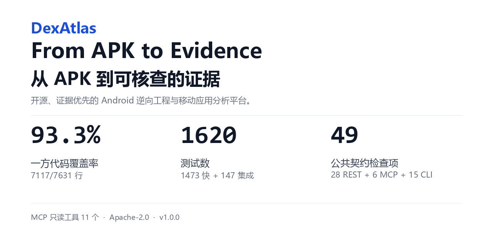

# GitHub social preview 图：怎么用

> 这份说明回答两件事：**这张图怎么设成仓库的 social preview**（只能手动做，GitHub 没有
> API），以及**图上每一个字、每一个数是从哪个文件的哪一行读出来的**。

## 1. 图文件

| 项 | 值 |
|---|---|
| 路径 | `.github/social-preview.png` |
| 格式 | PNG、1280×640 |
| 体积 | 71,404 字节 |
| 生成 | Pillow + Windows 自带字体（`msyh.ttc` / `msyhbd.ttc` / `consolab.ttf`），脚本见 §5 |

图里没有渐变、没有阴影、没有装饰图形：这是一个文档工具的仓库，卡片要像文档而不像广告。



## 2. 设成 social preview（三步）

1. 打开仓库主页，点顶部的 **Settings**（只有仓库管理员能进）。
2. 左侧栏选 **General**，页面往下滚到 **Social preview** 一节。
3. 点 **Upload an image**，选本地的 `.github/social-preview.png`，上传后点 **Save**。

**这一步只能手动做**：GitHub 没有提供设置 social preview 的 REST/GraphQL 接口，`gh` CLI
也没有对应子命令。在浏览器里点完即生效。

换图之后 GitHub 会缓存旧图，分享链接里可能要过一段时间才看到新图。

## 3. README 里怎么用

`README.md` 在仓库根目录，所以在标题下面（徽章那一行之后）加这一行：

```html

```

放在 `docs/` 下的文档里，路径要按文档所在目录相对写（`../../.github/social-preview.png`）。

本次提交把它放在英文 `README.md` 的徽章那一行之后、收尾的 `</div>` 之前。中文
`README.zh-CN.md` 同样可以加同一段；本次交付范围里只有英文 README，所以没动它。

## 4. 图上每一句话的出处

| 图上的文字 | 落盘出处 | 说明 |
|---|---|---|
| `DexAtlas` | `README.md:3` | 仓库名 |
| `From APK to Evidence` | `README.md:5` | tagline 的前半句，逐字 |
| `从 APK 到可核查的证据` | `README.md:5` | 同一句 tagline 的中文表述 |
| `开源、证据优先的 Android 逆向工程与移动应用分析平台。` | `README.zh-CN.md:7` | 逐字 |
| `93.3%` | `docs/reports/phase1-execution-report.md:77` | `<!--fig:coverage.pct-->` |
| `7117/7631 行` | `docs/reports/phase1-execution-report.md:77` | `<!--fig:coverage.covered-->` / `<!--fig:coverage.total-->` |
| `1620` | `docs/reports/phase1-execution-report.md:76` | `<!--fig:tests.total-->` |
| `1473 快 + 147 集成` | `docs/reports/phase1-execution-report.md:76` | `<!--fig:tests.fast-->` / `<!--fig:tests.slow-->` |
| `49` / `公共契约检查项` | `docs/architecture/public-contracts.md:348` | 检查项清单的静态条数 |
| `28 REST + 6 MCP + 15 CLI`（合计 49 项） | `docs/architecture/public-contracts.md:348` | 同一行的分项 |
| `MCP 只读工具 11 个` | `docs/architecture/public-contracts.md:207-217` | §3.1 工具清单的 11 行 |
| `Apache-2.0` | `pyproject.toml:10` | 许可证标识 |
| `v1.0.0` | `src/dexatlas/__init__.py:11` | 版本号的唯一来源 |

图上的数字不是手抄的：生成脚本直接解析上面这些文件（§5）。报告里的数字变了
（`scripts/refresh-report-figures.py` 写回），下一次生成的图就跟着变。

## 5. 重新生成这张图

脚本不入库——画一张图不需要给仓库增加依赖，Pillow 是 demo extra 已经带来的。把它放在
**项目根目录下**临时用（不要提交，用完删掉或加进 `.gitignore`），例如
`make_social_preview.py`，然后：

```bash
python make_social_preview.py E:/Dexatlas
```

脚本从落盘文件里解析要画的东西：

- `README.md` → tagline；
- `README.zh-CN.md` → 中文定位句；
- `docs/reports/phase1-execution-report.md` 的 `<!--fig:...-->` → 覆盖率与测试数；
- `docs/architecture/public-contracts.md` → 49 项检查与 11 个 MCP 工具。

画完会打印每一行文字的坐标，越界就以非零码退出；图里唯一手写的字符串是中文定位句
「从 APK 到可核查的证据」——它是英文 tagline 的中译。

```python
"""Draw the GitHub social preview card for DexAtlas (1280x640).

Every string on the card is parsed out of a file that is checked into the
repository, so the card cannot drift away from the reports it quotes:

* the tagline comes from ``README.md``;
* the Chinese descriptor comes from ``README.zh-CN.md``;
* the coverage and test numbers come from the ``<!--fig:...-->`` markers in
  ``docs/reports/phase1-execution-report.md``;
* the public-contract count comes from ``docs/architecture/public-contracts.md``;
* the MCP tool count is the number of rows in that file's tool table.

Nothing here is typed from memory. Run it with the repository root as the
first argument::

    python make_social_preview.py E:/Dexatlas

Only Pillow is used; the fonts are the ones Windows already ships.
"""

from __future__ import annotations

import re
import sys
from pathlib import Path

from PIL import Image, ImageDraw, ImageFont

# --------------------------------------------------------------------- canvas

WIDTH, HEIGHT = 1280, 640
MARGIN = 80

BACKGROUND = (255, 255, 255)
INK = (17, 24, 39)
BODY = (55, 65, 81)
MUTED = (107, 114, 128)
ACCENT = (29, 78, 216)
RULE = (226, 232, 240)

FONT_CJK = "C:/Windows/Fonts/msyh.ttc"
FONT_CJK_BOLD = "C:/Windows/Fonts/msyhbd.ttc"
FONT_MONO_BOLD = "C:/Windows/Fonts/consolab.ttf"


# ----------------------------------------------------------------- repo facts

FIG = re.compile(r"<!--fig:([\w.]+)-->(.*?)<!--/fig-->", re.DOTALL)
CONTRACT_LINE = re.compile(
    r"检查项清单共\s*(\d+)\s*项[：:]\s*(\d+)\s*REST\s*\+\s*(\d+)\s*MCP\s*\+\s*(\d+)\s*CLI"
)
MCP_ROW = re.compile(r"^\|\s*(\d+)\s*\|\s*`[a-z_]+`\s*\|")


def read_figures(report: Path) -> dict[str, str]:
    """The ``<!--fig:...-->`` values of one report, by key."""
    return {key: value.strip() for key, value in FIG.findall(report.read_text(encoding="utf-8"))}


def read_contract_counts(contracts: Path) -> tuple[int, int, int, int, int]:
    """``(total, rest, mcp, cli)`` from the contract checklist, and the tool count."""
    text = contracts.read_text(encoding="utf-8")
    match = CONTRACT_LINE.search(text)
    if match is None:
        raise SystemExit("public-contracts.md: the checklist line was not found")
    total, rest, mcp, cli = (int(part) for part in match.groups())
    tools = 0
    in_table = False
    for line in text.splitlines():
        if line.startswith("### 3.1 "):
            in_table = True
        elif in_table and line.startswith("### "):
            break
        elif in_table and MCP_ROW.match(line):
            tools += 1
    return total, rest, mcp, cli, tools


def read_tagline(readme: Path) -> str:
    """``From APK to Evidence`` — the first half of the repository's tagline."""
    for line in readme.read_text(encoding="utf-8").splitlines():
        if line.startswith("**From APK to Evidence"):
            return line.strip("*").split("—")[0].strip()
    raise SystemExit(f"{readme}: the tagline was not found")


def read_descriptor(readme: Path) -> str:
    """The one-line Chinese description under the Chinese tagline."""
    lines = readme.read_text(encoding="utf-8").splitlines()
    for index, line in enumerate(lines):
        if line.startswith("**From APK to Evidence") and index + 2 < len(lines):
            return lines[index + 2].strip()
    raise SystemExit(f"{readme}: the descriptor was not found")


# ------------------------------------------------------------------ rendering


def main() -> int:
    repo = Path(sys.argv[1] if len(sys.argv) > 1 else ".").resolve()
    report = repo / "docs" / "reports" / "phase1-execution-report.md"
    contracts = repo / "docs" / "architecture" / "public-contracts.md"

    figures = read_figures(report)
    total, rest, mcp, cli, tools = read_contract_counts(contracts)
    tagline = read_tagline(repo / "README.md")
    descriptor = read_descriptor(repo / "README.zh-CN.md")

    image = Image.new("RGB", (WIDTH, HEIGHT), BACKGROUND)
    draw = ImageDraw.Draw(image)

    def font(path: str, size: int) -> ImageFont.FreeTypeFont:
        return ImageFont.truetype(path, size)

    cjk_bold = font(FONT_CJK_BOLD, 46)
    cjk_regular = font(FONT_CJK, 22)
    label = font(FONT_CJK, 25)
    detail = font(FONT_CJK, 21)
    footer = font(FONT_CJK, 19)
    number = font(FONT_MONO_BOLD, 66)
    wordmark = font(FONT_CJK_BOLD, 38)
    english = font(FONT_CJK_BOLD, 54)

    problems: list[str] = []

    def place(
        text: str,
        xy: tuple[int, int],
        fnt: ImageFont.FreeTypeFont,
        fill,
        limit: int,
        anchor: str = "lt",
    ) -> None:
        """Draw text and record whether it stays inside the canvas."""
        draw.text(xy, text, font=fnt, fill=fill, anchor=anchor)
        left, top, right, bottom = draw.textbbox(xy, text, font=fnt, anchor=anchor)
        width = right - left
        if left < 0 or right > WIDTH or top < 0 or bottom > HEIGHT:
            problems.append(f"{text!r} leaves the canvas: {(left, top, right, bottom)}")
        if right - MARGIN > limit:
            problems.append(f"{text!r} ends at {right}, past its {limit} limit")
        print(f"{text!r:60} x={left:5}..{right:5} y={top:4}..{bottom:4} w={width:5}")

    # -- header -------------------------------------------------------------
    place("DexAtlas", (MARGIN, 56), wordmark, ACCENT, WIDTH - MARGIN)
    place(tagline, (MARGIN, 108), english, INK, WIDTH - MARGIN)
    place("从 APK 到可核查的证据", (MARGIN, 182), cjk_bold, INK, WIDTH - MARGIN)
    place(descriptor, (MARGIN, 250), cjk_regular, MUTED, WIDTH - MARGIN)

    draw.line([(MARGIN, 300), (WIDTH - MARGIN, 300)], fill=RULE, width=1)

    # -- the three numbers --------------------------------------------------
    column = (WIDTH - 2 * MARGIN - 2 * 48) / 3
    cells = [
        (
            figures["coverage.pct"],
            "一方代码覆盖率",
            f"{figures['coverage.covered']}/{figures['coverage.total']} 行",
        ),
        (
            figures["tests.total"],
            "测试数",
            f"{figures['tests.fast']} 快 + {figures['tests.slow']} 集成",
        ),
        (
            str(total),
            "公共契约检查项",
            f"{rest} REST + {mcp} MCP + {cli} CLI",
        ),
    ]
    for index, (value, caption, sub) in enumerate(cells):
        x = round(MARGIN + index * (column + 48))
        place(value, (x, 372), number, INK, round(x + column), anchor="ls")
        place(caption, (x, 412), label, BODY, round(x + column))
        place(sub, (x, 446), detail, MUTED, round(x + column))

    # -- footer -------------------------------------------------------------
    draw.line([(MARGIN, 528), (WIDTH - MARGIN, 528)], fill=RULE, width=1)
    place(
        f"MCP 只读工具 {tools} 个  ·  Apache-2.0  ·  v1.0.0",
        (MARGIN, 556),
        footer,
        MUTED,
        WIDTH - MARGIN,
    )

    out = repo / ".github" / "social-preview.png"
    out.parent.mkdir(parents=True, exist_ok=True)
    image.save(out, format="PNG", optimize=True)
    print(f"\nwrote {out} ({out.stat().st_size} bytes, {image.size[0]}x{image.size[1]})")

    if problems:
        print("\nLAYOUT PROBLEMS:")
        for problem in problems:
            print(f"  {problem}")
        return 1
    print("layout: no overflow")
    return 0


if __name__ == "__main__":
    raise SystemExit(main())
```

## 6. 图上没有写的，和为什么

- **没有 agent 的准确率。** M6 层级 2 三轮合计 49/60 = 81.7%，未达 ≥90% 的验收线
  （`docs/benchmarks/m6-level2-retest3-failure-analysis.md:5`）。对外的卡片不该暗示一个
  没达到的门槛，所以图上没有任何 agent 准确率或验收达成率的数字。
- **没有客户、收益、性能承诺。** 一个都没有。
- **没有任何没在仓库里落盘的数字。** 图上每个数字的出处见 §4。

## 7. 改图之后跑一遍

```bash
python make_social_preview.py E:/Dexatlas     # 打印 layout: no overflow
uv run --no-sync pytest tests/test_docs.py -q  # 图片路径、内嵌图片、相对链接
uv run --no-sync python scripts/check-doc-citations.py
uv run --no-sync python scripts/check-version-claims.py --base auto
```

最后再把 PNG 打开看一眼：文字有没有截断、有没有重叠。
